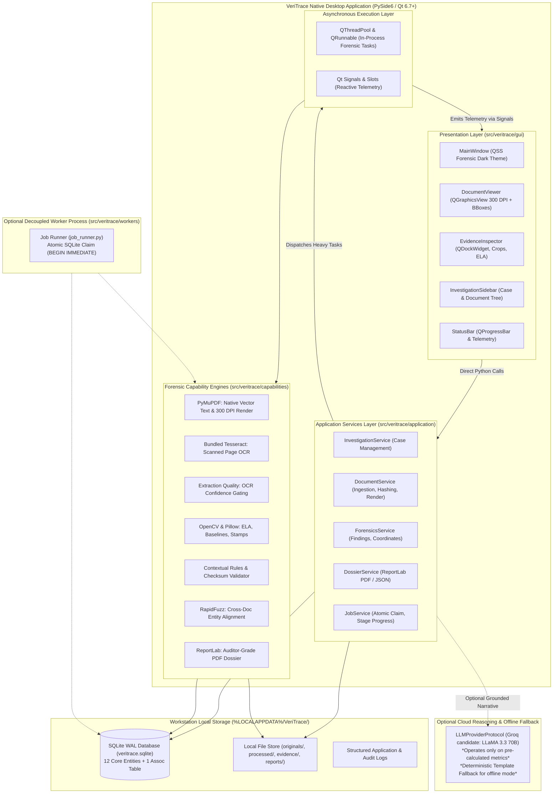

# VeriTrace Desktop

### **AI-Powered Document Forensics & Contextual Intelligence System**
> *Every document tells a story. Every inconsistency leaves evidence.*

**Target Competition:** DataOps Innovation Hackathon – Problem Statement 2 (PS-2)
**Product Form Factor:** Standalone Desktop Application (Windows 10/11 x64)
**Development Status:** PySide6 Architecture Finalized & Repository Restructured (Ready for Milestone 0)

---

## 1. Executive Summary & Vision

Financial institutions, enterprise auditors, and regulatory bodies process millions of critical documents daily—including national identity cards, salary slips, bank transaction statements, commercial invoices, and tax filings. Traditional document-processing pipelines rely predominantly on Optical Character Recognition (OCR) to convert pixels into text strings, followed by hardcoded regex rules.

However, **text extraction does not establish whether that information is authentic, internally consistent, or contextually reliable.**

Digital alteration tools allow malicious actors to modify financial numbers, overwrite names, splice signatures, and alter dates with sub-millimeter precision. Furthermore, discrepancies frequently cross document boundaries (e.g., stated monthly earnings on a salary slip contradicting bank deposit records), remaining completely invisible when documents are parsed in isolation.

**VeriTrace Desktop** transforms document review from passive, field-isolated text extraction into an **active, contextual, and evidence-backed forensic investigation workstation**. Combining computer vision, layout-aware OCR, deterministic cross-document reconciliation, and grounded Large Language Model (LLM) reasoning, VeriTrace delivers complete visual-to-data traceability and compiles an authoritative, auditor-grade Document Investigation Dossier.

---

## 2. Desktop Product Form Factor & End-User Experience

VeriTrace is intentionally architected as **standalone native desktop software**, NOT a website or cloud SaaS platform:
* **Target Operating System:** Windows 10/11 x64.
* **Planned Distribution:** Downloadable, single-click Windows installer (`VeriTrace-Setup.exe`).
* **Zero Developer Setup:** End-users do not install Python, Node.js, Rust, terminal environments, databases, or manual Tesseract OCR binaries.
* **Investigator Experience:** `DOWNLOAD → INSTALL → OPEN → CREATE INVESTIGATION → IMPORT DOCUMENTS → ANALYSE → REVIEW EVIDENCE → GENERATE DOSSIER`.
* **Complete Local Privacy:** The application runs locally on the user's workstation. All raw document binaries, rendered 300 DPI pages, visual evidence crops, and SQLite relational databases reside strictly in `%LOCALAPPDATA%/VeriTrace/`.

---

## 3. Core Planned Forensic Capabilities

1. **Multi-Document Case Ingestion:** Native OS drag-and-drop import for multi-page PDFs, PNGs, and JPEGs grouped into an immutable investigation case container with cryptographic SHA-256 evidence hashing.
2. **Multi-Factor Text Quality & Hybrid OCR:** Native PyMuPDF vector text extraction combined with bundled Tesseract OCR fallback for scanned sheets, routing pages based on glyph geometry, raster coverage ratio, and credential regex patterns.
3. **Visual Forensics Suite (OpenCV & Pillow):**
   * **Error Level Analysis (ELA):** Detects localized JPEG compression differential anomalies to highlight spliced or modified figures.
   * **Font Baseline Regression:** Identifies inserted or manipulated characters offset from row regression baselines ($>2.5\sigma$).
   * **Clone & Seal Matching:** Segments signatures and official stamps, detecting duplicated copy-paste manipulation across documents via ORB feature matching.
4. **Deterministic Contextual Rules:** Intra-document verification of financial line items (Gross = Basic + HRA + Allowances; Net = Gross - Deductions), temporal chronology, and credential formats (PAN, Aadhaar).
5. **Cross-Document Correlation Engine:** Reconciles entities (names, birth dates, employers, accounts) across distinct files using RapidFuzz token sort matching and flags factual contradictions.
6. **Pixel-Anchored Evidence Mapping:** Every finding links directly to an immutable evidence identifier with normalized bounding box coordinates `[ymin, xmin, ymax, xmax] \in [0.0, 1.0]` and high-resolution visual crops.
7. **Interactive Workstation UI (PySide6 / Qt 6.7+):** 4-pane workstation layout featuring High-DPI document viewing (`QGraphicsView`), docking Evidence Inspector (`QDockWidget`), case tree sidebar, and real-time status bar.
8. **Automated Investigation Dossier (ReportLab):** One-click compilation of an auditor-grade forensic report in structured JSON and downloadable PDF formats, strictly complying with Sections 7.1–7.6 of PS-2.

---

## 4. Authoritative Technology Stack

| Layer | Technology | Assigned Responsibility |
| :--- | :--- | :--- |
| **Desktop Framework** | **PySide6 (Qt 6.7+)** | Native Windows desktop application, Qt Widgets, QSS stylesheet theme. |
| **UI Architecture** | **Qt Model/View & Docking** | High-performance document canvas (`QGraphicsView`), dockable inspector, tree views. |
| **Application Layer** | **Python 3.11 Services** | In-process application services (`InvestigationService`, `DocumentService`, `DossierService`). |
| **Background Threading** | **QThreadPool & QRunnable** | Multi-threaded forensic pipeline execution without blocking UI event loop. |
| **Database & ORM** | **SQLite (WAL) + SQLAlchemy 2.0** | Local relational persistence (12 Core Entities + 1 Association Table) in `%LOCALAPPDATA%`. |
| **PDF & OCR Engine** | **PyMuPDF + Bundled Tesseract (Baseline)** | Direct vector text extraction, 300 DPI page rendering, TextExtractorProtocol abstraction, empirical benchmark suite. |
| **Computer Vision** | **OpenCV + Pillow + NumPy** | Error Level Analysis (ELA), baseline regression, visual evidence cropping. |
| **Text Matching** | **RapidFuzz** | High-speed C++ Levenshtein string and entity alignment. |
| **AI Reasoning** | **Configurable LLM + Offline Fallback** | Grounded narrative synthesis over verified findings via `LLMProviderProtocol` (*optional cloud Groq candidate, with 100% deterministic template fallback*). |
| **Reporting Engine** | **ReportLab** | Programmatic compilation of auditor-grade multi-page PDF dossiers. |
| **Packaging & Distribution**| **PyInstaller + Inno Setup** | One-folder Python bundle + single-click Windows installer (`VeriTrace-Setup.exe`). |

---

## 5. High-Level Desktop Architecture



---

## 6. Authoritative Repository Structure

Under ADR-030, the codebase is consolidated into a standard Python `src`-layout rooted at `src/veritrace/`:

```text
VeriTrace/
├── pyproject.toml                     # Root PEP 517/518 build & package configuration
├── requirements.txt                   # Pinned dependency manifest
├── alembic.ini                        # Database schema migration configuration
├── README.md                          # Authoritative desktop product README
├── .gitignore                         # Protects %LOCALAPPDATA%, binaries, caches
├── .env.example                       # Local environment template
├── LICENSE                            # MIT License
│
├── src/                               # Standard Python Source Root
│   └── veritrace/                     # Core Application Package
│       ├── __init__.py                # Package declaration & version metadata
│       ├── __main__.py                # python -m veritrace entrypoint
│       ├── main.py                    # Root application entrypoint
│       ├── bootstrap.py               # Pre-flight environment & directory initialization
│       │
│       ├── gui/                       # Presentation Layer (PySide6 / Qt)
│       │   ├── app.py                 # QApplication lifecycle & setup
│       │   ├── views/                 # MainWindow, InvestigationView, DocumentViewer, DossierView
│       │   ├── components/            # Reusable widgets (viewer, evidence inspector, sidebar, status bar)
│       │   ├── viewmodels/            # UI state holders
│       │   ├── controllers/           # Presentation mediators to application services
│       │   ├── styles/                # Theme manager & dark_theme.qss
│       │   └── resources/             # Icons, fonts, static assets
│       │
│       ├── application/               # Application Services & Coordination Layer
│       │   ├── services/              # InvestigationService, DocumentService, AnalysisService, DossierService
│       │   ├── workflows/             # Pipeline coordinator & state machines
│       │   ├── use_cases/             # Specific command/query handlers
│       │   └── dtos/                  # Strongly typed Data Transfer Objects
│       │
│       ├── domain/                    # Pure Business Logic & Domain Entities (Zero external deps)
│       │   ├── models/                # Core domain models (Investigation, Document, Finding, Evidence)
│       │   ├── rules/                 # Deterministic business rules (math checksums, date chronology)
│       │   ├── events/                # Domain event definitions
│       │   └── interfaces/            # Repository & adapter protocol definitions
│       │
│       ├── capabilities/              # Algorithmic & Forensic Processing Engines
│       │   ├── ingestion/             # File intake validation, MIME checking, SHA-256 calculation
│       │   ├── extraction/            # PDF vector text extraction, OCR raster extraction
│       │   ├── quality/               # Extraction Quality: OCR confidence scoring, degradation assessment
│       │   ├── forensics/             # Visual forensics (ELA, baseline alignment, copy-move), PDF metadata
│       │   ├── correlation/           # Cross-document entity reconciliation & contradiction matrix
│       │   ├── reasoning/             # Contextual intelligence narrative synthesis & prompt engineering
│       │   └── reporting/             # PS-2 Section 7.1–7.6 PDF & JSON dossier compilation
│       │
│       ├── infrastructure/            # Concrete Technical Adapters
│       │   ├── persistence/           # SQLite database (WAL mode), SQLAlchemy 2.0 ORM, Alembic migrations
│       │   ├── pdf/                   # PyMuPDF rasterizer & vector text adapter
│       │   ├── ocr/                   # Tesseract / RapidOCR engine adapter
│       │   ├── vision/                # OpenCV & Pillow image processing adapter
│       │   ├── reporting/             # ReportLab PDF generation adapter
│       │   ├── ai/                    # ChatGroq LLM adapter with fallback & mocking
│       │   └── security/              # Windows DPAPI storage & local filesystem path resolution
│       │
│       └── workers/                   # Concurrency & Asynchronous Workers
│           ├── job_runner.py          # Standalone background CLI worker (atomic SQLite claim)
│           ├── tasks/                 # Discrete executable background tasks
│           └── pools/                 # QThreadPool / QRunnable worker implementations
│
├── packaging/                         # Desktop Packaging & Distribution
│   ├── pyinstaller/                   # PyInstaller spec files (veritrace.spec)
│   └── installer/                     # Inno Setup scripts (veritrace_setup.iss)
│
├── scripts/                           # Development, build, packaging & validation scripts
│   ├── development/                   # Developer tools (run_desktop.py)
│   ├── validation/                    # Architectural checks (check_architecture.py)
│   └── packaging/                     # Installer compilation automation
│
├── tests/                             # Test Suite
│   ├── unit/                          # Pure unit tests (math rules, quality metrics, hashing)
│   ├── integration/                   # Pipeline integration tests (PDF render, ELA, DB)
│   ├── desktop/                       # PySide6 UI tests (pytest-qt)
│   └── fixtures/                      # Test cases & synthetic data
│
├── docs/                              # Project Documentation & Architecture Guides
├── dev/                               # 26 Technical Architecture & Planning Documents
│
└── legacy/                            # Quarantined Reference Assets
    ├── backend/                       # Deprecated UdyogPermit AI backend & agents
    ├── frontend/                      # Deprecated UdyogPermit AI React components
    ├── desktop_tauri/                 # Retired Tauri 2 + React 18 scaffolding
    └── Dockerfile                     # Deprecated container configuration
```

---

## 7. Local-First Processing & Privacy Principles

1. **100% Offline Core Capability:** PDF ingestion, 300 DPI rasterization, Tesseract OCR, OpenCV forensics (ELA, baseline regressions), arithmetic validation, cross-document correlation, and ReportLab PDF dossier generation execute entirely locally on the user's machine without an internet connection.
2. **Zero Cloud Document Storage:** Raw document files and rendered page images are NEVER uploaded to third-party cloud servers.
3. **Optional Cloud AI with Strict Data Minimization:** Cloud LLM reasoning (via Groq API) is strictly optional and user-controlled. When enabled, only pre-calculated numerical findings and anonymized text snippets are sent for narrative synthesis—raw document binaries and unredacted scans are never transmitted.
4. **Evidence Immutability:** Original uploaded files are hashed immediately upon intake (SHA-256) and treated as legally immutable physical evidence. Processing or retrying never overwrites original submissions.

---

## 8. Planned Windows Distribution

> [!NOTE]
> The single-click downloadable installer (`VeriTrace-Setup.exe`) is a **planned release deliverable** scheduled for compilation and verification during **Milestone 6 (Desktop Packaging & Release)**, not an already completed artifact.

The distribution package will feature:
* **Self-Contained Installer:** Bundles the Python runtime, PySide6 dependencies, capability engines, and Tesseract OCR binaries into a single Inno Setup wizard (`VeriTrace-Setup.exe`).
* **Zero Host Prerequisites:** Installs and launches smoothly on standard Windows 10/11 x64 systems without requiring pre-installed Python, Node.js, or development toolchains.
* **Automated Data Directory Initialization:** Automatically initializes `%LOCALAPPDATA%/VeriTrace/` and the SQLite WAL database on first launch.

---

## 9. Current Development Status & Phased Roadmap

* **Phase 0 (Initialization, Architecture & Restructuring):** **COMPLETED**
  * Source code migrated and verified from foundation repository.
  * Standalone Windows desktop product direction formalized ([ADR-019](file:///c:/Users/ghong/OneDrive/Attachments/Desktop/VeriTrace/dev/12_DECISION_LOG.md#adr-019-standalone-desktop-product-direction-target-windows-1011-x64)).
  * PySide6 native desktop architecture approved ([ADR-025](file:///c:/Users/ghong/OneDrive/Attachments/Desktop/VeriTrace/dev/12_DECISION_LOG.md#adr-025-native-pyside6-qt-desktop-application-framework)).
  * FastAPI loopback eliminated in favor of direct in-process Python services ([ADR-026](file:///c:/Users/ghong/OneDrive/Attachments/Desktop/VeriTrace/dev/12_DECISION_LOG.md#adr-026-direct-in-process-python-application-services-fastapi-removal)).
  * Unified Python `src`-layout and layered monolith architecture consolidated ([ADR-030](file:///c:/Users/ghong/OneDrive/Attachments/Desktop/VeriTrace/dev/12_DECISION_LOG.md#adr-030-unified-python-src-layout-and-layered-monolith-architecture)).
  * Root build configurations established (`pyproject.toml`, `requirements.txt`, `alembic.ini`).
  * 27 comprehensive technical architecture documents updated in [`dev/`](file:///c:/Users/ghong/OneDrive/Attachments/Desktop/VeriTrace/dev/).
* **Milestone 0 (PySide6 Desktop Prototype):** **PLANNED (Next Step)**
  * Technical feasibility gate: PySide6 application lifecycle, High-DPI support, QSS forensic dark stylesheet, 4-pane docking layout, and SQLite database connection in `%LOCALAPPDATA%`.
* **Milestones 1 – 6:** Detailed in [23_DETAILED_DEVELOPMENT_PLAN.md](file:///c:/Users/ghong/OneDrive/Attachments/Desktop/VeriTrace/dev/23_DETAILED_DEVELOPMENT_PLAN.md).

---

## 10. Technical Documentation Suite (`dev/`)

The permanent technical planning, architectural decisions, and progress tracking documentation are maintained in the [`dev/`](file:///c:/Users/ghong/OneDrive/Attachments/Desktop/VeriTrace/dev/) directory:

| Document | Title | Key Architectural Focus |
| :--- | :--- | :--- |
| **[`00_PROJECT_CHARTER.md`](file:///c:/Users/ghong/OneDrive/Attachments/Desktop/VeriTrace/dev/00_PROJECT_CHARTER.md)** | Project Charter | Standalone desktop product identity, vision, scope, non-goals. |
| **[`01_PROBLEM_STATEMENT_ANALYSIS.md`](file:///c:/Users/ghong/OneDrive/Attachments/Desktop/VeriTrace/dev/01_PROBLEM_STATEMENT_ANALYSIS.md)** | PS-2 Problem Analysis | Exhaustive breakdown of PS-2 requirements and scoring criteria. |
| **[`04_SYSTEM_ARCHITECTURE.md`](file:///c:/Users/ghong/OneDrive/Attachments/Desktop/VeriTrace/dev/04_SYSTEM_ARCHITECTURE.md)** | System Architecture | Native PySide6 monolith, in-process services, QThreadPool execution. |
| **[`05_BACKEND_ARCHITECTURE.md`](file:///c:/Users/ghong/OneDrive/Attachments/Desktop/VeriTrace/dev/05_BACKEND_ARCHITECTURE.md)** | Backend Architecture | Application services, capability modules, PyInstaller bundling. |
| **[`06_FRONTEND_ARCHITECTURE.md`](file:///c:/Users/ghong/OneDrive/Attachments/Desktop/VeriTrace/dev/06_FRONTEND_ARCHITECTURE.md)** | UI Architecture | Workstation layout, PySide6 widgets, QSS theming, QGraphicsView. |
| **[`07_DATABASE_AND_DATA_MODELS.md`](file:///c:/Users/ghong/OneDrive/Attachments/Desktop/VeriTrace/dev/07_DATABASE_AND_DATA_MODELS.md)** | Database & Storage | SQLite WAL persistence at `%LOCALAPPDATA%/VeriTrace/database/veritrace.sqlite`. |
| **[`08_API_CONTRACTS.md`](file:///c:/Users/ghong/OneDrive/Attachments/Desktop/VeriTrace/dev/08_API_CONTRACTS.md)** | Service Contracts | Strongly-typed in-process Python service contracts and DTOs. |
| **[`09_AI_AND_FORENSICS_STRATEGY.md`](file:///c:/Users/ghong/OneDrive/Attachments/Desktop/VeriTrace/dev/09_AI_AND_FORENSICS_STRATEGY.md)** | AI & Forensics Strategy | Deterministic-first principles, offline resilience, and data minimization. |
| **[`10_IMPLEMENTATION_ROADMAP.md`](file:///c:/Users/ghong/OneDrive/Attachments/Desktop/VeriTrace/dev/10_IMPLEMENTATION_ROADMAP.md)** | Implementation Roadmap | Phased schedule from Milestone 0 (Feasibility Gate) to Milestone 6 (Release). |
| **[`11_TECHNICAL_RISKS.md`](file:///c:/Users/ghong/OneDrive/Attachments/Desktop/VeriTrace/dev/11_TECHNICAL_RISKS.md)** | Technical Risk Register | 18 technical failure modes, including PySide6 DLLs and offline fallback. |
| **[`12_DECISION_LOG.md`](file:///c:/Users/ghong/OneDrive/Attachments/Desktop/VeriTrace/dev/12_DECISION_LOG.md)** | Architectural Decision Log | Formal ADR register (ADR-001 through ADR-033) recording all design choices. |
| **[`13_PROGRESS_TRACKER.md`](file:///c:/Users/ghong/OneDrive/Attachments/Desktop/VeriTrace/dev/13_PROGRESS_TRACKER.md)** | Progress Tracker | Milestone checklist and compliance tracking matrix. |
| **[`15_FINAL_SYSTEM_DESIGN.md`](file:///c:/Users/ghong/OneDrive/Attachments/Desktop/VeriTrace/dev/15_FINAL_SYSTEM_DESIGN.md)** | Modular Monolith Design | Comprehensive specifications for the 14 lifecycle capabilities. |
| **[`16_FINAL_DIRECTORY_STRUCTURE.md`](file:///c:/Users/ghong/OneDrive/Attachments/Desktop/VeriTrace/dev/16_FINAL_DIRECTORY_STRUCTURE.md)** | Target Directory Structure | Authoritative desktop repository tree and migration matrix. |
| **[`17_MODULE_RESPONSIBILITY_MATRIX.md`](file:///c:/Users/ghong/OneDrive/Attachments/Desktop/VeriTrace/dev/17_MODULE_RESPONSIBILITY_MATRIX.md)** | Module Responsibilities | Public interfaces, service boundaries, workstreams, and engineering conventions. |
| **[`18_END_TO_END_DATA_FLOW.md`](file:///c:/Users/ghong/OneDrive/Attachments/Desktop/VeriTrace/dev/18_END_TO_END_DATA_FLOW.md)** | End-to-End Investigation Flow | 16-stage pipeline from native drag-and-drop to compiled PDF dossier. |
| **[`19_DOMAIN_MODEL_SPECIFICATION.md`](file:///c:/Users/ghong/OneDrive/Attachments/Desktop/VeriTrace/dev/19_DOMAIN_MODEL_SPECIFICATION.md)** | Core Domain Models | 12 Core Entities + 1 Association Table, SQLite WAL constraints. |
| **[`20_AGENT_AND_PROCESSING_STRATEGY.md`](file:///c:/Users/ghong/OneDrive/Attachments/Desktop/VeriTrace/dev/20_AGENT_AND_PROCESSING_STRATEGY.md)** | Agent Minimization & Deps | Pure determinism prioritized; all desktop & backend dependencies evaluated. |
| **[`21_FRONTEND_FEATURE_SPECIFICATION.md`](file:///c:/Users/ghong/OneDrive/Attachments/Desktop/VeriTrace/dev/21_FRONTEND_FEATURE_SPECIFICATION.md)** | Desktop Feature Specs | Workstation features, QGraphicsView viewer, inspector, and status bar. |
| **[`22_API_AND_INTERNAL_CONTRACTS.md`](file:///c:/Users/ghong/OneDrive/Attachments/Desktop/VeriTrace/dev/22_API_AND_INTERNAL_CONTRACTS.md)** | Internal Service Protocols | Application services DTOs, Qt signal protocols, and capability contracts. |
| **[`23_DETAILED_DEVELOPMENT_PLAN.md`](file:///c:/Users/ghong/OneDrive/Attachments/Desktop/VeriTrace/dev/23_DETAILED_DEVELOPMENT_PLAN.md)** | Phased Development Plan | 3 parallel workstreams and 7 granular milestone blueprints (M0 to M6). |
| **[`24_TESTING_AND_DEMO_STRATEGY.md`](file:///c:/Users/ghong/OneDrive/Attachments/Desktop/VeriTrace/dev/24_TESTING_AND_DEMO_STRATEGY.md)** | Testing & Demo Strategy | Desktop lifecycle tests, offline tests, installer validation, 5-min demo. |
| **[`25_ARCHITECTURE_CORRECTIONS...md`](file:///c:/Users/ghong/OneDrive/Attachments/Desktop/VeriTrace/dev/25_ARCHITECTURE_CORRECTIONS_AND_IMPLEMENTATION_READINESS.md)** | Implementation Readiness | Final review checklist and implementation readiness verdict. |
| **[`26_TEAM_DEVELOPMENT_AND_GITHUB_WORKFLOW.md`](file:///c:/Users/ghong/OneDrive/Attachments/Desktop/VeriTrace/dev/26_TEAM_DEVELOPMENT_AND_GITHUB_WORKFLOW.md)** | Team & Git Workflow | Authoritative onboarding guide, 6 workstreams, 13 shared contracts, coding standards, and PR process. |

---

## 11. Developer Runtime & Validation Commands

To develop and validate **VeriTrace Desktop** locally:

### Run Native Desktop Application
```powershell
python scripts/development/run_desktop.py
# Or via module execution
$env:PYTHONPATH = "src"
python -m veritrace
```

### Validate Architecture & Import Boundaries
```powershell
python scripts/validation/check_architecture.py
```
Ensures strict layered isolation: `domain/` contains zero external dependencies; `capabilities/` contains zero GUI imports; `gui/` contains zero direct infrastructure imports.
