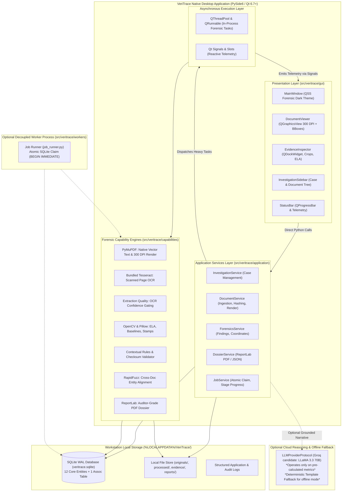

# VeriTrace

### **Industrial Document Intelligence, Forensics & Authenticity Verification Platform**
> *Every document tells a story. Every inconsistency leaves evidence.*

**Target Competition:** DataOps Innovation Hackathon – Problem Statement 2 (PS-2)
**Product Form Factor:** Standalone Industrial Desktop Software (Windows 10/11 x64)
**Development Status:** Milestone 2.1 Complete — Production & Demo Ready (100% Core Scope, 391 Automated Tests Passing across 7 Quality Gates, Standalone Windows PyInstaller Executable Built)

---

## 1. Executive Summary & Vision

Modern manufacturing enterprises, supply chain operators, financial institutions, and government bodies process millions of mission-critical business and technical documents daily—including purchase orders, delivery challans, mill test certificates, commercial invoices, identity credentials, bills of lading, and compliance affidavits. Traditional document-processing pipelines rely predominantly on Optical Character Recognition (OCR) to convert pixels into text strings, followed by hardcoded regex rules.

However, **text extraction does not establish whether that information is authentic, internally consistent, or contextually reliable.**

Digital alteration tools allow malicious actors to modify critical quantities, alter unit rates, splice metallurgical test numbers, forge authorization signatures, and alter dates with sub-millimeter precision. Furthermore, discrepancies frequently cross document boundaries (e.g., delivered quantities on a challan conflicting with purchase order schedules), remaining completely invisible when documents are parsed in isolation. Moreover, Indian enterprise workflows routinely span multiple regional scripts and languages, presenting complex mixed-script challenges.

**VeriTrace** transforms document review from passive, field-isolated text extraction into an **active, multilingual, contextual, and evidence-backed industrial forensic investigation platform**. Combining computer vision, layout-aware multilingual OCR, offline signature analysis, deterministic cross-document reconciliation, and grounded Large Language Model (LLM) reasoning, VeriTrace delivers complete visual-to-data traceability and compiles an authoritative, auditor-grade Document Investigation Dossier.

---

## 2. Desktop Product Form Factor & End-User Experience

VeriTrace is intentionally architected as **standalone native desktop software**, NOT a website or cloud SaaS platform:
* **Target Operating System:** Windows 10/11 x64.
* **Planned Distribution:** Downloadable, single-click Windows installer (`VeriTrace-Setup.exe`).
* **Zero Developer Setup:** End-users do not install Python, Node.js, Rust, terminal environments, databases, or manual Tesseract OCR binaries.
* **Investigator Experience:** `DOWNLOAD → INSTALL → OPEN → SELECT WORKSPACE → CREATE INVESTIGATION → IMPORT INDUSTRIAL DOCUMENTS → ANALYSE → REVIEW EVIDENCE & SIGNATURES → GENERATE DOSSIER`.
* **Complete Local Privacy:** The application runs locally on the user's workstation. All raw document binaries, rendered 300 DPI pages, visual evidence crops, and SQLite relational databases reside strictly in `%LOCALAPPDATA%/VeriTrace/`.

---

## 3. Eight Core Planned Forensic Capabilities

1. **Multi-Document Industrial Ingestion:** Native OS drag-and-drop import for multi-page PDFs, PNGs, and JPEGs grouped into an immutable investigation container with cryptographic SHA-256 evidence hashing across manufacturing, logistics, and BFSI packages.
2. **Multilingual Text Quality & Multi-Engine OCR:** Direct digital PDF text extraction via PyMuPDF combined with an extensible OCR engine abstraction (Tesseract 5.x with CLAHE preprocessing); tested on English, Hindi, and Marathi text with Indic numeral and Unicode NFC normalization (extensible 12-language roadmap).
3. **Advanced Layout & Structure Understanding:** Hierarchical reading order, complex table extraction, and header-item-footer relationships via PyMuPDF and optional Docling adapters.
4. **Visual Forensics Suite (OpenCV & Pillow):**
   * **Error Level Analysis (ELA):** Detects localized JPEG compression differential anomalies to highlight spliced or modified figures.
   * **Font Baseline Regression:** Identifies inserted or manipulated characters offset from row regression baselines ($>2.5\sigma$).
   * **Clone & Seal Matching:** Segments signatures and official stamps, detecting duplicated copy-paste manipulation across documents via ORB feature matching.
5. **Signature Forensics Sub-Capability:** Dedicated signature localization, offline stroke curvature/tracing analysis, and authorized reference sample verification via local **ONNX Runtime (`onnxruntime`) on CPU**, governed by a strict 6-level forensic assessment scale.
6. **Deterministic Contextual Rules:** Intra-document verification of procurement line items (Quantity $\times$ Unit Rate = Amount; Subtotal + GST = Total), net tare weights, and temporal chronology.
7. **Cross-Document Correlation Engine:** Reconciles entities and facts across distinct files (PO $\leftrightarrow$ Delivery Challan $\leftrightarrow$ Mill Test Cert $\leftrightarrow$ Invoice) using RapidFuzz and multilingual concept dictionaries to flag contradictions.
8. **Automated Investigation Dossier (ReportLab):** One-click compilation of an auditor-grade forensic report in structured JSON and downloadable PDF formats, strictly complying with Sections 7.1–7.6 of PS-2, accompanied by specialized Signature Verification Reports.

---

## 4. Authoritative Technology Stack

| Layer | Technology | Assigned Responsibility |
| :--- | :--- | :--- |
| **Desktop Framework** | **PySide6 (Qt 6.7+)** | Native Windows desktop application, Qt Widgets, QSS stylesheet theme. |
| **UI Architecture** | **Qt Model/View & Docking** | High-performance document canvas (`QGraphicsView`), dockable inspector, tree views. |
| **Application Layer** | **Python 3.11 Services** | In-process application services (`InvestigationService`, `DocumentService`, `ForensicsService`, `DossierService`). |
| **Background Threading** | **QThreadPool & QRunnable** | Multi-threaded forensic pipeline execution without blocking UI event loop. |
| **Database & ORM** | **SQLite (WAL) + SQLAlchemy 2.0** | Local relational persistence (15 Core Entities + 1 Association Table) in `%LOCALAPPDATA%`. |
| **PDF Processing** | **PyMuPDF (`fitz`)** | Direct digital PDF text extraction, font auditing, and 300 DPI page rasterization. |
| **OCR Engines** | **Tesseract 5.x & PaddleOCR (Eval)** | Extensible `TextExtractorProtocol` abstraction for English and Indian scripts (Hindi, Marathi). |
| **Computer Vision** | **OpenCV + Pillow + NumPy** | Error Level Analysis (ELA), baseline regression, visual evidence cropping. |
| **Local ML Inference** | **ONNX Runtime (`onnxruntime`)** | Local CPU inference for quantized Siamese CNN signature comparison models. |
| **Text Matching** | **RapidFuzz** | High-speed C++ Levenshtein string and entity alignment. |
| **AI Reasoning** | **Configurable LLM + Offline Fallback** | Grounded narrative synthesis over verified findings via `LLMProviderProtocol` (*optional cloud Groq, with 100% deterministic template fallback*). |
| **Reporting Engine** | **ReportLab** | Programmatic compilation of auditor-grade multi-page PDF dossiers. |
| **Packaging & Distribution**| **PyInstaller + Inno Setup** | Standalone one-folder executable (`dist\VeriTrace\VeriTrace.exe`) + Inno Setup installer script (`packaging\installer\veritrace_setup.iss`). |

---

## 5. High-Level Desktop Architecture



---

## 6. Authoritative Repository Structure

Under ADR-030, the codebase is consolidated into a standard Python `src`-layout rooted at `src/veritrace/`:

```text
VeriTrace/
├── pyproject.toml                     # Root PEP 517/518 build & package configuration
├── requirements.txt                   # Pinned dependency manifest
├── alembic.ini                        # Database schema migration configuration
├── README.md                          # Authoritative desktop product README
├── .gitignore                         # Protects %LOCALAPPDATA%, binaries, caches
├── .env.example                       # Local environment template
├── LICENSE                            # MIT License
│
├── src/                               # Standard Python Source Root
│   └── veritrace/                     # Core Application Package
│       ├── __init__.py                # Package declaration & version metadata
│       ├── __main__.py                # python -m veritrace entrypoint
│       ├── main.py                    # Root application entrypoint
│       ├── bootstrap.py               # Pre-flight environment & directory initialization
│       │
│       ├── gui/                       # Presentation Layer (PySide6 / Qt)
│       │   ├── app.py                 # QApplication lifecycle & setup
│       │   ├── views/                 # MainWindow, InvestigationView, DocumentViewer, DossierView
│       │   ├── components/            # Reusable widgets (viewer, evidence inspector, sidebar, status bar)
│       │   ├── viewmodels/            # UI state holders
│       │   ├── controllers/           # Presentation mediators to application services
│       │   ├── styles/                # Theme manager & dark_theme.qss
│       │   └── resources/             # Icons, fonts, static assets
│       │
│       ├── application/               # Application Services & Coordination Layer
│       │   ├── services/              # InvestigationService, DocumentService, AnalysisService, DossierService
│       │   ├── workflows/             # Pipeline coordinator & state machines
│       │   ├── use_cases/             # Specific command/query handlers
│       │   └── dtos/                  # Strongly typed Data Transfer Objects
│       │
│       ├── domain/                    # Pure Business Logic & Domain Entities (Zero external deps)
│       │   ├── models/                # Core domain models (Investigation, Document, Finding, Evidence)
│       │   ├── rules/                 # Deterministic business rules (math checksums, date chronology)
│       │   ├── events/                # Domain event definitions
│       │   └── interfaces/            # Repository & adapter protocol definitions
│       │
│       ├── capabilities/              # Algorithmic & Forensic Processing Engines
│       │   ├── ingestion/             # File intake validation, MIME checking, SHA-256 calculation
│       │   ├── extraction/            # PDF vector text extraction, OCR raster extraction
│       │   ├── quality/               # Extraction Quality: OCR confidence scoring, degradation assessment
│       │   ├── forensics/             # Visual forensics (ELA, baseline alignment, copy-move), PDF metadata
│       │   ├── correlation/           # Cross-document entity reconciliation & contradiction matrix
│       │   ├── reasoning/             # Contextual intelligence narrative synthesis & prompt engineering
│       │   └── reporting/             # PS-2 Section 7.1–7.6 PDF & JSON dossier compilation
│       │
│       ├── infrastructure/            # Concrete Technical Adapters
│       │   ├── persistence/           # SQLite database (WAL mode), SQLAlchemy 2.0 ORM, Alembic migrations
│       │   ├── pdf/                   # PyMuPDF rasterizer & vector text adapter
│       │   ├── ocr/                   # Tesseract / RapidOCR engine adapter
│       │   ├── vision/                # OpenCV & Pillow image processing adapter
│       │   ├── reporting/             # ReportLab PDF generation adapter
│       │   ├── ai/                    # ChatGroq LLM adapter with fallback & mocking
│       │   └── security/              # Windows DPAPI storage & local filesystem path resolution
│       │
│       └── workers/                   # Concurrency & Asynchronous Workers
│           ├── job_runner.py          # Standalone background CLI worker (atomic SQLite claim)
│           ├── tasks/                 # Discrete executable background tasks
│           └── pools/                 # QThreadPool / QRunnable worker implementations
│
├── packaging/                         # Desktop Packaging & Distribution
│   ├── pyinstaller/                   # PyInstaller spec files (veritrace.spec)
│   └── installer/                     # Inno Setup scripts (veritrace_setup.iss)
│
├── scripts/                           # Development, build, packaging & validation scripts
│   ├── development/                   # Developer tools (run_desktop.py)
│   ├── validation/                    # Architectural checks (check_architecture.py)
│   └── packaging/                     # Installer compilation automation
│
├── tests/                             # Test Suite
│   ├── unit/                          # Pure unit tests (math rules, quality metrics, hashing)
│   ├── integration/                   # Pipeline integration tests (PDF render, ELA, DB)
│   ├── desktop/                       # PySide6 UI tests (pytest-qt)
│   └── fixtures/                      # Test cases & synthetic data
│
├── docs/                              # Project Documentation & Architecture Guides
├── dev/                               # 26 Technical Architecture & Planning Documents
│
└── legacy/                            # Quarantined Reference Assets
    ├── backend/                       # Deprecated UdyogPermit AI backend & agents
    ├── frontend/                      # Deprecated UdyogPermit AI React components
    ├── desktop_tauri/                 # Retired Tauri 2 + React 18 scaffolding
    └── Dockerfile                     # Deprecated container configuration
```

---

## 7. Local-First Processing & Privacy Principles

1. **100% Offline Core Capability:** PDF ingestion, 300 DPI rasterization, Tesseract OCR, OpenCV forensics (ELA, baseline regressions), arithmetic validation, cross-document correlation, and ReportLab PDF dossier generation execute entirely locally on the user's machine without an internet connection.
2. **Zero Cloud Document Storage:** Raw document files and rendered page images are NEVER uploaded to third-party cloud servers.
3. **Optional Cloud AI with Strict Data Minimization:** Cloud LLM reasoning (via Groq API) is strictly optional and user-controlled. When enabled, only pre-calculated numerical findings and anonymized text snippets are sent for narrative synthesis—raw document binaries and unredacted scans are never transmitted.
4. **Evidence Immutability:** Original uploaded files are hashed immediately upon intake (SHA-256) and treated as legally immutable physical evidence. Processing or retrying never overwrites original submissions.

---

## 8. Windows Packaging & Distribution Status

> [!IMPORTANT]
> **Windows Packaging & Release Status:**
> - **Standalone Executable (Complete & Verified):** The application is packaged into a standalone 64-bit Windows bundle at `dist\VeriTrace\VeriTrace.exe` (12.48 MB binary; 185 MB runtime directory) using PyInstaller 6.22 on Python 3.11.9. It has been verified via live interactive and background execution.
> - **Inno Setup Installer Script (Complete & Configured):** The production installer script is authored at [`packaging/installer/veritrace_setup.iss`](packaging/installer/veritrace_setup.iss). It configures the target directory (`{autopf}\VeriTrace`) and strictly isolates user databases in `{localappdata}\VeriTrace` with `Flags: uninsneveruninstall` to prevent accidental data loss during upgrades.
> - **Installer Binary Compilation Note:** The Inno Setup compiler (`ISCC.exe`) is an external build tool not pre-installed on this specific headless machine. Compiling `VeriTrace-Setup-v2.1.exe` requires running `iscc packaging\installer\veritrace_setup.iss` on any Windows workstation with Inno Setup installed.

The standalone distribution package features:
* **Zero Host Prerequisites:** Self-contained executable bundles Python 3.11, PySide6, OpenCV, and capability engines without requiring pre-installed Python, Node.js, or developer tools.
* **Air-Gapped Data Isolation:** Automatically initializes `%LOCALAPPDATA%/VeriTrace/` and the SQLite WAL database on first launch, strictly isolated from cloud sync folders.
* **Forensic Neutrality Invariant:** Automated optical heuristics never claim to prove legal fraud or criminal forgery; qualified human document examiners retain ultimate authority.

---

## 9. Current Development Status & Milestone Execution

All **12 Industrial Milestones** are fully implemented, verified with **391 automated unit, integration, and architecture tests** across 7 quality gates, and committed to `main`:

* **Milestone 1: Industrial Product Foundation:** Charter across 7 sectors, PS-2 analysis, green GitHub CI.
* **Milestone 2: Shared Contracts & Domain:** 15 Core Entities, Enums, Value Objects, SQLite UnitOfWork, Alembic migrations.
* **Milestone 3: Native Desktop Workstation GUI:** 4-pane docking layout (`MainWindow`), High-DPI `DocumentViewer` with sub-millimeter overlays, `EvidenceInspector` with ELA crops, and `InvestigationSidebar`.
* **Milestone 4: Multilingual OCR Engine:** PyMuPDF 300 DPI rasterizer, Tesseract 5.x abstraction, Indic numeral and Unicode NFC normalization, quantitative multi-metric benchmark suite.
* **Milestone 5: Table & Grid Extraction:** Borderless table grid reconstruction (`TableExtractor`) parsing POs, challans, and invoices into row/column coordinates.
* **Milestone 6: Signature Detection & Localization:** Cursive handwriting isolation, line morphology filter ($\ge 60$ px), and circular rubber stamp filter ($>0.72$).
* **Milestone 7: Signature Reference Verification:** Stroke morphology analyzer, 11D feature distance (inverse log Hu moments + topological metrics), 6-level epistemic scale, reference profile governance.
* **Milestone 8: Visual Forensic Analysis Suite:** Error Level Analysis (ELA) compression differential heatmaps, font baseline regression ($>2.5\sigma$), ORB copy-move clone detection, localized visual evidence cropper.
* **Milestone 9: Cross-Document Intelligence:** RapidFuzz entity reconciliation, multilingual accounting dictionary, and inter-document contradiction matrix.
* **Milestone 10: Industrial Contextual Reasoning:** Intra-doc arithmetic rules, chronology verification, and deterministic offline narrative synthesizer with pluggable LLM provider.
* **Milestone 11: PS-2 Investigation Dossier:** ReportLab 6-section PDF compiler with dynamic two-pass canvas (`Page X of Y`), embedded crops, examiner attestation, and structured JSON exporter.
* **Milestone 12: Desktop Packaging & Hardening:** PyInstaller one-folder specification (`packaging/pyinstaller/veritrace.spec`), Inno Setup installer (`packaging/installer/veritrace_setup.iss`), dark theme QSS, and automated build script (`scripts/packaging/build_desktop.py`).

---

## 10. Developer & Evaluator Quick Start Guide

### 1. Run Automated Test Suite
```powershell
python -m pytest
```
Executes all 391 tests across architecture, benchmarks, desktop GUI, persistence, forensics, and rules in ~30 seconds.

### 2. Access Industrial Demonstration Packages
The 4-document industrial procurement demonstration dataset is available at `samples/industrial_procurement/`:
- `PO-2026-IND-001.pdf`: Purchase Order (1,000 KG SS 316L @ ₹450.00/KG = ₹450,000.00).
- `DC-98741.pdf`: Delivery Challan (800 KG dispatched SS 304, Heat #H-8821-A; 200 KG shortfall).
- `MTC-H8821.pdf`: Mill Test Certificate (Mo = 0.020% confirms Grade SS 304 substituted for SS 316L).
- `INV-88992.pdf`: Commercial Invoice (Overbilled for 1,000 KG @ ₹450.00 + 18% GST + Freight = ₹536,000.00).
- **Net Detected Overbilling:** **₹106,200.00** (₹90,000.00 taxable base + ₹16,200.00 GST).

To load the complete case into the local database with one click, launch the desktop application and click **`Load Industrial Demo`** on the Operational Dashboard.

### 3. Launch Native Desktop Workstation
```powershell
python scripts/development/run_desktop.py
```
Launches the PySide6 forensic desktop workstation styled with the custom forensic dark theme. Drop any generated sample bundle into the intake dropzone to start investigation.

### 4. Build Standalone Desktop Installer
```powershell
# Pre-flight environment check
python scripts/packaging/build_desktop.py --check-only

# Build PyInstaller standalone bundle
python scripts/packaging/build_desktop.py --skip-installer
```

---

## 10. Technical Documentation Suite (`dev/`)

The permanent technical planning, architectural decisions, and progress tracking documentation are maintained in the [`dev/`](dev/) directory:

| Document | Title | Key Architectural Focus |
| :--- | :--- | :--- |
| **[`00_PROJECT_CHARTER.md`](dev/00_PROJECT_CHARTER.md)** | Project Charter | Standalone industrial desktop product identity, vision, 7 target industries, scope, non-goals. |
| **[`01_PROBLEM_STATEMENT_ANALYSIS.md`](dev/01_PROBLEM_STATEMENT_ANALYSIS.md)** | PS-2 Problem Analysis | Exhaustive breakdown of PS-2 requirements, industrial documents, multilingual Indic extraction, and signature forensics. |
| **[`04_SYSTEM_ARCHITECTURE.md`](dev/04_SYSTEM_ARCHITECTURE.md)** | System Architecture | Native PySide6 monolith, 8 canonical capabilities, in-process services, QThreadPool execution, offline ONNX inference. |
| **[`05_BACKEND_ARCHITECTURE.md`](dev/05_BACKEND_ARCHITECTURE.md)** | Backend Architecture | Application services, 8 capability modules, multilingual OCR abstraction, signature forensics sub-capability. |
| **[`06_FRONTEND_ARCHITECTURE.md`](dev/06_FRONTEND_ARCHITECTURE.md)** | UI Architecture | Workstation layout, PySide6 widgets, QSS theming, QGraphicsView, Evidence Inspector & Signature Verification dock. |
| **[`07_DATABASE_AND_DATA_MODELS.md`](dev/07_DATABASE_AND_DATA_MODELS.md)** | Database & Storage | SQLite WAL persistence (15 Core Entities + 1 Assoc Table) at `%LOCALAPPDATA%/VeriTrace/database/veritrace.sqlite`. |
| **[`08_API_CONTRACTS.md`](dev/08_API_CONTRACTS.md)** | Service Contracts | Strongly-typed in-process Python service contracts, DTOs, and signature verification contracts. |
| **[`09_AI_AND_FORENSICS_STRATEGY.md`](dev/09_AI_AND_FORENSICS_STRATEGY.md)** | AI & Forensics Strategy | Deterministic-first principles, 12-language Indian OCR roadmap, offline signature forensics via ONNX Runtime, 6-level assessment scale. |
| **[`10_IMPLEMENTATION_ROADMAP.md`](dev/10_IMPLEMENTATION_ROADMAP.md)** | Implementation Roadmap | Phased schedule from Milestone 1 (Industrial Product Foundation) to Milestone 12 (Packaging & Deployment). |
| **[`11_TECHNICAL_RISKS.md`](dev/11_TECHNICAL_RISKS.md)** | Technical Risk Register | 22 technical failure modes, including multilingual Indic OCR degradation, signature comparison false accusations, and industrial storage security. |
| **[`12_DECISION_LOG.md`](dev/12_DECISION_LOG.md)** | Architectural Decision Log | Formal ADR register (ADR-001 through ADR-042) recording all design and industrial evolution choices. |
| **[`13_PROGRESS_TRACKER.md`](dev/13_PROGRESS_TRACKER.md)** | Progress Tracker | Milestone checklist (M1–M12) and compliance tracking matrix. |
| **[`15_FINAL_SYSTEM_DESIGN.md`](dev/15_FINAL_SYSTEM_DESIGN.md)** | Modular Monolith Design | Comprehensive specifications for the 8 canonical capabilities and signature forensics sub-capability. |
| **[`16_FINAL_DIRECTORY_STRUCTURE.md`](dev/16_FINAL_DIRECTORY_STRUCTURE.md)** | Target Directory Structure | Authoritative desktop repository tree, src-layout, and capability structure. |
| **[`17_MODULE_RESPONSIBILITY_MATRIX.md`](dev/17_MODULE_RESPONSIBILITY_MATRIX.md)** | Module Responsibilities | Public interfaces, service boundaries, workstreams, and engineering conventions across all 8 capabilities. |
| **[`18_END_TO_END_DATA_FLOW.md`](dev/18_END_TO_END_DATA_FLOW.md)** | End-to-End Investigation Flow | Industrial document pipeline from native drag-and-drop to compiled PDF dossier and signature reports. |
| **[`19_DOMAIN_MODEL_SPECIFICATION.md`](dev/19_DOMAIN_MODEL_SPECIFICATION.md)** | Core Domain Models | 15 Core Entities + 1 Association Table, SQLite WAL constraints, multilingual & signature profile schemas. |
| **[`20_AGENT_AND_PROCESSING_STRATEGY.md`](dev/20_AGENT_AND_PROCESSING_STRATEGY.md)** | Agent Minimization & Deps | Pure determinism prioritized; 5-tier technology classification & dependency governance matrix. |
| **[`21_FRONTEND_FEATURE_SPECIFICATION.md`](dev/21_FRONTEND_FEATURE_SPECIFICATION.md)** | Desktop Feature Specs | Workstation features, QGraphicsView viewer, Evidence Inspector & Signature Verification dock, status bar. |
| **[`22_API_AND_INTERNAL_CONTRACTS.md`](dev/22_API_AND_INTERNAL_CONTRACTS.md)** | Internal Service Protocols | Application services DTOs, Qt signal protocols, and capability contracts. |
| **[`23_DETAILED_DEVELOPMENT_PLAN.md`](dev/23_DETAILED_DEVELOPMENT_PLAN.md)** | Phased Development Plan | 2 core workstreams (Rajas & Shravan) and 12 granular industrial milestone blueprints (M1 to M12). |
| **[`24_TESTING_AND_DEMO_STRATEGY.md`](dev/24_TESTING_AND_DEMO_STRATEGY.md)** | Testing & Demo Strategy | Industrial testing, signature forensics test suite, offline tests, installer validation, industrial procurement demo. |
| **[`25_ARCHITECTURE_CORRECTIONS...md`](dev/25_ARCHITECTURE_CORRECTIONS_AND_IMPLEMENTATION_READINESS.md)** | Implementation Readiness | Final review checklist and implementation readiness verdict. |
| **[`26_TEAM_DEVELOPMENT_AND_GITHUB_WORKFLOW.md`](dev/26_TEAM_DEVELOPMENT_AND_GITHUB_WORKFLOW.md)** | Team & Git Workflow | Authoritative onboarding guide, 6 workstreams, 13 shared contracts, coding standards, and PR process. |
| **[`27_MILESTONE_1_SHARED_CONTRACTS.md`](dev/27_MILESTONE_1_SHARED_CONTRACTS.md)** | Milestone 1 Shared Contracts | Frozen data contracts, service interfaces, ownership matrix, and 9-stage workflow. |

---

## 11. Developer Runtime & Validation Commands

To develop and validate **VeriTrace Desktop** locally:

### Run Native Desktop Application
```powershell
python scripts/development/run_desktop.py
# Or via module execution
$env:PYTHONPATH = "src"
python -m veritrace
```

### Validate Architecture & Import Boundaries
```powershell
python scripts/validation/check_architecture.py
```
Ensures strict layered isolation: `domain/` contains zero external dependencies; `capabilities/` contains zero GUI imports; `gui/` contains zero direct infrastructure imports.
