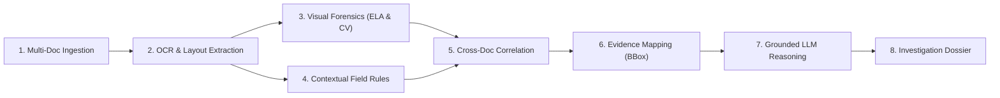

# 00_PROJECT_CHARTER.md
# VeriTrace Desktop: AI-Powered Document Forensics & Contextual Intelligence System

---

## 1. Project Identity

* **Project Name:** VeriTrace Desktop
* **Product Category:** Standalone Desktop Document Forensics & Investigation Software
* **Initial Target Platform:** Windows 10/11 x64
* **Distribution Form:** Single self-contained Windows Installer (`VeriTrace-Setup.exe`)
* **Project Title:** AI-Powered Document Forensics and Contextual Intelligence System
* **Tagline:** *Every document tells a story. Every inconsistency leaves evidence.*
* **Target Competition:** Innovation Hackathon – Problem Statement 2 (PS-2)
* **Architectural Form Factor:** **Standalone desktop application + local-first processing + optional cloud AI**. Operates primarily on the local workstation without requiring internet access for core document intake, rendering, OCR, visual forensics, or dossier generation. Optional cloud LLM reasoning (via Groq API) is user-controlled.
* **End-User Experience:** `DOWNLOAD → INSTALL → OPEN → CREATE INVESTIGATION → IMPORT DOCUMENTS → ANALYSE → REVIEW EVIDENCE → GENERATE DOSSIER` (zero manual Python, Node.js, terminal, database, or Tesseract setup).

---

## 2. Project Vision

Modern enterprises, financial institutions, and government bodies process millions of mission-critical documents—including identity credentials, salary slips, bank statements, tax declarations, and legal affidavits. While traditional Optical Character Recognition (OCR) systems extract text strings and execute isolated field validations, they operate with a critical blind spot: **extraction does not verify authenticity, consistency, or contextual truth.**

Subtle digital tampering (such as pixel manipulation, cloned signatures, overwritten numerals, and font inconsistencies) and multi-document contradictions (such as conflicting employer names, mismatched dates, or inconsistent financial totals across documents within the same submission) easily bypass single-document parsers.

**VeriTrace transforms document review from passive, field-isolated text extraction into an active, contextual, and evidence-backed forensic investigation.** By unifying computer vision, document layout analysis, deterministic cross-document reconciliation, and grounded Large Language Model (LLM) reasoning, VeriTrace delivers complete visual-to-data traceability and compiles an authoritative Document Investigation Dossier.

---

## 3. The Problem Addressed

1. **Vulnerability to Synthetic & Tampered Records:** Fraudsters exploit off-the-shelf image editing tools to alter financial numbers, dates, and names on PDF/image submissions. Basic OCR reads the forged text as valid input without inspecting font morphology, compression artifacts, or pixel grid alignments.
2. **Context Blindness in Siloed Validation:** Existing document processing tools inspect documents in complete isolation. When an applicant submits a PAN card, an Aadhaar card, and three months of bank statements, conflicting data points (e.g., date of birth discrepancies, misaligned salary deposits vs. stated income) go undetected because no cross-document relational graph exists.
3. **Black-Box AI Hallucinations:** When modern generative AI is asked "is this document forged?", it frequently hallucinates confident assessments without pointing to verifiable physical pixels or bounding box coordinates.
4. **Lack of Forensic Chain-of-Custody:** Enterprise auditors and risk underwriters cannot act on subjective "risk scores" alone. They require an admissible, evidence-backed dossier linking every flagged anomaly directly to document coordinates, page numbers, and forensic measurements.

---

## 4. Target Users & Stakeholders

| Stakeholder Role | Operational Pain Point | VeriTrace Value Proposition |
| :--- | :--- | :--- |
| **Financial Underwriters & Loan Officers** | Manual cross-checking of pay stubs, bank statements, and tax forms for loan underwriting is slow and prone to oversight. | Instant automated cross-document reconciliation, flagging mismatched employers, altered net pay figures, and date incongruities. |
| **Forensic Document Examiners & Fraud Analysts** | Analyzing manipulated image headers, altered typography, and forged digital seals requires multiple disjointed desktop tools. | Unified visual forensic tool suite (ELA, font alignment, clone detection) with page-level bounding box evidence inspector. |
| **Enterprise Compliance & Legal Auditors** | Audit logs must prove *how* and *why* a document was accepted or rejected to satisfy regulatory standards (e.g., ISO/IEC 27037). | Immutable audit trail, deterministic anomaly classification, and exportable Investigation Dossiers with pixel-anchored proof. |
| **Procurement & Vendor Risk Managers** | Invoices, purchase orders, and tax certificates submitted by vendors may contain altered bank account details or inflated amounts. | Real-time cross-checking of vendor credentials and financial math across multi-file transaction bundles. |

---

## 5. Hackathon Objectives (DataOps PS-2)

1. **Score 90+ out of 100 points** across all evaluation criteria defined in the PS-2 rubric:
   * OCR & Information Extraction (15 pts)
   * Document Understanding (15 pts)
   * Visual Forensic Analysis (15 pts)
   * Contextual Intelligence (20 pts)
   * Evidence & Traceability (10 pts)
   * AI Reasoning & Explainability (10 pts)
   * Technical Implementation (10 pts)
   * Innovation (5 pts)
2. **Deliver a Live, Demonstrable Prototype** running seamlessly during the judges' interactive demonstration checklist.
3. **Execute End-to-End Investigation Workflow:** Demonstrate multi-document upload, automatic layout extraction, visual anomaly detection (e.g., Error Level Analysis heatmaps, font misalignment), cross-document conflict identification, and instant dossier export.
4. **Demonstrate Strict Assessment Integrity:** Accurately separate confirmed observations from potential anomalies, preventing false accusations while providing human reviewers with clear evidence.

---

## 6. Core System Capabilities

VeriTrace delivers eight foundational capabilities:

1. **Multi-Document Ingestion & File Handling:** Support digital PDFs, scanned PDFs, PNGs, and JPEGs grouped into a single transactional investigation container.
2. **Hybrid OCR & Layout Extraction:** Direct vector text and layout extraction via PyMuPDF for native digital PDFs, backed by image OCR (Tesseract / PaddleOCR) with word-level confidence and bounding box geometries.
3. **Visual Forensic Analysis:**
   * Error Level Analysis (ELA) to expose differential JPEG compression rates indicating spliced or altered regions.
   * Font and baseline alignment variance detection to flag inserted or modified characters.
   * Template and clone detection for duplicated signatures or replicated digital stamps.
4. **Contextual Rule Verification:** Deterministic intra-document validation (e.g., math checksums, date chronology, format checks for PAN/Aadhaar/Tax IDs).
5. **Cross-Document Entity & Fact Correlation:** Cross-referencing entities (names, entity types, dates of birth, addresses, monetary values, identifiers) across distinct documents in the investigation.
6. **Pixel-Grounded Evidence Mapping:** Every finding retains a normalized coordinate bounding box `[ymin, xmin, ymax, xmax]`, page number, and document identifier.
7. **Traceable AI Reasoning:** Using Groq LLMs strictly as forensic reasoning and synthesis engines, consuming structured findings and evidence references without generating ungrounded facts.
8. **Automated Investigation Dossier Generation:** Real-time generation of a forensic report in structured JSON and downloadable PDF format, adhering to sections 7.1–7.6 of PS-2.

---

## 7. Scope Boundaries: Prototype vs. Production

### 7.1 In-Scope for Hackathon Prototype (Mandatory Focus)
* Ingestion of multi-page PDF, PNG, and JPEG documents into an active Investigation case.
* Extraction of textual fields, tables, and key-value pairs with page-level coordinate references.
* Visual forensic analysis pipeline:
  * Error Level Analysis (ELA) generation and suspicious compression variance highlighting.
  * Typography and alignment irregularity detection on financial and identification documents.
  * Signature and stamp presence and boundary isolation.
* Cross-document correlation engine:
  * Entity normalization and fuzzy matching across documents (e.g., Name on ID vs. Name on Bank Statement).
  * Direct conflict detection (e.g., mismatched addresses, conflicting income figures, conflicting dates).
* Interactive Desktop Investigation Workstation (PySide6 + Qt Widgets):
  * Native Windows drag-and-drop file import and local folder selection.
  * Side-by-side document viewer with highlighted forensic bounding boxes and PyMuPDF rendering.
  * Qt Graphics Scene / Table / Tree-based Document & Evidence Relationship Graph.
  * Evidence Inspector drawer displaying visual crops, OCR confidence, and anomaly reasoning.
* Automated Dossier generation conforming strictly to the 6 mandatory sections of PS-2.
* Local SQLite persistence (%LOCALAPPDATA%/VeriTrace/) ensuring complete data isolation and stability.

### 7.2 Advanced / Extension Scope (Time-Permitting / Stretch)
* Automated document type classification via lightweight zero-shot vision models.
* Handwritten text recognition (HTR) for handwritten declarations.
* Multilingual OCR (Hindi + English bilingual government identity cards).
* Deep copy-move forgery detection using SIFT/ORB feature matching.
* Interactive audit trail replay slider in the desktop UI.

### 7.3 Explicit Non-Goals (Out of Scope)
* **Hosted Web Application or Cloud SaaS:** VeriTrace is strictly a local desktop software product; hosted web endpoints, browser-only deployments, and public SaaS infrastructure are explicitly out of scope.
* **Cloud Storage & Multi-Tenant Infrastructure:** No user documents, processed images, or databases are sent to or stored on third-party cloud servers; everything resides in `%LOCALAPPDATA%/VeriTrace/`.
* **Automated Conviction or Legal Adjudication:** VeriTrace is an investigative aid, not an autonomous judicial system. The system flags discrepancies and compiles evidence; human operators make final decisions.
* **Industrial Compliance / Factory Permitting:** VeriTrace completely deprecates the industrial zoning, pollution categorization, and factory clearance scope of UdyogPermit AI.
* **Live GIS Satellite Integration:** Bhuvan and Overpass OSM APIs are decoupled from the active VeriTrace pipeline.
* **Unbounded Conversational Chatbot:** VeriTrace is not an open-domain chat assistant; LLM calls are strictly structured and bounded to factual forensic analysis.

---

## 8. Core Engineering Principles

1. **Deterministic-First Principle:** Where mathematical, geometric, or algorithmic logic can solve a problem (e.g., checksums, date comparisons, font alignment variance, coordinate mapping, fuzzy string matching), do not delegate to an LLM. Use LLMs for synthesis, semantic categorization, and contextual narrative reasoning.
2. **Zero Ungrounded Claims:** An AI model is never permitted to report an anomaly without citing a specific `document_id`, `page_number`, and normalized bounding box coordinate. If evidence cannot be anchored, it cannot be reported as an anomaly.
3. **Epistemic Humility (Three-Tier Classification):** The system must strictly distinguish between:
   * *Confirmed Observation:* Factually verified measurement (e.g., "Compression variance of 38% observed at (x, y); font size differs by 4pt").
   * *Detected Inconsistency:* Mathematical or textual conflict (e.g., "Monthly pay multiplied by 12 does not match annual gross salary").
   * *Suspected Manipulation:* Potential fraud indicator requiring human review (e.g., "Potential clone stamp detected in signature block").
4. **Resilient Degradation:** If an advanced CV filter fails on an unusual image format, the pipeline logs the failure gracefully and continues with OCR and contextual analysis rather than terminating the entire investigation.
5. **Human-in-the-Loop Centricity:** The UI must provide immediate inspection tools allowing a human investigator to override, confirm, or dismiss any automated finding.

---

## 9. Definition of a Successful Hackathon Prototype

A successful demonstration of VeriTrace to the hackathon judges requires:
1. **Multi-Document Upload:** Uploading a sample loan/vendor verification package (e.g., National ID Card + Salary Slip + Bank Statement or Invoice + PO + Tax Certificate).
2. **Instant Pipeline Execution:** Processing completes efficiently via native Python capability engines, QThreadPool execution, and optional Groq acceleration.
3. **Live Visual Anomaly Demonstration:** Revealing an ELA heatmap or font-misalignment bounding box over an artificially altered number on a salary slip or invoice.
4. **Live Cross-Document Conflict Detection:** Automatically identifying and displaying that the entity name or date on Document A contradicts Document B.
5. **Interactive Evidence Inspection:** Clicking on a flagged anomaly in the desktop UI, which smoothly pans to the exact document page, highlights the bounding box, and displays the underlying visual crop and OCR metadata.
6. **One-Click Dossier Export:** Generating a professional, structured PDF/JSON Investigation Dossier matching the PS-2 problem statement specifications.
