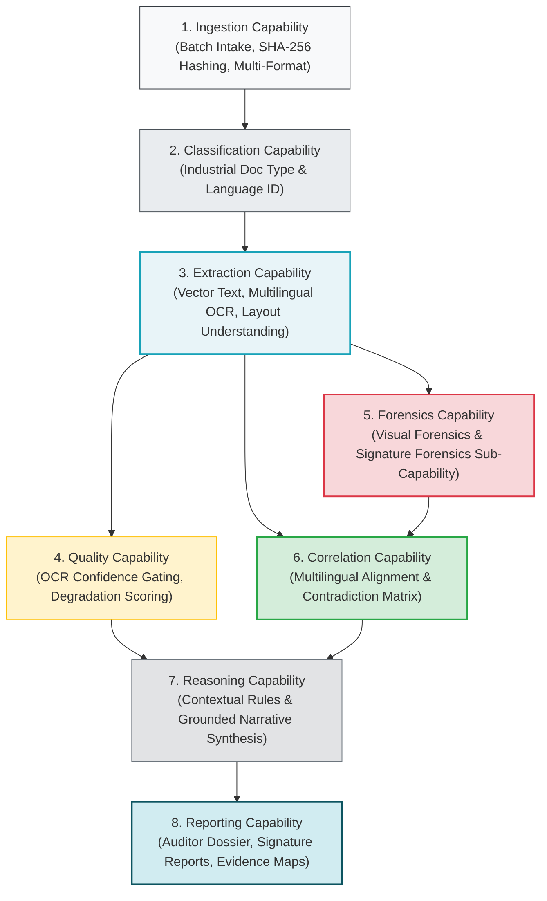

# 00_PROJECT_CHARTER.md
# VeriTrace: Industrial Document Intelligence, Forensics & Authenticity Verification Platform

---

## 1. Project Identity

* **Project Name:** VeriTrace
* **Product Category:** Standalone Industrial Desktop Document Intelligence & Forensic Investigation Platform
* **Initial Target Platform:** Windows 10/11 x64
* **Distribution Form:** Single self-contained Windows Installer (`VeriTrace-Setup.exe`)
* **Project Title:** Industrial Document Intelligence, Forensics & Authenticity Verification Platform
* **Tagline:** *Every document tells a story. Every inconsistency leaves evidence.*
* **Target Competition:** Innovation Hackathon – Problem Statement 2 (PS-2)
* **Architectural Form Factor:** **Standalone desktop application + local-first processing + optional cloud AI**. Operates primarily on the local workstation without requiring internet access for core document intake, rendering, multilingual OCR, visual forensics, signature analysis, or dossier generation. Optional cloud LLM reasoning (via Groq API) is user-controlled, strictly gated, and governed by explicit data-minimization policies.
* **End-User Experience:** `DOWNLOAD → INSTALL → OPEN → SELECT WORKSPACE → CREATE INVESTIGATION → IMPORT INDUSTRIAL DOCUMENTS → ANALYSE → REVIEW EVIDENCE & SIGNATURES → GENERATE DOSSIER` (zero manual Python, Node.js, terminal, database, or external binary configuration).

---

## 2. Project Vision

Modern enterprises, industrial manufacturers, financial institutions, and government bodies process millions of mission-critical business and industrial documents daily—including purchase orders, delivery challans, bills of lading, quality inspection reports, mill test certificates, commercial invoices, identity credentials, tax declarations, and authorized compliance affidavits.

While traditional Optical Character Recognition (OCR) systems extract text strings and execute isolated regex checks, they operate with a critical blind spot: **extraction does not verify authenticity, consistency, signature legitimacy, or contextual truth.**

Subtle digital tampering (such as pixel manipulation, cloned signatures, overwritten quantities/rates, spliced figures, and font irregularities), suspicious signature insertions, and cross-document contradictions (such as conflicting consignee details, mismatched batch numbers, or incompatible item totals across transaction files) easily bypass conventional single-document parsers. Furthermore, Indian enterprise workflows routinely span multiple regional scripts and languages, presenting complex mixed-script challenges.

**VeriTrace transforms document review from passive, field-isolated text extraction into an active, multilingual, contextual, and evidence-backed industrial forensic investigation.** By unifying computer vision, layout-aware multilingual OCR, offline signature analysis, deterministic cross-document reconciliation, and grounded Large Language Model (LLM) reasoning, VeriTrace delivers complete visual-to-data traceability and compiles an authoritative, auditor-grade Document Investigation Dossier.

---

## 3. Target Industries & Scope Strategy

The VeriTrace architecture is designed for **cross-industry industrial document intelligence**, engineered to be universally applicable while maintaining domain-specific contextual awareness:

| Industry Sector | Typical Documents Analyzed | Primary Forensic & Verification Challenges |
| :--- | :--- | :--- |
| **1. Manufacturing** *(Initial Demonstration Domain)* | Purchase Orders (PO), Goods Receipt Notes (GRN), Mill Test Certificates (MTC), Quality Inspection Sheets, Material Dispatch Clearances. | Spliced material specifications, manipulated metallurgical test values, forged quality inspector signatures, quantity/rate mismatches. |
| **2. Logistics & Supply Chain** *(Initial Demonstration Domain)* | Bills of Lading (BOL), Delivery Challans, Freight Invoices, Waybills, Gate Passes, Customs Declarations. | Altered shipment weights, duplicate delivery stamps, unauthorized driver signatures, route/date chronology conflicts. |
| **3. Banking & Financial Services (BFSI)** | Loan applications, national ID proofs (Aadhaar, PAN), bank transaction statements, income certificates, audited balance sheets. | Forged account holder signatures, inflated salary figures, altered statement balances, mismatched identity details. |
| **4. Insurance** | Claim forms, surveyor assessment reports, hospital bills, death certificates, vehicle repair estimates. | Manipulated medical invoices, duplicated damage photographs, reused stamp impressions, non-chronological incident dates. |
| **5. Government & Public Administration** | Land deeds, caste/income affidavits, government tenders, municipal trade licenses, compliance certificates. | Spliced government seals, bilingual Devanagari/English typography discrepancies, unauthorized officer endorsements. |
| **6. Construction & Infrastructure** | Contractor billing sheets, structural stability certificates, vendor supply bids, compliance checklists. | Inflated material quantities, forged structural engineer stamps, inconsistent progress payment line items. |
| **7. Human Resources & Enterprise Administration** | Employment contracts, educational degrees, experience certificates, salary slips, non-disclosure agreements. | Digitally altered qualification dates, fabricated employer credentials, spliced HR executive signatures. |

> **Scope Decision:** While VeriTrace supports cross-industry document intelligence, **manufacturing and supply-chain documentation serves as the initial demonstration domain**. The core system architecture, data models, and verification engines remain strictly modular and extensible across all seven sectors.

---

## 4. Multilingual Scope (Indian Languages Roadmap)

Indian enterprise and industrial documentation is inherently multilingual. VeriTrace establishes an architectural roadmap supporting **twelve major Indian languages** (minimum ten target), categorized into three operational readiness stages:

1. **Stage 3 — Validated for Initial Release:** English, Hindi, Marathi (Priority 1: Core Devanagari & Latin script extraction, normalization, and field alignment).
2. **Stage 2 — Experimental / Benchmarking:** Bengali, Gujarati, Punjabi, Tamil, Telugu (Priority 2: Regional script OCR evaluation, font variation analysis, and multilingual dictionaries).
3. **Stage 1 — Planned Roadmap:** Kannada, Malayalam, Odia, Urdu (Priority 3: Complex conjunct support, right-to-left layout integration for Urdu, and specialized font modeling).

---

## 5. Eight Core System Capabilities

VeriTrace maintains exactly **eight canonical capability boundaries**. No additional top-level capabilities are introduced; signature forensics is integrated as a dedicated sub-capability of Forensics.

1. **Ingestion:** Industrial document intake, multi-format validation (PDF, PNG, JPG, TIFF), cryptographic SHA-256 evidence hashing, immutable storage, batch intake queue, intake quality pre-check.
2. **Classification:** Industrial document type recognition (Purchase Orders, Delivery Challans, Mill Test Certificates, Invoices, Bills of Lading, Identity, Tax), template recognition, language/script-aware classification.
3. **Extraction:** PyMuPDF direct vector extraction, Multilingual OCR engine abstraction (PaddleOCR / Tesseract / specialized), layout understanding (reading order, tables, headers/footers via optional Docling adapter), signature region candidate extraction, structured field parsing, extraction provenance tracking.
4. **Quality:** Multi-factor extraction quality evaluation, language-specific quality heuristics, OCR confidence distribution scoring, image degradation metrics (blur, skew, illumination), completeness & uncertainty propagation, human review triggers.
5. **Forensics:** Pure deterministic visual forensics (ELA, font baseline regression, clone/stamp detection), PDF object & metadata inspection, Signature Forensics sub-capability (signature localization, offline stroke/curvature analysis, reference comparison via ONNX Runtime, tampering/copy-paste detection), pixel-anchored evidence crops.
6. **Correlation:** Cross-document entity reconciliation (RapidFuzz), multilingual concept/field alignment (deterministic dictionary + optional Sentence Transformers), contradiction matrix, inter-document relationship mapping (e.g. PO $\leftrightarrow$ Challan $\leftrightarrow$ Invoice), organizational reference matching.
7. **Reasoning:** Industrial contextual intelligence, deterministic rule-based checksums & chronological validation, evidence-grounded AI narrative synthesis (ChatGroq optional), offline deterministic template fallback, uncertainty-aware risk reasoning.
8. **Reporting:** Industrial Investigation Dossier compilation (ReportLab PDF & structured JSON), PS-2 Sections 7.1–7.6 compliance, signature forensic reports, multilingual summary tables, immutable audit ledger.

---

## 6. Core Engineering & Forensic Principles

1. **Deterministic-First Principle:** Where mathematical, geometric, or algorithmic logic can solve a problem (e.g., checksums, date comparisons, font alignment variance, coordinate mapping, fuzzy string matching), do not delegate to an LLM. Use LLMs for synthesis, semantic categorization, and contextual narrative reasoning.
2. **Zero Ungrounded Claims:** An AI model is never permitted to report an anomaly without citing a specific `document_id`, `page_number`, and normalized bounding box coordinate. If evidence cannot be anchored, it cannot be reported as an anomaly.
3. **Forensic Neutrality & Epistemic Humility:** Findings record empirical discrepancies, baseline deviations, and mathematical mismatches. An anomaly does NOT prove fraud or deliberate manipulation:
   * *Level 1 (Confirmed Observation):* Objective physical measurement (e.g., compression variance cluster at $(x, y)$; font size differs by 4pt).
   * *Level 2 (Detected Inconsistency):* Mathematical or textual conflict (e.g., line item total does not match purchase order grand total).
   * *Level 3 (Suspicious Indicator):* Visual or morphological anomaly requiring human review (e.g., potential cloned signature block or boundary masking artifact).
4. **Signature Verification Guardrails:** Static scanned 2D images cannot measure dynamic writing speed, actual pen-lift sequencing, or 3D pen pressure. Visual similarity between a questioned signature and reference samples does NOT prove legal authorship. The system strictly distinguishes:
   - `SIGNATURE_DETECTED` (localized bounding box)
   - `VISUAL_ANOMALY_OBSERVED` (quality-dependent stroke width variance or boundary artifacts)
   - `SIMILARITY_WITH_REFERENCE` (metric feature distance against enrolled profile)
   - `POSSIBLE_MANIPULATION_INDICATOR` (cross-document clone keypoints or compression discontinuity)
   - `INSUFFICIENT_EVIDENCE` (low scan resolution or missing reference)
   - `HUMAN_EXAMINER_DECISION` (authoritative examiner review)
   *Automated legal determinations of forgery or authenticity are strictly prohibited.*
5. **AI Privacy Modes & Data Governance:** Raw industrial binaries, sensitive engineering schematics, and confidential vendor contracts reside strictly on local storage (`%LOCALAPPDATA%/VeriTrace/`). The platform enforces three AI privacy modes:
   * *Mode A (Offline Deterministic - Default):* 100% local, guarantees zero external network or AI calls for document intake, extraction, analysis, forensics, and dossier generation; local template-driven.
   * *Mode B (Privacy-Preserving AI - Opt-In):* Pre-calculated anonymized numerical metrics only; zero document text, pixels, or PII transmitted.
   * *Mode C (Explicitly Authorized AI):* Requires organizational authorization and per-case consent; restricted to selected, redacted textual excerpts. Raw unredacted scans are never transmitted.
6. **Human-in-the-Loop Centricity:** The workstation UI provides immediate inspection tools allowing an authorized human examiner to review visual crops, inspect ELA heatmaps, annotate findings, and make final sign-off decisions.

---

## 7. Scope Boundaries: Hackathon Prototype vs. Production

### 7.1 In-Scope for Hackathon Prototype (Mandatory Focus)
* Ingestion of multi-page PDF, PNG, and JPEG industrial files into an active Investigation container.
* High-DPI 300 DPI page rendering and interactive bounding box overlay canvas in PySide6.
* Multilingual OCR extraction for English, Hindi, and Marathi documents with token bounding boxes.
* Tabular extraction for industrial purchase orders, delivery challans, and commercial invoices.
* Visual forensic analysis pipeline: Error Level Analysis (ELA) and font baseline misalignment.
* Signature detection and localized evidence crop extraction.
* Cross-document correlation and contradiction matrix across transaction bundles (PO vs. Challan vs. Invoice).
* Interactive desktop Evidence Inspector displaying visual crops, OCR confidence, and examiner review actions.
* One-click PS-2 Investigation Dossier generation in structured JSON and printable PDF format.
* Local SQLite WAL persistence ensuring complete workstation isolation and reliability.

### 7.2 Advanced / Extension Scope (Roadmap)
* Offline signature reference verification prototype using Siamese CNN via ONNX Runtime.
* Full 12-language Indian OCR evaluation benchmark harness.
* Advanced layout parsing via Docling adapter for complex nested engineering tables.
* Organizational workspaces, role-based access control, and encrypted local database storage.

### 7.3 Explicit Non-Goals (Out of Scope)
* **Hosted Web Application or Cloud SaaS:** VeriTrace is strictly a local desktop product; browser-only web deployments and multi-tenant SaaS are explicitly out of scope.
* **Automatic Legal Conviction / Accusation:** The system produces empirical forensic observations; human examiners make authoritative determinations.
* **Legacy Factory Environmental Permitting:** VeriTrace completely deprecates the municipal environmental zoning and pollution categorization scope of UdyogPermit AI.
* **Live GIS Satellite Integration:** Bhuvan and Overpass OSM APIs are decoupled from the active pipeline.
* **Unbounded Conversational Chatbot:** LLM calls are strictly structured, JSON schema-enforced, and bounded to factual forensic analysis.
