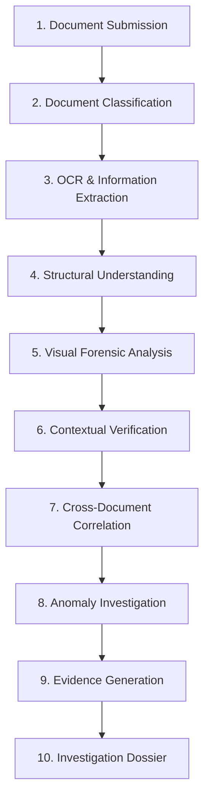
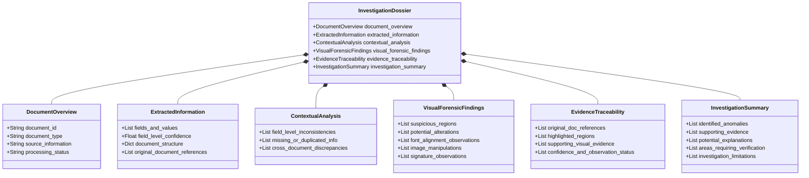

# 01_PROBLEM_STATEMENT_ANALYSIS.md
# Comprehensive Analysis of DataOps Innovation Hackathon PS-2

---

## 1. Background & Context (From Official PS-2)

Financial institutions and enterprises process vast volumes of critical documentation every day, including:
* Loan and account opening application forms
* Identity proofs (passports, national IDs, driver licenses)
* Transaction requests and financial statements
* Official declarations and tax filings
* Commercial contracts, invoices, and supporting affidavits

Traditional document-processing systems rely predominantly on Optical Character Recognition (OCR) to convert pixels into text strings, followed by hardcoded or regex-based field validation rules. However, **extracting information does not establish whether that information is authentic, internally consistent, or contextually reliable.**

In modern digital environments, documents frequently contain:
* Subtle digital alterations (e.g., modified numeric values, spliced text lines)
* Overwritten fields or masked backgrounds
* Inconsistent font geometry, line pitch, and character weight
* Manipulated photographs, altered security watermarks, and copied/pasted signatures
* Cross-document discrepancies that only manifest when related documents within a single submission package are examined collectively.

Detecting such irregularities requires an **AI-powered document intelligence and forensic investigation system** capable of understanding layouts, analyzing visual characteristics, evaluating contextual consistency, and establishing relationships across multi-document submissions.

---

## 2. Official Problem Definition

> **Problem Statement (PS-2):**
> Design and develop an AI-powered Intelligent Document Forensics System capable of analyzing, interpreting, and investigating digital and scanned documents to identify suspicious modifications, contextual inconsistencies, and potential document manipulation.
>
> The proposed system must go beyond conventional OCR-based text extraction by combining document intelligence, computer vision, contextual analysis, and intelligent verification mechanisms to establish the reliability of submitted documents. Unlike isolated validation tools, it must analyze relationships between multiple documents, identify discrepancies that are invisible in isolation, investigate suspicious visual characteristics, generate evidence-backed explanations, and maintain complete traceability to original document sources.

---

## 3. Expected End-to-End Workflow

The official problem statement mandates a 10-stage sequential document investigation pipeline:

### Detailed Workflow Stages

| Stage # | Stage Name | Official PS-2 Definition & Operational Role |
| :---: | :--- | :--- |
| **1** | **Document Submission** | Accepts scanned documents, image captures (PNG, JPG), and native digital PDF documents as input into an investigation case. |
| **2** | **Document Classification** | Identifies the document type (e.g., Identity Card, Bank Statement, Salary Slip, Tax Return) and determines its schema, structural sections, and relevant information fields. |
| **3** | **OCR & Information Extraction** | Extracts printed and handwritten text wherever applicable, preserving character-level and token-level coordinates and confidence metrics. |
| **4** | **Structural Understanding** | Organizes raw extracted text into hierarchical representations (key-value pairs, structured tables, header-body relationships) while preserving coordinate linkage to original pages. |
| **5** | **Visual Forensic Analysis** | Examines image and vector characteristics to identify suspicious modifications, overwritten numbers, mismatched typography/fonts, compression anomalies, and altered images/signatures. |
| **6** | **Contextual Verification** | Evaluates relationships between extracted fields within an individual document (e.g., line-item sums matching grand totals, issue date precedes expiry date, valid ID checksums). |
| **7** | **Cross-Document Correlation** | Compares information across all related documents in the submission to uncover conflicting dates, mismatched names, incompatible addresses, or divergent financial figures. |
| **8** | **Anomaly Investigation** | Deeply analyzes all identified discrepancies, categorizes anomalies, evaluates anomaly significance, and establishes supporting corroborating evidence. |
| **9** | **Evidence Generation** | Automatically calculates and highlights suspicious regions on document pages, associating every finding with high-resolution visual crops and textual snippets. |
| **10** | **Investigation Dossier** | Compiles a structured, comprehensive report containing executive summaries, extracted fields, visual forensic findings, cross-document conflicts, and areas requiring human review. |

---

## 4. Functional Requirements (Sections 5.1 – 5.9)

### 5.1 Document Ingestion and Classification
* Accept scanned documents, raster images (PNG, JPEG), and digital PDF formats.
* Support multiple documents within a single unified investigation case.
* Identify document types and determine relevant structural layouts.
* Maintain unique document identifiers (`doc_id`), hashes, and source references.

### 5.2 OCR and Information Extraction
* Extract printed and handwritten information wherever applicable.
* Identify relevant fields, sections, and tabular data.
* Convert extracted information into a structured schema (JSON).
* Maintain field-level confidence scores and precise page/coordinate references.

### 5.3 Document Structure Understanding
* Recognize relationships between different fields, headers, and sections.
* Interpret document layouts, reading orders, and information hierarchies.
* Identify missing, duplicated, or misplaced fields.
* Preserve the spatial relationship between extracted information and its original visual location.

### 5.4 Visual Forensic Analysis
* Identify suspicious alterations and overwritten fields.
* Detect inconsistencies in fonts, character spacing, baseline alignment, and document grid structure.
* Identify suspicious image insertions, replacements, or splicing (via Error Level Analysis and noise analysis).
* Analyze signatures and organizational seals/stamps for placement consistency, digital clipping, or clone repetition.
* Highlight potentially manipulated regions with bounding boxes for investigator inspection.

### 5.5 Contextual Information Verification
* Identify internal inconsistencies between related fields within the same document (e.g., date logic, mathematical totals).
* Compare information against expected contextual patterns (e.g., valid identifier formats, logical date sequences).
* Detect missing mandatory disclosures or contextually incompatible data.

### 5.6 Cross-Document Correlation
* Establish transactional relationships between multiple documents submitted together (e.g., ID Proof + Income Proof + Bank Statement).
* Compare extracted entity information across documents (names, birth dates, tax numbers, addresses, declared amounts).
* Detect discrepancies that become visible only when multiple documents are analyzed in concert.
* Maintain complete traceability between related documents and their comparative findings.

### 5.7 Evidence Mapping and Investigation
* Associate every identified anomaly with its exact source document, page number, and bounding box coordinates `[ymin, xmin, ymax, xmax]`.
* Highlight suspicious regions directly on document page renders.
* Provide supporting visual evidence (cropped image patches, ELA heatmaps) alongside textual diffs.
* Explain why a particular field or region requires investigation.
* Distinguish between confirmed observations and potential anomalies.

### 5.8 Investigation Dossier Generation
* Generate a structured, standardized investigation dossier containing:
  1. Document overview
  2. Extracted information
  3. Identified inconsistencies
  4. Visual forensic observations
  5. Cross-document discrepancies
  6. Supporting evidence
  7. Confidence levels
  8. Investigation explanations
  9. Areas requiring additional verification.

### 5.9 Audit Trail
* Maintain comprehensive records of document submissions, file hashes, timestamps, and processing activities.
* Record all identified anomalies, automated checks, and human overrides.
* Preserve full investigation history with immutable event tracking.

---

## 5. Minimum Demonstrable Prototype vs. Advanced Extensions

The PS-2 problem statement strictly distinguishes between **mandatory capabilities** for a working prototype and **bonus/advanced features**:

| Category | Functional Capability | Prototype Status | VeriTrace Implementation Plan |
| :--- | :--- | :---: | :--- |
| **Mandatory** | Document ingestion and OCR-based information extraction | **MANDATORY** | Digital PDF parsing via PyMuPDF + scanned image OCR via Tesseract/PaddleOCR. |
| **Mandatory** | Structured extraction of information from multiple documents | **MANDATORY** | Normalized Pydantic schemas capturing key-value pairs, tables, and metadata. |
| **Mandatory** | Identification of suspicious document regions and visual inconsistencies | **MANDATORY** | Error Level Analysis (ELA) heatmap generation + font/baseline alignment detection. |
| **Mandatory** | Identification of inconsistencies within and across documents | **MANDATORY** | Deterministic intra-document rule checks + RapidFuzz cross-document entity reconciliation. |
| **Mandatory** | Evidence mapping with references to original document locations | **MANDATORY** | Normalized coordinate system `[ymin, xmin, ymax, xmax]` linking findings to high-res page crops. |
| **Mandatory** | Generation of a structured investigation dossier | **MANDATORY** | Automated PDF and JSON report generation complying with PS-2 Sections 7.1–7.6. |
| **Mandatory** | Interface for reviewing extracted information and findings | **MANDATORY** | Native PySide6 (Qt) interactive canvas, side-by-side page viewer, and Evidence Inspector dock widget. |
| *Advanced* | Advanced document classification and layout understanding | *Advanced / Bonus* | Zero-shot layout detection and visual document header classification. |
| *Advanced* | Handwritten text recognition and multilingual document processing | *Advanced / Bonus* | Tesseract Hindi/English multilingual pack integration. |
| *Advanced* | Advanced image forensics and manipulation localization | *Advanced / Bonus* | Clone-detection (SIFT/ORB feature matching) for repeated signatures and stamps. |
| *Advanced* | Intelligent cross-document relationship discovery | *Advanced / Bonus* | Native PySide6 (QGraphicsView / QTreeView) interactive entity-relationship visualizer linking related document nodes. |
| *Advanced* | Advanced contextual reasoning and anomaly correlation | *Advanced / Bonus* | Groq-powered contextual reasoning synthesis anchored to extracted evidence. |
| *Advanced* | Automated investigation summaries & interactive evidence exploration | *Advanced / Bonus* | Real-time click-to-highlight interaction linking findings to canvas bounding boxes. |
| *Advanced* | Investigation history, analytics, and advanced audit workflows | *Advanced / Bonus* | SQLite-backed audit event logging and investigation case history management. |

---

## 6. Required Investigation Dossier Sections (PS-2 Section 7)

Every generated dossier must be structured into the following six standardized sections:

---

## 7. Required Deliverables (PS-2 Section 9)

1. **Working AI Agent / Prototype:** Fully functional document intelligence and forensic investigation desktop application (Windows 10/11 x64) demonstrated using authorized sample documents.
2. **Architecture Overview:** High-level architecture diagrams detailing OCR, document processing, AI models, computer vision forensics, contextual analysis, and evidence management.
3. **Sample Investigation Dossier:** An AI-generated investigation report (PDF and JSON) demonstrating realistic extracted information, identified anomalies, and supporting evidence crops.
4. **Source Repository:** Complete, reproducible source code repository containing setup instructions, environment dependencies, licensing, and execution steps.
5. **Demonstration Dataset:** Curated collection of genuine and artificially manipulated sample documents (e.g., tampered salary slips, mismatched identity credentials, cloned signatures).
6. **Technical Documentation:** Comprehensive engineering documentation (the `dev/` directory) explaining models, algorithms, limitations, and pipeline designs.
7. **Evidence Traceability Demonstration:** Interactive demonstration showing how any flagged finding can be traced back to its exact pixel bounding box on the original document page.
8. **Limitations and Assumptions:** Transparent documentation covering known false positives, unsupported image formats, and operating constraints.

---

## 8. Judges' Live Demonstration Checklist (PS-2 Section 10)

During the live demonstration, the judging panel will evaluate:

* [ ] **Multi-Document Ingestion:** Upload multiple authorized sample documents within a single investigation case.
* [ ] **Classification & Extraction:** Demonstrate automatic document classification and OCR-based text/table extraction.
* [ ] **Structured Representation:** Show how extracted raw tokens are transformed into structured key-value entities.
* [ ] **Visual Anomaly Highlighting:** Demonstrate detection and bounding-box highlighting of suspicious image regions (e.g., ELA compression variance, font misalignment).
* [ ] **Intra-Document Verification:** Demonstrate the identification of internal mathematical or contextual inconsistencies within an individual document.
* [ ] **Cross-Document Comparison:** Demonstrate automated cross-document comparison and detection of conflicting information (e.g., name/DOB mismatch across ID and salary slip).
* [ ] **Relational Graphing:** Show how the system visually links related findings and documents in a relational evidence graph.
* [ ] **Evidence Inspection:** Inspect the visual and textual evidence supporting identified anomalies (cropped patches, confidence metrics).
* [ ] **Dossier Generation:** Demonstrate one-click compilation and export of the structured Document Investigation Dossier.
* [ ] **Traceability & Grounding:** Trace any selected finding directly back to its source document coordinates.
* [ ] **Epistemic Distinction:** Verify that the system clearly distinguishes potential anomalies from confirmed observations without making ungrounded accusations.
* [ ] **Safe Failure Handling:** Demonstrate graceful handling of degraded, blurred, or corrupted documents without application crashes.

---

## 9. Judging Criteria & Point Distribution (100 Points)

| Evaluation Criterion | Maximum Points | Specific Assessment Focus from PS-2 |
| :--- | :---: | :--- |
| **OCR & Information Extraction** | **15** | Accuracy, reliability, and structured extraction of printed and handwritten document information. |
| **Document Understanding** | **15** | Interpretation of document layouts, section hierarchies, tabular structures, and field relationships. |
| **Visual Forensic Analysis** | **15** | Identification of suspicious modifications, overwritten fields, font inconsistencies, and image tampering. |
| **Contextual Intelligence** | **20** | Detection of contextual discrepancies, internal logic flaws, and cross-document inconsistencies across submissions. |
| **Evidence & Traceability** | **10** | Ability to associate every finding with precise original document coordinates and visual evidence snippets. |
| **AI Reasoning & Explainability** | **10** | Quality of investigative explanations, structured anomaly reasoning, and clear articulation of evidence. |
| **Technical Implementation** | **10** | Architecture cleanliness, modularity, integration reliability, API design, and system robustness. |
| **Innovation** | **5** | Novelty and practical enterprise applicability of the proposed forensic approach. |
| **TOTAL** | **100** | **Comprehensive Hackathon Score** |

---

## 10. Safety, Ethics, and Assessment Integrity (PS-2 Section 13)

The solution must adhere strictly to forensic and ethical guidelines:
1. **Authorized Datasets Only:** Use only synthetic or authorized mock documents; do not ingest real customer, investor, or personal data.
2. **Data Protection:** Maintain ephemeral or secured local storage for uploaded documents; avoid leaking PII into public third-party logs.
3. **No Blind Trust in OCR:** OCR text is treated as an unverified machine reading, not ground truth.
4. **No Automated Fraud Convictions:** The system must never automatically label a document or person as "fraudulent" or "criminal." Findings must be categorized as *suspicious regions*, *observed visual variances*, or *contextual discrepancies*.
5. **Human-in-the-Loop Oversight:** Every consequential flag must remain subject to human examiner review, verification, and sign-off.
6. **Reference Standards:** System design aligns with principles from:
   * **ISO/IEC 27037:** Digital evidence collection, acquisition, and preservation.
   * **ISO/IEC 27041 / 27042:** Appropriateness and interpretation of digital investigative methods.
   * **NIST SP 800-86:** Integrating forensic techniques into incident investigation.
   * **OWASP ML Security Top 10:** Securing AI and machine learning pipelines against manipulation.

---

## 11. Requirement-to-Feature Mapping Table

| PS-2 Section | Requirement Description | VeriTrace System Module / Architectural Component |
| :--- | :--- | :--- |
| **5.1** | Ingestion & Document ID | `src/veritrace/capabilities/ingestion/`, `src/veritrace/application/services/document.py` |
| **5.2** | OCR & Structured Extraction | `src/veritrace/capabilities/extraction/` (`TextExtractorProtocol` + Tesseract) |
| **5.3** | Layout Understanding & Quality | `src/veritrace/capabilities/quality/` (Confidence scoring, normalized BBoxes) |
| **5.4** | Visual Forensics (ELA & CV) | `src/veritrace/capabilities/forensics/` (OpenCV, Pillow ELA, font baselines) |
| **5.5** | Contextual Field Verification | `src/veritrace/domain/rules/` (Intra-doc arithmetic & checksums) |
| **5.6** | Cross-Document Correlation | `src/veritrace/capabilities/correlation/` (RapidFuzz entity match & contradiction matrix) |
| **5.7** | Evidence Mapping & BBoxes | `src/veritrace/domain/entities/evidence.py`, `src/veritrace/gui/components/` (Evidence dock) |
| **5.8** | Investigation Dossier | `src/veritrace/capabilities/reporting/` (ReportLab PDF + JSON export) |
| **5.9** | Audit Trail | `src/veritrace/domain/entities/audit.py`, SQLite `audit_events` table |
| **6.0** | Interactive Investigator UI | `src/veritrace/gui/` (PySide6 4-pane workstation layout) |
