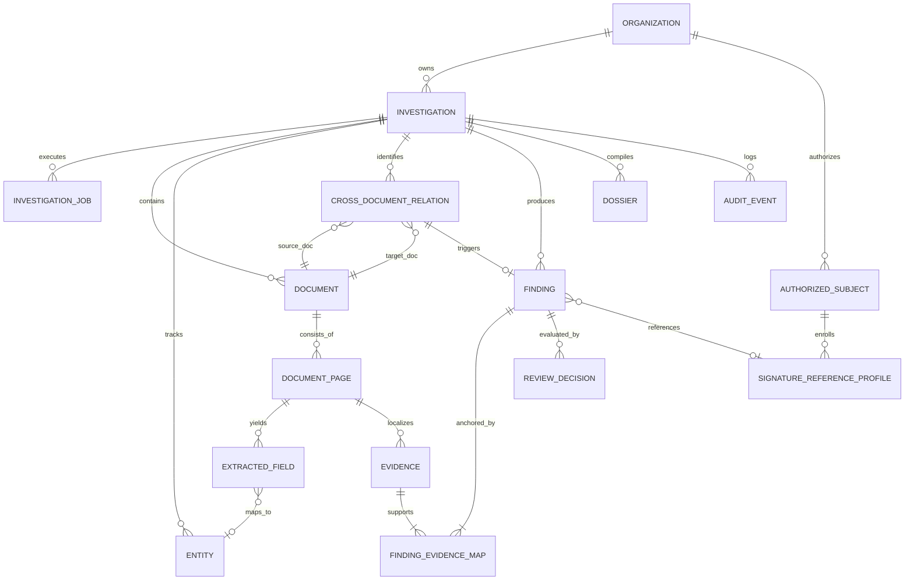

# 07_DATABASE_AND_DATA_MODELS.md
# VeriTrace Relational Data Architecture & Persistence Design

---

## 1. Persistence Strategy & Technology Recommendation

### 1.1 Database Engine Recommendation: SQLite 3 via SQLAlchemy 2.0
For the VeriTrace Desktop application, **SQLite 3** is the authoritative persistent database engine.

**Technical Rationale:**
1. **Zero External Infrastructure:** Eliminates external service dependencies (Docker Postgres, Redis, MongoDB), guaranteeing that the application installs and runs seamlessly on any Windows 10/11 x64 workstation.
2. **ACID Concurrency:** SQLite in WAL (Write-Ahead Logging) mode (`PRAGMA journal_mode=WAL;`) supports concurrent readers alongside a serialized background writer, preventing UI stutter.
3. **ORM Portability:** Implemented with **SQLAlchemy 2.0**, allowing seamless zero-code-change migration to PostgreSQL in a post-hackathon enterprise production phase.
4. **Local Desktop File Location:** Database resides at `%LOCALAPPDATA%/VeriTrace/database/veritrace.sqlite`, ensuring complete local privacy on the user's workstation.
5. **Alembic Schema Migrations:** All table creation and schema changes are versioned through Alembic migrations (`src/veritrace/infrastructure/persistence/migrations/`).

### 1.2 Database Records vs. Local File Storage
To prevent SQLite database bloat and memory degradation:
* **The Database Stores:** Structured metadata, extracted fields, bounding box coordinates, anomaly descriptions, confidence scores, and immutable audit logs across the **15 Core Entities + 1 Association Table (16 Tables Total)**.
* **The File System Stores:** Raw uploaded PDF/image binaries, rendered 300 DPI page images, cropped visual patches, Error Level Analysis (ELA) heatmaps, and generated PDF dossier reports under `%LOCALAPPDATA%/VeriTrace/investigations/{investigation_id}/`.
* **Evidence Immutability:** Original uploaded documents are treated as legally immutable physical evidence. Ingestion computes SHA-256 digests immediately; reprocessing or retrying never modifies or overwrites the original files.

---

## 2. Entity-Relationship (ER) Diagram (Industrial Architecture: 15 Core Entities + 1 Association Table)

---

## 3. Detailed Entity Specifications

### 3.1 Entity: `Investigation`
* **Purpose:** Root container grouping multiple submitted documents for collective evaluation.
* **Attributes:**
  * `id` (VARCHAR(36), PK): UUID string.
  * `title` (VARCHAR(255)): Human-readable case label.
  * `reference_code` (VARCHAR(64), UNIQUE): Business identifier (e.g., "CASE-2026-0891").
  * `status` (VARCHAR(32)): `DRAFT`, `INGESTING`, `PROCESSING`, `WAITING_REVIEW`, `COMPLETED`, `FAILED`.
  * `risk_score` (FLOAT): Aggregate normalized risk assessment `[0.0 - 1.0]`.
  * `created_at` (DATETIME): UTC creation timestamp.
  * `updated_at` (DATETIME): UTC last update timestamp.
* **Indexes:** `idx_investigation_ref` ON (`reference_code`), `idx_investigation_status` ON (`status`).

### 3.2 Entity: `InvestigationJob`
* **Purpose:** Manages durable background processing, stage-level resumes, and heartbeat telemetry.
* **Attributes:**
  * `id` (VARCHAR(36), PK): UUID string.
  * `investigation_id` (VARCHAR(36), FK $\to$ `Investigation.id`): Target investigation.
  * `status` (VARCHAR(32)): `QUEUED`, `CLAIMED`, `RUNNING`, `COMPLETED`, `FAILED`, `CANCELLED`.
  * `stage` (VARCHAR(64)): `INTAKE`, `PAGE_RENDER`, `TEXT_EXTRACTION`, `VISUAL_FORENSICS`, `CROSS_MATCHING`, `DOSSIER_GEN`.
  * `progress_percent` (INTEGER): Value `[0 - 100]`.
  * `claimed_by` (VARCHAR(64)): Worker identifier.
  * `heartbeat_at` (DATETIME): Heartbeat timestamp.
  * `retry_count` (INTEGER): Current retry attempt.
  * `max_retries` (INTEGER): Max retry attempts allowed (default: 3).
  * `error_message` (TEXT): Failure diagnostics.

### 3.3 Entity: `Document`
* **Purpose:** Represents an individual file submitted within an investigation.
* **Attributes:**
  * `id` (VARCHAR(36), PK): UUID string.
  * `investigation_id` (VARCHAR(36), FK $\to$ `Investigation.id`): Foreign key with cascade delete.
  * `original_filename` (VARCHAR(255)): Name of uploaded file.
  * `file_hash_sha256` (VARCHAR(64)): Cryptographic SHA-256 digest.
  * `mime_type` (VARCHAR(64)): MIME type (`application/pdf`, `image/png`, `image/jpeg`).
  * `document_type` (VARCHAR(64)): Category (`PURCHASE_ORDER`, `DELIVERY_CHALLAN`, `MILL_TEST_CERT`, `COMMERCIAL_INVOICE`, `IDENTITY_PROOF`, `SALARY_SLIP`, `BANK_STATEMENT`, etc.).
  * `primary_language` (VARCHAR(16), DEFAULT 'eng'): Primary detected language code (`eng`, `hin`, `mar`, `mixed`). Fast-lookup indexed summary.
  * `primary_script` (VARCHAR(32), DEFAULT 'Latn'): Primary script (`Latn`, `Deva`, `MIXED`).
  * `languages_json` (TEXT/JSON): Structured document-level `LanguageDetectionProfile` value object recording overall language distribution, primary script, confidence, and detection engine provenance. Avoids table proliferation by serializing immutable detection profiles.
  * `page_count` (INTEGER): Total pages in file.
  * `file_size_bytes` (INTEGER): File size.
  * `storage_path` (VARCHAR(512)): Relative path in `%LOCALAPPDATA%/VeriTrace/`.
  * `quality_status` (VARCHAR(32), DEFAULT 'UNVERIFIED'): `VERIFIED_HIGH`, `DEGRADED_SCAN`, `UNVERIFIED`.
  * `uploaded_at` (DATETIME): Upload timestamp.

### 3.4 Entity: `DocumentPage`
* **Purpose:** Represents a single rasterized 300 DPI page of a document.
* **Attributes:**
  * `id` (VARCHAR(36), PK): UUID string.
  * `document_id` (VARCHAR(36), FK $\to$ `Document.id`): Parent document.
  * `page_number` (INTEGER): 1-indexed sequence number.
  * `width_pixels` (INTEGER): Rendered width at 300 DPI.
  * `height_pixels` (INTEGER): Rendered height at 300 DPI.
  * `image_storage_path` (VARCHAR(512)): Relative path to rendered PNG.
  * `text_layer_type` (VARCHAR(32)): `VECTOR_NATIVE`, `SCANNED_RASTER`, `HYBRID`.
  * `primary_language` (VARCHAR(16), DEFAULT 'eng'): Fast-lookup page language code.
  * `primary_script` (VARCHAR(32), DEFAULT 'Latn'): Fast-lookup page script code.
  * `languages_json` (TEXT/JSON): Structured page-level `LanguageDetectionProfile` capturing page script distribution, confidence, OCR engine provenance, and a list of spatial `LanguageScriptRegion` bounding boxes for multi-region / mixed-script pages (e.g. English header, Devanagari table). Zero table proliferation.

### 3.5 Entity: `ExtractedField`
* **Purpose:** Granular OCR tokens and parsed key-value pairs with normalized coordinates and extraction provenance.
* **Attributes:**
  * `id` (VARCHAR(36), PK): UUID string.
  * `page_id` (VARCHAR(36), FK $\to$ `DocumentPage.id`): Target page.
  * `entity_id` (VARCHAR(36), FK $\to$ `Entity.id`, NULLABLE): Associated canonical entity.
  * `field_name` (VARCHAR(128)): Normalized key name (e.g., `net_salary`, `pan_number`, `heat_number`).
  * `field_value` (TEXT): Normalized textual or numerical content used in deterministic rules.
  * `raw_text` (TEXT): Verbatim original glyphs / text exactly as extracted, preserving original Indic scripts and numerals without translation.
  * `language` (VARCHAR(16), NULLABLE): Token/region-level detected language code (`eng`, `hin`, `mar`).
  * `script` (VARCHAR(32), NULLABLE): Token/region-level detected script code (`Latn`, `Deva`).
  * `lang_confidence` (FLOAT, NULLABLE): Language detection confidence `[0.0 - 1.0]`.
  * `confidence` (FLOAT): Extraction OCR/parser confidence `[0.0 - 1.0]`.
  * `normalized_bbox` (JSON): `[ymin, xmin, ymax, xmax]` normalized coordinates ($0.0 \le ymin < ymax \le 1.0, 0.0 \le xmin < xmax \le 1.0$).
  * `extraction_method` (VARCHAR(32)): `PYMUPDF_VECTOR`, `TESSERACT_OCR`, `PADDLEOCR_INDIC`, `REGEX_RULE`.
  * `ocr_engine` (VARCHAR(64), NULLABLE): OCR runtime identifier (`tesseract-5.3`, `paddleocr-v4`).
  * `ocr_model_version` (VARCHAR(64), NULLABLE): Specific weights or model version tag.

### 3.6 Entity: `Entity`
* **Purpose:** Canonical real-world identity or fact reconciled across distinct documents.
* **Attributes:**
  * `id` (VARCHAR(36), PK): UUID string.
  * `investigation_id` (VARCHAR(36), FK $\to$ `Investigation.id`): Associated case.
  * `entity_type` (VARCHAR(64)): `PERSON_NAME`, `ID_NUMBER`, `EMPLOYER`, `DATE`, `MONETARY_AMOUNT`.
  * `canonical_value` (TEXT): Normalized reconciled string.
  * `confidence` (FLOAT): Reconciled confidence score.

### 3.7 Entity: `Finding`
* **Purpose:** Standardized forensic conclusion categorized under the Three-Tier Epistemic Ontology.
* **Attributes:**
  * `id` (VARCHAR(36), PK): UUID string.
  * `investigation_id` (VARCHAR(36), FK $\to$ `Investigation.id`): Associated case.
  * `tier` (VARCHAR(32)): `CONFIRMED_OBSERVATION`, `DETECTED_INCONSISTENCY`, `SUSPECTED_MANIPULATION`.
  * `category` (VARCHAR(64)): `VISUAL_ELA`, `FONT_BASELINE`, `CLONE_STAMP`, `ARITHMETIC_RULE`, `CROSS_DOC_CONFLICT`.
  * `severity` (VARCHAR(32)): `CRITICAL`, `WARNING`, `INFORMATIONAL`.
  * `title` (VARCHAR(255)): Brief headline.
  * `description` (TEXT): Detailed observation narrative.
  * `metric_score` (FLOAT): Algorithmic metric score.

### 3.8 Entity: `Evidence`
* **Purpose:** Physical visual crop and coordinate anchor that supports a Finding.
* **Attributes:**
  * `id` (VARCHAR(36), PK): UUID string.
  * `page_id` (VARCHAR(36), FK $\to$ `DocumentPage.id`): Source page.
  * `crop_image_path` (VARCHAR(512)): Relative path to cropped image patch.
  * `heatmap_image_path` (VARCHAR(512), NULLABLE): Relative path to ELA differential crop.
  * `pixel_coordinates` (JSON): `[ymin, xmin, ymax, xmax]` normalized coordinates.
  * `grounding_explanation` (TEXT): Physical description of what is depicted.

### 3.9 Association Table: `FindingEvidenceMap`
* **Purpose:** Many-to-many relationship linking Findings to supporting Evidence anchors.
* **Attributes:**
  * `finding_id` (VARCHAR(36), PK, FK $\to$ `Finding.id`): Associated finding.
  * `evidence_id` (VARCHAR(36), PK, FK $\to$ `Evidence.id`): Supporting evidence anchor.
  * `is_primary` (BOOLEAN): Denotes primary illustrative evidence.

### 3.10 Entity: `CrossDocumentRelation`
* **Purpose:** Semantic relationship between entities across distinct documents in the investigation.
* **Attributes:**
  * `id` (VARCHAR(36), PK): UUID string.
  * `investigation_id` (VARCHAR(36), FK $\to$ `Investigation.id`): Associated case.
  * `source_document_id` (VARCHAR(36), FK $\to$ `Document.id`): Source document.
  * `target_document_id` (VARCHAR(36), FK $\to$ `Document.id`): Comparison document.
  * `relation_type` (VARCHAR(64)): `MATCHES`, `CONTRADICTS`, `SUPPORTS`.
  * `similarity_score` (FLOAT): Fuzzy match score `[0.0 - 1.0]`.
  * `narrative` (TEXT): Comparative explanation.

### 3.11 Entity: `ReviewDecision`
* **Purpose:** Authoritative sign-off, dismissal, or note recorded by a human investigator.
* **Attributes:**
  * `id` (VARCHAR(36), PK): UUID string.
  * `finding_id` (VARCHAR(36), FK $\to$ `Finding.id`): Evaluated finding.
  * `decision` (VARCHAR(32)): `CONFIRMED`, `DISMISSED`, `PENDING`.
  * `reviewer_notes` (TEXT): Justification commentary.
  * `decided_at` (DATETIME): Timestamp of human review.

### 3.12 Entity: `Dossier`
* **Purpose:** Permanent record of generated investigation reports (PDF and JSON).
* **Attributes:**
  * `id` (VARCHAR(36), PK): UUID string.
  * `investigation_id` (VARCHAR(36), FK $\to$ `Investigation.id`): Associated case.
  * `pdf_path` (VARCHAR(512)): Relative path to compiled PDF.
  * `json_path` (VARCHAR(512)): Relative path to compiled JSON.
  * `file_hash_sha256` (VARCHAR(64)): Cryptographic digest of generated PDF dossier.
  * `generated_at` (DATETIME): Timestamp of compilation.

### 3.13 Entity: `AuditEvent`
* **Purpose:** Immutable append-only event ledger for auditability and regulatory compliance.
* **Attributes:**
  * `id` (VARCHAR(36), PK): UUID string.
  * `investigation_id` (VARCHAR(36), FK $\to$ `Investigation.id`): Target case.
  * `event_type` (VARCHAR(64)): `CASE_CREATED`, `DOC_INGESTED`, `PIPELINE_STARTED`, `HUMAN_REVIEW_RECORDED`, `DOSSIER_COMPILED`.
  * `actor` (VARCHAR(64)): `SYSTEM`, `WORKER`, `HUMAN_INVESTIGATOR`.
  * `payload` (JSON): Contextual snapshot of event parameters.
  * `timestamp` (DATETIME): Event UTC timestamp.

### 3.14 Entity: `Organization`
* **Purpose:** Multi-tenant workspace container grouping investigations, audit logs, and authorized subjects.
* **Attributes:**
  * `id` (VARCHAR(36), PK): UUID string (`org_<uuid4_hex>`).
  * `name` (VARCHAR(255), NOT NULL): Legal name of industrial entity or corporate division.
  * `industry_sector` (VARCHAR(64), NOT NULL): Sector classification (`MANUFACTURING`, `SUPPLY_CHAIN`, `BFSI`, `INSURANCE`, `GOVERNMENT`, `CONSTRUCTION`, `ENTERPRISE_HR`).
  * `created_at` (DATETIME, NOT NULL): UTC creation timestamp.

### 3.15 Entity: `AuthorizedSubject`
* **Purpose:** Designated individual authorized to endorse, sign, or inspect enterprise documents.
* **Attributes:**
  * `id` (VARCHAR(36), PK): UUID string (`subj_<uuid4_hex>`).
  * `organization_id` (VARCHAR(36), FK $\to$ `Organization.id`, NOT NULL): Associated organization.
  * `full_name` (VARCHAR(255), NOT NULL): Full legal name of authorized signer.
  * `designation` (VARCHAR(128), NOT NULL): Professional role (e.g., "Chief Metallurgist", "Quality Assurance Lead", "Plant General Manager").
  * `id_reference` (VARCHAR(64), NOT NULL): Employee ID or government ID reference.
  * `created_at` (DATETIME, NOT NULL): UTC timestamp.

### 3.16 Entity: `SignatureReferenceProfile`
* **Purpose:** Reference signature sample enrolled under chain-of-custody for comparison against questioned signatures.
* **Attributes:**
  * `id` (VARCHAR(36), PK): UUID string (`sig_<uuid4_hex>`).
  * `subject_id` (VARCHAR(36), FK $\to$ `AuthorizedSubject.id`, NOT NULL): Signer identity.
  * `crop_image_path` (VARCHAR(512), NOT NULL): Path to enrolled clean visual patch PNG.
  * `sha256_hash` (VARCHAR(64), NOT NULL): Cryptographic digest of reference crop.
  * `embedding_vector` (BLOB, NULLABLE): Serialized float32 metric embedding vector.
  * `enrollment_date` (DATETIME, NOT NULL): UTC timestamp.
  * `source_document_ref` (VARCHAR(255), NOT NULL): Enrolled sample provenance certificate/file.
  * `consent_mandate_ref` (VARCHAR(255), NOT NULL): Reference to corporate power-of-attorney or signatory authorization mandate.
  * `retention_expiry_date` (DATETIME, NULLABLE): Expiration date for reference profile retention.
  * `access_role_required` (VARCHAR(64), DEFAULT 'FORENSIC_INVESTIGATOR'): Role required to query reference profiles.
  * `provenance_json` (JSON, NULLABLE): Verification witness, enrollment scanner metadata, and authorization certificate audit record.
* **Signature Reference Governance Requirements:**
  1. *Authorized Enrollment & Provenance:* Reference signatures must originate from verified legal instruments (board resolutions, identity verification cards, physical signature specimen cards witnessed by corporate compliance officers).
  2. *Consent & Authorization Mandate:* Enrolling reference signatures requires written corporate signatory authorization; unauthorized biometric profiling is strictly prohibited.
  3. *Role-Based Access Control (RBAC):* Only authenticated investigators with `FORENSIC_INVESTIGATOR` or `LEAD_AUDITOR` roles may retrieve or match against enrolled reference profiles.
  4. *Retention & Purge Policy:* Reference profiles are subject to scheduled retention lifecycles and must be purged upon employee separation or contract expiration.
  5. *Secure Encrypted Storage & Cryptographic Erasure Design:* In the planned security architecture, Windows DPAPI protects the symmetric Data Encryption Key (DEK). Visual reference crops and embedding BLOBs are to be stored encrypted at rest using AES-256-GCM under this DEK. Key lifecycle and recovery must be explicitly governed. Retention expiry or mandate revocation triggers cryptographic erasure (cryptographic key destruction) -- destroying the relevant DEK and recoverable key copies rather than relying on ordinary disk overwrite operations, which cannot guarantee physical sector sanitization on modern SSDs. Backups, snapshots, SQLite WAL files, and export archives are comprehensively included in the retention lifecycle design. Full database encryption via SQLCipher vs OS-level BitLocker remains an open decision for Milestone 11. (Design specification for future milestones; not claimed as currently implemented in application code).
  6. *Mandatory Human Review:* Algorithmic comparison yields candidate visual similarity signals only. Automated declarations of legal forgery or authenticity are strictly prohibited.
