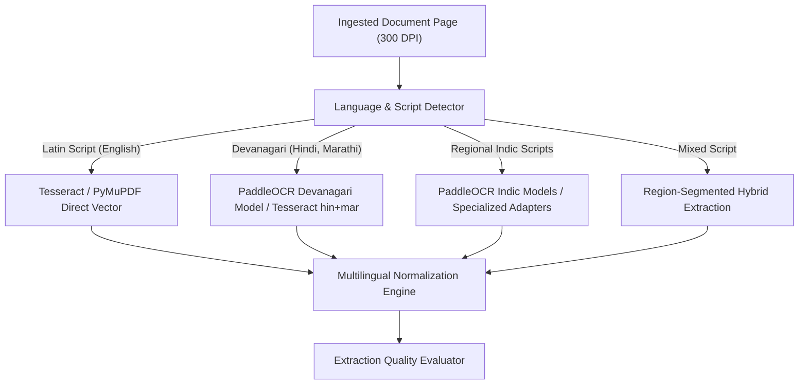
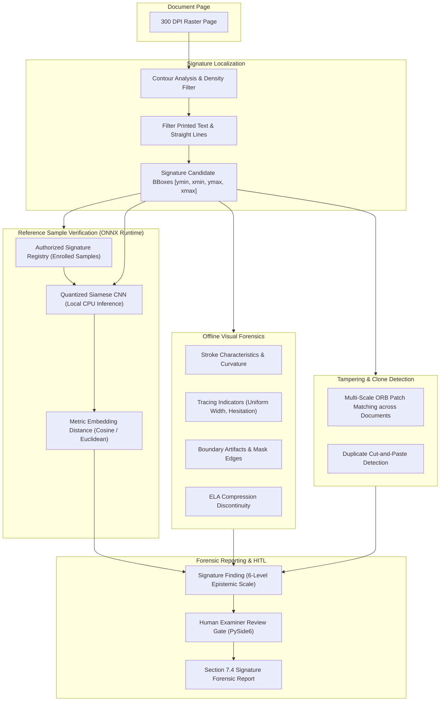
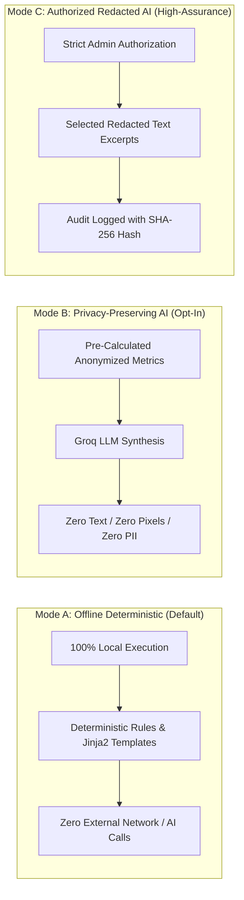

# 09_AI_AND_FORENSICS_STRATEGY.md
# AI, Multilingual OCR & Forensic Investigation Strategy

---

## 1. Technical Framework & Tool Evaluation

VeriTrace integrates specialized, industry-proven libraries, computer vision algorithms, and local machine learning runtimes. Each technology is assigned a strictly defined architectural role based on its algorithmic capabilities:

| Technology / Library | Domain | Assigned Architectural Role | Adoption Status | Technical Justification |
| :--- | :--- | :--- | :---: | :--- |
| **PyMuPDF (`fitz`)** | PDF Processing & Vector Extraction | Direct vector text extraction, font descriptor analysis, metadata auditing, and lossless 300 DPI page rasterization. | **Adopted** | High-performance C-backed engine (`MuPDF`); extracts character-level bounding boxes and embedded image layers without external binaries. |
| **Tesseract OCR (`pytesseract`)** | Optical Character Recognition | Baseline open-source OCR candidate for scanned documents, photographed pages, and fallback recognition. | **Adopted** | Robust open-source engine; outputs token-level bounding boxes and individual word confidences `[0 - 100]`. Supports English, Hindi, and regional scripts. |
| **PaddleOCR** | Multilingual OCR & Layout Detection | Primary multilingual OCR candidate for high-accuracy Devanagari (Hindi, Marathi) and regional Indian script extraction. | **Evaluate / Benchmark** | State-of-the-art lightweight DBNet++ text detector and SVTR text recognizer; superior accuracy on complex Indian conjuncts and low-resolution scans. |
| **Docling (IBM Docling)** | Document Structure & Layout Parsing | Optional adapter for layout analysis, reading order determination, and complex nested table extraction in technical sheets. | **Evaluate / Benchmark** | Advanced document structure modeling; converts complex industrial layouts into structured trees while preserving coordinate anchors. Optional adapter. |
| **OpenCV (`cv2`)** | Computer Vision & Image Forensics | Preprocessing, adaptive thresholding, edge/contour detection, font baseline regression, and signature contour analysis. | **Adopted** | Comprehensive algorithmic vision library; provides exact matrix operations required for deterministic forensic measurements. |
| **Pillow (`PIL`)** | Image Manipulation & ELA | Lossless format conversion, controlled-quality JPEG re-compression for Error Level Analysis, and visual evidence cropping. | **Adopted** | Native Python imaging library; provides pixel-perfect `ImageChops.difference` arithmetic for ELA generation. |
| **NumPy & SciPy** | Numerical & Statistical Computing | Baseline regression analysis, metric distance computation (cosine, Euclidean), and statistical anomaly scoring. | **Adopted** | High-performance array operations for spatial coordinates and feature embeddings. |
| **ONNX Runtime (`onnxruntime`)** | Local Model Inference | High-performance, cross-platform local CPU execution of quantized signature comparison models and layout models. | **Evaluate / Benchmark** | Eliminates heavy PyTorch runtime requirements in desktop production; executes quantized `.onnx` models with zero cloud dependency. |
| **PyTorch (`torch`)** | Model Development & Training | Offline research, model architecture experimentation, and Siamese CNN training for offline signature verification. | **Evaluate / Benchmark (Offline Dev)** | Standard framework for forensic model training; strictly isolated to offline model development, never bundled in desktop client. |
| **Sentence Transformers** | Multilingual Semantic Matching | Semantic field alignment and terminology matching across Indian languages for unstructured descriptions. | **Evaluate / Benchmark** | Maps multilingual phrases ("एकूण रक्कम", "कुल रकम", "Total Amount") to shared embedding space. Never used alone for financial totals. |
| **RapidFuzz** | Fuzzy String Matching | High-speed C++ Levenshtein entity reconciliation (matching variations in company names, addresses, and identifiers). | **Adopted** | Orders of magnitude faster than fuzzywuzzy; deterministic matching thresholds for cross-document reconciliation. |
| **Pydantic V2** | Schema Enforcement & Validation | Data contract serialization, JSON schema validation, and typed domain DTO enforcement. | **Adopted** | Compiled Rust core (`pydantic-core`) ensures blazing fast type safety. |
| **Groq ChatGroq (`llama-3.3-70b-versatile`)** | Large Language Model Reasoning | Grounded contextual reasoning, cross-document discrepancy synthesis, and narrative explanation for investigation dossiers. | **Optional / User-Gated** | Sub-second inference speeds (300+ tokens/sec); JSON schema enforcement. Strictly downstream of deterministic findings. |
| **ReportLab** | Document Generation | Programmatic compilation of standardized, multi-page PDF Investigation Dossiers and Signature Reports. | **Adopted** | Standard Python engine for generating professional, printable PDF documents with embedded image crops, tables, and audit ledgers. |
| **PySide6 / QGraphicsView** | Desktop Document Viewer | High-fidelity interactive document rendering with zoom, pan, and coordinate-aligned bounding box overlays. | **Adopted** | Qt graphics architecture; ensures sub-millimeter visual alignment of forensic bounding boxes over document pages. |

---

## 2. Eight Foundational Forensic & Investigation Principles

To comply with forensic digital evidence standards (ISO/IEC 27037 / 27042) and PS-2 assessment guidelines, VeriTrace operates under eight immutable engineering rules:

### Principle 1: OCR Extraction is Not Proof of Authenticity
* Extracting text via OCR merely records what characters appear on the page surface.
* A forged or digitally spliced salary slip or purchase order will parse cleanly into text strings.
* **Engineering Standard:** The system must never label a document as "authentic" simply because its text fields parsed successfully. OCR is solely an extraction layer.

### Principle 2: Error Level Analysis (ELA) is an Investigative Signal, Not Proof
* Error Level Analysis highlights areas with different rates of compression error when resaved at a known JPEG quality (typically 90%).
* Text on high-contrast backgrounds naturally yields higher error levels than flat backgrounds; repeated resaving or scanning also affects noise.
* **Engineering Standard:** An elevated ELA score must be labeled as an *Observed Compression Variance Signal*, not as "Confirmed Forgery." It highlights a region for human inspection.

### Principle 3: Signature Verification Guardrails & Legal Epistemics
* Visual similarity or machine-computed feature proximity between a questioned signature and reference samples **does not prove legal authorship or authenticity**.
* A low similarity score does not prove deliberate forgery (it may reflect natural intra-writer variation, writing surface differences, fatigue, or illness).
* **Engineering Standard:** The system must strictly categorize signature analysis findings into six distinct evidentiary levels:
  1. `SIGNATURE_DETECTED`: Signature region localized on page.
  2. `VISUAL_ANOMALY_OBSERVED`: Stroke irregularity, tracing hesitation, or rectangular boundary mask detected.
  3. `SIMILARITY_WITH_REFERENCE`: Algorithmic feature similarity score against enrolled reference profile.
  4. `POSSIBLE_MANIPULATION_INDICATOR`: Cloned/reused image patch or ELA boundary discontinuity detected.
  5. `INSUFFICIENT_EVIDENCE`: Degraded scan, low resolution, or lack of reference samples prevents conclusive comparison.
  6. `HUMAN_EXAMINER_DECISION`: Authoritative sign-off, confirmation, or dismissal by a qualified human examiner.
  *The system must never automatically declare a person guilty of forgery.*

### Principle 4: Zero Ungrounded LLM Claims
* LLMs are susceptible to hallucinating plausible-sounding fraud narratives.
* **Engineering Standard:** An LLM prompt must never ask "is this document forged?" in free text. The LLM is provided only with structured, pre-calculated measurements (e.g., "Math mismatch: A+B != C", "Font baseline offset: 3.5px at [x,y,w,h]"). The LLM's role is strictly to explain the investigative implications of recorded facts.

### Principle 5: Strict Epistemic Classification (Three-Tier Findings)
Every detected finding must be classified into one of three distinct categories:
1. **Confirmed Observation:** An objective, mathematically verified measurement (e.g., "Date of birth on Doc A is 1988; Date of birth on Doc B is 1992").
2. **Detected Inconsistency:** An internal or cross-document contradiction violating known domain logic (e.g., "PO line-item sum ₹8,50,000 does not reconcile with invoice total ₹9,20,000").
3. **Suspected Manipulation:** A visual or structural irregularity indicating potential intentional tampering (e.g., "Font baseline discontinuity of +3.5px combined with 42% ELA compression spike").

### Principle 6: Confidence Values Must Not Be Invented
* Arbitrary pseudo-random confidence percentages (e.g., "94.2% Fraud Probability") destroy forensic credibility.
* **Engineering Standard:** Confidence scores must derive from documented formulas:
  * OCR Confidence: Direct mean of recognizer token confidences.
  * Fuzzy Match Score: Exact Levenshtein token sort ratio from RapidFuzz `[0.0 - 1.0]`.
  * ELA Anomaly Score: Local variance normalized against global background variance:
    $$\text{Score}_{\text{ELA}} = \min\left(1.0, \frac{\sigma_{\text{local}} - \mu_{\text{background}}}{\kappa \cdot \sigma_{\text{background}}}\right)$$
  * Signature Similarity Score: Normalized cosine distance between metric embedding vectors $\in [0.0, 1.0]$.

### Principle 7: Total Page & Coordinate Traceability
* Every finding must permanently retain its source metadata:
  $$\text{Evidence Anchor} = \{\text{investigation\_id}, \text{document\_id}, \text{page\_number}, \text{normalized\_bbox}\}$$
* Clicking any finding in the UI must immediately pan the viewer to the exact physical pixel location on the page.

### Principle 8: Data Minimization & Optional Cloud AI Execution
* **100% Offline Core Capability:** PDF rendering, multilingual OCR, OpenCV forensics, signature stroke analysis, arithmetic checksums, cross-document correlation, and ReportLab PDF dossier generation execute purely locally with zero network connectivity.
* **Optional Cloud Inference:** Groq LLM inference is strictly optional and user-controlled.
* **Strict Data Minimization:** Raw document binaries, full-page scans, or unredacted personal files are NEVER transmitted off the user's desktop. When Groq is enabled, only pre-calculated numerical findings and anonymized text discrepancies are sent for narrative synthesis.
* **Deterministic Fallback:** If offline or if `GROQ_API_KEY` is not provided, the pipeline seamlessly generates standard factual forensic observations using local rule templates, without crashing or degrading functionality.

---

## 3. Multilingual Indian Document Intelligence Strategy

Indian industrial, commercial, and legal workflows routinely span multiple regional languages. VeriTrace establishes an extensible multilingual document intelligence pipeline.

### 3.1 Target Languages & Operational Readiness

| Language | Primary Script | Implementation Priority | Operational Readiness Stage | Key Technical Challenges |
| :--- | :--- | :---: | :---: | :--- |
| **English** | Latin | **Priority 1** | **Stage 2: Initial Implementation and Benchmarking** | Standard typography, tabular alignment, font baseline variance. |
| **Hindi** | Devanagari | **Priority 1** | **Stage 2: Initial Implementation and Benchmarking** | Shirorekha (top hanging line), complex conjuncts (युक्ताक्षर), vowel matras. |
| **Marathi** | Devanagari | **Priority 1** | **Stage 2: Initial Implementation and Benchmarking** | Extended Devanagari glyphs (ळ), legal/industrial vocabulary, government stamps. |
| **Bengali** | Bengali | **Priority 2** | **Stage 2: Experimental / Benchmark** | Complex ligatures, curved glyph morphology, ink-bleed in low-quality scans. |
| **Gujarati** | Gujarati | **Priority 2** | **Stage 2: Experimental / Benchmark** | Absence of top hanging line, distinctive loop structures, commercial invoices. |
| **Punjabi** | Gurmukhi | **Priority 2** | **Stage 2: Experimental / Benchmark** | Diacritics (tippi, bindi, addak), agricultural/transport receipt fonts. |
| **Tamil** | Tamil | **Priority 2** | **Stage 2: Experimental / Benchmark** | Rounded non-alphabetic glyphs, distinct numeral legacy glyphs, high stroke count. |
| **Telugu** | Telugu | **Priority 2** | **Stage 2: Experimental / Benchmark** | Circular ligatures, complex vowel sign stacking above/below base consonants. |
| **Kannada** | Kannada | **Priority 3** | **Stage 1: Planned Roadmap** | Multi-level subscript consonants (ottakshara), rounded glyph segmentation. |
| **Malayalam** | Malayalam | **Priority 3** | **Stage 1: Planned Roadmap** | High ligature count (chillu letters), dense horizontal packaging. |
| **Odia** | Odia | **Priority 3** | **Stage 1: Planned Roadmap** | Curved umbrella loops (top stroke), distinct conjunct glyph formations. |
| **Urdu** | Perso-Arabic (Nastaliq) | **Priority 3** | **Stage 1: Planned Roadmap** | Right-to-left (RTL) reading order, sloping baseline, contextual character shaping. |

> [!IMPORTANT]
> **Production Validation Guardrail:** No language is designated as production-validated until benchmark results on representative, labelled domain datasets satisfy the empirical acceptance criteria specified below.

#### 3.1.1 Proposed Benchmark & Release Gates (Evaluation Targets)
These criteria represent **proposed target gates for upcoming benchmark evaluation in Milestone 4**, NOT achieved performance claims. Empirical validation requires testing across a curated benchmark dataset encompassing:
1. **Representative Document Types:** Purchase orders, delivery challans, mill test certificates, commercial invoices, identity cards, and salary slips.
2. **Scan Quality Variations:** High-quality digital PDFs, 300 DPI flatbed scans, degraded/low-contrast (150–200 DPI) mobile captures, and skewed documents ($\pm 3^\circ$).
3. **Mixed-Language & Bilingual Pages:** Multi-region documents containing English boilerplate with Hindi/Marathi itemized schedules or official bilingual stamps.
4. **Critical Field Accuracy:** Exact field match rate for GSTIN, PAN, line-item quantities, serial/heat numbers, dates, and currency totals.

* **Target Gate: English (Latin):**
  - Clean printed documents: $\text{CER} \le 1.5\%$, $\text{WER} \le 3.0\%$.
  - Scanned/skewed delivery challans: $\text{CER} \le 4.0\%$, $\text{WER} \le 8.0\%$.
  - Exact field match on key procurement numbers (GSTIN, PO#, PAN): $\ge 99.0\%$.
* **Target Gate: Hindi (Devanagari):**
  - Clean printed documents: $\text{CER} \le 3.0\%$, $\text{WER} \le 6.0\%$.
  - Scanned/noisy industrial documents: $\text{CER} \le 7.0\%$, $\text{WER} \le 12.0\%$.
  - Conjunct ligature & vowel matra accuracy: $\ge 92.0\%$.
  - Indic numeral normalization accuracy: $100\%$ on recognized numerals.
* **Target Gate: Marathi (Devanagari):**
  - Clean printed documents: $\text{CER} \le 3.5\%$, $\text{WER} \le 6.5\%$.
  - Scanned/noisy challans & tax slips: $\text{CER} \le 7.5\%$, $\text{WER} \le 13.0\%$.
  - Specific Marathi character recognition (ळ) accuracy: $\ge 95.0\%$.
  - Indic numeral normalization accuracy: $100\%$ on recognized numerals.

### 3.2 Multilingual Data Representation Architecture
To support mixed-language, bilingual documents (e.g. English-Hindi invoices, English-Marathi challans) with multiple language regions per page:
1. **Document-Level Language Profile:** `Document.languages_json` stores a structured `LanguageDetectionProfile` value object containing:
   - Primary language code (`eng`, `hin`, `mar`, `mixed`).
   - Primary script family (`Latn`, `Deva`, `MIXED`).
   - Overall detection confidence `[0.0 - 1.0]`.
   - Immutable tuple of detected language and script distributions (`tuple[LanguageScriptIdentification, ...]`).
   - Detection engine and model provenance.
2. **Page-Level Language Profile:** `DocumentPage.languages_json` captures page-specific script breakdowns and an immutable tuple of spatial bounding box regions (`tuple[LanguageScriptRegion, ...]`), allowing a single page to contain multiple distinct script regions (e.g., English header, Devanagari table).
3. **Region-Level Language Gating & Provenance:** `ExtractedField` persists granular token/region-level attributes:
   - `language: Optional[str]`, `script: Optional[str]`, `lang_confidence: Optional[float]`.
   - `raw_text: str`: Verbatim original characters/ligatures preserved with complete fidelity.
   - `ocr_engine: str` and `ocr_model_version: Optional[str]`: Exact recognizer runtime identification.
4. **Normalized Coordinates:** Preserves top-left normalized coordinates $[ymin, xmin, ymax, xmax] \in [0.0, 1.0]$.
5. **Manual Examiner Override:** When language identification confidence is low ($<0.70$), the workstation UI highlights the uncertain language indicator and allows the examiner to manually specify the script.

### 3.3 Multilingual OCR Engine Compatibility Registry

* **Engine Selection Rules:**
  - **Native Digital PDFs:** PyMuPDF direct vector extraction is always prioritized for Latin text; regional scripts with embedded fonts are verified for glyph-to-Unicode mapping.
  - **Devanagari Scans (Hindi, Marathi):** PaddleOCR is the primary benchmarking candidate due to superior conjunct and matra recognition; Tesseract 5.x serves as fallback.
  - **Dravidian & Regional Scans:** PaddleOCR Indic models are benchmarked against ground truth; language packs are loaded on demand.

### 3.4 Multilingual Text Normalization
* **Unicode Normalization:** Standardize on Unicode NFC (Canonical Decomposition followed by Canonical Composition) to resolve disparate matra encoding sequences.
* **Script-Aware Numeral Normalization:** Convert Indic numerals (Devanagari: `०, १, २, ३, ४, ५, ६, ७, ८, ९`) to standard Hindu-Arabic digits (`0-9`) for arithmetic validation while **preserving the original extracted string in provenance**.
* **Punctuation & Currency Normalization:** Standardize danda (`।`), double danda (`॥`), and currency symbols (`₹`, `Rs.`, `रुपये`) for financial rules.
* **Core Rule:** Never replace source-language text with machine translation. All source text is preserved verbatim with an immutable extraction record.

### 3.5 Cross-Language Entity & Concept Matching
* **Deterministic Concept Dictionaries:** Standardized taxonomy mapping key accounting, logistical, and legal terms across Indian languages:
  - Total Amount: `"Total Amount"`, `"Grand Total"`, `"एकूण रक्कम"` (Marathi), `"कुल रकम"` (Hindi), `"மொத்த தொகை"` (Tamil), `"કુલ રકમ"` (Gujarati).
  - Date of Issue: `"Date"`, `"दिनांक"` (Hindi/Marathi), `"तारीख"` (Hindi), `"தேதி"` (Tamil).
  - Consignee / Buyer: `"Buyer"`, `"खरेदीदार"` (Marathi), `"क्रेता"` (Hindi), `"வாங்குபவர்"` (Tamil).
* **Semantic Vector Matching (Sentence Transformers):** For unstructured clauses or item descriptions, evaluate multilingual sentence embeddings (`paraphrase-multilingual-MiniLM-L12-v2`) via local ONNX Runtime inference to score semantic equivalence.
* **Strict Constraint:** Embeddings are strictly auxiliary; financial totals, tax IDs, dates, and legal names require deterministic exact/fuzzy verification.

---

## 4. Signature Forensics Architecture & Verification Pipeline

Signature Forensics is integrated as a major specialized sub-capability within `src/veritrace/capabilities/forensics/`.

### 4.1 Functional Architecture

### 4.2 Signature Detection and Localization
* **Region Proposal:** Isolate signature candidate zones using high-contrast contour clustering, stroke curvature analysis, and bounding box aspect ratios.
* **Text Separation:** Distinguish free-form handwritten strokes from horizontal printed form lines, machine typography, and circular official stamps.
* **Coordinate Anchoring:** Anchor signature bounding boxes as `NormalizedBoundingBox [ymin, xmin, ymax, xmax]` tied to specific `document_id` and `page_number`.

### 4.3 Scientific Boundaries of Static 2D Scanned Signature Analysis
In forensic document examination (SWGDOC / ASTM standards), analysis of static scanned 2D images operates under strict physical and scientific limits:

#### 4.3.1 What CAN Be Directly Measured from Static 2D Scans
1. **2D Geometry & Spatial Extent:** Exact bounding box $[ymin, xmin, ymax, xmax]$, aspect ratio, slant angle, and spatial relationship to form guidelines.
2. **Pixel-Level Stroke Width Variation:** Apparent stroke width measured in pixels across horizontal, vertical, and curved stroke segments.
3. **Stroke Density & Skeleton Topology:** Binarized stroke pixel coverage, topological skeleton branching, loop closures, and endpoint locations.
4. **Digital Image Reuse & Cloning:** Identical pixel structures, identical contour morphology, and ORB keypoint matches across distinct documents in an investigation.
5. **Digital Manipulation Artifacts:** Sharp rectangular boundary clipping masks, pixel halo luminance shifts, and localized JPEG Error Level Analysis (ELA) compression differentials.

#### 4.3.2 What Can Only Be ESTIMATED
1. **Optical Feature Similarity:** Metric feature vector distance calculated via deep metric networks (e.g., Siamese CNN embeddings executed via ONNX Runtime CPU inference).
2. **Apparent Visual Stroke Continuity & Smoothness:** Polynomial curvature fitting and line smoothness heuristics, which are heavily confounded by scanning resolution, JPEG compression artifacts, and document binarization thresholds.

#### 4.3.3 What CANNOT Be Reliably Inferred from Static 2D Scans
1. **True 3D Pen Pressure:** Physical indentation depth into paper cannot be reconstructed from flat optical pixel intensity. Ink darkness is heavily influenced by pen ink viscosity, paper absorbency, and scanner contrast thresholding.
2. **Dynamic Writing Speed & Acceleration:** Temporal dynamics ($dx/dt, d^2x/dt^2$) do not exist in static scans.
3. **Chronological Pen-Lift Sequences:** The exact order in which separate strokes or pen lifts occurred cannot be determined from static 2D bitmap imagery.
4. **Physiological Motor Hesitation:** Micro-tremors cannot be reliably separated from flatbed scanner sensor vibration, mobile phone hand-shake blur, or pen ballpoint ink starvation.
*All claims of "pen pressure reconstruction", "writing velocity measurement", or "pen-lift sequence recovery" are strictly excluded from the forensic capabilities.*

### 4.4 Reference Signature Enrollment, Comparison & Governance
To ensure scientific integrity and regulatory compliance, signature reference verification operates under strict organizational governance:
* **Authorized Enrollment Protocol:** Reference signatures must originate from verified legal instruments (board resolutions, corporate power-of-attorney mandates, witnessed physical specimen cards).
* **Provenance & Consent:** Every reference profile requires an enrolled certificate reference, verified witness metadata, and explicit written signatory mandate.
* **Role-Based Access Control (RBAC):** Only authorized investigators with `FORENSIC_INVESTIGATOR` or `LEAD_AUDITOR` roles may retrieve or match against enrolled reference profiles.
* **Retention & Cryptographic Erasure Design:** Reference profiles must carry a mandatory retention expiration date (`retention_expiry_date`) and be purged upon employee separation or mandate revocation. The architectural design specifies cryptographic erasure (cryptographic key destruction) rather than ordinary disk block overwriting, which cannot guarantee physical sector sanitization on modern SSDs due to wear-leveling algorithms, flash translation layers (FTL), and OS caching. Retention expiry or mandate revocation triggers the destruction of the relevant Data Encryption Key (DEK) and recoverable key copies, followed by deletion of encrypted artifacts and temporary files. Backups, snapshots, SQLite WAL files, and export archives must be comprehensively included in the retention lifecycle. (This cryptographic storage and erasure architecture is a specification for upcoming milestones and is not claimed as already implemented in application code).
* **Secure Storage & DPAPI Key Protection Design:** Windows DPAPI (`CryptProtectData`/`CryptUnprotectData`) protects the symmetric Data Encryption Key (DEK), NOT arbitrary image files or SQLite database pages directly. Sensitive reference signature crops and embedding BLOBs are designated to be stored in restricted `%LOCALAPPDATA%` paths encrypted at rest using AES-256-GCM under this DEK. Key lifecycle and recovery must be explicitly governed; the unsealed DEK is recovered in-memory only within the active authenticated Windows user session. If the user account is deleted or password reset without domain recovery keys, encrypted biometric reference assets fail secure. (Full SQLite WAL database page encryption via SQLCipher vs OS-level BitLocker remains an open architectural decision for Milestone 11).
* **Model Inference (ONNX Runtime CPU):**
  - Offline model trained on public benchmark datasets (CEDAR, BHSig260) using metric learning architectures.
  - Exported to INT8/FP32 quantized **ONNX format**.
  - Executed 100% locally on desktop CPU via **ONNX Runtime (`onnxruntime`)** with zero network calls.
  - Metric distance: $d = 1.0 - \text{cosine\_similarity}(v_{\text{questioned}}, v_{\text{ref}})$.
* **Legal Invariant:** Machine similarity does NOT prove legal authorship; visual difference does NOT prove forgery. Automated legal determinations are strictly prohibited.

### 4.5 Forensic Guardrails & Six-Level Assessment Scale
To prevent false accusations of fraud, the system strictly adheres to the **Six-Level Assessment Scale**:

| Level | Assessment Category | System Output Description | Required Action |
| :---: | :--- | :--- | :--- |
| **1** | `SIGNATURE_DETECTED` | Signature region localized on page $(x, y, w, h)$. | Record coordinate anchor in evidence ledger. |
| **2** | `VISUAL_ANOMALY_OBSERVED` | Quality-dependent stroke width irregularities or rectangular boundary mask detected. | Highlight bounding box on canvas; display cropped comparison in UI. |
| **3** | `SIMILARITY_WITH_REFERENCE` | Feature embedding distance calculated against enrolled reference profile ($d \in [0.0, 1.0]$). | Display metric similarity and uncertainty range; do NOT declare authenticity. |
| **4** | `POSSIBLE_MANIPULATION_INDICATOR` | Pixel-identical signature patch found on two distinct documents, or ELA compression discontinuity. | Flag as high-priority candidate inconsistency; present side-by-side evidence crops. |
| **5** | `INSUFFICIENT_EVIDENCE` | Low-resolution scan ($<150\text{ DPI}$), severe blur, or absence of enrolled reference samples. | Note limitations in Section 7.6 of dossier; recommend higher-resolution scan. |
| **6** | `HUMAN_EXAMINER_DECISION` | Qualified human examiner reviews evidence crops, verifies metrics, and signs off. | Record immutable examiner decision (`CONFIRMED`, `DISMISSED`, `ANNOTATED`). |

### 4.6 Forensic Signal Calibration & Multi-Signal Corroboration
Forensic image processing algorithms (Error Level Analysis, font baseline linear regression, ORB patch cross-correlation, compression anomaly detection) are **candidate forensic signals**, NOT absolute binary determinations:
* **No Hardcoded Production Thresholds:** Numerical values (e.g., ELA variance thresholds, $>2.5\sigma$ baseline offset, ORB keypoint counts) are initial heuristic baselines that must be empirically calibrated against labelled domain datasets representing varying scanner hardware, resolutions (150–600 DPI), and multi-generation photocopies.
* **Extraction Quality Gating:** Visual forensic signals must be qualified by the `ExtractionQualityReport`. An anomaly detected on a degraded or blurred document must be weighted with high epistemic uncertainty or classified as `INSUFFICIENT_EVIDENCE`.
* **Multi-Signal Corroboration Invariant:** A solitary visual anomaly must never trigger a high-severity finding. Suspected manipulation findings require corroboration across multiple independent signals (e.g., ELA discontinuity corroborated by font baseline misalignment, metadata producer conflict, or cross-document contradiction).

---

## 5. Evaluation Datasets & Forensic Calibration Metrics

### 5.1 Multilingual OCR Evaluation Metrics
* **Character Error Rate (CER):** $\text{CER} = \frac{S_c + D_c + I_c}{N_c}$ (Substitutions, Deletions, Insertions over total reference characters).
* **Word Error Rate (WER):** $\text{WER} = \frac{S_w + D_w + I_w}{N_w}$.
* **Exact Field Match Rate (EFMR):** Percentage of critical structured fields (GSTIN, PAN, PO Number, Total Amount) matching ground truth with $100\%$ precision.

### 5.2 Signature Forensics Evaluation Metrics
* **False Acceptance Rate (FAR):** Rate at which forged or unauthorized signatures are incorrectly accepted as genuine.
* **False Rejection Rate (FRR):** Rate at which authentic signatures are incorrectly flagged as suspicious.
* **Equal Error Rate (EER):** Operating threshold where $\text{FAR} = \text{FRR}$.
* **Area Under the ROC Curve (ROC-AUC):** Comprehensive measure of discrimination across varying classification thresholds.
* **Prototype Invariant:** Ground truth benchmarks must be established on public/synthetic datasets (e.g. CEDAR, BHSig260). Benchmark figures must never be fabricated.

---

## 6. AI Privacy Modes & Data Governance

To safeguard confidential industrial trade secrets, competitive procurement pricing, and proprietary metallurgical formulations, VeriTrace enforces three explicit AI Privacy Modes:

### 6.1 Mode A: Offline Deterministic Explanations (Default & Air-Gapped)
* **Operation:** 100% offline local processing. Guarantees zero external network or AI calls for document intake, extraction, analysis, forensics, and dossier generation.
* **Mechanism:** Findings, contradiction matrices, and dossier reports are generated using deterministic mathematical checks, cross-document equality comparisons, and structured Jinja2 text templates.
* **Suitability:** Mandatory for defense contracts, classified government tenders, air-gapped forensic laboratories, and enterprise zero-trust networks.

### 6.2 Mode B: Privacy-Preserving AI (Opt-In Statistical Synthesis)
* **Operation:** User-enabled via explicit investigator toggle in workstation settings.
* **Data Transmitted:** Strictly pre-calculated, anonymized numerical metrics, discrepancy category tags, and schema-constrained summary statistics (e.g., `{"cer": 0.018, "price_diff_pct": 14.2, "category": "QUANTITY_MISMATCH"}`).
* **Data Protected:** **Zero raw document text, zero page pixel crops, zero personal names, zero tax IDs, and zero proprietary formulas are transmitted.**
* **Mechanism:** External LLM (Groq `llama-3.3-70b-versatile`) synthesizes fluent narrative paragraphs from abstract metrics, which are injected back into the local report template.

### 6.3 Mode C: Explicitly Authorized AI Processing (Selected Redacted Excerpts)
* **Operation:** Restricted mode requiring dual-key governance: (1) Organizational policy enablement in configuration, and (2) Affirmative per-case consent by the lead investigator.
* **Data Transmitted:** Short, explicitly selected textual excerpts (e.g., a single disputed contract warranty clause or item specification paragraph), strictly after automatic and manual PII/IP redaction.
* **Absolute Invariant:** Full unredacted page scans, raw PDF binaries, and high-resolution images are **NEVER transmitted under any circumstances**.
* **Audit & Accountability:** Every Mode C invocation generates an immutable record in `audit_events` containing the UTC timestamp, investigator ID, external endpoint, and SHA-256 hash of the exact redacted payload transmitted.
