# 10_IMPLEMENTATION_ROADMAP.md
# VeriTrace Industrial Document Intelligence: Implementation Roadmap & Milestones

---

## 1. Roadmap Architecture & Phased Evolution

VeriTrace is evolving from a general-purpose document forensics prototype into an **Industrial Document Intelligence, Forensics & Authenticity Verification Platform**. The implementation roadmap is structured into **twelve sequential, dependency-aware milestones**.

```mermaid
flowchart TD
    M01["Milestone 1: Industrial Product Foundation<br/>(Charter, PS-2 Alignment, Governance & Baseline)"] --> M02["Milestone 2: Shared Contracts & Domain Updates<br/>(15 Core Entities, Value Objects, Protocols, ADR-035)"]
    M02 --> M03["Milestone 3: Desktop & Ingestion Foundation<br/>(PySide6 Shell, SQLite WAL, Batch Intake, SHA-256)"]
    M03 --> M04["Milestone 4: Multilingual OCR Benchmarking<br/>(En/Hi/Mr, PaddleOCR & Tesseract Abstraction, Registry)"]
    M04 --> M05["Milestone 5: Advanced Document Layout<br/>(PyMuPDF Vector + Optional Docling Table/Reading Order)"]
    M05 --> M06["Milestone 6: Signature Detection & Localization<br/>(Contour Proposals, BBox Anchors, Text Filtering)"]
    M06 --> M07["Milestone 7: Signature Reference Verification<br/>(Authorized Signer Registry, Siamese CNN via ONNX Runtime)"]
    M07 --> M08["Milestone 8: Visual Forensic Analysis<br/>(OpenCV ELA, Font Baseline Regression, Stamp Clones)"]
    M08 --> M09["Milestone 9: Cross-Language Correlation<br/>(RapidFuzz, Multilingual Field Matching, Contradiction Matrix)"]
    M09 --> M10["Milestone 10: Industrial Contextual Reasoning<br/>(Manufacturing PO/GRN Rules, Grounded Narrative, Offline Fallback)"]
    M10 --> M11["Milestone 11: Investigation Dossier & Audit<br/>(PS-2 6-Section ReportLab PDF, Signature Reports, HITL)"]
    M11 --> M12["Milestone 12: Packaging & Deployment<br/>(PyInstaller One-Folder + Inno Setup -> VeriTrace-Setup.exe)"]

    style M01 fill:#d4edda,stroke:#28a745,stroke-width:2px
    style M02 fill:#d4edda,stroke:#28a745,stroke-width:2px
    style M03 fill:#e1f5fe,stroke:#0288d1,stroke-width:2px
    style M04 fill:#fff3cd,stroke:#ffc107,stroke-width:1px
    style M06 fill:#f8d7da,stroke:#dc3545,stroke-width:1px
    style M07 fill:#f8d7da,stroke:#dc3545,stroke-width:1px
    style M12 fill:#e2e3e5,stroke:#6c757d,stroke-width:1px
```

---

## 2. Granular Milestone Execution Specifications

### Milestone 1: Industrial Product Foundation
* **Status:** **COMPLETED** (Baseline commit `603254c`)
* **Focus:** Establish project charter, target industries (Manufacturing, BFSI, Logistics, Insurance, Govt, Construction, HR), PS-2 requirements analysis, Python 3.11.9 runtime, GitHub Actions CI verification, and team collaboration governance (`dev/26`).

### Milestone 2: Shared Contracts & Domain Updates
* **Status:** **COMPLETED** (Frozen under ADR-035 in `dev/27`)
* **Focus:** Codify exact Python dataclasses and Protocols:
  - 15 Core Entities + 1 Assoc Table (`organizations`, `authorized_subjects`, `signature_references`).
  - Coordinate convention $[ymin, xmin, ymax, xmax] \in [0.0, 1.0]$.
  - Unified `ProcessingStatus` and `ExtractionSourceType` enums.
  - Granular ownership boundaries between desktop orchestration (Rajas) and processing engines (Shravan).

### Milestone 3: Desktop Shell, Persistence & Ingestion Foundation
* **Status:** **PLANNED (Next Phase)**
* **Focus:**
  1. Initialize native PySide6 application shell (`src/veritrace/main.py`, `src/veritrace/gui/app.py`).
  2. Implement QSS forensic dark stylesheet (`dark_theme.qss`) and 4-pane workstation layout.
  3. Initialize local SQLite WAL database at `%LOCALAPPDATA%/VeriTrace/database/veritrace.sqlite`.
  4. Implement document intake pipeline (`InvestigationService`, `DocumentService`) with SHA-256 evidence hashing and immutable original file storage.
  5. Build native drag-and-drop file import UI and asynchronous `investigation_jobs` runner.

### Milestone 4: Multilingual OCR Benchmarking & Engine Integration
* **Status:** **PLANNED**
* **Focus:**
  1. Build PyMuPDF 300 DPI page rasterization engine (`infrastructure/pdf/`).
  2. Implement `TextExtractorProtocol` abstraction in `capabilities/extraction/`.
  3. Execute empirical multilingual OCR benchmark suite across English, Hindi, and Marathi documents (measuring CER, WER, Exact Field Match, and IoU).
  4. Integrate bundled Tesseract 5.x and evaluate lightweight PaddleOCR models for Devanagari.
  5. Build Unicode NFC/NFKD text normalization and Indic numeral normalization to Hindu-Arabic digits.

### Milestone 5: Advanced Document Layout & Structure Understanding
* **Status:** **PLANNED**
* **Focus:**
  1. Evaluate Docling (IBM Docling) as an optional layout adapter for reading order and table structure.
  2. Implement table grid reconstruction for industrial purchase orders, delivery challans, and commercial invoices.
  3. Parse multi-column technical specifications and mill test certificate schedules.
  4. Preserve coordinate linkage from extracted table cells directly to 300 DPI raster canvas.

### Milestone 6: Signature Detection & Localization
* **Status:** **PLANNED**
* **Focus:**
  1. Implement contour and stroke density heuristics in `capabilities/forensics/` to isolate handwritten signatures from machine typography and form lines.
  2. Filter horizontal signature underlines and circular official stamps.
  3. Extract normalized signature bounding boxes $[ymin, xmin, ymax, xmax]$ and link to `Evidence` records.
  4. Display localized signature candidate boxes with zoom-inspection overlays in the desktop viewer.

### Milestone 7: Signature Reference Comparison Prototype
* **Status:** **PLANNED**
* **Focus:**
  1. Implement `AuthorizedSubject` and `SignatureReferenceProfile` management in the desktop UI.
  2. Build offline reference signature enrollment workflow with chain-of-custody metadata.
  3. Implement quantized Siamese CNN inference module using **local ONNX Runtime (`onnxruntime`)** executing purely on the CPU.
  4. Compute metric embedding distance ($d \in [0.0, 1.0]$) between questioned signatures and reference samples.
  5. Enforce 6-level forensic assessment guardrails: visual similarity does not prove legal authorship or fraud.

### Milestone 8: Visual Forensic Analysis Suite
* **Status:** **PLANNED**
* **Focus:**
  1. Implement Error Level Analysis (ELA) differential engine computing compression heatmaps.
  2. Implement font baseline regression engine detecting spliced or elevated numerals ($>2.5\sigma$).
  3. Implement multi-scale ORB feature matching detecting duplicated signature/stamp images across documents.
  4. Extract high-resolution visual evidence crops (with 20px context padding) and calibrate forensic anomaly thresholds.

### Milestone 9: Cross-Language Entity & Concept Correlation
* **Status:** **PLANNED**
* **Focus:**
  1. Implement RapidFuzz entity reconciliation aligning vendor names, consignees, dates, and amounts across files.
  2. Build multilingual concept dictionary mapping accounting terms across Indian languages ("Total Amount" $\leftrightarrow$ "एकूण रक्कम" $\leftrightarrow$ "कुल रकम").
  3. Construct contradiction matrix detecting inter-document discrepancies (PO vs. Delivery Challan vs. Tax Invoice).
  4. Evaluate multilingual Sentence Transformers for unstructured clause comparisons.

### Milestone 10: Industrial Contextual Reasoning & Verification
* **Status:** **PLANNED**
* **Focus:**
  1. Implement deterministic intra-document arithmetic rules for industrial procurement (Quantity $\times$ Unit Rate = Amount; Subtotal + GST = Total).
  2. Implement logistical chronology rules (PO Date $\le$ Challan Date $\le$ Invoice Date).
  3. Implement optional Groq ChatGroq LLM narrative synthesizer for clear explanations over verified metrics.
  4. Implement 100% deterministic offline template fallback for air-gapped environments.

### Milestone 11: Investigation Dossier & Audit Workflows
* **Status:** **PLANNED**
* **Focus:**
  1. Build interactive Evidence Inspector dock widget with review controls (`CONFIRM`, `DISMISS`, `ANNOTATE`).
  2. Finalize immutable append-only `AuditEvent` audit logging in SQLite.
  3. Build ReportLab PDF compiler generating standardized 6-section PS-2 Investigation Dossiers with embedded crops.
  4. Include dedicated Signature Forensic Verification Reports and multilingual extraction summaries.

### Milestone 12: Desktop Packaging, Hardening & Final Release
* **Status:** **PLANNED**
* **Focus:**
  1. Configure PyInstaller one-folder specification bundling Python runtime, PySide6, OpenCV, PyMuPDF, ONNX Runtime, and Tesseract.
  2. Configure Inno Setup script compiling `VeriTrace-Setup.exe` with desktop shortcut and clean uninstaller.
  3. Validate clean installation on fresh Windows 10/11 x64 test environment without Python or developer tools.
  4. Rehearse the 12-item Judges' Live Demonstration Checklist in under 5 minutes.
