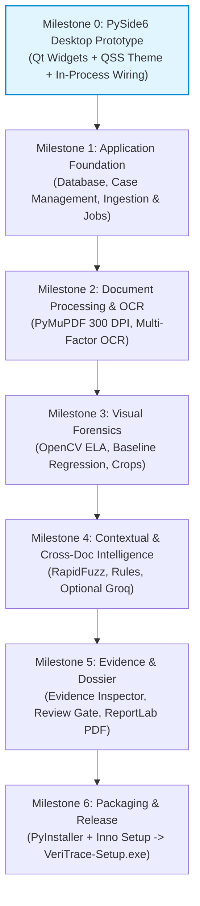

# 10_IMPLEMENTATION_ROADMAP.md
# VeriTrace Desktop Implementation Roadmap & Milestone Blueprint

---

## 1. Roadmap Strategy & Dependency Graph

Development is structured into seven sequential, dependency-aware milestones (Milestone 0 through Milestone 6). 
Crucially, **Milestone 0 serves as a Technical Feasibility Gate** for the native PySide6 desktop architecture: establishing the Qt application shell, High-DPI support, QSS theme engine, in-process service wiring, and local SQLite database before deep domain implementation begins.

---

## 2. Granular Milestone Execution Specifications

### Milestone 0: PySide6 Desktop Prototype (Technical Feasibility Gate)
* **Status:** Planned (Next Phase)
* **Objectives:**
  1. Initialize native PySide6 application lifecycle (`src/veritrace/main.py`, `src/veritrace/gui/app.py`).
  2. Implement QSS forensic dark stylesheet (`src/veritrace/gui/styles/dark_theme.qss`).
  3. Implement base workstation window (`src/veritrace/gui/views/main_window.py`) with 4-pane docking layout.
  4. Wire direct in-process Python application services (`src/veritrace/gui/controllers/` $\to$ `src/veritrace/application/services/`).
  5. Initialize local SQLite database at `%LOCALAPPDATA%/VeriTrace/database/veritrace.sqlite` via Alembic migrations.
* **Deliverables:** Working native desktop application window loading local database status and forensic theme cleanly.
* **Exit Criteria:** Launching `python scripts/development/run_desktop.py` (or `python -m veritrace`) starts the Qt event loop, connects to SQLite in WAL mode, renders the 4-pane workstation layout, and exits cleanly on close.

---

### Milestone 1: Application Foundation, Database & Case Ingestion
* **Status:** Planned
* **Objectives:**
  1. Implement SQLite schema (12 Core Entities + 1 Assoc Table) via SQLAlchemy 2.0 in `src/veritrace/infrastructure/persistence/`.
  2. Implement local document ingestion pipeline (`InvestigationService`, `DocumentService`).
  3. Save raw files to `%LOCALAPPDATA%/VeriTrace/investigations/{id}/originals/` and compute SHA-256 hashes.
  4. Implement `investigation_jobs` queue and background worker execution via `QThreadPool` / `QRunnable` (and standalone `job_runner.py`).
  5. Build Desktop Case Management UI (sidebar tree, creation dialog, drag-and-drop import dropzone).
* **Deliverables:** Working case creation and multi-document file intake with asynchronous job execution.
* **Exit Criteria:** Dropping a 3-document bundle registers the case, saves original files, and queues an investigation job with reactive status updates in the UI.

---

### Milestone 2: Document Processing, Multi-Factor OCR & Extraction Quality
* **Status:** Planned
* **Objectives:**
  1. Build PyMuPDF rasterization service rendering pages to 300 DPI PNGs (`processed/`).
  2. Implement Multi-Factor Text Quality Evaluator and Extraction Quality Scorer (`capabilities/quality/`).
  3. Integrate bundled Tesseract OCR fallback for scanned pages and image regions.
  4. Extract token bounding boxes with normalized coordinates `[ymin, xmin, ymax, xmax] \in [0.0, 1.0]`.
  5. Implement `QGraphicsView` document viewer displaying rendered pages with coordinate bounding boxes.
* **Deliverables:** High-resolution page rendering and structured token extraction with coordinate provenance.
* **Exit Criteria:** PDF sample pages render smoothly with zoom/pan; text tokens extract with $>90\%$ coordinate accuracy.

---

### Milestone 3: Visual Forensics Suite & Threshold Calibration
* **Status:** Planned
* **Objectives:**
  1. Implement Error Level Analysis (ELA) engine computing compression differential heatmaps.
  2. Implement font baseline regression engine detecting spliced or elevated numerals ($>2.5\sigma$ row residual).
  3. Implement duplicate signature/stamp clone detection using ORB feature matching.
  4. Implement high-resolution visual evidence crop extractor (20px context padding).
  5. Empirically calibrate target forensic thresholds on synthetic ground-truth fixtures.
* **Deliverables:** Deterministic visual anomaly detection with localized heatmaps and cropped patches.
* **Exit Criteria:** Altered figures on test salary slip flag with compression anomaly and generate side-by-side evidence crops in the inspector.

---

### Milestone 4: Contextual and Cross-Document Intelligence
* **Status:** Planned
* **Objectives:**
  1. Implement RapidFuzz entity reconciliation aligning names, DOBs, and identifiers across files.
  2. Implement arithmetic checksum validator (gross/net pay, invoice sums) and temporal rules.
  3. Build cross-document conflict matrix detecting contradictions between separate files.
  4. Integrate optional Groq LLM inference for grounded narrative explanations of pre-calculated findings.
* **Deliverables:** Cross-document discrepancy detection and evidence-grounded reasoning narratives.
* **Exit Criteria:** Conflicting names/dates between ID and bank statement are automatically flagged; offline fallback generates standard factual descriptions without network access.

---

### Milestone 5: Evidence Mapping, Reviewer Gate & PDF Dossier
* **Status:** Planned
* **Objectives:**
  1. Build desktop Evidence Inspector dock widget displaying visual crops, ELA diffs, and review actions.
  2. Implement Human-in-the-Loop review controls (`CONFIRM`, `DISMISS`, `ANNOTATE`) updating `ReviewDecision`.
  3. Finalize immutable append-only `AuditEvent` audit logging.
  4. Build ReportLab PDF compiler generating 6-section PS-2 Investigation Dossier with embedded crops.
* **Deliverables:** Complete interactive evidence review drawer and one-click PDF dossier export.
* **Exit Criteria:** Submitting a review decision updates case risk; clicking "Export Dossier" compiles an auditor-grade PDF report in $<3$ seconds.

---

### Milestone 6: Desktop Packaging and Release
* **Status:** Planned
* **Objectives:**
  1. Configure PyInstaller specification bundling Python runtime, PySide6, PyMuPDF, OpenCV, and Tesseract.
  2. Configure Inno Setup script compiling `VeriTrace-Setup.exe` with desktop shortcut and uninstaller.
  3. Validate clean installation on fresh Windows 10/11 x64 test machine without Python or development tools installed.
* **Deliverables:** Single-file downloadable Windows installer (`VeriTrace-Setup.exe`).
* **Exit Criteria:** End-to-end `DOWNLOAD → INSTALL → OPEN → CREATE INVESTIGATION → ANALYSE → EXPORT DOSSIER` workflow executes successfully on a pristine Windows system.
