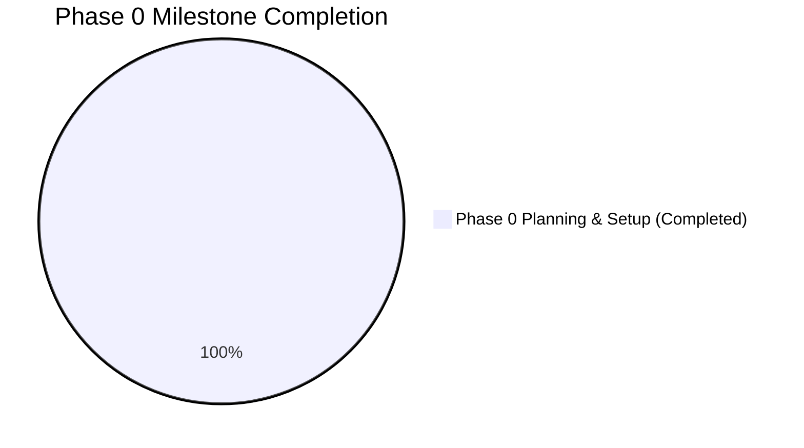

# 13_PROGRESS_TRACKER.md
# VeriTrace Project Milestone & Capability Progress Tracker

---

## 1. Executive Status Dashboard

* **Current Active Phase:** **Phase 0 (Initialization & Planning)**
* **Phase 0 Status:** **COMPLETED**
* **Implementation Status:** **READY FOR EXECUTION (Milestone 0 Pending Baseline Commit)**
* **Last Verified Timestamp:** 2026-11-05T00:30:00+05:30

---

## 2. Phase 0: Project Initialization & Architectural Decisions

| Task ID | Deliverable / Activity | Status | Verified Evidence / Notes |
| :---: | :--- | :---: | :--- |
| **P0-01** | Inspect `UdyogPermit AI` source repository | **COMPLETED** | Complete directory tree and file inventory audited. |
| **P0-02** | Migrate 53 reusable source files to `VeriTrace` | **COMPLETED** | Zero copy errors; 100% MD5 hash match; caches & secrets excluded. |
| **P0-03** | Verify original `UdyogPermit AI` repository isolation | **COMPLETED** | Git status confirmed pristine; zero files modified in source. |
| **P0-04** | Formulate Project Charter (`00_PROJECT_CHARTER.md`) | **COMPLETED** | VeriTrace identity, vision, principles, and success criteria documented. |
| **P0-05** | Analyze Problem Statement (`01_PROBLEM_STATEMENT_ANALYSIS.md`) | **COMPLETED** | Official PS-2 requirements, scoring criteria, and flow mapped. |
| **P0-06** | Audit Source Code (`02_SOURCE_CODE_AUDIT.md`) | **COMPLETED** | Verified implementations contrasted against claims; technical debt recorded. |
| **P0-07** | Document Component Decisions (`03_REUSE_AND_REPLACEMENT_DECISIONS.md`)| **COMPLETED** | KEEP / MODIFY / REPLACE / DEPRECATE / NEW matrix established. |
| **P0-08** | Define System Architecture (`04_SYSTEM_ARCHITECTURE.md`) | **COMPLETED** | 10-stage flow, Mermaid diagrams, and HITL gate designed. |
| **P0-09** | Define Backend Architecture (`05_BACKEND_ARCHITECTURE.md`) | **COMPLETED** | Modular layered structure, PyMuPDF, OpenCV, and services detailed. |
| **P0-10** | Define Frontend Architecture (`06_FRONTEND_ARCHITECTURE.md`) | **COMPLETED** | Document Viewer, Evidence Inspector, and ReactFlow DAG designed. |
| **P0-11** | Design Database & Models (`07_DATABASE_AND_DATA_MODELS.md`) | **COMPLETED** | SQLite + SQLAlchemy schema with 10 entities, PKs, FKs, and indexes. |
| **P0-12** | Specify API Contracts (`08_API_CONTRACTS.md`) | **COMPLETED** | RESTful OpenAPI contracts for all 13 forensic endpoints specified. |
| **P0-13** | Formulate AI & Forensics Strategy (`09_AI_AND_FORENSICS_STRATEGY.md`) | **COMPLETED** | Six core forensic principles, ELA, and coordinate conventions codified. |
| **P0-14** | Build Implementation Roadmap (`10_IMPLEMENTATION_ROADMAP.md`) | **COMPLETED** | Dependency-aware 8-phase execution plan scheduled. |
| **P0-15** | Document Technical Risks (`11_TECHNICAL_RISKS.md`) | **COMPLETED** | 11 critical technical failure modes and mitigations formulated. |
| **P0-16** | Initialize Decision Register (`12_DECISION_LOG.md`) | **COMPLETED** | ADR-001 through ADR-010 formally accepted and recorded. |
| **P0-17** | Establish Progress Tracker (`13_PROGRESS_TRACKER.md`) | **COMPLETED** | Active tracking document created. |
| **P0-18** | Update Root `README.md` with VeriTrace Identity | **COMPLETED** | Brand identity, tagline, architecture, and dev/ references updated. |
| **P0-19** | Architectural Reality Check & Validation (`14_ARCHITECTURE_VALIDATION.md`) | **COMPLETED** | Source code audited against claims; mocks vs reality distinguished. |
| **P0-20** | Final Modular Monolith System Design (`15_FINAL_SYSTEM_DESIGN.md`) | **COMPLETED** | 14 lifecycle capabilities specified with inputs/outputs/errors. |
| **P0-21** | Final Target Directory Structure (`16_FINAL_DIRECTORY_STRUCTURE.md`) | **COMPLETED** | Capability-driven tree and file-by-file migration mapping created. |
| **P0-22** | Module Responsibility Matrix (`17_MODULE_RESPONSIBILITY_MATRIX.md`) | **COMPLETED** | Public interfaces, contracts, and dependency flows codified. |
| **P0-23** | End-to-End Investigation Data Flow (`18_END_TO_END_DATA_FLOW.md`) | **COMPLETED** | 16-stage pipeline detailed with provenance and Mermaid charts. |
| **P0-24** | Domain Model Specification (`19_DOMAIN_MODEL_SPECIFICATION.md`) | **COMPLETED** | Entity rationalization, ER diagram, and relational schema finalized. |
| **P0-25** | Agent Minimization & Dependency Strategy (`20_AGENT_AND_PROCESSING_STRATEGY.md`) | **COMPLETED** | Pure determinism prioritized; all 14 dependencies evaluated. |
| **P0-26** | Frontend Feature Specification (`21_FRONTEND_FEATURE_SPECIFICATION.md`) | **COMPLETED** | UI features, viewer, graph, drawer, and state machine specified. |
| **P0-27** | API Contracts & Internal Protocols (`22_API_AND_INTERNAL_CONTRACTS.md`) | **COMPLETED** | RESTful schemas, async job model, and Python protocols defined. |
| **P0-28** | Detailed Development Plan (`23_DETAILED_DEVELOPMENT_PLAN.md`) | **COMPLETED** | 3 parallel workstreams and 7 granular milestone blueprints defined. |
| **P0-29** | Testing & Demonstration Strategy (`24_TESTING_AND_DEMO_STRATEGY.md`) | **COMPLETED** | Automated test pyramid, synthetic fixtures, and 5-min demo script. |
| **P0-30** | Corrections & Implementation Readiness Review (`25_...READINESS.md`) | **COMPLETED** | Persistent job queue, model reconciliation, storage safety, and dataset ground truth verified. |
| **P0-31** | Finalize Desktop Architecture & Repository Restructure (Task 02.3) | **COMPLETED** | Standalone desktop product decision (Tauri 2 + Python Supervisor), ADR-019 through ADR-024, repository restructured. |
| **P0-32** | PySide6 Architecture Migration & Repository Alignment (Task 02.4) | **COMPLETED** | Native PySide6 architecture, direct Python services, elimination of FastAPI & supervisor, ADR-025 through ADR-029, repository aligned. |
| **P0-33** | Repository Architecture Finalization & Structural Consolidation (Task 02.5) | **COMPLETED** | Unified Python src-layout (`src/veritrace/`), layered monolith, root pyproject.toml/requirements.txt/alembic.ini, extraction quality capability, ADR-030. |
| **P0-34** | Architecture Verification & Pre-Development Readiness Audit (Task 02.6) | **COMPLETED** | Comprehensive audit of src-layout, dependency tier separation, enhanced architectural boundary enforcement, extraction reliability audit, and pre-dev freeze candidates. |
| **P0-35** | Final Architecture Corrections & Architecture Freeze Readiness (Task 02.7) | **COMPLETED** | Resolved OCR benchmarking protocol & TextExtractorProtocol (ADR-023), 12 background execution & recovery rules (ADR-028), configurable GenAI provider & offline fallback (ADR-032), and host Python environment resolution. |
| **P0-36** | Team Collaboration, Governance & GitHub Baseline Preparation (Task 02.8) | **COMPLETED** | Established 6 workstreams, 13 shared contracts, Git/PR workflow, code quality standards, task allocation lifecycle, GitHub templates, repository baseline audit, and authoring of `26_TEAM_DEVELOPMENT_AND_GITHUB_WORKFLOW.md`. |
| **P0-37** | Repository Cleanup & Permanent Reporting Policy | **COMPLETED** | Removed redundant `TASK_XX_...md` reports from repository root, established three-tier documentation hierarchy in `CONTRIBUTING.md` and `dev/26`, and instituted chat-only reporting policy. |
| **P0-38** | Final Structural Simplification & Baseline Approval (Task 02.10) | **COMPLETED** | Consolidated duplicate capabilities (intake->ingestion, dossier->reporting, findings/evidence/validation), anchored `requirements.txt` to `pyproject.toml` (`-e .[all]`), pruned 37 redundant `.gitkeep` placeholders, and validated all 6 architectural layers. |
| **P0-39** | Final Capability Ownership Verification (Task 02.11) | **COMPLETED** | Verified architectural ownership of Validation (Domain Rules + Capabilities), Findings (Domain Entity + App Workflow decoupled from AI narratives), and Evidence (independently addressable Domain Entity + Forensics cropper); created `.github/workflows/ci.yml`, `.github/CODEOWNERS`, and aligned all test directories (`tests/benchmarks/`, `tests/packaging/`); authored ADR-034. |

---

## 3. Implementation Milestones Progress (Milestones 0 – 6)

> **STRICT COMPLIANCE NOTE:** In accordance with task constraints, zero implementation code has been introduced during Phase 0 / Tasks 01–02.8. All downstream milestones are currently marked as **PENDING / PLANNED**. No implementation milestone has been prematurely marked complete.

### Milestone 0: PySide6 Desktop Prototype (Technical Feasibility Gate)
* [ ] Initialize PySide6 native desktop application shell (`src/veritrace/main.py`, `src/veritrace/gui/app.py`).
* [ ] Implement QSS forensic dark theme stylesheet (`src/veritrace/gui/styles/dark_theme.qss`).
* [ ] Implement 4-pane workstation layout in Qt Widgets (`src/veritrace/gui/views/main_window.py`).
* [ ] Wire direct in-process Python application services (`src/veritrace/gui/controllers/` -> `src/veritrace/application/services/`).
* [ ] Initialize local SQLite database at `%LOCALAPPDATA%/VeriTrace/database/veritrace.sqlite`.

### Milestone 1: Application Foundation, Database & Case Ingestion
* [ ] Initialize SQLite WAL schema (12 Core Entities + 1 Assoc Table) via SQLAlchemy 2.0.
* [ ] Implement local document ingestion pipeline (`InvestigationService`, `DocumentService`).
* [ ] Implement SQLite `investigation_jobs` queue and background worker execution via QThreadPool with stage checkpoints.
* [ ] Build desktop drag-and-drop file import UI with SHA-256 calculation.

### Milestone 2: Document Processing and Multi-Factor OCR
* [ ] Implement PyMuPDF 300 DPI page rasterization.
* [ ] Implement `TextExtractorProtocol` abstraction in `src/veritrace/capabilities/extraction/`.
* [ ] Execute multi-dimensional OCR benchmark suite (CER, WER, Exact Field Match, IoU $\ge 0.70$) across CAT-01 to CAT-07.
* [ ] Integrate bundled Tesseract OCR fallback for scanned pages and image regions.
* [ ] Extract token bounding boxes with normalized coordinates `[ymin, xmin, ymax, xmax] \in [0.0, 1.0]`.
* [ ] Implement QGraphicsView document viewer with coordinate overlays.

### Milestone 3: Visual Forensics Suite & Threshold Calibration
* [ ] Implement Error Level Analysis (ELA) engine computing compression differential heatmaps.
* [ ] Implement font baseline regression engine detecting spliced or elevated numerals ($>2.5\sigma$).
* [ ] Implement duplicate signature/stamp clone detection using ORB feature matching.
* [ ] Extract visual evidence crops (20px context padding) and calibrate forensic thresholds.

### Milestone 4: Contextual and Cross-Document Intelligence
* [ ] Implement RapidFuzz entity reconciliation aligning names, DOBs, and identifiers across files.
* [ ] Implement arithmetic checksum validator (gross/net pay, invoice sums) and temporal rules.
* [ ] Build cross-document conflict matrix detecting contradictions between separate files.
* [ ] Implement `LLMProviderProtocol` abstraction with configurable provider/model (`VERITRACE_AI_MODEL`).
* [ ] Implement deterministic template narrative fallback for air-gapped / offline operation.

### Milestone 5: Evidence Mapping, Reviewer Gate & PDF Dossier
* [ ] Build desktop Evidence Inspector dock widget displaying visual crops, ELA diffs, and review actions.
* [ ] Implement Human-in-the-Loop review controls (`CONFIRM`, `DISMISS`, `ANNOTATE`) updating `ReviewDecision`.
* [ ] Finalize immutable append-only `AuditEvent` audit logging.
* [ ] Build ReportLab PDF compiler generating 6-section PS-2 Investigation Dossier with embedded crops.

### Milestone 6: Desktop Packaging, Distribution & Final Demonstration
* [ ] Configure PyInstaller one-folder specification bundling Python runtime, PySide6, OpenCV, and Tesseract.
* [ ] Configure Inno Setup script compiling `VeriTrace-Setup.exe`.
* [ ] Validate clean installation on fresh Windows 10/11 x64 test environment.
* [ ] Rehearse 10-item Judges' Live Demonstration Checklist in under 5 minutes.

---

## 4. PS-2 Mandatory Prototype Compliance Matrix

| Mandatory Capability (PS-2 Section 6) | Planned Implementing Component | Readiness Status |
| :--- | :--- | :---: |
| **1. Document Ingestion & OCR Extraction** | `ingestion/`, `extraction/` (`TextExtractorProtocol`) | Architecture Ready (Milestone 1–2) |
| **2. Structured Extraction from Multi-Docs**| `extraction/`, `quality/` (`ExtractedField` schema) | Architecture Ready (Milestone 2) |
| **3. Suspicious Regions & Visual Inconsistencies**| `forensics/` (ELA, Font Alignment, Clone Detection) | Architecture Ready (Milestone 3) |
| **4. Inconsistencies Within & Across Documents** | `correlation/`, `reasoning/` (Cross-Doc Rules) | Architecture Ready (Milestone 4) |
| **5. Evidence Mapping with Source References** | `gui/widgets/evidence_dock.py`, `evidence_viewer.py` | Architecture Ready (Milestone 5) |
| **6. Structured Investigation Dossier** | `reporting/` (ReportLab PDF & JSON Dossier) | Architecture Ready (Milestone 5) |
| **7. Review Interface for Findings** | `gui/views/main_window.py` (PySide6 4-Pane Workstation) | Architecture Ready (Milestone 0 & 5) |
