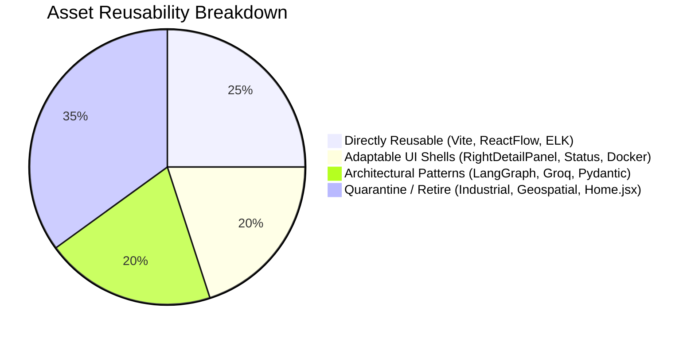

# 14_ARCHITECTURE_VALIDATION.md
# Reality Check: Codebase Audit & Architectural Validation

---

## 1. Executive Summary & Purpose

The initial migration (Task 01) successfully transferred 53 source files from `UdyogPermit AI` into the `VeriTrace` repository and established an initial set of 14 technical planning documents. However, an architectural blueprint cannot be built on planning assumptions alone; it must be anchored in the **empirical reality of the actual source code**.

This document establishes the code-level baseline by distinguishing between:
1. **Verified Functional Code:** What actually compiles, executes, and behaves as expected.
2. **Partially Implemented Logic:** Modules with working scaffolding but incomplete domain logic.
3. **Mocks and Placeholders:** Stubs or prompt-only endpoints that simulate functionality without real underlying engines.
4. **Purely Documented Designs:** Concepts defined in `dev/` (such as SQLite persistence, OpenCV forensic algorithms, or normalized coordinate bounding boxes) that have **zero lines of implementation in the current codebase**.
5. **Technical Debt & Architectural Hazards:** Hard dependencies, fragile top-level imports, and monolithic file structures that must be remediated before feature development can proceed.

---

## 2. Granular Code-Level Reality Check

### 2.1 Backend Subsystem Verification

| Component | Actual Source File | Current Code State | Code Reality vs. Task 01 Documentation |
| :--- | :--- | :--- | :--- |
| **FastAPI Core & Routing** | [`legacy/backend/main.py`](..\legacy\backend\main.py) | **Monolithic Single File (485 lines)** | The application was migrated as a single file containing route definitions, LangGraph initialization, CORS configuration, Pydantic models, in-memory state holders, and static mounting. It does **not** have the modular router hierarchy (`api/routers/`) described in `05_BACKEND_ARCHITECTURE.md`. |
| **Environment Initialization** | [`legacy/backend/main.py#L42-L44`](..\legacy\backend\main.py#L42-L44) | **Fragile Top-Level Guard** | `api_key = os.environ.get("GROQ_API_KEY"); if not api_key: raise ValueError(...)`. The application crashes on import if `GROQ_API_KEY` is not present in the environment, preventing offline unit testing and test runner discovery. |
| **Document Validation Route** | [`legacy/backend/main.py#L340-L354`](..\legacy\backend\main.py#L340-L354) | **Unanchored Text-Only Prompt Mock** | The `/api/v1/document/validate` endpoint accepts only a plain text string (`document_text: str`), passes it to a single Groq prompt with system message *"You are a Document Pre-Validation AI..."*, and returns raw string markdown. It has **no file upload handling, no OCR, no image parsing, no bounding boxes, and zero evidence grounding**. |
| **Workflow State Persistence** | [`legacy/backend/main.py#L188`](..\legacy\backend\main.py#L188) | **Volatile In-Memory `MemorySaver`** | Uses LangGraph's in-memory `MemorySaver()`. No SQLite database, SQLAlchemy models, or file persistence exist in the codebase. All state, threads, and history are wiped if the server restarts. |
| **Geospatial & Bhuvan** | [`legacy/backend/geospatial/`](..\legacy\backend\geospatial/), [`legacy/backend/bhuvan_checker.py`](..\legacy\backend\bhuvan_checker.py) | **Active in `main.py` (Not Quarantined)** | Task 01 documentation classified these as "quarantined." In reality, `main.py` explicitly imports `bhuvan_checker` and `geospatial.service`, initializes `geospatial_data_holder`, and exposes active endpoints `/api/v1/geospatial/check` and `/api/v1/geospatial/office`. They are still fully compiled and active in the application runtime. |
| **Agents 1 – 4** | [`legacy/backend/agents/`](..\legacy\backend\agents/) | **Hardcoded Industrial Domain Logic** | Agents 1–3 and `resolver.py` (33KB) are completely hardcoded for industrial pollution categorization (Red/Orange/Green), capital investment, and Maharashtra government offices. None of the forensic agents (Ingestion, Forensics, Dossier) exist in code. |
| **Agent 4 (Visualizer)** | [`legacy/backend/agents/agent4.py`](..\legacy\backend\agents\agent4.py) | **Working ReactFlow DAG Formatter** | Generates node dictionaries with `{id, type, data, position}` and edges with `{id, source, target, type}`. The graph structuring logic genuinely works and can be adapted to evidence relationships. |
| **Tests & Verification** | [`legacy/backend/test_agent2_wrapper.py`](..\legacy\backend\test_agent2_wrapper.py) | **Single Manual Script (Not a Unit Test)** | Only one test file exists. It is an unasserted manual script that directly imports `main.py` and calls Groq for Maharashtra regulatory clearance. No `pytest` suite, fixtures, or automated regression tests exist. |

---

### 2.2 Frontend Subsystem Verification

| Component | Actual Source File | Current Code State | Code Reality vs. Task 01 Documentation |
| :--- | :--- | :--- | :--- |
| **React Framework & Build** | [`package.json`](..\legacy\frontend\package.json), [`vite.config.js`](..\legacy\frontend\vite.config.js) | **Functional Vite 5 + React 18** | React 18.3.1, Vite 5.4.1, Tailwind CSS 4.0.0, `@xyflow/react` v12.11.6, and `elkjs` v0.12.0 are present and properly configured in `package.json`. |
| **Graph Visualization Canvas** | [`src/WorkflowCanvas.jsx`](..\legacy\frontend\src\WorkflowCanvas.jsx) | **Production-Quality ReactFlow Implementation** | Genuinely implements ReactFlow v12 with custom nodes, zoom/pan controls, background grids, filtering, and responsive container layout. Highly reusable. |
| **ELK Auto-Layout Engine** | [`src/elkLayout.js`](..\legacy\frontend\src\elkLayout.js) | **High-Quality Graph Layout Algorithm** | Implements transitive edge reduction, cycle breaking, and layered orthogonal routing using `elkjs`. Works reliably and cleanly. |
| **Right Detail Panel** | [`src/RightDetailPanel.jsx`](..\legacy\frontend\src\RightDetailPanel.jsx) | **Working Slide-Out Drawer** | Excellent UI shell with animations and tabs, but internally hardcoded to display industrial clearances, government authority portals, and browser geolocation permissions. |
| **Thinking Status Indicator** | [`src/AgentThinkingStatus.jsx`](..\legacy\frontend\src\AgentThinkingStatus.jsx) | **Working CSS Animated Status** | Fully functional animated wave indicator cycling through status strings, but hardcoded to industrial phases (`'Parsing facility profile...'`, `'Cross-referencing MPCB...'`). |
| **Home Input View** | [`src/Home.jsx`](..\legacy\frontend\src\Home.jsx) | **Massive 77KB Monolith** | A single 77KB component containing an entire marketing landing page, sample industrial prompt buttons, and multi-step factory parameter inputs. Completely unsuitable for document forensic investigation. |
| **Document Viewer** | *(None)* | **Completely Missing** | No PDF or image viewer component exists. There is no code for rendering PDF pages, zooming on high-resolution scans, or overlaying bounding boxes. |
| **Multi-Document Uploader** | *(None)* | **Completely Missing** | No drag-and-drop file upload component exists. Current input is exclusively a raw text `<textarea>` in `Home.jsx`. |

---

## 3. Discrepancy Analysis: Planning Documents vs. Actual Code

During Task 01, several design intentions were documented in the `dev/` directory as if they were already established. A rigorous engineering audit requires recording the exact truth:

1. **"Quarantined" Modules are Still Live:**
   * *Claim:* `03_REUSE_AND_REPLACEMENT_DECISIONS.md` states geospatial and industrial modules are quarantined.
   * *Reality:* In `backend/main.py`, lines 30-31, 376-412, and 414-460 still import and expose these endpoints. They are active in the executable code.
2. **Persistence is Purely Theoretical:**
   * *Claim:* `07_DATABASE_AND_DATA_MODELS.md` defines an extensive SQLite schema with 10 tables.
   * *Reality:* No database file, no SQLAlchemy models, and no migration scripts exist anywhere in the code. The backend still runs purely in-memory on `langgraph.checkpoint.memory.MemorySaver`.
3. **No Computer Vision or PDF Processing Libraries are Installed:**
   * *Claim:* `05_BACKEND_ARCHITECTURE.md` and `09_AI_AND_FORENSICS_STRATEGY.md` describe PyMuPDF, OpenCV, Pillow, RapidFuzz, and Tesseract pipelines.
   * *Reality:* None of these libraries are in `backend/requirements.txt`. The current `requirements.txt` contains only: `fastapi`, `uvicorn`, `langgraph`, `langchain-groq`, `pydantic`, `python-dotenv`, `httpx`, `requests`, `shapely`, `pyproj`, `beautifulsoup4`.
4. **Performance Claims Lack Benchmarks:**
   * *Claim:* Groq inference speed of "300+ tokens/sec" and sub-second processing.
   * *Reality:* While Groq hardware is capable of high throughput, no benchmark scripts or latency tests have been run on this repository. Network overhead, prompt payload sizes, and cold-start latencies remain unmeasured.
5. **Frontend Folder Naming:**
   * *Claim:* The repository represents `VeriTrace`.
   * *Reality:* The frontend folder is still named `frontend/udyog-permit-frontend`, and its `package.json` still carries the name `"udyog-permit-frontend"`.

---

## 4. Reusability Classification

Based on actual inspection, the existing assets are categorized as follows:

### 4.1 Directly Reusable Without Architectural Modification
* **Vite 5 + React 18 Build Pipeline:** Modern, extremely fast developer server and production bundler.
* **`WorkflowCanvas.jsx`:** Robust ReactFlow v12 implementation with pan, zoom, custom node hooks, and mini-map.
* **`elkLayout.js`:** Production-grade graph layout calculation with transitive edge reduction and orthogonal edge routing.
* **`ApprovalNode.jsx`:** Custom node structure with top/bottom handles, badge displays, and selection styling.

### 4.2 Reusable Architectural Patterns (Requiring Total Domain Adaptation)
* **LangGraph `StateGraph` with Checkpointing:** The pattern of state-driven workflow with `interrupt_before` is structurally sound, but the state definition and node adapters must be rewritten for document forensics.
* **`ChatGroq` Structured Output:** The pattern of calling `ChatGroq` with `response_format={"type": "json_object"}` is reliable, but prompts and target schemas must be replaced.
* **`RightDetailPanel.jsx` Shell:** The sliding drawer animation, tab navigation, and responsive dismissal logic are excellent, but all internal content widgets must be replaced with the Evidence Inspector.
* **`AgentThinkingStatus.jsx`:** The animated CSS wave banner is ideal for displaying pipeline execution progress, but the string constants must reflect forensic stages.

### 4.3 Quarantined / Retired (Must Not Enter Active Architecture)
* **`backend/agents/resolver.py` (33KB):** Massive hardcoded registry of Maharashtra government bodies. Irrelevant to document forensics.
* **`backend/agents/category_classifier.py`:** Keyword classifier for industrial factory pollution categories.
* **`backend/geospatial/` & `backend/bhuvan_checker.py`:** Complex GIS modules for spatial buffers and ISRO satellite queries.
* **`frontend/src/Home.jsx` (77KB):** Industrial clearance intake form.
* **`frontend/src/GeospatialDashboard.jsx` & `GeospatialScanConsole.jsx`:** GIS map consoles.
* **`/api/v1/document/validate` endpoint in `main.py`:** Unanchored, text-only LLM prompt mock.

---

## 5. Architectural Corrective Actions for Task 02

To transition from the current state to a robust VeriTrace system:
1. **Design a Capability-Centric Modular Monolith:** Restructure the monolithic `main.py` into distinct domain capabilities.
2. **Decouple the API Key Initialization:** Move `GROQ_API_KEY` verification out of module-level import scope into runtime application configuration (`app.config`), allowing testing and compilation without active API keys.
3. **Formalize Domain Models Before Coding:** Specify real SQLAlchemy database entities and Pydantic validation schemas to replace volatile memory state.
4. **Define Explicit Capability Boundaries:** Organize backend and frontend around the document investigation lifecycle rather than arbitrary "agent" scripts or generic folders.
5. **Establish Evidence Anchoring as a Mandatory Contract:** Ensure no finding can be created or displayed without an immutable evidence reference linking to document page coordinates.

---

## 6. Historical Resolution in Task 02.3: Desktop Architecture Initial Restructure

Task 02.3 initially transitioned the project from web to desktop:
1. **Physical Isolation of Legacy Assets:** `bhuvan_checker.py`, `test_agent2_wrapper.py`, `agents/`, `geospatial/`, and original `main.py` moved to `legacy/backend/`. Industrial frontend components moved to `legacy/frontend/`.
2. **Local Workstation Storage:** Active runtime data partitioned outside the repository in `%LOCALAPPDATA%/VeriTrace/`.

---

## 7. Authoritative Resolution in Task 02.4: Native PySide6 Desktop Architecture & FastAPI Elimination

Task 02.4 established the authoritative native desktop architecture, eliminating unnecessary multi-language boundaries:
1. **Native PySide6 Desktop Monolith:** Replaced the Tauri 2 + React 18 + TypeScript + Vite + Rust architecture with **PySide6 (Qt 6.7+ for Python)**. Eliminates Node.js, npm, Rust, and Cargo completely from the active application.
2. **Direct In-Process Python Application Services:** Eliminated FastAPI and Uvicorn from the active architecture. PySide6 UI controllers call Python Application Services (`backend/app/services/`) directly in-process, removing loopback HTTP serialization overhead, ephemeral port binding hazards, and local token validation.
3. **Dual-Layer Asynchronous Background Execution:** Heavy CPU tasks (PyMuPDF 300 DPI rendering, Tesseract OCR, OpenCV ELA) are executed via Qt's `QThreadPool` / `QRunnable` in-process, communicating real-time progress via Qt Signals & Slots. A decoupled standalone worker (`investigation_worker.py`) is preserved for out-of-process batch isolation.
4. **Quarantine of Tauri Scaffolding:** Archived obsolete Tauri/React scaffolding in `legacy/desktop_tauri/` to preserve a complete audit trail without polluting active source code.
5. **Windows Packaging Pipeline:** Configured PyInstaller one-folder bundling and Inno Setup Windows installer (`VeriTrace-Setup.exe`).
