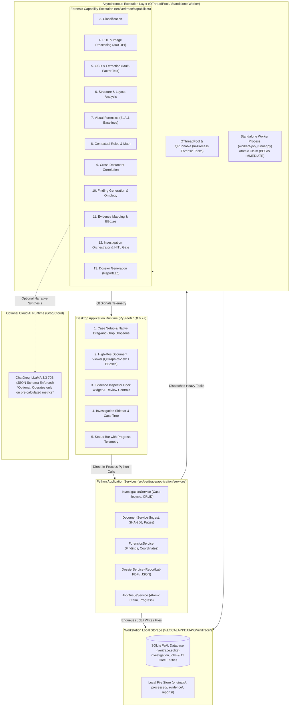

# 15_FINAL_SYSTEM_DESIGN.md
# VeriTrace Final Modular Monolith System Design

---

## 1. Architectural Strategy: The Capability-Centric Modular Monolith

### 1.1 Why a Native Python Desktop Modular Monolith?
VeriTrace is intentionally designed as a **Native Python Desktop Modular Monolith** rather than a distributed set of microservices or a multi-tier web application.

**Evidence-Backed Architectural Justification:**
1. **Direct In-Process Performance:** The PySide6 presentation layer communicates directly with Python Application Services. Eliminates HTTP loopback network serialization, JSON parsing overhead, ephemeral port binding hazards, and security token management.
2. **Zero Network Serialization for Heavy Image & Document Data:** Passing 300 DPI page bitmaps ($2480 \times 3508$ pixels, $\sim 25\text{MB}$ uncompressed RAM) across HTTP boundaries introduces massive bottlenecks. In a native monolith, image processing (OpenCV), PDF rendering (PyMuPDF), and OCR engines (Tesseract) share in-process memory or local disk caching with zero transport overhead.
3. **Transactional Integrity & Atomic Audit Logging:** An investigation must maintain an unshakeable chain of custody (ISO/IEC 27037). A single ACID-compliant database (SQLite with WAL mode) guarantees that documents, extracted fields, visual anomalies, and audit events commit atomically.
4. **Clean Internal Boundaries:** The system enforces strict capability separation through internal Python package boundaries and typed interfaces, allowing individual modules to be tested in complete isolation.

---

## 2. High-Level Modular Monolith Architecture

---

## 3. The 14 Logical Capabilities: Complete Specifications

The architecture is divided into fourteen distinct product capabilities organized around the document investigation lifecycle:

---

### Capability 1: Investigation and Document Intake
* **Purpose:** Provides the entry gate for creating forensic cases and ingesting document bundles.
* **Responsibilities:** Validate file formats, enforce file size limits, prevent path traversal attacks, and generate cryptographic SHA-256 digests.
* **Inputs:** Multipart form data (files: `.pdf`, `.png`, `.jpg`, `.jpeg`), case title, reference identifier.
* **Outputs:** Registered `Investigation` entity, initialized `Document` entities, SHA-256 hashes.
* **Processing:** **100% Deterministic** (Python `hashlib`, file-type sniffing via magic bytes).
* **Dependencies:** Standard library (`hashlib`, `pathlib`).
* **Error Handling:** Returns `415 Unsupported Media Type` if magic bytes do not match expected PDF/image headers; returns `413 Payload Too Large` if file $>20\text{MB}$.
* **Persistence:** Creates records in `investigations` and `documents` tables; writes raw file to `storage/investigations/{id}/raw/`.
* **Evidence Traceability:** Computes and records immutable SHA-256 hash immediately upon file intake to establish chain of custody (ISO/IEC 27037).

---

### Capability 2: Document Storage and Lifecycle Management
* **Purpose:** Manages the storage paths, versions, and file lifecycle of original uploads, rasterized pages, and forensic derivative artifacts.
* **Responsibilities:** Partition storage by `investigation_id`, ensure atomic writes, maintain relative file path pointers in the database, and handle resource cleanup.
* **Inputs:** File binaries, investigation UUID, file classification.
* **Outputs:** Standardized filesystem URIs (e.g., `storage/investigations/{inv_id}/pages/{doc_id}_p1.png`).
* **Processing:** **100% Deterministic**.
* **Dependencies:** Python `pathlib`, `shutil`.
* **Error Handling:** Filesystem permission errors logged as critical system events; temp files cleaned up in `finally` blocks.
* **Persistence:** Paths persisted in `documents`, `document_pages`, and `evidence_references`.

---

### Capability 3: Document Classification
* **Purpose:** Categorizes submitted documents into standardized operational schemas to determine required fields and applicable validation rules.
* **Responsibilities:** Identify document type:
  * `IDENTITY_PROOF` (Passport, Aadhaar, PAN Card, Driver's License)
  * `INCOME_PROOF` (Salary Slip, Paystub, Form 16)
  * `FINANCIAL_STATEMENT` (Bank Statement, Account Passbook)
  * `COMMERCIAL_RECORD` (Invoice, Purchase Order, Tax Return)
  * `GENERAL_AFFIDAVIT` (Declaration, Agreement, Certificate)
* **Inputs:** Extracted text tokens, PDF metadata, visual layout cues.
* **Outputs:** `classified_type: str`, `classification_confidence: float [0.0 - 1.0]`.
* **Processing:** **Hybrid** (Primary: Deterministic keyword & regex matching against document headers; Fallback: Lightweight Groq zero-shot classification if keywords are ambiguous).
* **Dependencies:** `re`, Groq API (fallback).
* **Error Handling:** Defaults to `GENERAL_AFFIDAVIT` with `confidence=0.50` if unclassified; flags for human review.
* **Persistence:** Stored in `documents.document_type` and `documents.classification_confidence`.

---

### Capability 4: PDF and Image Processing
* **Purpose:** Renders document pages into high-resolution images suitable for computer vision and browser display.
* **Responsibilities:** Inspect PDF page trees, detect vector text vs. scanned images, render each page to lossless PNG at 300 DPI ($zoom \approx 4.166$), and extract native PDF metadata.
* **Inputs:** Raw PDF binary or raster image files.
* **Outputs:** Rendered 300 DPI page PNGs, pixel dimensions `[width, height]`, page count.
* **Processing:** **100% Deterministic** (`PyMuPDF` / `fitz`).
* **Dependencies:** `PyMuPDF`.
* **Error Handling:** Catches encrypted or password-protected PDFs; marks page as `UNREADABLE_ENCRYPTED` without terminating pipeline.
* **Persistence:** Creates `document_pages` database records; writes page images to `pages/` directory.

---

### Capability 5: OCR and Structured Information Extraction
* **Purpose:** Extracts text characters, words, and lines while capturing spatial coordinates and confidence metrics.
* **Responsibilities:**
  1. For native digital PDFs: Extract character/word spans directly from the vector text stream via PyMuPDF.
  2. For scanned/raster pages: Preprocess image (CLAHE, deskewing) and run Tesseract OCR.
  3. Capture token text, normalized bounding box `[ymin, xmin, ymax, xmax]`, and token confidence.
* **Inputs:** Rendered page image and PDF page handle.
* **Outputs:** List of `ExtractedField` objects with text values, bounding boxes, and confidence scores.
* **Processing:** **100% Deterministic**.
* **Dependencies:** `PyMuPDF`, `pytesseract`, `OpenCV` (preprocessing).
* **Error Handling:** Low-confidence tokens ($<0.60$) are tagged with `LOW_CONFIDENCE_WARNING` rather than discarded.
* **Persistence:** Stored in `extracted_fields` table.
* **Traceability:** Every extracted token permanently records `document_id`, `page_number`, and normalized bounding box.

---

### Capability 6: Document Structure and Layout Understanding
* **Purpose:** Transforms unorganized text tokens into hierarchical business structures (key-value pairs, tables, and headers).
* **Responsibilities:** Group tokens based on spatial proximity (horizontal alignment for lines, vertical alignment for table columns), associate field labels with field values (e.g., `"Gross Salary:"` $\to$ `"₹85,000"`), and extract tabular grids.
* **Inputs:** Spatial text tokens with bounding boxes from Capability 5.
* **Outputs:** Structured JSON payload representing sections, key-value maps, and rows/columns of tables.
* **Processing:** **100% Deterministic** (Geometric spatial clustering and bounding box adjacency algorithms).
* **Dependencies:** Python standard library (`math`, `collections`).
* **Error Handling:** If table boundaries cannot be deterministically resolved, falls back to linear text representation and logs a layout warning.
* **Persistence:** Stored as structured JSON in `documents.structured_content`.

---

### Capability 7: Visual and PDF Forensic Analysis
* **Purpose:** Inspects physical and digital image properties to detect visual manipulation, spliced patches, font inconsistencies, and cloned signatures.
* **Responsibilities:**
  1. **Error Level Analysis (ELA):** Resave image at 90% JPEG quality, compute pixel difference against original, calculate local variance, and detect spliced regions exceeding background compression noise by $>3.0\sigma$.
  2. **Font & Baseline Deviation:** Group character bounding boxes along horizontal lines, fit linear baseline regressions, and flag characters offset by $>2.5\sigma$ from the row baseline.
  3. **Clone & Signature Detection:** Detect duplicate feature clusters (ORB descriptors) across signatures, stamps, and logos.
  4. **PDF Stream Inspection:** Scan PDF stream objects for multiple embedded author software tags or conflicting `ModDate` vs `CreationDate` timestamps.
* **Inputs:** 300 DPI rendered page PNGs, PDF vector descriptors.
* **Outputs:** Raw anomaly signals, metric scores, localized heatmap images, and pixel bounding boxes.
* **Processing:** **100% Deterministic** (OpenCV, Pillow, NumPy).
* **Dependencies:** `opencv-python`, `Pillow`, `numpy`.
* **Error Handling:** Gracefully handles non-standard color spaces (CMYK, Grayscale) by converting to RGB before CV operations.
* **Persistence:** Writes heatmap images to `storage/.../forensics/`; creates pending anomaly records.
* **Traceability:** Heatmaps and crops retain direct pixel coordinates linked to source page numbers.

---

### Capability 8: Entity and Contextual Verification
* **Purpose:** Executes deterministic internal logic checks within individual documents.
* **Responsibilities:**
  1. **Arithmetic Checksums:** Verify mathematical formulas:
     $$\text{Gross Pay} = \text{Basic} + \text{Allowances}$$
     $$\text{Net Pay} = \text{Gross Pay} - \text{Deductions}$$
     $$\text{Invoice Total} = \sum(\text{Line Items}) + \text{Tax}$$
  2. **Temporal Validity:** Verify that `Issue Date <= Current Date`, `Expiry Date > Issue Date`, and transaction dates fall within the statement cycle.
  3. **Identifier Syntax:** Verify regular expressions for standard credentials (e.g., PAN: `[A-Z]{5}[0-9]{4}[A-Z]`, Aadhaar: 12-digit format).
* **Inputs:** Structured fields and values from Capability 6.
* **Outputs:** Validation results, detected arithmetic or logical discrepancies.
* **Processing:** **100% Deterministic** (Python math and regex rules).
* **Dependencies:** Python standard library (`re`, `datetime`, `math`).
* **Error Handling:** Unparseable date strings are flagged as format anomalies rather than failing the process.
* **Persistence:** Discrepancies written to `findings` table as `DETECTED_INCONSISTENCY`.

---

### Capability 9: Cross-Document Correlation
* **Purpose:** Evaluates facts, entities, and numbers across all related documents in an investigation case to detect contradictions.
* **Responsibilities:**
  1. **Entity Extraction & Alignment:** Extract applicant names, dates of birth, identification numbers, and declared earnings across all files.
  2. **Fuzzy String Matching:** Use `RapidFuzz` normalized token sort ratios to align name variations (e.g., `"Rajesh K. Sharma"` on ID vs `"Rajesh Kumar Sharma"` on paystub).
  3. **Cross-Document Discrepancy Detection:** Flag conflicting dates of birth, mismatched employer names, or salary figures that contradict bank deposits.
* **Inputs:** Extracted entities from all documents in the investigation.
* **Outputs:** Entity alignment graph, cross-document conflict records.
* **Processing:** **100% Deterministic** (RapidFuzz Levenshtein metrics and relational rule matrix).
* **Dependencies:** `RapidFuzz`.
* **Error Handling:** When two entities cannot be aligned with confidence, they are marked as separate entities rather than forced into a false match.
* **Persistence:** Stored in `entities` and `cross_document_relations` tables.

---

### Capability 10: Anomaly Detection and Finding Generation
* **Purpose:** Synthesizes raw visual signals, contextual rule failures, and cross-document conflicts into formal, categorized investigation findings.
* **Responsibilities:**
  1. Apply the **Three-Tier Epistemic Classification**:
     * **`CONFIRMED_OBSERVATION`:** Factual, mathematically verified measurement (e.g., date of birth on ID is 1988; on paystub is 1992).
     * **`DETECTED_INCONSISTENCY`:** Logical or mathematical rule violation (e.g., net pay does not equal gross minus deductions).
     * **`SUSPECTED_MANIPULATION`:** Visual or structural tampering indicator (e.g., ELA compression variance with elevated font baseline).
  2. Assign severity: `LOW`, `MEDIUM`, `HIGH`, `CRITICAL`.
  3. Invoke Groq LLM with strictly bounded factual prompts to generate human-readable forensic explanations detailing *why* the finding is suspicious and *what* verification steps should be taken.
* **Inputs:** Raw visual metrics (Cap 7), contextual failures (Cap 8), cross-doc conflicts (Cap 9).
* **Outputs:** Structured `Finding` records with grounded narrative explanations.
* **Processing:** **Hybrid** (Classification & severity: Deterministic; Narrative explanation: AI-assisted via Groq).
* **Dependencies:** `ChatGroq`, `Pydantic`.
* **Traceability:** Finding must link to at least one `Evidence` record; ungrounded findings are rejected.
* **Persistence:** Stored in `findings` table.

---

### Capability 11: Evidence Mapping and Traceability
* **Purpose:** Preserves the physical chain of custody linking every finding to its exact visual source on a document page.
* **Responsibilities:**
  1. Calculate exact pixel coordinates on the 300 DPI page image from normalized bounding boxes `[ymin, xmin, ymax, xmax]`.
  2. Crop high-resolution image patches with a 20-pixel context border around the anomaly.
  3. Generate side-by-side evidence comparison artifacts (Original Crop vs. ELA Heatmap).
  4. Assign an immutable `evidence_id` to each visual patch.
* **Inputs:** Page image, normalized bounding box, anomaly identifier.
* **Outputs:** `Evidence` entity, cropped PNG artifact, side-by-side comparison artifact.
* **Processing:** **100% Deterministic** (Pillow, OpenCV).
* **Dependencies:** `Pillow`, `OpenCV`.
* **Persistence:** Evidence metadata in `evidence` table; crop image files written to `storage/.../forensics/evidence_{id}.png`.

---

### Capability 12: Investigation Orchestration and Human Review
* **Purpose:** Controls the end-to-end execution lifecycle, coordinates asynchronous processing via `QThreadPool` / `QRunnable` or standalone worker (`investigation_worker.py`), and manages Human-in-the-Loop review gates.
* **Responsibilities:**
  1. Claims queued investigation jobs via SQLite `BEGIN IMMEDIATE;` row-locking (`investigation_jobs`).
  2. Updates stage-level progress percentages and records continuous heartbeats (`last_heartbeat_at`).
  3. Executes the forensic workflow without blocking the PySide6 UI event loop.
  4. Pauses execution at the `HumanReviewGate` when high-severity or suspected-manipulation findings are flagged.
  5. Receives analyst review decisions (`CONFIRMED`, `DISMISSED`, `ANNOTATE`) and records review justifications.
  6. Resumes pipeline to complete AI synthesis and dossier generation; supports stage resumption upon worker crashes or retry triggers (`can_resume`).
* **Inputs:** Investigation state, analyst review payloads.
* **Outputs:** Updated state snapshots, review decision records, job completion events.
* **Processing:** **Hybrid** (State machine: Deterministic LangGraph in standalone worker; Synthesis: Groq).
* **Dependencies:** `langgraph`, `SqliteSaver`, SQLite WAL mode.
* **Persistence:** Checkpoints saved to SQLite via `SqliteSaver`; job status in `investigation_jobs`; review decisions written to `review_decisions` table.

---

### Capability 13: Dossier Generation
* **Purpose:** Compiles the complete findings into an authoritative, standardized Document Investigation Dossier.
* **Responsibilities:**
  1. Structure report strictly into the 6 mandatory sections of PS-2 (Section 7.1 – 7.6).
  2. Compile a machine-readable JSON dossier.
  3. Programmatically compile an auditor-grade PDF report using ReportLab, embedding high-resolution evidence crops, ELA heatmaps, finding tables, and cryptographic audit stamps.
* **Inputs:** Investigation metadata, document profiles, extracted fields, findings, evidence crops, audit events.
* **Outputs:** `dossier.json` and `dossier.pdf`.
* **Processing:** **100% Deterministic** (ReportLab PDF compilation, JSON serialization).
* **Dependencies:** `reportlab`, Python standard library (`json`).
* **Persistence:** Dossier record in `dossiers` table; files stored in `storage/.../reports/`.

---

### Capability 14: Audit History and Persistence
* **Purpose:** Provides an immutable, append-only log of every system event, automated calculation, and analyst intervention.
* **Responsibilities:** Log timestamps, actor types (`SYSTEM_PIPELINE`, `HUMAN_ANALYST`, `AI_SYNTHESIZER`), event types, and structured payloads (ISO/IEC 27037).
* **Inputs:** Event triggers from all capabilities.
* **Outputs:** Queryable audit trail for investigation transparency.
* **Processing:** **100% Deterministic**.
* **Dependencies:** SQLAlchemy 2.0, SQLite.
* **Persistence:** Stored in `audit_events` table with `idx_audit_investigation_time` index.
