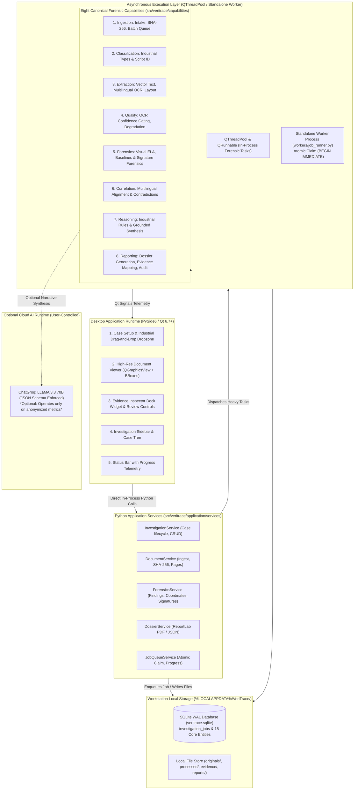

# 15_FINAL_SYSTEM_DESIGN.md
# VeriTrace Industrial System Design: The Eight Canonical Capabilities

---

## 1. Architectural Strategy: The Capability-Centric Modular Monolith

### 1.1 Why a Native Python Desktop Modular Monolith?
VeriTrace is engineered as a **Native Python Desktop Modular Monolith** rather than a distributed set of microservices or a multi-tier web application.

**Evidence-Backed Architectural Justification:**
1. **Direct In-Process Performance:** The PySide6 presentation layer communicates directly with Python Application Services. Eliminates HTTP loopback network serialization, JSON parsing overhead, ephemeral port binding hazards, and security token management.
2. **Zero Network Serialization for Heavy Image & Document Data:** Passing 300 DPI page bitmaps ($2480 \times 3508$ pixels, $\sim 25\text{MB}$ uncompressed RAM) across HTTP boundaries introduces massive bottlenecks. In a native monolith, image processing (OpenCV), PDF rendering (PyMuPDF), and OCR engines (PaddleOCR, Tesseract) share in-process memory or local disk caching with zero transport overhead.
3. **Transactional Integrity & Atomic Audit Logging:** An investigation must maintain an unshakeable chain of custody (ISO/IEC 27037). A single ACID-compliant database (SQLite with WAL mode) guarantees that documents, extracted fields, visual anomalies, and audit events commit atomically.
4. **Clean Internal Boundaries:** The system enforces strict capability separation through internal Python package boundaries and typed interfaces, allowing individual modules to be tested in complete isolation.

---

## 2. High-Level Modular Monolith Architecture

---

## 3. The Eight Canonical Capabilities: Complete Specifications

The architecture is strictly divided into **eight canonical capability modules** located under `src/veritrace/capabilities/`:

---

### Capability 1: Ingestion (`capabilities/ingestion/`)
* **Purpose:** Provides the entry gate for creating industrial forensic cases, validating files, and establishing immutable cryptographic provenance.
* **Responsibilities:**
  1. Validate file format headers via magic bytes (`%PDF-`, `\x89PNG`, `\xFF\xD8\xFF`, TIFF headers).
  2. Compute SHA-256 digests immediately upon file intake to establish ISO/IEC 27037 chain of custody.
  3. Store immutable originals in `%LOCALAPPDATA%/VeriTrace/cases/<case_id>/documents/originals/`.
  4. Manage batch intake queues and pre-screen documents for raster corruption or decryption locks.
* **Processing:** **100% Deterministic** (Python `hashlib`, `pathlib`).
* **Dependencies:** Python standard library (`hashlib`, `mimetypes`, `pathlib`).
* **Persistence:** Records in `investigations` and `documents` tables; files written to local originals storage.

---

### Capability 2: Classification (`capabilities/classification/`)
* **Purpose:** Categorizes submitted industrial documents and detects writing scripts to determine applicable schemas, validation rules, and OCR routing.
* **Responsibilities:**
  1. Classify industrial document types:
     - `PURCHASE_ORDER` (Procurement schedules, line item matrices)
     - `DELIVERY_CHALLAN` (Dispatch notes, vehicle numbers, received quantities)
     - `MILL_TEST_CERTIFICATE` (Metallurgical analysis, chemical/mechanical test sheets)
     - `COMMERCIAL_INVOICE` (Tax breakdown, GSTIN, payment terms)
     - `BILL_OF_LADING` (Freight terms, container IDs, shipping routes)
     - `IDENTITY_PROOF` (Aadhaar, PAN, Passport, Driving License)
     - `FINANCIAL_STATEMENT` (Bank statement, audited balance sheet)
  2. Perform language and script detection (Devanagari, Latin, Bengali, Gurmukhi, Dravidian scripts) to route pages to appropriate OCR models.
  3. Identify mixed-language pages requiring region-level hybrid font modeling.
* **Processing:** **Hybrid** (Primary: Deterministic header regex and layout heuristics; Fallback: Lightweight zero-shot classifier).
* **Dependencies:** `re`, standard library.

---

### Capability 3: Extraction (`capabilities/extraction/`)
* **Purpose:** Extracts digital vector text, raster OCR characters, layout hierarchies, tables, and signature candidates with pixel-level coordinate grounding.
* **Responsibilities:**
  1. Direct vector text, font descriptor, and layout extraction via PyMuPDF for native digital PDFs.
  2. Lossless 300 DPI page rasterization for visual forensics, signature analysis, and OCR fallback.
  3. Multilingual OCR engine abstraction (`TextExtractorProtocol`): routes Latin text to Tesseract/PyMuPDF; routes Devanagari (Hindi, Marathi) and regional Indic scripts to PaddleOCR models.
  4. Script-aware text normalization (Unicode NFC/NFKD, Indic numeral normalization to Hindu-Arabic digits for arithmetic checks while preserving source strings).
  5. Layout and table grid reconstruction (evaluating optional Docling layout adapters alongside PyMuPDF).
  6. Signature region candidate localization and coordinate extraction.
* **Processing:** **Deterministic & Local Neural Inference** (PyMuPDF, Tesseract, PaddleOCR).
* **Dependencies:** `pymupdf`, `pytesseract`, optional `paddleocr` / `docling`.
* **Persistence:** Records in `document_pages` and `extracted_fields`.

---

### Capability 4: Quality (`capabilities/quality/`)
* **Purpose:** Evaluates extraction completeness, calculates confidence distributions, and gates low-quality scans before downstream rules execute.
* **Responsibilities:**
  1. Compute page-level and token-level OCR confidence distributions across supported languages.
  2. Perform Vector-vs-Raster concordance checks to detect invisible text layers or rendering tampering.
  3. Detect image degradation factors (blur variance $<100$, excessive skew $>2^\circ$, low contrast, illumination noise).
  4. Enforce quality gating: flag low-confidence extractions ($<0.65$) as unverified, preventing automated false alarms.
* **Processing:** **100% Deterministic** (OpenCV, NumPy array statistics).
* **Dependencies:** `cv2`, `numpy`.
* **Persistence:** Metadata stored in `Document.quality_status` and `PageExtractionResult`.

---

### Capability 5: Forensics (`capabilities/forensics/`)
* **Purpose:** Executes pure computer vision forensics and deep signature authenticity analysis to detect visual tampering and authorization manipulation.
* **Sub-Capabilities:**
  1. **Visual Forensics Suite:**
     - Error Level Analysis (ELA): Computes JPEG compression differential heatmaps; flags local variance $>35\%$ above background noise.
     - Font Baseline Regression: Fits linear regression along text rows; flags glyph offsets $>2.5\sigma_y$ as suspicious splices.
     - Stamp & Seal Clone Detection: Multi-scale ORB feature matching detecting duplicated cut-and-paste official seals.
  2. **Signature Forensics Sub-Capability:**
     - Signature Localization: Isolates free-form handwritten strokes from form underlines and machine typography.
     - Offline Stroke Analysis: Inspects stroke continuity, curvature, proportions, and tracing indicators (hesitation marks, uniform line thickness).
     - Reference Signature Verification: Compares questioned signatures against enrolled reference samples of authorized subjects using metric embedding distance via a quantized Siamese CNN model executed locally via **ONNX Runtime (`onnxruntime`) on CPU**.
     - Tampering Detection: Detects pixel-identical signature reuse across documents, clipping boundary masks, and compression spikes.
     - Forensic Guardrails: Enforces 6-level assessment scale; visual similarity does not prove legal authorship or fraud.
* **Processing:** **Deterministic CV & Local ONNX Inference** (OpenCV, Pillow, NumPy, ONNX Runtime).
* **Dependencies:** `cv2`, `PIL`, `numpy`, `scipy`, `onnxruntime`.
* **Persistence:** Creates `findings`, `evidence`, and `finding_evidence_map` records; saves visual crops and heatmaps to disk.

---

### Capability 6: Correlation (`capabilities/correlation/`)
* **Purpose:** Reconciles entities and factual claims across distinct documents in an investigation bundle to detect discrepancies that are invisible in isolation.
* **Responsibilities:**
  1. Reconcile entities across multiple transaction files (PO $\leftrightarrow$ Delivery Challan $\leftrightarrow$ Mill Test Certificate $\leftrightarrow$ Commercial Invoice).
  2. Multilingual field concept mapping using standardized taxonomy ("Total Amount" $\leftrightarrow$ "एकूण रक्कम" $\leftrightarrow$ "कुल रकम").
  3. Construct contradiction matrix flagging discrepancies in quantities, rates, batch numbers, dates, consignees, or tax calculations.
  4. Maintain bidirectional evidence links connecting contradictory fields in separate documents.
* **Processing:** **100% Deterministic** (RapidFuzz C++ Levenshtein distance, concept dictionaries).
* **Dependencies:** `rapidfuzz`.
* **Persistence:** Records in `entities` and `cross_document_relations` tables.

---

### Capability 7: Reasoning (`capabilities/reasoning/`)
* **Purpose:** Evaluates deterministic contextual rules and synthesizes evidence-grounded explanatory narratives for human investigators.
* **Responsibilities:**
  1. Evaluate deterministic intra-document arithmetic rules (PO subtotal + taxes = total; net weight = gross - tare) and date chronology logic.
  2. Optional Grounded AI Synthesis: Groq ChatGroq synthesizes clear, structured explanations strictly grounded in pre-calculated numerical findings and coordinates.
  3. 100% Deterministic Offline Fallback: When offline or air-gapped, generates standard factual forensic observations using local rule templates.
  4. Epistemic Guardrail Enforcement: Strictly prevents the reasoning engine from creating ungrounded findings, changing severities, or making automated fraud accusations.
* **Processing:** **Deterministic Rule Execution & Optional Cloud AI**.
* **Dependencies:** Python standard library math, optional Groq client.

---

### Capability 8: Reporting (`capabilities/reporting/`)
* **Purpose:** Compiles the complete investigation into an authoritative, standardized Document Investigation Dossier and specialized signature reports.
* **Responsibilities:**
  1. Structure report strictly into the 6 mandatory sections of PS-2 (Section 7.1 – 7.6).
  2. Compile a machine-readable JSON dossier containing complete coordinate anchors and finding metrics.
  3. Programmatically compile an auditor-grade multi-page PDF dossier using ReportLab, embedding high-resolution visual evidence crops, ELA heatmaps, finding tables, and cryptographic audit stamps.
  4. Generate dedicated Signature Forensic Verification Reports detailing reference sample provenance and uncertainty metrics.
  5. Maintain an immutable append-only `AuditEvent` audit trail tracking all file submissions, automated checks, and human examiner decisions (ISO/IEC 27037).
* **Processing:** **100% Deterministic** (ReportLab, JSON serialization).
* **Dependencies:** `reportlab`, Python `json`.
* **Persistence:** Records in `dossiers` and `audit_events` tables; PDF/JSON outputs stored in reports directory.
