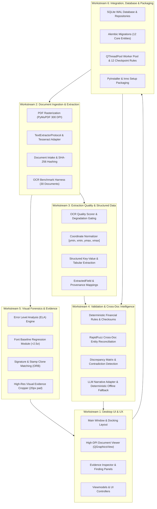

# 17_MODULE_RESPONSIBILITY_MATRIX.md
# Module Responsibility Matrix & Multi-Developer Engineering Governance

---

## 1. Architectural Responsibility Principles

To ensure that **VeriTrace** operates as a clean, scalable, and decoupled native desktop application that multiple developers can work on concurrently without merge conflicts or circular couplings:

1. **Strict Layered Dependency Flow:**
   $$\text{GUI } (gui/) \longrightarrow \text{Application } (application/) \longrightarrow \text{Domain } (domain/) \longleftarrow \text{Capabilities } (capabilities/) \longleftarrow \text{Infrastructure } (infrastructure/)$$
   - `gui/` depends ONLY on `application/` (facades/services) and `domain/` (entities/enums/DTOs). It NEVER accesses `infrastructure/`, raw databases, or low-level external libraries.
   - `application/` orchestrates operations across `domain/`, `capabilities/`, and `infrastructure/` interfaces.
   - `domain/` is pure business logic and model definitions. It has ZERO external framework dependencies (no PySide6, no SQLAlchemy, no OpenCV, no PyMuPDF).
   - `capabilities/` contains pure processing engines and algorithmic forensic functions. They do not depend on `gui/` or concrete database sessions.
   - `infrastructure/` provides concrete technical adapters (PyMuPDF, Tesseract, SQLite/SQLAlchemy, Groq, Inno Setup) implementing abstractions defined by domain and application layers.
   - `workers/` manages concurrency (`QThreadPool`, `job_runner.py`) to execute pipeline capabilities off the main Qt UI thread.

2. **Explicit Interface Boundaries:**
   Every module exposes typed Python interfaces (using Python `dataclasses`, `Pydantic v2`, or `typing.Protocol`). Callers must interact solely through public interfaces.

3. **Deterministic First & Grounded Evidence:**
   All measurement capabilities (ELA, baseline alignment, checksums) are pure, deterministic functions. Downstream reasoning components cannot assert findings without an immutable evidence anchor `[doc_id, page_number, normalized_bbox]`.

4. **Extraction Quality as an Architectural Gatekeeper:**
   Raw text/token output from OCR or vector extraction MUST pass through `capabilities/quality/` scoring before ingestion into rules or correlation engines.

---

## 2. Multi-Developer Module Responsibility Matrix

| Layer / Sub-package | Key Path | Primary Responsibility | Direct Dependencies | Workstream / Owner |
| :--- | :--- | :--- | :--- | :--- |
| **Root & Bootstrap** | `src/veritrace/bootstrap.py`<br>`src/veritrace/main.py` | App lifecycle, logging initialization, storage directory creation (`%LOCALAPPDATA%`), config loading. | `gui/`, `infrastructure/persistence/`, `infrastructure/security/` | **Lead Architect / Core** |
| **Presentation (GUI)** | `src/veritrace/gui/views/`<br>`src/veritrace/gui/components/`<br>`src/veritrace/gui/viewmodels/`<br>`src/veritrace/gui/controllers/` | Native PySide6 interface: Case workspace, 300 DPI document viewer with zoom/pan and bounding box overlays, evidence inspection panel, discrepancy matrix table, dossier export dialog, dark theme styling (`styles/dark_theme.qss`). | `application/services/`, `domain/entities/`, `PySide6` | **Workstream 1: GUI & Workstation** |
| **Application Coordination** | `src/veritrace/application/services/`<br>`src/veritrace/application/workflows/`<br>`src/veritrace/application/use_cases/`<br>`src/veritrace/application/dtos/` | Use-case coordinators: `InvestigationService`, `DocumentService`, `AnalysisService`, `DossierService`. Pipeline orchestrator (`PipelineCoordinator`), DTO transformations, progress notification dispatch. | `domain/`, `capabilities/`, `infrastructure/` (via interfaces) | **Workstream 2: Application Services** |
| **Pure Domain** | `src/veritrace/domain/entities/`<br>`src/veritrace/domain/value_objects/`<br>`src/veritrace/domain/rules/`<br>`src/veritrace/domain/events/`<br>`src/veritrace/domain/interfaces/` | Core domain entities (Investigation, Document, Finding, Evidence), enums (Severity, EpistemicTier), pure forensic validation rules (math consistency, date chronology, mandatory entity checks), repository interfaces. | **Standard Library only** (dataclasses, typing, enums, math) | **Workstream 2: Domain & Logic** |
| **Capability: Ingestion** | `src/veritrace/capabilities/ingestion/` | File intake validation (magic bytes, size limits, SHA-256 calculation), local disk partitioning under investigation workspace. | `domain/entities/` | **Workstream 3: Processing & Extraction** |
| **Capability: Classification** | `src/veritrace/capabilities/classification/` | Document type categorization (invoice, bank statement, tax ID, certificate), page role classification, template matching, schema dispatch. | `domain/entities/` | **Workstream 3: Processing & Extraction** |
| **Capability: Extraction** | `src/veritrace/capabilities/extraction/` | Vector text extraction, raster OCR text/token extraction, normalized coordinate projection ($[0.0, 1.0]$), layout parsing (tables, key-value pairs). | `domain/entities/`, `infrastructure/pdf/`, `infrastructure/ocr/` | **Workstream 3: Processing & Extraction** |
| **Capability: Quality** | `src/veritrace/capabilities/quality/` | **Extraction Quality Assessment:** OCR word/character confidence scoring, vector vs. OCR mismatch detection, image degradation assessment (blur, low contrast, skew), extraction quality gating. | `domain/entities/` | **Workstream 3: Processing & Extraction** |
| **Capability: Forensics** | `src/veritrace/capabilities/forensics/` | Deterministic visual forensics (Error Level Analysis / ELA, font baseline alignment, copy-move detection), PDF metadata forensic analysis, token-level manipulation checks, crop generation. | `domain/entities/`, `infrastructure/vision/` | **Workstream 4: Forensics & Intelligence** |
| **Capability: Correlation** | `src/veritrace/capabilities/correlation/` | Multi-document entity reconciliation, cross-document discrepancy detection (PAN, GSTIN, names, dates, amounts), contradiction matrix generation. | `domain/entities/` | **Workstream 4: Forensics & Intelligence** |
| **Capability: Reasoning** | `src/veritrace/capabilities/reasoning/` | Contextual intelligence synthesis: converting deterministic findings and discrepancies into structured, evidence-grounded forensic narratives; Groq LLM prompt assembly and schema enforcement. | `domain/entities/`, `infrastructure/ai/` | **Workstream 4: Forensics & Intelligence** |
| **Capability: Reporting** | `src/veritrace/capabilities/reporting/` | Compilation of complete investigation dossier: structured JSON dossier generation, ReportLab-based executive PDF generation with embedded evidence crops and audit logs. | `domain/entities/`, `infrastructure/reporting/` | **Workstream 2: Application & Dossier** |
| **Infrastructure: Persistence** | `src/veritrace/infrastructure/persistence/` | SQLite database configuration (WAL mode, foreign keys, busy timeout), SQLAlchemy 2.0 ORM mappings, repository implementations, Alembic database migrations. | `domain/interfaces/`, `SQLAlchemy`, `Alembic` | **Workstream 5: Infrastructure & Data** |
| **Infrastructure: Adapters** | `src/veritrace/infrastructure/` (`pdf/`, `ocr/`, `vision/`, `ai/`, `security/`) | External tool wrappers: PyMuPDF rasterizer adapter, Tesseract/RapidOCR adapter, OpenCV image transformation adapter, ChatGroq API client with fallback/mocking, storage path resolver (`%LOCALAPPDATA%`). | `PyMuPDF`, `pytesseract`, `cv2`, `PIL`, `groq` | **Workstream 5: Infrastructure & Adapters** |
| **Concurrency & Workers** | `src/veritrace/workers/` | In-process background task execution (`QRunnable`, `QThreadPool`, Qt Signals), standalone CLI worker (`job_runner.py`), SQLite atomic job claiming (`BEGIN IMMEDIATE`), crash recovery. | `application/workflows/`, `infrastructure/persistence/`, `PySide6` | **Workstream 6: Concurrency & DevOps** |
| **Packaging & Distribution** | `packaging/pyinstaller/`<br>`packaging/installer/` | PyInstaller `.spec` bundling configuration, Inno Setup `.iss` installer script compilation (`VeriTrace-Setup.exe`), release verification. | Standalone distribution artifacts | **Workstream 6: Packaging & DevOps** |

---

## 3. Workstream Assignments & Ownership

To maximize developer velocity and support parallel team execution, work is partitioned into 6 distinct functional workstreams aligned with `dev/26_TEAM_DEVELOPMENT_AND_GITHUB_WORKFLOW.md`:



---

## 4. Shared Engineering Contracts & Conventions

### 4.1. Coordinate Normalization Contract
All visual components, OCR engines, forensic detectors, and UI bounding box drawers MUST adhere to the **Normalized Bounding Box Standard**:
$$[y_{\min}, x_{\min}, y_{\max}, x_{\max}] \quad \text{where} \quad 0.0 \le y_{\min} < y_{\max} \le 1.0, \quad 0.0 \le x_{\min} < x_{\max} \le 1.0$$
* All coordinates are float values relative to the rendered page dimensions.
* Pixel conversions occur strictly at the display/crop boundary:
  $$\text{pixel\_x} = \lfloor x_{\text{norm}} \times \text{page\_width\_px} \rfloor, \quad \text{pixel\_y} = \lfloor y_{\text{norm}} \times \text{page\_height\_px} \rfloor$$

### 4.2. Evidence Traceability Contract: Evidence, EvidenceAnchor & FindingEvidenceMap
Evidence preserves first-class addressability through a tripartite structure:
1. **`EvidenceAnchor` (Value Object):** In-memory immutable spatial and contextual coordinate:
   ```python
   @dataclass(frozen=True)
   class EvidenceAnchor:
       document_id: str
       page_number: int
       normalized_bbox: List[float]  # [ymin, xmin, ymax, xmax]
       context_text: Optional[str] = None
       observation_type: Optional[str] = None
   ```
2. **`Evidence` (Domain Entity / Persistent Table `evidence`):** First-class persisted artifact:
   * Holds `evidence_id`, `investigation_id`, `document_id`, `page_number`, embedded `normalized_bbox`, absolute `crop_path` (300 DPI high-res crop with 20px padding), `crop_sha256` hash, and detector metadata.
   * Addressable and viewable directly in `src/veritrace/gui/components/evidence_inspector.py` independently of reports.
3. **`FindingEvidenceMap` (Association Relation `finding_evidence`):**
   * Many-to-many join relationship mapping `finding_id` to `evidence_id` with a `relevance_role` (`PRIMARY_OBSERVATION`, `CORROBORATING_SIGNAL`).
   * Guarantees that findings can link to multiple evidence anchors, and evidence crops can substantiate multiple findings.

### 4.3. Finding Dimensional Independence Contract: Severity, Confidence & Epistemic Tier
A `Finding` evaluates anomalies across three strictly independent dimensions:
1. **Severity (Impact / Priority):** `CRITICAL`, `HIGH`, `MEDIUM`, `LOW`, `INFO`. Represents the potential business or investigative impact if the finding is substantiated.
2. **Confidence (Detector Reliability):** Float $\in [0.0, 1.0]$. Represents the mathematical or statistical reliability of the underlying extraction or vision algorithm (e.g., OCR quality score, ELA residual deviation).
3. **Epistemic Tier (Evidentiary Grounding):** `CONFIRMED_OBSERVATION` / `DEFINITIVE`, `CORROBORATED`, `SUSPICIOUS` / `DETECTED_INCONSISTENCY`. Represents the structural strength of evidence supporting the conclusion.
* **Forensic Neutrality Policy:** Findings represent empirical observations, discrepancies, or mathematical contradictions. An anomaly does NOT prove fraud or deliberate manipulation. Monetary magnitude and isolated forensic signals must NEVER automatically promote epistemic tier to definitive.

### 4.4. Cross-Document Validation Separation Contract
Validation across multiple documents is strictly separated to avoid duplicated logic:
1. **Correlation Engine (`capabilities/correlation/entity_aligner.py`):** Resolves and clusters entities across documents using RapidFuzz string distance, token sorting, and schema matching to identify candidate pairs (`AlignedEntityPair`).
2. **Domain Rules (`domain/rules/cross_document.py`):** Pure deterministic comparison invariants (e.g. `EntityNameConsistencyRule`, `DateChronologyRule`, `FinancialCrossCheckRule`). Evaluates aligned entity pairs and returns pure `ValidationResult` objects.
3. **Application Workflows (`application/workflows/pipeline.py`):** Coordinates the execution: invokes entity alignment, passes matched pairs to domain rules, aggregates failures into `contradiction_matrix.py`, and instantiates `Finding` records.

### 4.5. AI Reasoning Permissions & Guardrails Contract
The generative reasoning capability (`src/veritrace/capabilities/reasoning/`) is strictly an explanatory presentation engine:
1. **Permitted Actions:**
   * Synthesizes natural-language explanations for **both verified and unverified findings**.
   * Must reference the specific evidence anchors and detector confidence supplied in the prompt.
   * Must explicitly preserve uncertainty (e.g., highlighting scan degradation or uncorroborated single-source signals).
2. **Strict Negative Guardrails (Forbidden):**
   * AI must NEVER independently create findings.
   * AI must NEVER change finding severity.
   * AI must NEVER upgrade epistemic tier.
   * AI must NEVER confirm or dismiss findings (exclusive human investigator action in HITL gate).
   * AI must NEVER modify or delete evidence records.

### 4.6. Extraction Quality Contract
Every extracted token and field must carry confidence metadata evaluated by `capabilities/quality/`:
```python
@dataclass(frozen=True)
class QualityMetrics:
    ocr_confidence: float         # 0.0 to 1.0
    is_vector_text: bool          # True if extracted from PDF stream
    degradation_flag: bool        # True if blur/noise/skew detected
    quality_passed: bool          # True if confidence >= quality threshold (0.65)
```

### 4.4. Code Conventions
1. **Module & File Naming:** `snake_case.py` (e.g., `document_service.py`, `ela_engine.py`).
2. **Class Naming:** `PascalCase` (e.g., `DocumentService`, `InvestigationJob`).
3. **Constants:** `UPPER_SNAKE_CASE` (e.g., `DEFAULT_DPI = 300`, `MAX_FILE_SIZE_BYTES`).
4. **Import Conventions:**
   - ALWAYS use absolute package imports: `from veritrace.application.services.investigation import InvestigationService`.
   - NEVER use relative package parent imports across layers (e.g., `from ...infrastructure import ...` inside `domain/` is strictly prohibited).
   - Domain models must never import from external frameworks:
     ```python
     # ACCEPTABLE in domain/entities/document.py:
     from dataclasses import dataclass
     from datetime import datetime
     from typing import Optional, List
     
     # FORBIDDEN in domain/entities/document.py:
     from PySide6.QtCore import QObject  # VIOLATION
     from sqlalchemy import Column       # VIOLATION
     ```

### 4.5. Git Branching & PR Guidelines
1. **Branch Naming:**
   - `feature/ws1-gui-<feature-name>`
   - `feature/ws2-app-<feature-name>`
   - `feature/ws3-proc-<feature-name>`
   - `feature/ws4-forensics-<feature-name>`
   - `feature/ws5-infra-<feature-name>`
   - `feature/ws6-devops-<feature-name>`
   - `fix/<issue-description>`
2. **Pull Request Quality Gates:**
   - All architecture boundary tests pass: `python scripts/validation/check_architecture.py`.
   - All unit tests pass: `pytest tests/unit/`.
   - Zero hardcoded external API calls without mock fallbacks.
   - Zero git commits modifying the source repository `Udyog-Permit-AI`.

---

## 5. Architectural Enforcement & Automated Validation

The architectural rules defined above are enforced automatically via [scripts/validation/check_architecture.py](file:///c:/Users/ghong/OneDrive/Attachments/Desktop/VeriTrace/scripts/validation/check_architecture.py).

Running:
```powershell
python scripts/validation/check_architecture.py
```
Validates:
1. `src/veritrace/domain/` has zero imports of `gui`, `infrastructure`, `PySide6`, `sqlalchemy`, or `cv2`.
2. `src/veritrace/capabilities/` has zero imports of `gui` or `PySide6`.
3. `src/veritrace/gui/` has zero direct imports of `infrastructure` or `sqlalchemy`.
4. All entrypoints adhere to the unified layout.
