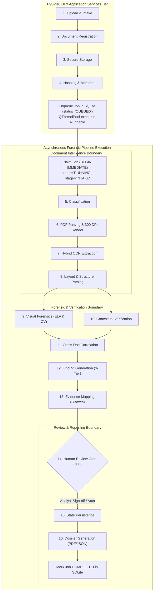

# 18_END_TO_END_DATA_FLOW.md
# End-to-End Investigation Data Flow & Stage Execution Specification

---

## 1. End-to-End Investigation Lifecycle Overview

The VeriTrace investigation lifecycle transitions submitted document bundles through sixteen deterministic and AI-assisted stages, from raw file intake to final dossier compilation.

To keep the PySide6 UI event loop responsive at 60 FPS while executing CPU-heavy operations (300 DPI rasterization, OCR, ELA matrix computation), the lifecycle is divided into two execution tiers:
1. **Desktop Presentation & Service Tier (Stages 1–4):** PySide6 UI intake, magic byte validation, cryptographic SHA-256 hashing, and job enqueuing via direct in-process `InvestigationService` and `DocumentService` calls.
2. **Asynchronous Execution Tier (Stages 5–16):** Multi-threaded execution via Qt's `QThreadPool` / `QRunnable` (or standalone worker process `investigation_worker.py`), updating SQLite stage checkpoints, emitting real-time Qt progress signals, executing the capability pipeline, and generating artifacts.

---

## 2. Granular Stage-by-Stage Execution Specifications

---

### Stage 1: Upload and Validation
* **Trigger:** Analyst selects files in GUI workstation and clicks "Import Documents".
* **Input:** File selection containing 1 to 10 binary files (`.pdf`, `.png`, `.jpg`).
* **Processing Component:** `src/veritrace/capabilities/ingestion/validator.py`.
* **Internal Logic:** Inspects file size ($<20\text{MB}$ per file) and checks magic bytes (`%PDF` for PDFs, `\x89PNG` for PNGs, `\xFF\xD8\xFF` for JPEGs).
* **Output:** Sanitized file stream, validated MIME type.
* **Failure Conditions:** File $>20\text{MB}$ flagged as error; invalid magic byte raises unsupported format error.
* **Persistence:** Temporary buffer in RAM / tempfile.
* **Provenance:** Original filename and client upload timestamp recorded.

---

### Stage 2: Document Registration
* **Trigger:** Successful completion of Stage 1 validation.
* **Input:** Validated file metadata, `investigation_id`.
* **Processing Component:** `src/veritrace/application/services/document.py` $\to$ `src/veritrace/infrastructure/persistence/models.py`.
* **Internal Logic:** Generates unique `document_id` (UUIDv4) for each uploaded file; assigns initial status `REGISTERED`.
* **Output:** Database records for `Document` entities linked to `Investigation`.
* **Failure Conditions:** `investigation_id` not found in database.
* **Persistence:** Persisted in `documents` table (`status='REGISTERED'`).
* **Provenance:** Foreign key `documents.investigation_id` established.

---

### Stage 3: Secure Storage
* **Trigger:** Document entity registration.
* **Input:** File byte streams, generated `document_id`, `investigation_id`.
* **Processing Component:** `src/veritrace/infrastructure/security/storage.py` & `src/veritrace/capabilities/ingestion/`.
* **Internal Logic:** Writes file atomically to `%LOCALAPPDATA%/VeriTrace/investigations/{inv_id}/originals/{doc_id}.bin`, preventing path traversal.
* **Output:** Absolute filesystem path to saved binary file.
* **Failure Conditions:** Disk full (`IOError`), OS permission denied.
* **Persistence:** File written to disk; relative path saved in `documents.storage_path`.
* **Provenance:** Exact disk location mapped to `document_id`.

---

### Stage 4: File Hashing and Metadata Extraction
* **Trigger:** File successfully written to disk.
* **Input:** Stored file binary on disk.
* **Processing Component:** `capabilities/document_processing/metadata_parser.py`.
* **Internal Logic:** Computes cryptographic SHA-256 digest; extracts PDF metadata (Producer, CreationDate, ModDate).
* **Output:** `sha256_hash: str`, metadata dictionary.
* **Failure Conditions:** Unreadable file stream.
* **Persistence:** Stored in `documents.file_hash_sha256` and `documents.metadata_json`.
* **Provenance:** SHA-256 hash guarantees data integrity according to ISO/IEC 27037 standards.

---

### Stage 5: Document Classification
* **Trigger:** Completion of metadata extraction.
* **Input:** First-page text stream, PDF metadata, filename cues.
* **Processing Component:** `capabilities/document_processing/classifier.py`.
* **Internal Logic:** Regex match against standard headers (e.g., `"INCOME TAX DEPARTMENT"` $\to$ `IDENTITY_PROOF:PAN`, `"PAYSLIP"` $\to$ `INCOME_PROOF`). Fallback to Groq zero-shot classification if keywords are inconclusive.
* **Output:** `classified_type: DocumentType`, `classification_confidence: float`.
* **Failure Conditions:** Ambiguous text returns `GENERAL_AFFIDAVIT` with confidence `0.50`.
* **Persistence:** Updated in `documents.document_type` and `documents.classification_confidence`.
* **Provenance:** Classification rationale and matched keywords recorded in document metadata.

---

### Stage 6: PDF Parsing and Page Rendering
* **Trigger:** Document classification completed.
* **Input:** Raw PDF or image file on disk.
* **Processing Component:** `capabilities/document_processing/pdf_rasterizer.py`.
* **Internal Logic:** PyMuPDF iterates through document pages; renders each page to lossless PNG at 300 DPI; detects whether page has selectable vector text.
* **Output:** Rendered PNG files saved to `pages/`, page dimensions `[width, height]`, page count.
* **Failure Conditions:** Corrupted PDF structure or password protection flags `status='ERROR_CORRUPTED'`.
* **Persistence:** Records inserted into `document_pages` table; PNGs written to `storage/.../pages/`.
* **Provenance:** Each page record permanently stores `page_number`, `width_pixels`, and `height_pixels`.

---

### Stage 7: Hybrid OCR and Structured Extraction
* **Trigger:** Page rendering completed.
* **Input:** Rendered 300 DPI page image and PyMuPDF vector page handle.
* **Processing Component:** `capabilities/extraction/ocr_engine.py`.
* **Internal Logic:**
  1. Extract vector character/word bounding boxes directly via PyMuPDF if digital text layer exists.
  2. For scanned bitmaps or image overlays, run Tesseract OCR with adaptive CLAHE binarization.
  3. Invert PDF coordinates to top-left normalized coordinates `[ymin, xmin, ymax, xmax] \in [0.0, 1.0]`.
* **Output:** List of `ExtractedToken` objects with text, coordinates, and confidence.
* **Failure Conditions:** Blank or unreadable page yields empty token list with low-confidence warning.
* **Persistence:** Persisted in `extracted_fields` table.
* **Provenance:** Every token linked to `page_id` with exact normalized bounding box.

---

### Stage 8: Layout and Structural Understanding
* **Trigger:** Extracted tokens available for page.
* **Input:** List of spatial text tokens from Stage 7.
* **Processing Component:** `capabilities/extraction/layout_parser.py`.
* **Internal Logic:** Clusters tokens by vertical alignment into lines; calculates column spacing for tables; binds key labels to adjacent values (e.g., `"Basic Pay"` $\to$ `"45,000"`).
* **Output:** Structured key-value dictionary, structured table grids.
* **Failure Conditions:** Irregular layout falls back to linear key-value pairs.
* **Persistence:** Persisted as JSON in `documents.structured_content`.
* **Provenance:** Every structured field retains pointers to its constituent token IDs.

---

### Stage 9: Visual Forensic Analysis
* **Trigger:** 300 DPI page PNG available.
* **Input:** Rendered page image file.
* **Processing Component:** `capabilities/visual_forensics/`.
* **Internal Logic:**
  1. `ela_engine.py`: Re-compresses image at 90% JPEG quality; computes difference matrix; detects local variance clusters exceeding background noise by $>3.0\sigma$.
  2. `baseline_engine.py`: Performs linear regression along horizontal text lines; flags characters with baseline residual $>2.5\sigma$.
  3. `clone_engine.py`: Uses ORB descriptors to detect duplicated signatures or seals.
* **Output:** Anomaly bounding boxes, anomaly scores `[0.0 - 1.0]`, ELA heatmap image PNGs.
* **Failure Conditions:** Non-fatal; logs warning and continues if an image algorithm fails on a specific page.
* **Persistence:** Heatmap PNGs written to `storage/.../forensics/`; raw anomalies held in LangGraph state.
* **Provenance:** Heatmap pixel coordinates directly map to the 300 DPI rendered page.

---

### Stage 10: Contextual Field Verification
* **Trigger:** Structured key-values and tables extracted (Stage 8).
* **Input:** Structured field dictionary.
* **Processing Component:** `capabilities/contextual_rules/`.
* **Internal Logic:**
  1. `math_rules.py`: Computes arithmetic checksums (e.g. `Gross - Deductions == Net`).
  2. `temporal_rules.py`: Asserts date sequence (Issue Date $\le$ Expiry Date).
  3. `identifier_rules.py`: Asserts checksums and regex syntax for PAN, Aadhaar, Passport.
* **Output:** List of intra-document rule discrepancies.
* **Failure Conditions:** Missing mandatory fields flagged as `MISSING_FIELD_VIOLATION`.
* **Persistence:** Held in LangGraph state.
* **Provenance:** Points to source `field_id` and document page.

---

### Stage 11: Cross-Document Correlation & Validation
* **Trigger:** Completion of Stages 9 and 10 across all documents in the investigation.
* **Input:** Extracted entities and fields across all documents in the investigation case.
* **Processing Components:**
  * `src/veritrace/capabilities/correlation/entity_aligner.py` (Entity resolution & pairing via RapidFuzz)
  * `src/veritrace/domain/rules/cross_document.py` (Deterministic domain comparison rules)
  * `src/veritrace/capabilities/correlation/conflict_matrix.py` (Discrepancy graph aggregation)
* **Internal Logic:**
  1. `entity_aligner.py`: Reconciles person names, employer names, and IDs using RapidFuzz token sort matching, generating candidate aligned entity pairs.
  2. `domain/rules/cross_document.py`: Evaluates deterministic comparison invariants across aligned pairs (e.g. *Does the employer name match? Does deposit match net pay within tolerance? Does chronology hold?*).
  3. `conflict_matrix.py`: Assembles rule failures into a structured contradiction matrix.
* **Output:** Cross-document conflict list, entity alignment graph.
* **Failure Conditions:** Non-fatal; unresolved entity matches flagged for investigator review.
* **Persistence:** Entities stored in `entities`; relations in `cross_document_relations`.
* **Provenance:** References both conflicting document IDs and their respective field bounding boxes.

---

### Stage 12: Finding Generation & Classification
* **Trigger:** Consolidation of visual anomalies, contextual violations, and cross-doc conflicts.
* **Input:** Raw detector outputs from Stages 9, 10, and 11 (`VisualAnomaly`, `ValidationResult`).
* **Processing Component:** `src/veritrace/application/workflows/finding_builder.py`.
* **Internal Logic:**
  1. Categorize each finding across three independent dimensions:
     * **Severity:** `LOW`, `MEDIUM`, `HIGH`, `CRITICAL` (Impact).
     * **Confidence:** $[0.0, 1.0]$ (Detector certainty).
     * **Epistemic Tier:** `CONFIRMED_OBSERVATION` / `DEFINITIVE`, `CORROBORATED`, `SUSPICIOUS` / `DETECTED_INCONSISTENCY` (Evidentiary strength).
  2. Maintain strict forensic neutrality: Observations record discrepancies without asserting legal conclusions of fraud or deliberate tampering.
  3. Instantiate `Finding` records and link them to persisted `Evidence` records via `FindingEvidenceMap`.
  4. Delegate to `src/veritrace/capabilities/reasoning/` to synthesize natural-language explanations (via Groq ChatGroq or deterministic offline fallback templates). AI explains both verified and unverified findings while preserving uncertainty, but is strictly prohibited from creating findings, changing severity, or upgrading epistemic tier.
* **Output:** List of `Finding` records with grounded narrative explanations and linked evidence.
* **Failure Conditions:** If Groq API fails or times out, deterministic fallback templates generate standard factual descriptions without prose synthesis.
* **Persistence:** Persisted in `findings` table and `finding_evidence` join table.
* **Provenance:** Every finding linked to source `document_id`, `page_id`, and bounding box.

---

### Stage 13: Evidence Mapping and Artifact Generation
* **Trigger:** Findings generated.
* **Input:** Finding bounding box coordinates and 300 DPI page images.
* **Processing Component:** `src/veritrace/capabilities/forensics/crop_manager.py`.
* **Internal Logic:** Translates normalized `[ymin, xmin, ymax, xmax]` into exact pixel bounds; extracts high-resolution cropped image patch with a 20-pixel context border; generates side-by-side visual comparison crop (Original vs. ELA).
* **Output:** `Evidence` database records, cropped image files on disk.
* **Failure Conditions:** Coordinates outside page boundaries are clamped to valid image margins.
* **Persistence:** Persisted in `evidence` table; crop images written to `storage/.../forensics/evidence_{id}.png`.
* **Provenance:** Immutable `evidence_id` directly assigned and linked to `finding_id`.

---

### Stage 14: Human Review Gate (HITL)
* **Trigger:** Anomaly detection yields at least one `HIGH` or `CRITICAL` severity finding, or `SUSPECTED_MANIPULATION`.
* **Input:** Consolidated investigation findings and evidence crops.
* **Processing Component:** `capabilities/orchestration/hitl_gate.py` (LangGraph checkpoint interrupt).
* **Internal Logic:**
  1. LangGraph pauses execution (`interrupt_before=["human_review_gate"]`).
  2. Worker updates `investigation_jobs.status='WAITING_FOR_REVIEW'`, `stage='HITL_GATE'`.
  3. Frontend displays interactive Evidence Inspector drawer.
  4. Investigator inspects visual crops and selects: `CONFIRM`, `DISMISS`, or `ANNOTATE`.
  5. Analyst submits review via `POST /api/v1/investigations/{id}/review/decisions`.
  6. Worker detects review submission and resumes execution.
* **Output:** `ReviewDecision` records, updated finding statuses.
* **Failure Conditions:** Investigator dismisses all findings; dossier updates risk score to `LOW`.
* **Persistence:** Persisted in `review_decisions` table; audit log records reviewer action.
* **Provenance:** Reviewer ID, decision timestamp, and rationale recorded permanently.

---

### Stage 15: Investigation State Persistence
* **Trigger:** Resume after human review (or bypass if automated mode).
* **Input:** Final LangGraph state values.
* **Processing Component:** `capabilities/orchestration/graph.py` $\to$ SQLite.
* **Internal Logic:** Computes aggregate case risk score; updates investigation status to `COMPLETED`; writes audit entry.
* **Output:** Finalized database state.
* **Failure Conditions:** SQLite transaction failure rolled back atomically.
* **Persistence:** Updated in `investigations` table (`status='COMPLETED'`, `risk_score=...`).
* **Provenance:** Atomic commit timestamp recorded.

---

### Stage 16: Dossier Generation & Job Completion
* **Trigger:** Pipeline state marked `COMPLETED`.
* **Input:** Complete investigation state from SQLite.
* **Processing Component:** `src/veritrace/capabilities/reporting/dossier_builder.py` & `src/veritrace/infrastructure/reporting/pdf_generator.py` executed by worker.
* **Internal Logic:**
  1. Assembles standardized JSON payload complying with PS-2 Sections 7.1 – 7.6.
  2. Invokes ReportLab to compile a printable, auditor-grade PDF report with embedded high-resolution evidence crops, ELA heatmaps, finding tables, and cryptographic audit stamps.
  3. Worker marks `investigation_jobs.status='COMPLETED'`, `progress_pct=100`, `completed_at=CURRENT_TIMESTAMP`.
* **Output:** `dossier.json` and `dossier.pdf`.
* **Failure Conditions:** ReportLab formatting overflow falls back to standard multi-page flowable table.
* **Persistence:** Persisted in `dossiers` table; files saved to `storage/.../reports/`; job completed in `investigation_jobs`.
* **Provenance:** SHA-256 hash of compiled PDF report written to `dossiers.pdf_hash_sha256`.
