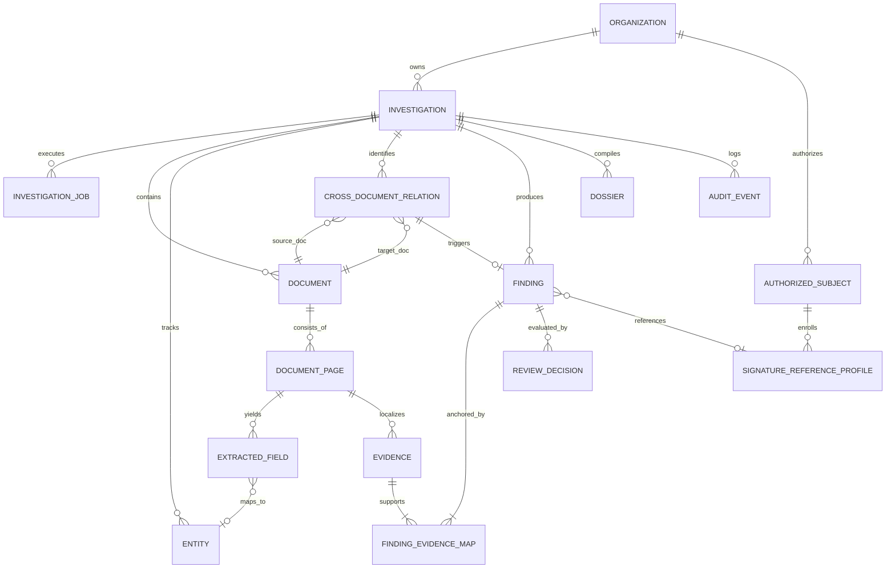

# 19_DOMAIN_MODEL_SPECIFICATION.md
# Core Domain Model & Relational Schema Specification

---

## 1. Domain Model Architecture & Entity Rationalization

The VeriTrace domain model is structured to enforce **strict evidence chain-of-custody (ISO/IEC 27037)**, deterministic traceability, and complete separation between raw data, analytical measurements, and subjective human review.

**Definitive Schema Count: Exactly 15 Core Relational Entities + 1 Association Table (16 SQLite Tables Total)**

### 1.1 Entity Rationalization & Justification

| Entity Name | Status | Engineering Justification |
| :--- | :---: | :--- |
| **`Organization`** | **NEW / RETAINED** | Enterprise workspace aggregate grouping investigations and authorized subjects. |
| **`AuthorizedSubject`** | **NEW / RETAINED** | Canonical authorized signer profile (e.g. Chief Metallurgist, Quality Inspector, Plant Head). |
| **`SignatureReferenceProfile`** | **NEW / RETAINED** | Reference signature crops enrolled under chain-of-custody with feature embeddings and legal mandate references. |
| **`Investigation`** | **RETAINED** | Core root aggregate representing a multi-document forensic investigation case. |
| **`InvestigationJob`** | **NEW / RETAINED** | Tracks persistent asynchronous processing lifecycle, stage progress, and failure recovery. |
| **`Document`** | **RETAINED** | Represents an individual uploaded physical/digital file submitted within an investigation. |
| **`DocumentVersion`** | **EXCLUDED (PROTOTYPE)** | In the hackathon prototype, documents are treated as immutable evidence. Versioning is tracked via immutable file hashes (`file_hash_sha256`) and upload timestamps directly on `Document`. A separate `DocumentVersion` table is deferred to post-hackathon enterprise scope. |
| **`Page`** (`DocumentPage`) | **RETAINED** | Fundamental unit of visual inspection and coordinate reference. Bounding boxes are meaningless without page-level dimensions. |
| **`ExtractedField`** | **RETAINED** | Stores granular OCR tokens and parsed key-value pairs with verbatim raw glyphs and normalized coordinates. |
| **`Entity`** | **RETAINED** | Represents a canonical real-world identity or fact (e.g., "Rajesh Sharma", "₹85,000") reconciled across multiple distinct documents. |
| **`ForensicAnalysis`** | **REFINED / EMBEDDED** | Rather than a disconnected generic table, raw analysis parameters (e.g., ELA quality, baseline deviation threshold) are recorded in the `AuditEvent` table and `Finding` metadata, keeping the query model clean. |
| **`Finding`** | **RETAINED** | Standardized forensic conclusion categorized under the Three-Tier Epistemic Ontology (`CONFIRMED_OBSERVATION`, `DETECTED_INCONSISTENCY`, `SUSPECTED_MANIPULATION`). |
| **`Evidence`** | **RETAINED** | The physical visual crop and coordinate anchor that supports a `Finding`. Crucial: A Finding can have multiple Evidence anchors; an Evidence patch can support multiple findings. |
| **`FindingEvidenceMap`** | **RETAINED** | Association table managing many-to-many relationships between `Finding` and `Evidence`. |
| **`CrossDocumentRelation`** | **RETAINED** | Maps semantic relationships (conflicts, confirmations, dependencies) between entities across two distinct documents. |
| **`ReviewDecision`** | **RETAINED** | Captures the human investigator's authoritative sign-off, dismissal, or note for a specific finding. |
| **`Dossier`** | **RETAINED** | Permanent record of generated investigation reports (PDF and JSON) with cryptographic output hashes. |
| **`AuditEvent`** | **RETAINED** | Immutable append-only event ledger for auditability and compliance. |

---

## 2. Complete Entity-Relationship (ER) Schema

---

## 3. Detailed Entity Schema Definitions

### 3.1 `Investigation`
* **Table:** `investigations`
* **Purpose:** Root case entity.
* **Fields:**
  * `id` (`VARCHAR(36)`, PK): UUIDv4 string.
  * `title` (`VARCHAR(255)`, NOT NULL): Human-readable label.
  * `reference_code` (`VARCHAR(64)`, UNIQUE, NOT NULL): Business case reference.
  * `status` (`VARCHAR(32)`, NOT NULL, DEFAULT `'DRAFT'`): `DRAFT`, `PROCESSING`, `WAITING_REVIEW`, `COMPLETED`, `FAILED`.
  * `risk_score` (`FLOAT`, DEFAULT `0.0`): Aggregate risk score in `[0.0, 1.0]`.
  * `risk_classification` (`VARCHAR(32)`, DEFAULT `'UNDETERMINED'`): `LOW_RISK`, `FLAGGED_INCONSISTENCY`, `SUSPECTED_MANIPULATION`.
  * `created_at` (`DATETIME`, NOT NULL): UTC creation timestamp.
  * `updated_at` (`DATETIME`, NOT NULL): UTC update timestamp.
* **Indexes:** `idx_inv_ref` (`reference_code`), `idx_inv_status` (`status`).

---

### 3.2 `InvestigationJob`
* **Table:** `investigation_jobs`
* **Purpose:** Manages persistent asynchronous processing lifecycle, stage progress, and failure recovery.
* **Fields:**
  * `id` (`VARCHAR(36)`, PK): UUIDv4 string.
  * `investigation_id` (`VARCHAR(36)`, FK $\to$ `investigations.id`, NOT NULL): Parent investigation.
  * `status` (`VARCHAR(32)`, NOT NULL, DEFAULT `'QUEUED'`): `QUEUED`, `RUNNING`, `WAITING_REVIEW`, `COMPLETED`, `FAILED`.
  * `current_stage` (`VARCHAR(64)`, NOT NULL, DEFAULT `'INIT'`): Active processing capability stage.
  * `progress_pct` (`INTEGER`, NOT NULL, DEFAULT `0`): Overall completion percentage (0 - 100).
  * `stage_message` (`VARCHAR(255)`, NULLABLE): Human-readable status update.
  * `error_message` (`TEXT`, NULLABLE): Detailed error message if failed.
  * `can_resume` (`BOOLEAN`, NOT NULL, DEFAULT `FALSE`): Flag indicating eligibility for stage-level resume.
  * `started_at` (`DATETIME`, NULLABLE): UTC timestamp of job execution start.
  * `completed_at` (`DATETIME`, NULLABLE): UTC timestamp of job completion.
  * `created_at` (`DATETIME`, NOT NULL): UTC creation timestamp.
* **Indexes:** `idx_job_inv_status` (`investigation_id`, `status`).

---

### 3.3 `Document`
* **Table:** `documents`
* **Purpose:** Represents an ingested file.
* **Fields:**
  * `id` (`VARCHAR(36)`, PK): UUIDv4 string.
  * `investigation_id` (`VARCHAR(36)`, FK $\to$ `investigations.id`, NOT NULL): Cascades on delete.
  * `original_filename` (`VARCHAR(255)`, NOT NULL): Name of uploaded file.
  * `file_hash_sha256` (`VARCHAR(64)`, NOT NULL): SHA-256 integrity hash.
  * `mime_type` (`VARCHAR(64)`, NOT NULL): `application/pdf`, `image/png`, `image/jpeg`.
  * `document_type` (`VARCHAR(64)`, NOT NULL, DEFAULT `'UNCLASSIFIED'`): `IDENTITY_PROOF`, `INCOME_PROOF`, `FINANCIAL_STATEMENT`, `COMMERCIAL_RECORD`, `GENERAL_AFFIDAVIT`.
  * `primary_language` (`VARCHAR(16)`, NOT NULL, DEFAULT `'eng'`): Primary detected language code (`eng`, `hin`, `mar`, `mixed`).
  * `primary_script` (`VARCHAR(32)`, NOT NULL, DEFAULT `'Latn'`): Primary script family (`Latn`, `Deva`, `MIXED`).
  * `languages_json` (`JSON`, NULLABLE): Structured document-level `LanguageDetectionProfile` recording language and script breakdowns, detection confidences, and detection engine provenance.
  * `classification_confidence` (`FLOAT`, DEFAULT `0.0`): `[0.0 - 1.0]`.
  * `page_count` (`INTEGER`, NOT NULL, DEFAULT `1`): Number of pages.
  * `file_size_bytes` (`INTEGER`, NOT NULL): File size in bytes.
  * `storage_path` (`VARCHAR(512)`, NOT NULL): Path to stored raw binary.
  * `quality_status` (`VARCHAR(32)`, NOT NULL, DEFAULT `'UNVERIFIED'`): `VERIFIED_HIGH`, `DEGRADED_SCAN`, `UNVERIFIED`.
  * `structured_content` (`JSON`, NULLABLE): Hierarchical key-value pairs and tables.
  * `metadata_json` (`JSON`, NULLABLE): PDF Producer, CreationDate, font descriptors.
  * `status` (`VARCHAR(32)`, NOT NULL, DEFAULT `'UPLOADED'`): `UPLOADED`, `PROCESSED`, `ERROR_CORRUPTED`.
  * `created_at` (`DATETIME`, NOT NULL): UTC timestamp.
* **Indexes:** `idx_doc_inv` (`investigation_id`), `idx_doc_hash` (`file_hash_sha256`), `idx_doc_lang` (`primary_language`).

---

### 3.4 `DocumentPage`
* **Table:** `document_pages`
* **Purpose:** Represents an individual rasterized page.
* **Fields:**
  * `id` (`VARCHAR(36)`, PK): UUIDv4 string.
  * `document_id` (`VARCHAR(36)`, FK $\to$ `documents.id`, NOT NULL): Cascades on delete.
  * `page_number` (`INTEGER`, NOT NULL): 1-based page sequence number.
  * `width_pixels` (`INTEGER`, NOT NULL): Image width at 300 DPI render.
  * `height_pixels` (`INTEGER`, NOT NULL): Image height at 300 DPI render.
  * `image_storage_path` (`VARCHAR(512)`, NOT NULL): Relative path to rendered PNG.
  * `has_digital_text` (`BOOLEAN`, NOT NULL, DEFAULT `FALSE`): Vector text layer flag.
  * `primary_language` (`VARCHAR(16)`, NOT NULL, DEFAULT `'eng'`): Page-level detected language code.
  * `primary_script` (`VARCHAR(32)`, NOT NULL, DEFAULT `'Latn'`): Page-level detected script code.
  * `languages_json` (`JSON`, NULLABLE): Page-level `LanguageDetectionProfile` with language distributions, scripts, OCR engine provenance, and a list of spatial `LanguageScriptRegion` objects $[ymin, xmin, ymax, xmax]$ supporting mixed-language / multi-script pages without database table proliferation.
* **Constraints:** `UNIQUE(document_id, page_number)`.
* **Indexes:** `idx_page_doc_num` (`document_id`, `page_number`).

---

### 3.5 `ExtractedField`
* **Table:** `extracted_fields`
* **Purpose:** Stores extracted text tokens and structured key-values with provenance and verbatim raw text.
* **Fields:**
  * `id` (`VARCHAR(36)`, PK): UUIDv4 string.
  * `page_id` (`VARCHAR(36)`, FK $\to$ `document_pages.id`, NOT NULL): Cascades on delete.
  * `entity_id` (`VARCHAR(36)`, FK $\to$ `entities.id`, NULLABLE): Mapped canonical entity.
  * `field_key` (`VARCHAR(128)`, NOT NULL): Normalized key (e.g., `net_pay`, `pan_number`, `heat_number`).
  * `field_value` (`TEXT`, NOT NULL): Normalized clean value for deterministic rule evaluation.
  * `raw_text` (`TEXT`, NOT NULL): Verbatim extracted text glyphs, preserving exact Indic script representations without translation.
  * `language` (`VARCHAR(16)`, NULLABLE): Token/region-level detected language code (`eng`, `hin`, `mar`).
  * `script` (`VARCHAR(32)`, NULLABLE): Token/region-level detected script code (`Latn`, `Deva`).
  * `lang_confidence` (`FLOAT`, NULLABLE): Language detection confidence `[0.0, 1.0]`.
  * `confidence` (`FLOAT`, NOT NULL): OCR recognizer confidence in `[0.0, 1.0]`.
  * `norm_ymin` (`FLOAT`, NOT NULL): Normalized top coordinate in `[0.0, 1.0]`.
  * `norm_xmin` (`FLOAT`, NOT NULL): Normalized left coordinate in `[0.0, 1.0]`.
  * `norm_ymax` (`FLOAT`, NOT NULL): Normalized bottom coordinate in `[0.0, 1.0]`.
  * `norm_xmax` (`FLOAT`, NOT NULL): Normalized right coordinate in `[0.0, 1.0]`.
  * `extraction_source` (`VARCHAR(32)`, NOT NULL): `PYMUPDF_VECTOR`, `TESSERACT_OCR`, `PADDLEOCR_INDIC`.
  * `ocr_engine` (`VARCHAR(64)`, NULLABLE): Engine identifier (e.g., `tesseract-5.3`, `paddleocr-v4`).
  * `ocr_model_version` (`VARCHAR(64)`, NULLABLE): OCR weights or model version tag.
* **Indexes:** `idx_field_page` (`page_id`), `idx_field_key` (`field_key`).

---

### 3.6 `Entity`
* **Table:** `entities`
* **Purpose:** Canonical identity or factual claim across the case.
* **Fields:**
  * `id` (`VARCHAR(36)`, PK): UUIDv4 string.
  * `investigation_id` (`VARCHAR(36)`, FK $\to$ `investigations.id`, NOT NULL): Cascades on delete.
  * `entity_type` (`VARCHAR(64)`, NOT NULL): `PERSON_NAME`, `DATE_OF_BIRTH`, `GOVERNMENT_ID`, `EMPLOYER_NAME`, `FINANCIAL_TOTAL`.
  * `canonical_value` (`TEXT`, NOT NULL): Reconciled standardized representation.
* **Indexes:** `idx_entity_inv_type` (`investigation_id`, `entity_type`).

---

### 3.7 `Finding`
* **Table:** `findings`
* **Purpose:** Standardized investigation finding.
* **Fields:**
  * `id` (`VARCHAR(36)`, PK): UUIDv4 string.
  * `investigation_id` (`VARCHAR(36)`, FK $\to$ `investigations.id`, NOT NULL): Cascades on delete.
  * `category` (`VARCHAR(64)`, NOT NULL): `ELA_COMPRESSION_VARIANCE`, `FONT_BASELINE_MISALIGNMENT`, `COPY_MOVE_CLONE`, `ARITHMETIC_MISMATCH`, `TEMPORAL_CONTRADICTION`, `CROSS_DOC_MISMATCH`.
  * `epistemic_tier` (`VARCHAR(32)`, NOT NULL): `CONFIRMED_OBSERVATION`, `DETECTED_INCONSISTENCY`, `SUSPECTED_MANIPULATION`.
  * `severity` (`VARCHAR(16)`, NOT NULL): `LOW`, `MEDIUM`, `HIGH`, `CRITICAL`.
  * `title` (`VARCHAR(255)`, NOT NULL): Short summary.
  * `narrative_explanation` (`TEXT`, NOT NULL): Evidence-grounded explanation.
  * `investigator_guidance` (`TEXT`, NULLABLE): Recommended human verification steps.
  * `review_status` (`VARCHAR(32)`, NOT NULL, DEFAULT `'PENDING_REVIEW'`): `PENDING_REVIEW`, `CONFIRMED`, `DISMISSED`.
  * `created_at` (`DATETIME`, NOT NULL): UTC timestamp.
* **Indexes:** `idx_finding_inv` (`investigation_id`), `idx_finding_severity` (`severity`), `idx_finding_tier` (`epistemic_tier`).

---

### 3.8 `Evidence`
* **Table:** `evidence`
* **Purpose:** Pixel-level visual crop and coordinates supporting a finding.
* **Fields:**
  * `id` (`VARCHAR(36)`, PK): UUIDv4 string.
  * `page_id` (`VARCHAR(36)`, FK $\to$ `document_pages.id`, NOT NULL): Source page.
  * `crop_image_path` (`VARCHAR(512)`, NOT NULL): Path to high-res visual patch PNG.
  * `heatmap_image_path` (`VARCHAR(512)`, NULLABLE): Path to ELA/contour heatmap PNG.
  * `pixel_x` (`INTEGER`, NOT NULL): Crop top-left X on 300 DPI image.
  * `pixel_y` (`INTEGER`, NOT NULL): Crop top-left Y on 300 DPI image.
  * `pixel_width` (`INTEGER`, NOT NULL): Crop width in pixels.
  * `pixel_height` (`INTEGER`, NOT NULL): Crop height in pixels.
  * `norm_ymin` (`FLOAT`, NOT NULL): Normalized top coordinate.
  * `norm_xmin` (`FLOAT`, NOT NULL): Normalized left coordinate.
  * `norm_ymax` (`FLOAT`, NOT NULL): Normalized bottom coordinate.
  * `norm_xmax` (`FLOAT`, NOT NULL): Normalized right coordinate.
* **Indexes:** `idx_evidence_page` (`page_id`).

---

### 3.9 `FindingEvidenceMap` (Association Table)
* **Table:** `finding_evidence_map`
* **Purpose:** Many-to-many relationship linking findings to visual evidence crops.
* **Fields:**
  * `finding_id` (`VARCHAR(36)`, FK $\to$ `findings.id`, PK): Finding reference.
  * `evidence_id` (`VARCHAR(36)`, FK $\to$ `evidence.id`, PK): Evidence reference.

---

### 3.10 `CrossDocumentRelation`
* **Table:** `cross_document_relations`
* **Purpose:** Explicit links between documents (conflicts, cross-references).
* **Fields:**
  * `id` (`VARCHAR(36)`, PK): UUIDv4 string.
  * `investigation_id` (`VARCHAR(36)`, FK $\to$ `investigations.id`, NOT NULL): Case scope.
  * `source_document_id` (`VARCHAR(36)`, FK $\to$ `documents.id`, NOT NULL): Document A.
  * `target_document_id` (`VARCHAR(36)`, FK $\to$ `documents.id`, NOT NULL): Document B.
  * `relation_type` (`VARCHAR(32)`, NOT NULL): `CONFLICTS_WITH`, `CORROBORATES`, `SUPPLEMENTS`.
  * `finding_id` (`VARCHAR(36)`, FK $\to$ `findings.id`, NULLABLE): Associated conflict finding.
  * `similarity_score` (`FLOAT`, NULLABLE): RapidFuzz score if entity comparison.
  * `description` (`TEXT`, NOT NULL): Detailed relation narrative.
* **Indexes:** `idx_rel_inv` (`investigation_id`), `idx_rel_src_tgt` (`source_document_id`, `target_document_id`).

---

### 3.11 `ReviewDecision`
* **Table:** `review_decisions`
* **Purpose:** Records human analyst verification and oversight.
* **Fields:**
  * `id` (`VARCHAR(36)`, PK): UUIDv4 string.
  * `finding_id` (`VARCHAR(36)`, FK $\to$ `findings.id`, NOT NULL): Evaluated finding.
  * `reviewer_id` (`VARCHAR(64)`, NOT NULL): Investigator ID/handle.
  * `decision` (`VARCHAR(32)`, NOT NULL): `CONFIRMED`, `DISMISSED`, `ANNOTATED`.
  * `rationale` (`TEXT`, NOT NULL): Human justification.
  * `timestamp` (`DATETIME`, NOT NULL): UTC timestamp.
* **Indexes:** `idx_review_finding` (`finding_id`).

---

### 3.12 `Dossier`
* **Table:** `dossiers`
* **Purpose:** Records compiled investigation reports.
* **Fields:**
  * `id` (`VARCHAR(36)`, PK): UUIDv4 string.
  * `investigation_id` (`VARCHAR(36)`, FK $\to$ `investigations.id`, NOT NULL): Associated case.
  * `dossier_json` (`JSON`, NOT NULL): Full 6-section PS-2 structured JSON payload.
  * `pdf_storage_path` (`VARCHAR(512)`, NOT NULL): File path to compiled PDF.
  * `pdf_hash_sha256` (`VARCHAR(64)`, NOT NULL): Cryptographic hash of generated PDF report.
  * `generated_at` (`DATETIME`, NOT NULL): UTC timestamp.
* **Indexes:** `idx_dossier_inv` (`investigation_id`).

---

### 3.13 `AuditEvent`
* **Table:** `audit_events`
* **Purpose:** Immutable append-only audit trail.
* **Fields:**
  * `id` (`VARCHAR(36)`, PK): UUIDv4 string.
  * `investigation_id` (`VARCHAR(36)`, FK $\to$ `investigations.id`, NOT NULL): Case context.
  * `event_type` (`VARCHAR(64)`, NOT NULL): `CASE_CREATED`, `DOC_UPLOADED`, `OCR_EXTRACTED`, `ANOMALY_FLAGGED`, `HUMAN_REVIEW_CONFIRMED`, `DOSSIER_COMPILED`.
  * `actor_type` (`VARCHAR(32)`, NOT NULL): `SYSTEM_PIPELINE`, `HUMAN_ANALYST`, `AI_SYNTHESIZER`.
  * `event_payload` (`JSON`, NOT NULL): Structured event parameters.
  * `timestamp` (`DATETIME`, NOT NULL): UTC timestamp.
* **Indexes:** `idx_audit_inv_time` (`investigation_id`, `timestamp`).

---

### 3.14 `Organization`
* **Table:** `organizations`
* **Purpose:** Multi-tenant workspace aggregate grouping industrial investigations and authorized personnel.
* **Fields:**
  * `id` (`VARCHAR(36)`, PK): UUIDv4 string (`org_<uuid4_hex>`).
  * `name` (`VARCHAR(255)`, NOT NULL): Corporate or factory name.
  * `industry_sector` (`VARCHAR(64)`, NOT NULL): Sector (`MANUFACTURING`, `SUPPLY_CHAIN`, `BFSI`, `INSURANCE`, `GOVERNMENT`, `CONSTRUCTION`, `ENTERPRISE_HR`).
  * `created_at` (`DATETIME`, NOT NULL): UTC timestamp.
* **Indexes:** `idx_org_sector` (`industry_sector`).

---

### 3.15 `AuthorizedSubject`
* **Table:** `authorized_subjects`
* **Purpose:** Designated signer profile authorized to execute, endorse, or verify enterprise documents.
* **Fields:**
  * `id` (`VARCHAR(36)`, PK): UUIDv4 string (`subj_<uuid4_hex>`).
  * `organization_id` (`VARCHAR(36)`, FK $\to$ `organizations.id`, NOT NULL): Associated enterprise.
  * `full_name` (`VARCHAR(255)`, NOT NULL): Full legal name.
  * `designation` (`VARCHAR(128)`, NOT NULL): Role (e.g., "Quality Control Head", "Plant Manager").
  * `id_reference` (`VARCHAR(64)`, NOT NULL): Employee ID or regulatory registration code.
  * `created_at` (`DATETIME`, NOT NULL): UTC timestamp.
* **Indexes:** `idx_subj_org` (`organization_id`), `idx_subj_ref` (`id_reference`).

---

### 3.16 `SignatureReferenceProfile`
* **Table:** `signature_references`
* **Purpose:** High-resolution enrolled reference signature sample maintained under strict chain-of-custody.
* **Fields:**
  * `id` (`VARCHAR(36)`, PK): UUIDv4 string (`sig_<uuid4_hex>`).
  * `subject_id` (`VARCHAR(36)`, FK $\to$ `authorized_subjects.id`, NOT NULL): Signer identity.
  * `crop_image_path` (`VARCHAR(512)`, NOT NULL): Relative path to enrolled clean visual patch PNG.
  * `sha256_hash` (`VARCHAR(64)`, NOT NULL): Cryptographic digest of reference crop.
  * `embedding_vector` (`BLOB`, NULLABLE): Serialized float32 metric embedding vector from Siamese CNN.
  * `enrollment_date` (`DATETIME`, NOT NULL): UTC timestamp.
  * `source_document_ref` (`VARCHAR(255)`, NOT NULL): Enrolled sample provenance certificate/file.
  * `consent_mandate_ref` (`VARCHAR(255)`, NOT NULL): Corporate power-of-attorney or signatory mandate reference.
  * `retention_expiry_date` (`DATETIME`, NULLABLE): Mandated retention expiration timestamp.
  * `access_role_required` (`VARCHAR(64)`, NOT NULL, DEFAULT `'FORENSIC_INVESTIGATOR'`): RBAC permission tier.
  * `provenance_json` (`JSON`, NULLABLE): Verification witness and authorization audit trail metadata.
* **Indexes:** `idx_sig_subject` (`subject_id`).

---

## 4. Architectural Evaluation of Proposed Domain Concepts

In accordance with Phase 9 of the Industrial Architecture Evolution, twelve candidate domain concepts were systematically evaluated:

| Candidate Concept | Architectural Layer | Classification | Persistence Strategy | Existing Representation & Justification |
| :--- | :---: | :---: | :---: | :--- |
| **1. `DocumentLanguage` / `LanguageDetectionProfile`** | **Domain** | Value Object | Embedded in `Document` & `DocumentPage` (`languages_json`, `primary_language`, `primary_script`) | Captures ISO 639-2/3 language codes, ISO 15924 script codes, spatial `LanguageScriptRegion` tuples for mixed-script pages, detection confidence distributions, and detection engine provenance. Embedded as structured JSON value objects; avoids table proliferation while maintaining fast indexed lookups. |
| **2. `LanguageScriptIdentification`** | **Capability / Domain** | Value Object | Embedded in `ExtractedField` (`language`, `script`, `lang_confidence`, `raw_text`) | Encapsulates token- and region-level script distributions, detection confidence, and preserves verbatim original glyphs. Transient in pipeline and persisted directly on `ExtractedField`. |
| **3. `OCRModelProfile`** | **Capability / Infra** | Configuration Object | In-Memory Registry | Metadata for OCR engines (PaddleOCR, Tesseract, script coverage, execution runtime). Purely infrastructural; zero database persistence required. |
| **4. `ExtractionQualityReport`** | **Domain / Application** | Value Object / DTO | Column on `Document` (`quality_status`, `quality_metrics_json`) | Aggregates CER, WER, blur variance, and skew angle across all pages. Persisted as structured metadata on `Document`. |
| **5. `SignatureRegion`** | **Domain** | Value Object | `Evidence` Table (`evidence_type="SIGNATURE_CROP"`) | Localized bounding box $[ymin, xmin, ymax, xmax]$ containing handwritten signature strokes. Subsumed by the canonical `Evidence` entity and `NormalizedBoundingBox`. |
| **6. `Organization`** | **Domain** | Aggregate Root | New Table: `organizations` | Multi-tenant industrial workspace boundary. Persisted as a first-class relational entity linking investigations, audit logs, and authorized personnel. |
| **7. `AuthorizedSubject`** | **Domain** | Domain Entity | New Table: `authorized_subjects` | Represents authorized signers (Quality Inspectors, Metallurgists, Plant Heads). Persisted as first-class entity with FK to `Organization`. |
| **8. `SignatureReferenceProfile`** | **Domain** | Domain Entity | New Table: `signature_references` | Clean, verified reference signature samples enrolled under chain-of-custody. Persisted with crop paths, SHA-256 hashes, feature embeddings, and legal mandate references. |
| **9. `SignatureComparisonResult`** | **Capability / Domain** | Value Object | Embedded in `Finding.metrics_json` | Captures metric distance, similarity score, and uncertainty between questioned signature and enrolled reference. Stored inside `Finding`. |
| **10. `SignatureAnalysisFinding`** | **Domain** | Entity Subtype | `Finding` Table (`category="SIGNATURE_VERIFICATION"`) | Specialized forensic finding. Avoids table proliferation by leveraging the existing polymorphic `findings` table with specialized category and metrics. |
| **11. `ForensicAnalysisProvenance`** | **Domain** | Value Object | Embedded in `AuditEvent` / `Finding` | Audit record of algorithm version, hyper-parameters, execution time, and device context. Persisted within the immutable audit event payload. |
| **12. `ReferenceSampleProvenance`** | **Domain** | Value Object | Column on `SignatureReferenceProfile` (`provenance_json`) | Legal witness and enrollment documentation for reference signatures. Embedded directly on `SignatureReferenceProfile`. |
