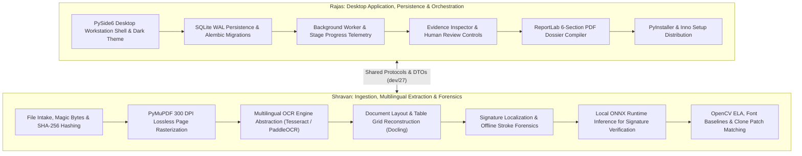

# 23_DETAILED_DEVELOPMENT_PLAN.md
# Industrial Phased Development Plan & Milestone Execution Blueprints

---

## 1. Execution Principles & Parallel Workstreams

To maximize development velocity while maintaining strict architectural boundaries and 100% offline desktop reliability, implementation is organized into two primary developer workstreams anchored by frozen shared contracts ([ADR-035](12_DECISION_LOG.md#adr-035-milestone-1-shared-contract-freeze-between-desktop-application-and-document-processing-engine) in `dev/27`):

---

## 2. Twelve-Milestone Industrial Execution Specifications

### Milestone 1: Industrial Product Foundation
* **Status:** **COMPLETED** (Baseline commit `603254c`)
* **Objective:** Establish the industrial product charter across 7 sectors (Manufacturing, Logistics, BFSI, Insurance, Govt, Construction, HR), PS-2 problem analysis, team collaboration governance (`dev/26`), and verify Python 3.11.9 runtime with green GitHub Actions CI.

### Milestone 2: Shared Contracts & Domain Updates
* **Status:** **COMPLETED** (Frozen under ADR-035 in `dev/27`)
* **Objective:** Codify shared data contracts (`NormalizedBoundingBox`, `ExtractedToken`, `ExtractedField`, `ExtractionProvenance`, `IngestionResult`), uniform `ProcessingStatus` enums, service protocols (`typing.Protocol`), 15 Core Entities + 1 Assoc Table, and 7 canonical test fixtures.

### Milestone 3: Desktop Shell, Persistence & Ingestion Foundation
* **Status:** **COMPLETED**
* **Responsible:** Rajas & Shravan
* **Modules Affected:**
  * `src/veritrace/main.py`, `src/veritrace/gui/app.py`, `src/veritrace/gui/views/main_window.py`
  * `src/veritrace/gui/components/`, `src/veritrace/gui/styles/dark_theme.qss`
  * `src/veritrace/infrastructure/persistence/`, `src/veritrace/application/services/`
  * `src/veritrace/capabilities/ingestion/`, `src/veritrace/workers/`
* **Deliverables:**
  * Launchable PySide6 native desktop window with 4-pane docking layout (`MainWindow`).
  * High-DPI Document Viewer with sub-millimeter bounding box overlays and interactive zoom/pan (`DocumentViewer`).
  * Evidence Inspector dock widget with original vs ELA differential crops and HITL triage controls (`EvidenceInspector`).
  * Case hierarchy tree and drag-and-drop file intake dropzone (`InvestigationSidebar`, `FileDropZone`).
  * Structured Discrepancy Matrix and multi-tier anomaly table (`FindingTable`).
  * SQLite WAL database initialization at `%LOCALAPPDATA%/VeriTrace/database/veritrace.sqlite`.
  * `InvestigationService.create_investigation()` and `DocumentService.ingest_documents()`.
  * Asynchronous `investigation_jobs` runner (`QThreadPool` + `QRunnable`) emitting reactive Qt Signals.
* **Acceptance Criteria:** Dropping an industrial 3-file bundle (PO + Challan + Test Certificate) registers the case, saves original files, and schedules an investigation job with reactive UI progress.

### Milestone 4: Multilingual OCR Benchmarking & Multi-Engine Integration
* **Status:** **COMPLETED**
* **Responsible:** Shravan
* **Modules Affected:**
  * `src/veritrace/infrastructure/pdf/`, `src/veritrace/infrastructure/ocr/`
  * `src/veritrace/capabilities/extraction/`, `src/veritrace/capabilities/quality/`
* **Deliverables:**
  * PyMuPDF 300 DPI lossless page rasterizer rendering PNGs to `processed/`.
  * `TextExtractorProtocol` abstraction in `src/veritrace/capabilities/extraction/`.
  * Quantitative multilingual OCR benchmark suite (CER, WER, Exact Field Match, IoU $\ge 0.70$) covering English, Hindi, and Marathi.
  * Bundled Tesseract 5.x baseline integration; evaluation of lightweight PaddleOCR models for Devanagari.
  * Script-aware Unicode NFC normalization and Indic numeral normalization to Hindu-Arabic digits.
* **Acceptance Criteria:** Bilingual Hindi-English and Marathi-English documents extract structured tokens with valid normalized coordinates $[ymin, xmin, ymax, xmax] \in [0.0, 1.0]$.

### Milestone 5: Advanced Document Layout & Structure Understanding
* **Status:** **COMPLETED**
* **Responsible:** Shravan
* **Modules Affected:**
  * `src/veritrace/capabilities/extraction/layout/`, `src/veritrace/capabilities/extraction/`
* **Deliverables:**
  * Optional Docling adapter evaluation for hierarchical reading order and complex table structure.
  * Table grid reconstruction for multi-column purchase order line items and chemical composition test schedules.
  * Direct coordinate linkage from extracted cells to 300 DPI raster canvas.
* **Acceptance Criteria:** Complex borderless industrial tables parse cleanly into structured key-value and row-column representations without dropped cells.

### Milestone 6: Signature Detection & Localization
* **Status:** **COMPLETED**
* **Responsible:** Shravan (Algorithms) & Rajas (Viewer Integration)
* **Modules Affected:**
  * `src/veritrace/capabilities/forensics/signatures/`, `src/veritrace/gui/components/`
* **Deliverables:**
  * Contour and stroke density heuristic algorithms isolating handwritten signatures from printed text and form lines.
  * Filter separating horizontal underlines and circular rubber stamps.
  * Normalized signature bounding box proposals $[ymin, xmin, ymax, xmax]$ linked to `Evidence` records.
  * High-DPI signature zoom overlay in the PySide6 Document Viewer.
* **Acceptance Criteria:** Signature blocks on inspection reports and delivery challans are accurately bounded ($\text{IoU} \ge 0.75$) and displayed as inspectable evidence patches.

### Milestone 7: Signature Reference Comparison Prototype
* **Status:** **COMPLETED**
* **Responsible:** Shravan (Model Inference) & Rajas (Registry UI)
* **Modules Affected:**
  * `src/veritrace/capabilities/forensics/signatures/`, `src/veritrace/infrastructure/models/`
  * `src/veritrace/gui/dialogs/`, `src/veritrace/domain/entities/`
* **Deliverables:**
  * UI dialogs for `Organization`, `AuthorizedSubject`, and `SignatureReferenceProfile` enrollment.
  * Quantized Siamese CNN model inference module using local **ONNX Runtime (`onnxruntime`) on CPU**.
  * Metric embedding distance calculation ($d \in [0.0, 1.0]$) between questioned signatures and enrolled samples.
  * Strict enforcement of the 6-level forensic assessment scale (visual similarity does not prove legal authorship).
* **Acceptance Criteria:** Questioned signature compared against enrolled reference samples outputs metric similarity and uncertainty in $<250\text{ms}$ on CPU with zero cloud calls.

### Milestone 8: Visual Forensic Analysis Suite
* **Status:** **COMPLETED**
* **Responsible:** Shravan (Vision Algorithms) & Rajas (Evidence Inspector)
* **Modules Affected:**
  * `src/veritrace/capabilities/forensics/`, `src/veritrace/infrastructure/vision/`
  * `src/veritrace/gui/components/evidence_inspector.py`
* **Deliverables:**
  * Error Level Analysis (ELA) differential engine computing JPEG compression heatmaps.
  * Font baseline regression engine detecting spliced or elevated numerals ($>2.5\sigma$).
  * Multi-scale ORB feature matching detecting duplicated signature/stamp images across documents.
  * Evidence crop extractor generating localized PNGs with 20px context padding.
* **Acceptance Criteria:** Digitally altered quantity on a test delivery challan flags with elevated ELA noise and baseline jitter, generating side-by-side evidence crops in the inspector.

### Milestone 9: Cross-Language Entity & Concept Correlation
* **Status:** **COMPLETED**
* **Responsible:** Rajas (Matching Logic & Correlation Engine)
* **Modules Affected:**
  * `src/veritrace/capabilities/correlation/`, `src/veritrace/domain/rules/cross_document.py`
  * `src/veritrace/gui/views/`
* **Deliverables:**
  * RapidFuzz entity reconciliation aligning vendor names, consignees, dates, and amounts across files.
  * Multilingual concept dictionary mapping accounting terms across Indian languages ("Total Amount" $\leftrightarrow$ "एकूण रक्कम" $\leftrightarrow$ "कुल रकम").
  * Contradiction matrix detecting inter-document discrepancies (PO vs. Delivery Challan vs. Tax Invoice).
* **Acceptance Criteria:** Discrepancies between ordered PO quantity and delivered challan quantity are automatically detected and visualized in the contradiction matrix.

### Milestone 10: Industrial Contextual Reasoning & Verification
* **Status:** **COMPLETED**
* **Responsible:** Rajas (Application Coordination) & Shravan (Rule Logic)
* **Modules Affected:**
  * `src/veritrace/domain/rules/`, `src/veritrace/capabilities/reasoning/`
* **Deliverables:**
  * Deterministic intra-document arithmetic rules (PO subtotal + taxes = total; net weight = gross - tare).
  * Industrial chronology rules (PO Date $\le$ Challan Date $\le$ Invoice Date).
  * Optional Groq ChatGroq LLM narrative synthesizer for clear explanations over verified metrics.
  * 100% deterministic offline template fallback for air-gapped facilities.
* **Acceptance Criteria:** Offline execution generates complete, high-quality factual forensic explanations without network calls.

### Milestone 11: Investigation Dossier & Audit Workflows
* **Status:** **COMPLETED**
* **Responsible:** Rajas & Shravan
* **Modules Affected:**
  * `src/veritrace/capabilities/reporting/`, `src/veritrace/infrastructure/reporting/`
  * `src/veritrace/gui/components/evidence_inspector.py`
* **Deliverables:**
  * Human-in-the-Loop review controls (`CONFIRM`, `DISMISS`, `ANNOTATE`) updating `ReviewDecision`.
  * Immutable `AuditEvent` audit logging in SQLite.
  * ReportLab compiler producing multi-page PDF reports with embedded visual crops and SHA-256 digests.
  * Dedicated Signature Forensic Verification Reports and multilingual extraction summaries.
* **Acceptance Criteria:** Submitting a review decision updates risk scores; exporting compiles an auditor-grade PDF dossier in $<3$ seconds.

### Milestone 12: Desktop Packaging, Hardening & Final Release
* **Status:** **IN PROGRESS (Core Packaging & Automation Completed)**
* **Responsible:** Rajas & Shravan
* **Modules Affected:**
  * `packaging/pyinstaller/veritrace.spec`, `packaging/installer/veritrace_setup.iss`
  * `packaging/resources/veritrace.ico`, `src/veritrace/gui/styles/dark_theme.qss`
  * `scripts/packaging/build_desktop.py`, `tests/packaging/test_packaging_config.py`
* **Deliverables:**
  * PyInstaller one-folder specification bundling Python runtime, PySide6, OpenCV, PyMuPDF, ReportLab, and Tesseract (`packaging/pyinstaller/veritrace.spec`).
  * Inno Setup script compiling `VeriTrace-Setup.exe` with desktop shortcut and clean uninstaller (`packaging/installer/veritrace_setup.iss`).
  * Desktop build automation script with pre-flight environment checks (`scripts/packaging/build_desktop.py`).
  * Forensic dark theme QSS stylesheet (`src/veritrace/gui/styles/dark_theme.qss`) and theme manager (`theme_manager.py`).
  * Windows application multi-resolution icon bundle (`packaging/resources/veritrace.ico`).
  * Automated packaging configuration test suite (`tests/packaging/test_packaging_config.py`).
* **Acceptance Criteria:** End-to-end `DOWNLOAD → INSTALL → OPEN → ANALYSE → EXPORT DOSSIER` workflow executes successfully on a pristine Windows system.
