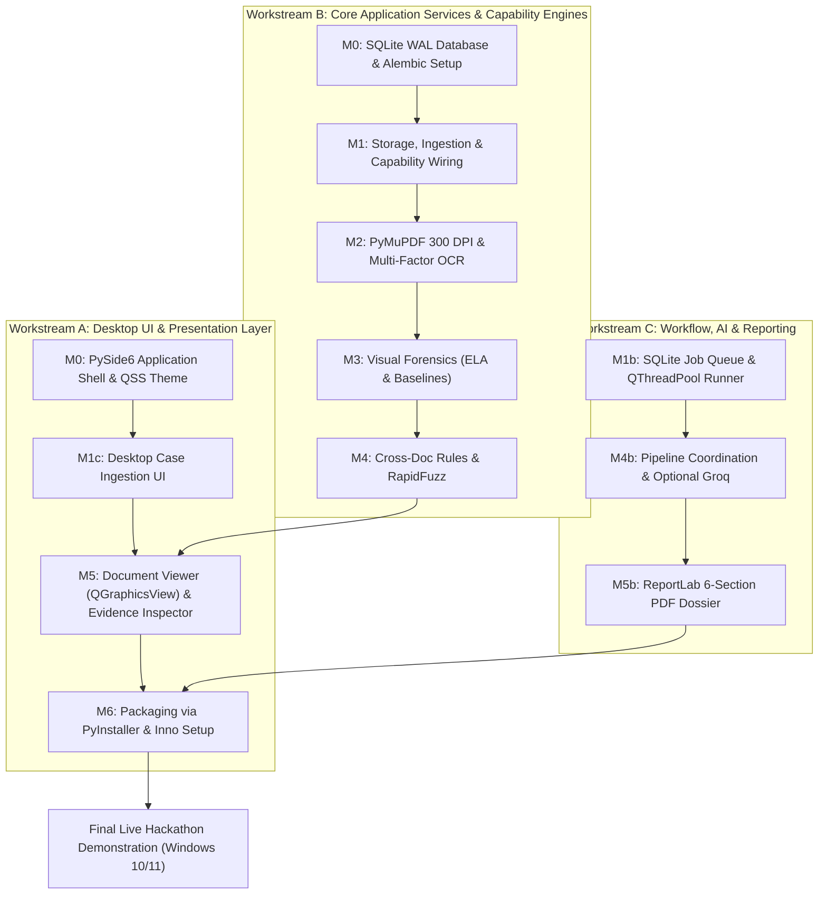

# 23_DETAILED_DEVELOPMENT_PLAN.md
# Dependency-Aware Phased Development Plan & Desktop Execution Blueprint

---

## 1. Execution Principles & Parallel Workstreams

To maximize development velocity while delivering a true standalone desktop product, the implementation is partitioned into three parallelizable workstreams anchored by the shared application services and domain models:

---

## 2. Granular Milestone Blueprints

---

### Milestone 0: PySide6 Desktop Prototype (Technical Feasibility Gate)
* **Objective:** Establish the PySide6 application lifecycle, implement the 4-pane workstation layout in Qt Widgets with QSS forensic dark theming, wire direct Python application services, and initialize SQLite in `%LOCALAPPDATA%/VeriTrace/`.
* **Prerequisites:** Task 02.5 approval.
* **Modules Affected:**
  * `src/veritrace/main.py`, `src/veritrace/gui/app.py`
  * `src/veritrace/gui/views/main_window.py`, `src/veritrace/gui/styles/dark_theme.qss`
  * `src/veritrace/gui/controllers/`, `src/veritrace/application/services/`
  * `src/veritrace/infrastructure/persistence/`
* **Deliverables:**
  * Launchable PySide6 native desktop window with responsive docking panels.
  * Direct in-process invocation of application services from desktop controllers.
  * Initialized SQLite database in `%LOCALAPPDATA%/VeriTrace/database/veritrace.sqlite`.
  * Graceful application exit handling without memory leaks.
* **Acceptance Criteria:** Running `python scripts/development/run_desktop.py` (or `python -m veritrace`) boots the Qt event loop, initializes SQLite in WAL mode, applies the custom QSS dark theme, and exits cleanly.
* **Tests Required:** `tests/desktop/test_app_lifecycle.py` verifying Qt initialization and database connection.

---

### Milestone 1: Application Foundation, Ingestion, Persistence & Asynchronous Execution
* **Objective:** Establish SQLite WAL persistence (12 Core Entities + 1 Assoc Table), build local multi-document intake in `%LOCALAPPDATA%/VeriTrace/`, and implement asynchronous job execution via `QThreadPool` / `QRunnable` (and standalone `job_runner.py`).
* **Prerequisites:** Milestone 0.
* **Modules Affected:**
  * `src/veritrace/infrastructure/persistence/`, `src/veritrace/domain/entities/`, `src/veritrace/domain/value_objects/`
  * `src/veritrace/application/services/`, `src/veritrace/capabilities/ingestion/`
  * `src/veritrace/workers/job_runner.py`, `src/veritrace/workers/pools/`
  * `src/veritrace/gui/views/`, `src/veritrace/gui/controllers/`
* **Deliverables:**
  * Working SQLite database with versioned Alembic migrations.
  * `InvestigationService.create_investigation()` and `DocumentService.ingest_documents()`.
  * Asynchronous job runner (`QThreadPool` + `QRunnable`) emitting Qt Signals.
  * Desktop drag-and-drop file import UI with real-time SHA-256 calculation.
* **Acceptance Criteria:** Dropping a 3-file bundle (PDF + PNG) creates database rows, saves files to `%LOCALAPPDATA%/.../originals/`, and schedules an investigation job with reactive status updates.
* **Tests Required:** `tests/unit/test_intake.py` verifying magic bytes and hashing; `tests/integration/test_job_execution.py` verifying atomic claims and stage progress.

---

### Milestone 2: Document Processing, Multi-Factor OCR & Extraction Quality
* **Objective:** Convert PDF pages into 300 DPI high-resolution PNGs, extract text tokens via `TextExtractorProtocol` with normalized bounding box coordinates, execute empirical OCR benchmark suite, and evaluate extraction quality.
* **Prerequisites:** Milestone 1.
* **Modules Affected:**
  * `src/veritrace/infrastructure/pdf/`, `src/veritrace/infrastructure/ocr/`
  * `src/veritrace/capabilities/extraction/`, `src/veritrace/capabilities/quality/`
  * `src/veritrace/gui/components/document_viewer.py`
* **Deliverables:**
  * PyMuPDF service rendering each page to a 300 DPI image (`processed/`).
  * `TextExtractorProtocol` interface isolating OCR engine specifics from downstream pipeline.
  * Empirical multi-dimensional OCR benchmark suite (CER, WER, Exact Field Match, IoU $\ge 0.70$, latency, RSS) across CAT-01 to CAT-07.
  * Bundled Tesseract OCR baseline integration (with pluggable RapidOCR candidate path).
  * Extraction Quality Assessment Engine evaluating OCR confidence distributions and image degradation.
  * `QGraphicsView` document viewer displaying pages with interactive coordinate bounding boxes.
* **Acceptance Criteria:** Sample 1-page PDF produces a 300 DPI PNG and returns structured fields with normalized coordinates $[ymin, xmin, ymax, xmax] \in [0.0, 1.0]$ and quality confidence metrics.
* **Tests Required:** `tests/integration/test_pdf_processing.py`, `tests/integration/test_ocr_extraction.py`, and `tests/benchmarks/test_ocr_benchmark.py`.

---

### Milestone 3: Visual Forensics Suite & Threshold Calibration
* **Objective:** Implement Error Level Analysis (ELA), font baseline regression, duplicate signature/stamp matching, and high-resolution visual evidence cropping.
* **Prerequisites:** Milestone 2.
* **Modules Affected:**
  * `src/veritrace/capabilities/forensics/`, `src/veritrace/infrastructure/vision/`
  * `src/veritrace/gui/components/evidence_inspector.py`
* **Deliverables:**
  * ELA engine computing JPEG compression differential heatmaps.
  * Font baseline regression engine detecting spliced or elevated numerals ($>2.5\sigma$ row residual).
  * Evidence crop extractor generating localized PNGs with 20px context padding.
  * Inspector dock widget rendering side-by-side original and ELA crops.
* **Acceptance Criteria:** Altered figures on a test salary slip are highlighted with compression anomalies and baseline flags.
* **Tests Required:** `tests/unit/test_ela.py` and `tests/unit/test_baseline.py`.

---

### Milestone 4: Contextual Rules, Cross-Document Intelligence & Configurable AI
* **Objective:** Implement arithmetic validation rules, date chronology checks, RapidFuzz cross-document entity reconciliation, and configurable narrative explanation with deterministic offline fallback.
* **Prerequisites:** Milestone 3.
* **Modules Affected:**
  * `src/veritrace/domain/rules/`
  * `src/veritrace/capabilities/correlation/`
  * `src/veritrace/capabilities/reasoning/`, `src/veritrace/infrastructure/ai/`
* **Deliverables:**
  * Deterministic intra-document financial rules (Gross = Basic + Allowances; Net = Gross - Deductions).
  * RapidFuzz cross-document reconciliation aligning names and accounts across files.
  * `LLMProviderProtocol` abstraction supporting configurable AI models (`VERITRACE_AI_MODEL`).
  * Deterministic template narrative generator (`TemplateNarrativeGenerator`) for offline / air-gapped operation.
  * PII redaction filter masking sensitive identifiers prior to optional cloud API calls.
* **Acceptance Criteria:** Contradictions between an ID card and bank statement are automatically flagged and categorized into the 3-tier ontology, with narrative generated offline or via configured LLM without hallucinated findings.
* **Tests Required:** `tests/unit/test_contextual_rules.py`, `tests/unit/test_correlation.py`, and `tests/unit/test_narrative_generator.py`.

---

### Milestone 5: Evidence Mapping, Reviewer Gate & PDF Dossier
* **Objective:** Implement Human-in-the-Loop review controls and compile an auditor-grade PDF report satisfying PS-2 Sections 7.1–7.6 via ReportLab.
* **Prerequisites:** Milestone 4.
* **Modules Affected:**
  * `src/veritrace/capabilities/reporting/`, `src/veritrace/infrastructure/reporting/`
  * `src/veritrace/gui/components/evidence_inspector.py`
  * `src/veritrace/gui/views/dossier_view.py`
* **Deliverables:**
  * Review controls (`CONFIRM`, `DISMISS`, `ANNOTATE`) updating `ReviewDecision`.
  * Immutable `AuditEvent` logging.
  * ReportLab compiler producing multi-page PDF reports with embedded visual crops and SHA-256 digests.
* **Acceptance Criteria:** Submitting a review decision updates risk scores; exporting compiles a compliant PDF dossier in $<3$ seconds.
* **Tests Required:** `tests/integration/test_dossier_generation.py`.

---

### Milestone 6: Desktop Packaging, Distribution & Verification
* **Objective:** Package the complete application into a single downloadable Windows installer (`VeriTrace-Setup.exe`).
* **Prerequisites:** Milestone 5.
* **Modules Affected:**
  * `packaging/pyinstaller/veritrace.spec`
  * `packaging/installer/veritrace_setup.iss`
  * `scripts/build/`, `scripts/packaging/`
* **Deliverables:**
  * PyInstaller one-folder distribution containing Python 3.11, PySide6, OpenCV, PyMuPDF, and Tesseract.
  * Inno Setup script compiling `VeriTrace-Setup.exe`.
  * Desktop and Start Menu shortcuts, clean uninstaller preserving `%LOCALAPPDATA%` databases.
* **Acceptance Criteria:** Clean install and execution on a pristine Windows 10/11 x64 machine without developer tools.
