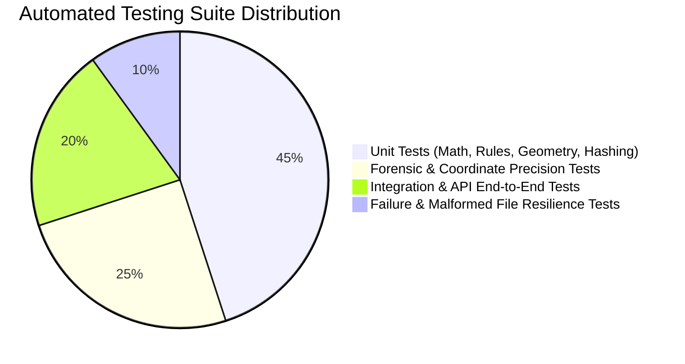
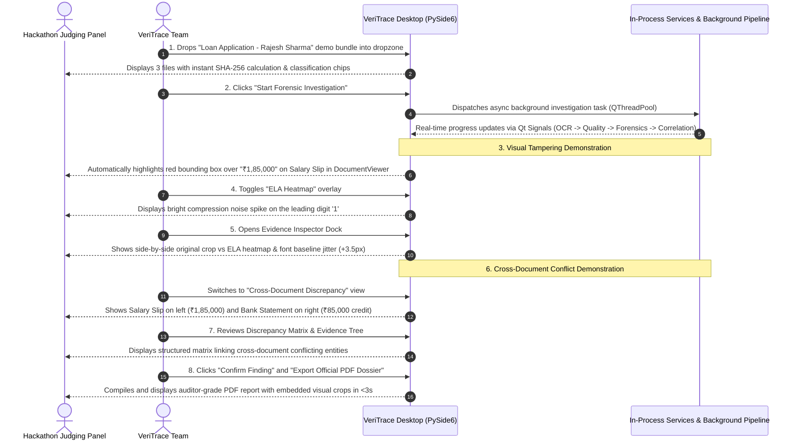

# 24_TESTING_AND_DEMO_STRATEGY.md
# Comprehensive Testing Framework & Live Demonstration Blueprint

---

## 1. Testing Philosophy & Test Pyramid

Forensic document systems require verifiable accuracy, zero silent failures, and strict evidence traceability. The VeriTrace testing strategy combines programmatic automated unit and integration tests with synthetic forensic benchmark datasets.

---

## 2. Automated Test Suite Specifications

### 2.1 Unit Tests (`tests/unit/`)
* **File Validation Tests (`test_intake.py`):**
  * Asserts magic byte detection correctly identifies PDF (`%PDF`), PNG (`\x89PNG`), JPEG (`\xFF\xD8\xFF`), and rejects `.exe`, `.sh`, `.zip`.
  * Enforces maximum file size limit ($20\text{MB}$).
  * Asserts SHA-256 calculation produces identical cryptographic digests across multiple runs.
* **Coordinate & Geometry Tests (`test_pdf_processing.py`):**
  * Verifies normalization math translates point space into $[ymin, xmin, ymax, xmax] \in [0.0, 1.0]$.
  * Asserts coordinate boundary invariants ($ymin < ymax$ and $xmin < xmax$).
  * Verifies that converting normalized coordinates back to 300 DPI pixels matches expected pixel bounding boxes within a $\pm 1$ pixel tolerance.
* **Contextual & Arithmetic Rule Tests (`test_contextual_rules.py`):**
  * Verifies mathematical assertions: `Basic + HRA + Allowances == Gross` and `Gross - Deductions == Net`.
  * Verifies date chronology rules: `Issue Date <= Today`, `Expiry Date > Issue Date`.
  * Asserts regex validation for Indian PAN (`[A-Z]{5}[0-9]{4}[A-Z]`) and Aadhaar formats.
* **Entity Reconciliation Tests (`test_cross_doc.py`):**
  * Tests RapidFuzz token sort matching against real-world name variations:
    * `"Rajesh Kumar Sharma"` vs `"Rajesh K. Sharma"` $\to$ Similarity $>0.88$ (Match).
    * `"Rajesh Kumar Sharma"` vs `"Rakesh Kumar Sharma"` $\to$ Similarity $\approx 0.76$ (Flagged Discrepancy).
    * `"Rajesh Sharma"` vs `"Vikram Singh"` $\to$ Similarity $<0.30$ (Distinct Entities).

### 2.2 Forensic False-Positive & Accuracy Testing
* **Error Level Analysis (ELA) Noise Baseline Test (`test_visual_forensics.py`):**
  * Evaluates ELA against a completely genuine scanned document; asserts that ambient background variance does not trigger false-positive manipulation flags.
  * Evaluates ELA against an image patch containing digitally spliced text; asserts that local compression error exceeds ambient noise by $>3.0\sigma$ and triggers an anomaly box.
* **Font Baseline Regression Test:**
  * Fits a linear regression line across genuine printed character coordinates; asserts variance $\sigma < 1.0\text{px}$.
  * Injects a vertically shifted character ($+4.0\text{px}$); asserts that baseline detector flags the shifted token with $z\text{-score} > 3.5$.

### 2.3 Evidence Traceability & Dossier Consistency Tests
* **Chain-of-Custody Verification (`test_dossier.py`):**
  * Verifies that every `Finding` record in the database is linked to at least one valid `Evidence` record.
  * Asserts that every `Evidence` record points to an existing high-resolution crop PNG file on disk.
  * Verifies that the compiled PDF dossier contains non-null document identifiers, valid dates, and an intact SHA-256 hash stamp.

### 2.4 Failure Mode & Malformed File Resilience Tests
* **Encrypted / Corrupted File Injection:** Injects a password-protected PDF; asserts intake validator returns `ERROR_CORRUPTED` without crashing the application process.
* **Oversized Batch Injection:** Submits oversized batch files; asserts intake validator cleanly rejects with `FileValidationException` (Payload Too Large).
* **Groq Rate-Limit Simulation:** Mocks a `429 Too Many Requests` response from Groq; asserts reasoning engine activates the deterministic template fallback and completes the dossier.

### 2.5 PySide6 Desktop Application, Packaging & Local Lifecycle Tests (`tests/desktop/`)
* **PySide6 Application Startup & GUI Interaction (`pytest-qt`):**
  * Asserts the desktop application initializes `QApplication`, loads the 4-pane workstation layout, and renders all docking panels cleanly.
* **In-Process Service Wiring & Background Threading:**
  * Asserts UI controllers communicate with application services in-process without network overhead.
  * Asserts heavy forensic tasks execute via `QThreadPool` / `QRunnable` without freezing the Qt main loop.
* **Qt Signals & Progress Telemetry:**
  * Asserts background runnables emit `progress_updated` and `stage_changed` signals correctly.
* **100% Offline Capability Test:**
  * Simulates complete network disconnection (airplane mode / mock DNS drop); asserts full investigation workflow (intake, rendering, OCR, ELA, cross-doc correlation, PDF dossier) completes with 0 errors.
* **Application Restart & State Recovery:**
  * Simulates closing and reopening the app; asserts historical investigations, completed dossiers, and in-flight job resumption states are preserved in `%LOCALAPPDATA%/VeriTrace/database/veritrace.sqlite`.
* **Clean Windows Environment & Installer Validation:**
  * Validates `VeriTrace-Setup.exe` on a fresh Windows 10/11 x64 virtual machine lacking Python, Node.js, and developer tools; asserts setup installs to `Program Files`, desktop shortcuts work, and the application opens out of the box.

---

### 2.6 Empirical OCR & Extraction Benchmark Specification

To avoid speculative or unverified performance claims, all OCR engines (Tesseract default vs. alternative evaluation candidates like PaddleOCR) must be quantitatively evaluated across a multi-dimensional benchmark suite prior to final comparative claims.

#### 1. Evaluation Dimensions & Formulas

* **Raw OCR Accuracy:**
  * **Character Error Rate (CER):**
    $$\text{CER} = \frac{S_c + D_c + I_c}{N_c}$$
    Where $S_c$ is character substitutions, $D_c$ is deletions, $I_c$ is insertions, and $N_c$ is total reference characters.
  * **Word Error Rate (WER):**
    $$\text{WER} = \frac{S_w + D_w + I_w}{N_w}$$
    Where $S_w, D_w, I_w$ are word-level edits and $N_w$ is total reference words.

* **Field Extraction Accuracy:**
  * **Exact Field Match Rate:**
    $$\text{Match Rate} = \frac{\sum \mathbb{I}(\text{Extracted Value} == \text{Ground Truth Value})}{N_{\text{fields}}}$$
  * **Field Precision & Recall:**
    $$\text{Precision} = \frac{\text{TP}_{\text{fields}}}{\text{TP}_{\text{fields}} + \text{FP}_{\text{fields}}}, \quad \text{Recall} = \frac{\text{TP}_{\text{fields}}}{\text{TP}_{\text{fields}} + \text{FN}_{\text{fields}}}$$

* **Geometric Localization Accuracy:**
  * **Bounding-Box Intersection over Union (IoU):**
    $$\text{IoU}(\text{Box}_{\text{pred}}, \text{Box}_{\text{gt}}) = \frac{\text{Area}(\text{Box}_{\text{pred}} \cap \text{Box}_{\text{gt}})}{\text{Area}(\text{Box}_{\text{pred}} \cup \text{Box}_{\text{gt}})}$$
  * Target localization threshold: $\text{IoU} \ge 0.70$ for successful field anchoring.

* **Computational Performance Metrics:**
  * **Wall-Clock Processing Latency:** Mean and 95th-percentile execution time per page (milliseconds on standard CPU).
  * **Peak Memory Footprint:** Peak Resident Set Size (RSS in MB) during page rasterization and recognition.
  * **CPU Core Utilization:** Single-thread vs. multi-thread utilization percentage during batch execution.

#### 2. Representative Benchmark Dataset Composition

A 10-document test set serves solely as an initial smoke-test and must **not** be used to assert broad statistical performance. A statistically valid benchmark requires at least 30 diverse document pages covering seven operational categories:

| Category ID | Category Description | Target Document Samples | Key Forensic & Extraction Challenges |
| :--- | :--- | :--- | :--- |
| **CAT-01** | **Clean Digital PDFs** | Born-digital paystubs, computer-generated invoices, industrial purchase orders | Vector font stream vs. raster comparison, zero scan noise. |
| **CAT-02** | **High-Resolution Scans** | 300 DPI flatbed scans of printed forms, delivery challans, tax IDs | Sharp contrast, standard printed fonts (Calibri, Times, Arial, Mangal). |
| **CAT-03** | **Low-Resolution / Degraded** | 150 DPI scans, multi-generation photocopies, factory floor receipts | Salt-and-pepper noise, broken character stems, low contrast. |
| **CAT-04** | **Skewed & Distorted** | Mobile camera photos, angled scans ($\pm 5^\circ$ to $\pm 15^\circ$) | Perspective distortion, non-linear text baselines, shadow gradients. |
| **CAT-05** | **Complex Industrial Tables** | Multi-column PO schedules, chemical composition grids in Mill Test Certs | Multi-line headers, missing cell borders, merged cells, numeric alignments. |
| **CAT-06** | **Multilingual & Indic Scripts** | Bilingual Hindi-English tax invoices, Marathi delivery challans, Tamil receipts | Shirorekha continuity, complex conjuncts, regional numerals (`१, २, ३`). |
| **CAT-07** | **Signatures & Mixed Typography**| Inspection reports with rubber stamps, handwritten endorsements, and seals | Overlapping strokes, signature localization, clone patch detection. |

---

### 2.7 Signature Forensics Test Framework

* **Offline Signature Detection & Localization:**
  * Asserts signature contour proposal achieves $\text{IoU} \ge 0.75$ against ground-truth signature bounding boxes on scanned forms.
  * Asserts printed form lines and circular rubber stamps are successfully filtered out from candidate signature regions.
* **Tampering & Clone Detection Test:**
  * Injects identical signature image patch onto two distinct invoice PDFs; asserts ORB feature matching detects cut-and-paste clone (candidate threshold calibrated on labelled test pairs).
  * Evaluates ELA around signature bounding box; asserts rectangular insertion masks flag with elevated boundary variance (calibrated against compression baseline).
* **Reference Comparison & Evaluation Dataset Requirements:**
  * Evaluated on standard benchmark sets containing **genuine signatures, skilled forgeries, and random forgeries** across different writing instruments and scanning resolutions.
  * Measures **False Acceptance Rate (FAR)**, **False Rejection Rate (FRR)**, and **Equal Error Rate (EER)**.
  * Asserts local CPU inference via **ONNX Runtime (`onnxruntime`)** completes in $<250\text{ms}$ per signature without GPU requirements.
  * Asserts the 6-level assessment scale is strictly enforced; a low similarity score never outputs an autonomous accusation of forgery, and static 2D scans are never used to claim pen pressure or writing speed.

---

## 3. Curated Hackathon Demonstration Datasets (`fixtures/`)

To guarantee a flawless live evaluation against the **PS-2 Judges' Live Demonstration Checklist**, VeriTrace includes two pre-packaged demonstration datasets:

### Demonstration Package 1: "Industrial Manufacturing Procurement – CASE-2026-IND-01"
Demonstrates the primary industrial evaluation domain across manufacturing and supply chain documents:

| Document Role | Mock File Name | Nature | Engineered Characteristics / Ground Truth |
| :--- | :--- | :---: | :--- |
| **Doc 1: Purchase Order** | `PO_SteelTubes_AutoCorp.pdf` | **Genuine** | Clean digital PO for 500 units of Seamless Steel Tubes (Grade SS-304) at ₹1,200/unit. Total: ₹6,00,000 + 18% GST (₹1,08,000) = **₹7,08,000**. Authorized Signer: *"Amitabh Sen (Procurement Lead)"*. |
| **Doc 2: Delivery Challan** | `DeliveryChallan_SteelTubes_Tampered.pdf` | **Artificially Manipulated** | Scanned delivery challan from supplier. The delivered quantity field has been digitally altered from 450 units to **500 units** to match the PO. Elevated JPEG compression noise and font baseline misalignment ($+3.8\text{px}$) are present on the digit '5'. |
| **Doc 3: Mill Test Certificate** | `MillTestCert_Grade_ForgedSig.pdf` | **Signature Anomaly** | Metallurgical test sheet certifying chemical composition (Cr 18.2%, Ni 8.1%). Features a cloned cut-and-paste signature of *"Dr. R. K. Deshmukh (Chief Metallurgist)"* identical down to the pixel level with a previous shipment's certificate, accompanied by an ELA boundary mask anomaly. |

### Demonstration Package 2: "Financial Loan Application Bundle – CASE-2026-0891"
Contains three realistic sample documents representing a consumer banking package:

| Document Role | Mock File Name | Nature | Engineered Characteristics / Ground Truth |
| :--- | :--- | :---: | :--- |
| **Doc 1: Identity Proof** | `National_ID_RajeshSharma.pdf` | **Genuine** | Clean, authentic identity card. Name: *"Rajesh Kumar Sharma"*, DOB: *12/04/1988*, PAN: *ABCDE1234F*. |
| **Doc 2: Income Proof** | `SalarySlip_Nov2023_Tampered.pdf` | **Artificially Manipulated** | Digitally spliced salary slip. Net pay altered from ₹85,000 to **₹1,85,000** with font baseline misalignment and ELA noise spike. Math failure: Basic + HRA + Allowances = ₹85,000 $\ne$ stated ₹1,85,000. |
| **Doc 3: Bank Statement** | `BankStatement_Nov2023_Conflicting.pdf` | **Cross-Doc Conflict** | Clean transaction statement from HDFC Bank showing genuine credit of **₹85,000** from *"Apex Solutions Ltd"*, contradicting Doc 2's stated ₹1,85,000. Name spelled *"Rakesh K. Sharma"*. |

---

## 4. Judges' Live Demonstration Script (5-Minute Walkthrough)

The live presentation follows a strict 8-step script mapped directly to the official PS-2 demonstration checklist:

### Demonstration Checklist Mapping Verification

* [x] **Upload multiple sample documents:** Demonstrated via 3-file bundle drag-and-drop intake.
* [x] **Classification & OCR extraction:** Demonstrated via automatic document typing and text coordinate extraction.
* [x] **Structured representation:** Demonstrated via key-value and tabular JSON parsing.
* [x] **Highlight suspicious document regions:** Demonstrated via bounding boxes on paystub in `QGraphicsView`.
* [x] **Intra-document inconsistencies:** Demonstrated via Salary Slip arithmetic math failure ($85\text{K} \ne 185\text{K}$).
* [x] **Cross-document comparison:** Demonstrated via Salary Slip declared pay vs Bank Statement actual deposit credit.
* [x] **Relational evidence mapping:** Demonstrated via Discrepancy Matrix and hierarchical Evidence Tree.
* [x] **Inspect evidence crops:** Demonstrated via Evidence Inspector dock with ELA heatmaps.
* [x] **Generate final investigation dossier:** Demonstrated via one-click ReportLab PDF export.
* [x] **Trace findings to original location:** Demonstrated via click-to-highlight coordinate anchoring.
* [x] **Distinguish observations from manipulation:** Demonstrated via Three-Tier Epistemic ontology.
* [x] **Safe failure handling:** Demonstrated via handling of encrypted or blurry document samples.
