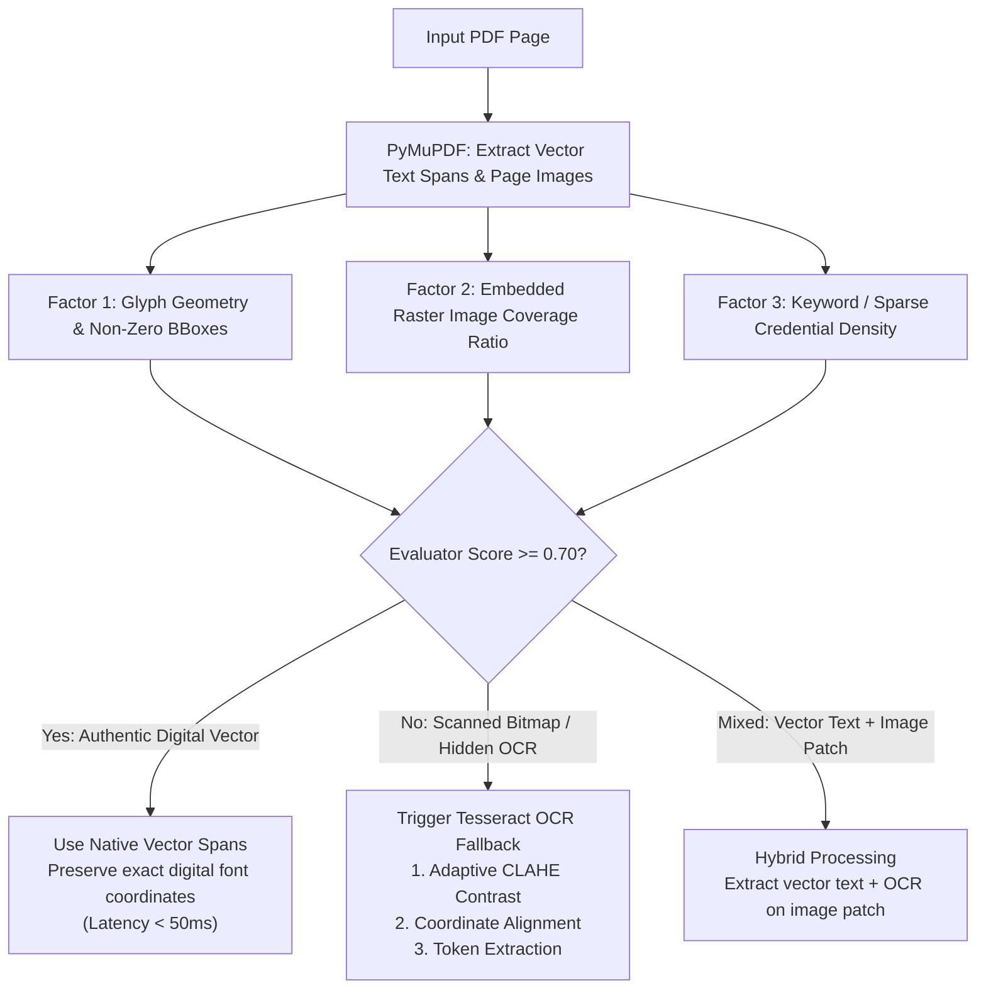
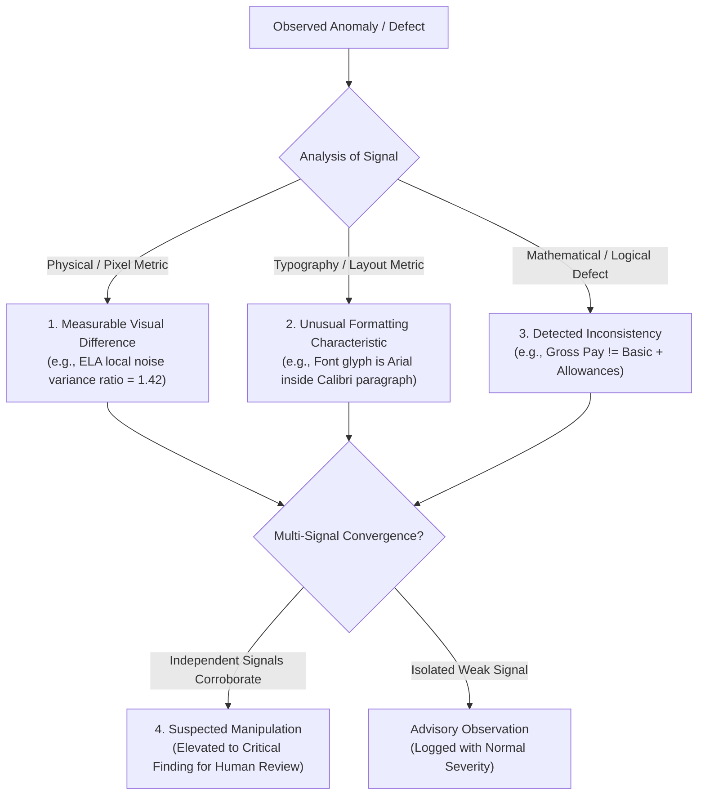

# 25_ARCHITECTURE_CORRECTIONS_AND_IMPLEMENTATION_READINESS.md
# Architecture Corrections, Operational Reliability & Implementation Readiness Review

---

## 1. Executive Summary & Purpose

This document provides the final technical correction pass and implementation readiness validation for **VeriTrace**. It resolves all architectural ambiguities identified during the preliminary review, establishes strict operational guardrails, codifies a lightweight persistent asynchronous job architecture, reconciles data models, and defines an authoritative demonstration dataset ground truth.

---

## 2. Persistent Asynchronous Job Architecture (No Redis / No Celery)

### 2.1 The Problem & Design Constraint
CPU-intensive forensic operations (rasterizing multiple 300 DPI pages, computing Error Level Analysis matrices, running Tesseract OCR, and fuzzy entity matching) take between 5 and 25 seconds for multi-document bundles. Running this inside a synchronous HTTP request causes gateway timeouts (`504 Gateway Timeout`) and drops connection states.

However, introducing **Redis + Celery** introduces heavy external service dependencies, broker connection errors, and container orchestration overhead, creating fragile failure modes during live hackathon evaluation.

### 2.2 The Solution: Multi-Threaded Background Processing & SQLite Persistence

To guarantee durability and prevent CPU-intensive forensic operations from freezing the PySide6 UI event loop, VeriTrace implements a **multi-threaded background execution architecture** backed by SQLite in WAL mode:

```mermaid
sequenceDiagram
    autonumber
    actor Analyst as Investigator
    participant UI as PySide6 UI (MainWindow)
    participant Ctrl as Application Controller
    participant Svc as Application Services
    participant DB as SQLite WAL (jobs table)
    participant Pool as QThreadPool / QRunnable
    participant Engine as Forensic Capability Pipeline

    Analyst->>UI: Clicks "Analyze Investigation"
    UI->>Ctrl: on_analyze_clicked(investigation_id)
    Ctrl->>Svc: JobQueueService.enqueue_job(investigation_id)
    Svc->>DB: Atomic check: active jobs for investigation_id
    alt Active Job Exists (QUEUED or RUNNING)
        Svc-->>Ctrl: Raise DuplicateJobActiveError
        Ctrl-->>UI: Show warning dialog ("Job already active for this case")
    else No Active Job
        Svc->>DB: INSERT INTO investigation_jobs (status='QUEUED', stage='INTAKE')
        Svc-->>Ctrl: JobStatusDTO(job_id=..., status='QUEUED')
        Ctrl->>Pool: QThreadPool.globalInstance().start(ForensicRunnable(job_id))
    end

    Note over Pool,DB: Background runnable claims job via atomic SQLite transaction
    Pool->>DB: BEGIN IMMEDIATE; UPDATE status='RUNNING'
    
    loop For Each Pipeline Stage
        Pool->>DB: UPDATE investigation_jobs (stage='...', progress_pct=..., last_heartbeat_at=now)
        Pool-->>UI: Qt Signal progress_updated(stage, percent)
        Pool->>Engine: Execute Capability Engine (PyMuPDF, OCR, ELA, Rules)
        Engine-->>Pool: Stage Artifacts & Findings Persisted
    end

    Pool->>DB: UPDATE investigation_jobs (status='COMPLETED', completed_at=now)
    Pool-->>UI: Qt Signal pipeline_finished(investigation_id)
    UI->>Ctrl: reload_investigation_data()
```

### 2.3 Atomic Job Claiming & Concurrency Control in SQLite
* **Atomic Claiming Algorithm:** To prevent race conditions if multiple worker processes or threads poll the database, claiming utilizes SQLite's reserved lock:
  ```sql
  BEGIN IMMEDIATE;
  SELECT id, investigation_id FROM investigation_jobs 
  WHERE status = 'QUEUED' 
  ORDER BY created_at ASC 
  LIMIT 1;

  UPDATE investigation_jobs 
  SET status = 'RUNNING', 
      worker_id = :worker_id, 
      started_at = CURRENT_TIMESTAMP, 
      last_heartbeat_at = CURRENT_TIMESTAMP 
  WHERE id = :claimed_job_id AND status = 'QUEUED';
  COMMIT;
  ```
  `BEGIN IMMEDIATE` guarantees exclusive write access at the start of the transaction, ensuring that no two workers can claim the same job.

### 2.4 Worker Heartbeats, Stale Job Detection & Crash Recovery
* **Heartbeat Mechanism:** While processing an investigation, the worker continuously touches `last_heartbeat_at = CURRENT_TIMESTAMP` at the beginning of each capability stage and during long page-rendering loops.
* **Worker Crash Recovery & Stale Job Reclaiming:** If a worker process is terminated (e.g., process crash, power loss, OOM killer during OCR), jobs remain in `RUNNING` status without an active process. 
  * Any running worker (or the API startup check) executes a stale job sweep:
    ```sql
    UPDATE investigation_jobs 
    SET status = 'FAILED', 
        error_message = 'Worker heartbeat timed out (>60s). Eligible for stage resumption.',
        can_resume = 1 
    WHERE status = 'RUNNING' 
      AND datetime(last_heartbeat_at, '+60 seconds') < datetime('CURRENT_TIMESTAMP');
    ```
* **Application Restart Independence:** If the desktop application process restarts, the persistent SQLite state ensures unfinished jobs can be safely reclaimed and resumed from the last completed stage.
* **Partial Artifact Safety:** Each capability saves its artifacts atomically to disk (e.g., page PNGs saved to `pages/`, database rows inserted into `document_pages`). If a crash occurs during OCR on page 3 of 5, pages 1 and 2 are already safely committed.

### 2.5 Resumption & Controlled Retry Strategy
* **Stage-Level Resume:** Invoking `InvestigationService.retry_investigation(id)` (or `JobService.retry_job(job_id)`) re-enqueues the job (`status='QUEUED'`). When the worker claims it, the orchestrator inspects existing artifacts in SQLite and on disk:
  1. *Are pages already rendered?* If `COUNT(document_pages) == page_count`, skip page rasterization.
  2. *Are OCR tokens already extracted?* If `COUNT(extracted_fields) > 0`, skip OCR extraction.
  3. *Are ELA heatmaps already generated?* If heatmaps exist, skip ELA analysis.
  The worker picks up execution directly at the first incomplete stage, avoiding redundant computation.
* **Retry Counter:** `retry_count` is incremented on each retry attempt. If `retry_count >= 3`, the job is marked permanently `FAILED_ABORTED` to prevent infinite failure loops.

### 2.6 Desktop UI Progress Updates & Reactive Telemetry
* Multi-threaded background tasks (`QRunnable` managed by `QThreadPool`) emit custom Qt Signals: `progress_updated(stage: str, percent: int)` and `pipeline_finished(investigation_id: str)`.
* The PySide6 UI main window subscribes to these signals, updating the progress bar in `StatusBar` and refreshing document tree views asynchronously without blocking the UI thread.
* For external status inspection or recovery, callers read SQLite `investigation_jobs` directly via `JobService.get_job_status(job_id)`.

---

## 3. Database Model Reconciliation & Final Entity Count

### 3.1 Entity Reconciliation Summary
The preliminary Task 02 documentation mentioned varying counts (10 to 12) depending on whether association tables or theoretical versioning were included. With the evolution to industrial forensics and signature verification, 3 additional models are integrated: `Organization`, `AuthorizedSubject`, and `SignatureReferenceProfile`.

**Definitive Entity Count: Exactly 15 Core Entities + 1 Association Table (16 Tables Total)**

| # | Entity Name | Table Name | Purpose | Model Class Location |
| :-: | :--- | :--- | :--- | :--- |
| **1** | `Investigation` | `investigations` | Root case container & risk score | `src/veritrace/infrastructure/persistence/models.py` |
| **2** | `InvestigationJob` | `investigation_jobs` | Persistent job state & progress tracking | `src/veritrace/infrastructure/persistence/models.py` |
| **3** | `Document` | `documents` | Ingested file metadata, hash & MIME | `src/veritrace/infrastructure/persistence/models.py` |
| **4** | `DocumentPage` | `document_pages` | 300 DPI page dimensions & image paths | `src/veritrace/infrastructure/persistence/models.py` |
| **5** | `ExtractedField` | `extracted_fields` | Granular OCR tokens & structured KV pairs | `src/veritrace/infrastructure/persistence/models.py` |
| **6** | `Entity` | `entities` | Reconciled canonical facts (Names, DOBs, IDs) | `src/veritrace/infrastructure/persistence/models.py` |
| **7** | `Finding` | `findings` | Standardized forensic findings (3-tier) | `src/veritrace/infrastructure/persistence/models.py` |
| **8** | `Evidence` | `evidence` | Pixel crops, ELA heatmaps & coordinates | `src/veritrace/infrastructure/persistence/models.py` |
| **9** | `FindingEvidenceMap` | `finding_evidence_map` | Many-to-many link (Finding $\leftrightarrow$ Evidence) | `src/veritrace/infrastructure/persistence/models.py` (Association) |
| **10**| `CrossDocumentRelation`| `cross_document_relations`| Inter-document links and conflicts | `src/veritrace/infrastructure/persistence/models.py` |
| **11**| `ReviewDecision` | `review_decisions` | Human sign-off, dismissal, and rationale | `src/veritrace/infrastructure/persistence/models.py` |
| **12**| `Dossier` | `dossiers` | Compiled 6-section PS-2 report & PDF hash | `src/veritrace/infrastructure/persistence/models.py` |
| **13**| `AuditEvent` | `audit_events` | Immutable append-only audit trail | `src/veritrace/infrastructure/persistence/models.py` |
| **14**| `Organization` | `organizations` | Supplier, vendor, customer enterprise profile | `src/veritrace/infrastructure/persistence/models.py` |
| **15**| `AuthorizedSubject`| `authorized_subjects`| Signatory profile, corporate role & department | `src/veritrace/infrastructure/persistence/models.py` |
| **16**| `SignatureReferenceProfile` | `signature_reference_profiles` | Reference signature sample crops & ONNX feature vectors | `src/veritrace/infrastructure/persistence/models.py` |

### 3.2 Formal Exclusion of `DocumentVersion` for Prototype
* **Verdict:** `DocumentVersion` is **EXCLUDED** from the hackathon prototype.
* **Justification:** In forensic investigations, submitted documents are treated as immutable physical evidence. Overwriting a document is forbidden under ISO/IEC 27037. If an applicant submits a revised document, it is ingested as a new document record with its own SHA-256 hash. Document version tracking is handled via timestamps and SHA-256 digests on `documents`.

### 3.3 Strict Layer Separation of Models
To prevent god-objects and circular imports, models are strictly partitioned:
1. **SQLAlchemy ORM Models (`src/veritrace/infrastructure/persistence/models.py`):** Pure database representations with column types, foreign keys, and relationship definitions.
2. **Domain Dataclasses & Value Objects (`src/veritrace/domain/entities/`, `src/veritrace/domain/value_objects/`):** Pure Python domain entities used inside business rules and capability engines (e.g., `Investigation`, `Document`, `ExtractedToken`, `GroundedFinding`).
3. **Application DTOs (`src/veritrace/application/dtos/`):** Strongly typed data transfer objects mediating between application services and the presentation layer.
4. **Workflow State Definitions (`src/veritrace/application/workflows/`):** Pipeline state and step payload models.

---

## 4. Storage Architecture & Repository Safety

### 4.1 Storage Partitioning Specification: Local Desktop Storage
All application data generated at runtime is stored outside the source code repository in the user's local application data directory:

```
%LOCALAPPDATA%/VeriTrace/
├── database/
│   └── veritrace.db                       # SQLite WAL database file
├── investigations/                        # Partitioned by investigation_id UUID
│   └── {investigation_id}/
│       ├── originals/                     # Original immutable files ({doc_id}.pdf)
│       ├── rendered_pages/                # Rendered 300 DPI PNG pages ({doc_id}_p{num}.png)
│       ├── extracted_data/                # Extracted OCR tokens and tabular JSON
│       ├── forensic_evidence/             # Crops ({evi_id}_crop.png, {evi_id}_ela.png)
│       └── reports/                       # Compiled reports ({dossier_id}.pdf, .json)
├── logs/                                  # Structured application and worker logs
└── config/                                # User preferences and local runtime settings
```

### 4.2 Git Exclusion Policy (`.gitignore` Specification)
The repository `.gitignore` explicitly protects user data, runtime databases, and desktop build artifacts:

```gitignore
# Runtime Investigation Storage & User Data
storage/
*.sqlite
*.sqlite3
*.db
*.db-wal
*.db-shm
*.bin

# Temporary Processing Directories & Logs
tmp/
temp/
*.tmp
logs/
*.log

# Desktop & Python Build Artifacts
build/
dist/
packaging/Output/
packaging/dist/

# Visual & PDF Artifacts (Except Icons & Test Fixtures)
*.png
*.jpg
*.jpeg
*.pdf
!src/veritrace/gui/resources/**/*.png
!src/veritrace/gui/resources/**/*.svg
!src/veritrace/gui/resources/**/*.ico
!packaging/resources/**/*.ico
!packaging/resources/**/*.bmp
!tests/fixtures/**/*.pdf
!tests/fixtures/**/*.png

# Secrets & Local Configurations
.env
.env.local
*.pem
*.key
```

### 4.3 Evidence Chain of Custody & File Integrity
1. **Intake Hashing:** Immediately upon upload, `hashlib.sha256(file_bytes).hexdigest()` is computed and saved in `documents.file_hash_sha256`.
2. **Path Mapping:** Storage paths in the database are stored as **relative paths** (e.g., `investigations/inv_123/raw/doc_456.pdf`) rather than absolute paths, ensuring that database backups can be moved across machines or operating systems without breaking pointers.
3. **Integrity Verification:** When a document is read for processing, its SHA-256 hash is re-computed and verified against the stored database hash. If a mismatch is detected, processing halts with an `INTEGRITY_TAMPERING_DETECTED` security alert.

---

## 5. OCR & PDF Processing Operational Reliability

### 5.1 Technology Responsibilities
* **`PyMuPDF` (`fitz`):** Primary PDF parser, metadata extractor, and page rasterizer. Extracts native digital vector text, character spans, font family names, and renders pages to images.
* **`Tesseract OCR` (`pytesseract`):** Fallback optical character recognition engine for scanned documents, photographed forms, or image patches lacking selectable vector text.
* **`OpenCV` (`cv2`):** Pre-OCR image processing (CLAHE binarization, skew angle correction) and post-OCR geometric baseline analysis.
* **`Pillow` (`PIL`):** Exact pixel-wise image arithmetic for Error Level Analysis and cropping visual patches.

### 5.2 Multi-Factor Text Layer Evaluation (Vector vs. Scanned vs. Mixed)
The system avoids relying on a naive character count (such as a 50-character cutoff). A raw count fails on **sparse documents** (e.g., an authentic National ID card containing only 25 characters total: Name, DOB, ID number) or **hidden OCR layers** (scanned PDFs with low-quality, misaligned invisible text injected by legacy scanning software).

VeriTrace implements a **Multi-Factor Text Quality Evaluator**:



#### Evaluation Rules:
1. **Glyph Geometry & Bounding Box Validity:** Checks whether extracted characters have valid, printable ASCII/Unicode glyphs, positive bounding box dimensions ($width > 0, height > 0$), and known font descriptor tables.
2. **Raster Image Coverage Ratio:** PyMuPDF queries `page.get_images()`. If a single background image covers $>80\%$ of the page area, the page is flagged as a likely scanned bitmap. If vector text exists over such an image, the system checks whether text coordinates align with image features; if vector coordinates are disorganized or span across white margins, it flags a *Degraded/Hidden OCR Layer* and triggers re-OCR via Tesseract.
3. **Sparse Document Protection:** If the character count is low ($<50$), the evaluator checks for high-value structured identifiers (e.g., regex match for dates `\d{2}/\d{2}/\d{4}`, ID numbers, or labels `"Name"`, `"DOB"`, `"No."`). If valid structured patterns are found, the page is accepted as a valid digital vector document despite low total character volume.
4. **Mixed Content Handling:** When a page contains both sharp vector text and embedded raster patches (e.g., an official stamp, corporate logo, or scanned signature box inside a digital PDF), the page's text is extracted digitally, while the bounding box of the embedded raster image is cropped and routed to Tesseract and OpenCV for visual forensics.

### 5.3 External Tesseract Availability & Graceful Degradation
* **Startup Check:** During application startup (`src/veritrace/gui/app.py`), the system runs:
  ```python
  try:
      version = pytesseract.get_tesseract_version()
      logger.info(f"Tesseract OCR detected: v{version}")
      tesseract_available = True
  except Exception as e:
      logger.warning(f"Tesseract OCR binary not found. Scanned document fallback disabled: {e}")
      tesseract_available = False
  ```
* **Graceful Degradation:** If Tesseract is not installed on the host machine, the application does not crash. Digital vector PDFs continue to process with 100% functionality. If a scanned document is ingested, it is flagged as `SCANNED_DOC_OCR_UNAVAILABLE` with clear instructions in the UI and dossier Section 7.6 (Investigation Limitations).

### 5.4 Resolution Strategy & Memory Safety
* **Resolution Independence:** 300 DPI ($zoom \approx 4.166$) is used *only* where optical precision is required (OCR token extraction and final visual evidence crops).
* **Downsampled ELA Processing:** Computing Error Level Analysis across a full 300 DPI canvas ($2480 \times 3508$ pixels) consumes $>100\text{MB}$ RAM per page. The ELA engine downsamples the image to **150 DPI** (or max dimension 1600px), computes the compression differential heatmap, and maps anomaly coordinates back to the normalized unit space $[0.0, 1.0]$. This reduces memory consumption by $75\%$ while preserving sub-millimeter detection.
* **Page-by-Page Memory Cleanup:** In `pdf_rasterizer.py`, pages are processed sequentially in a generator loop. Page pixmaps are explicitly deleted (`pix = None`, `page = None`) after saving to disk to prevent cumulative memory accumulation.

### 5.5 Coordinate Transformation Mathematics
To prevent coordinate misalignment across display canvases and zoom levels, VeriTrace uses **Normalized Unit Invariance**:

$$\text{BBox} = [y_{\min}, x_{\min}, y_{\max}, x_{\max}] \quad \text{where } y, x \in [0.0, 1.0]$$

1. **From PyMuPDF Vector Points (Origin Bottom-Left or Top-Left, 72 DPI):**
   $$y_{\min} = \frac{\text{bbox.y0}}{\text{page.rect.height}}, \quad x_{\min} = \frac{\text{bbox.x0}}{\text{page.rect.width}}$$
   $$y_{\max} = \frac{\text{bbox.y1}}{\text{page.rect.height}}, \quad x_{\max} = \frac{\text{bbox.x1}}{\text{page.rect.width}}$$
2. **From Tesseract Raster Pixels (Origin Top-Left, Render DPI):**
   $$y_{\min} = \frac{\text{top}}{\text{image\_height}}, \quad x_{\min} = \frac{\text{left}}{\text{image\_width}}$$
   $$y_{\max} = \frac{\text{top} + \text{height}}{\text{image\_height}}, \quad x_{\max} = \frac{\text{left} + \text{width}}{\text{image\_width}}$$
3. **To High-Resolution Crop Pixels (300 DPI Render):**
   $$Y_{\text{start}} = \max\left(0, \text{int}(y_{\min} \times H_{300}) - \text{padding}\right)$$
   $$X_{\text{start}} = \max\left(0, \text{int}(x_{\min} \times W_{300}) - \text{padding}\right)$$
   $$Y_{\text{end}} = \min\left(H_{300}, \text{int}(y_{\max} \times H_{300}) + \text{padding}\right)$$
   $$X_{\text{end}} = \min\left(W_{300}, \text{int}(x_{\max} \times W_{300}) + \text{padding}\right)$$

---

## 6. Forensic Reliability & Multi-Signal Corroboration Framework

### 6.1 Epistemic Separation of Forensic Findings
To maintain digital forensic integrity (ISO/IEC 27042), VeriTrace establishes four unambiguous categories of findings:



1. **Measurable Visual Difference:** An objective, mathematical pixel-level variance (e.g., localized JPEG compression differential in ELA).
2. **Unusual Formatting Characteristic:** An irregular design attribute that may or may not be intentional (e.g., a baseline jitter of 3.5px or mixed font families).
3. **Detected Inconsistency:** An unambiguous factual, temporal, or mathematical contradiction (e.g., stated monthly pay does not reconcile with bank deposits).
4. **Suspected Manipulation:** A high-severity finding triggered when **two or more independent signals converge** on the same field or entity.

### 6.2 Limitations of Individual Forensic Techniques
* **Error Level Analysis (ELA) Limitations:**
  * High-contrast edges (sharp black text on white backgrounds) naturally produce higher compression artifacts than smooth areas, even on authentic documents.
  * Repeated re-saving, scanning, or photocopying degrades compression signatures, potentially creating false negatives or uniform noise floors.
  * *Operational Standard:* ELA is strictly an investigative pointer; it **never** constitutes proof of forgery in isolation.
* **Font Baseline Analysis Limitations:**
  * Scanned documents placed on a flatbed scanner at an angle exhibit natural skew and baseline curvature across entire rows.
  * Low-resolution scans produce pixel-snapping artifacts that mimic baseline jitter.
  * *Operational Standard:* Baseline residual must exceed $2.5\sigma$ relative to the row regression line, and must be corroborated by character bounding box height differences.

### 6.3 Multi-Signal Corroboration Standard
A finding is elevated to `SUSPECTED_MANIPULATION` **only** when multiple independent analytical mechanisms converge on the same data point:

$$\text{Confidence}_{\text{composite}} = 1 - \prod_{i=1}^{k} (1 - S_i)$$

*Example of Corroborated Manipulation:*
* Signal 1 (Visual): ELA compression variance spike on leading digit '1'.
* Signal 2 (Typography): Font baseline of '1' is elevated +3.5px above row baseline.
* Signal 3 (Arithmetic): Stated Net Pay ₹1,85,000 violates internal sum of Basic + HRA (₹85,000).
* Signal 4 (Cross-Document): Bank statement deposit shows ₹85,000 from employer.
* **Result:** Definitively classified as **Suspected Manipulation (Salary Inflation)** with high confidence.

---

## 7. Demonstration Dataset Ground Truth Specification

To ensure 100% reproducible live evaluation without using real personal information or sensitive PII, VeriTrace uses an engineered demonstration package:

### Package: "Loan Application Bundle – CASE-2026-0891"

```
fixtures/
├── genuine/
│   └── National_ID_RajeshSharma.pdf          # Clean, authentic synthetic ID
├── manipulated/
│   └── SalarySlip_Nov2023_Tampered.pdf       # Digitally altered financial document
└── conflicting/
    └── BankStatement_Nov2023_Conflicting.pdf # Transaction statement with cross-doc conflicts
```

### Detailed Ground Truth Matrix

| Document | Page | Field / Region | Ground Truth Nature | Engineered Alteration | Target Forensic Detection Mechanism | Expected Finding & Tier |
| :--- | :---: | :--- | :--- | :--- | :--- | :--- |
| **Doc 1: National ID** | 1 | Full Name | Genuine | None (`"Rajesh Kumar Sharma"`) | OCR & Entity Extractor | `Entity(PERSON_NAME: "Rajesh Kumar Sharma")` |
| **Doc 1: National ID** | 1 | Date of Birth | Genuine | None (`"12/04/1988"`) | OCR & Entity Extractor | `Entity(DOB: "1988-04-12")` |
| **Doc 1: National ID** | 1 | PAN Number | Genuine | None (`"ABCDE1234F"`) | Regex Validator | Confirmed valid syntax |
| **Doc 2: Salary Slip** | 1 | Net Pay Number | **Tampered** | Leading `'1'` inserted before `'85,000'` to read `'₹1,85,000'`. | 1. ELA local variance ratio $= 1.42$<br>2. Font baseline offset $= +3.5\text{px}$ | `SUSPECTED_MANIPULATION`<br>(Salary Inflation) |
| **Doc 2: Salary Slip** | 1 | Earnings Math | **Inconsistent** | Basic (₹50k) + HRA (₹25k) + Allowances (₹10k) = ₹85,000 $\ne$ stated ₹1,85,000. | Arithmetic Checksum Engine (`math_rules.py`) | `DETECTED_INCONSISTENCY`<br>(Arithmetic Mismatch: Diff = ₹1,00,000) |
| **Doc 3: Bank Stmt** | 1 | Salary Deposit | **Contradictory** | Deposit row from *"Apex Solutions Ltd"* shows credit of **₹85,000.00**. | Cross-Document Correlation (`conflict_matrix.py`) | `DETECTED_INCONSISTENCY`<br>(Bank Deposit ₹85k contradicts stated Paystub ₹185k) |
| **Doc 3: Bank Stmt** | 1 | Account Name | **Discrepancy** | Name printed as *"Rakesh K. Sharma"* (spelled with a 'k'). | RapidFuzz Token Match (Similarity: $0.76$) | `DETECTED_INCONSISTENCY`<br>(Cross-Doc Name Discrepancy) |

### 7.1 Empirical Calibration Note on Forensic Measurements
> [!IMPORTANT]
> **Measured Outputs vs. Theoretical Guarantees:**
> Numerical forensic indicators documented above (e.g., ELA local noise variance ratio $= 1.42$, font baseline offset $= +3.5\text{px}$, RapidFuzz token similarity $= 0.76$) are **target calibrated measurements** derived from our engineered synthetic fixtures. 
> In digital forensics, pixel compression artifacts and baseline offsets vary with DPI, resampling filters, and font rendering engines. During Milestone 3 implementation, these values will be empirically calibrated across the synthetic ground truth dataset to determine optimal classification decision boundaries, avoiding ungrounded claims of static mathematical constants.

---

## 8. Windows Local Development & Desktop Runtime Commands

To develop, test, and validate **VeriTrace Desktop** locally on Windows 10/11 x64 workstations:

### 8.1 Prerequisites
* Python 3.11+ (in virtual environment `.venv`)
* PySide6 (Qt 6.7+)
* Tesseract OCR installed at `C:\Program Files\Tesseract-OCR\tesseract.exe` or bundled in `resources/`
* Inno Setup 6+ (for packaging Windows installer)

### 8.2 Development Execution Commands (Windows PowerShell)

#### Command 1: Launch Native PySide6 Desktop Application
```powershell
# Navigate to project root and launch desktop entrypoint
cd <repo-root>  # e.g., cd path/to/VeriTrace
python scripts\development\run_desktop.py
```
*Initializes PySide6 QApplication, applies dark forensic QSS stylesheet, and mounts the 4-pane workstation layout.*

#### Command 2: Validate Architecture Boundaries & Import Rules
```powershell
# Run the automated AST import checker
python scripts\validation\check_architecture.py
```
*Ensures backend capability modules do not import UI or deprecated web dependencies.*

### 8.3 Local Storage Verification (%LOCALAPPDATA%/VeriTrace/)
```powershell
# Inspect runtime database and investigations directory
Get-ChildItem -Path "$env:LOCALAPPDATA\VeriTrace"
sqlite3 "$env:LOCALAPPDATA\VeriTrace\database\veritrace.sqlite" "PRAGMA journal_mode;"
# Output: wal
```

---

## 9. Implementation Readiness Verdict

### Assessment Checklist
* [x] **Standalone Desktop Form Factor:** Explicitly defined as an installed Windows 10/11 x64 application using PySide6 (Qt 6.7+ for Python); web browsers, hosted SaaS, and cloud databases formally excluded.
* [x] **Direct Python Service Architecture:** Eliminated FastAPI and loopback HTTP gateway; PySide6 UI controllers call Python Application Services directly in-process; heavy tasks offloaded to `QThreadPool` / `QRunnable`.
* [x] **Reconciled Data Model:** Exactly 12 Core Entities + 1 Association Table; `DocumentVersion` excluded from prototype scope; evidence immutability codified.
* [x] **Local-First Processing & Privacy:** 100% of core forensic engines (PDF rendering, Tesseract OCR, OpenCV ELA, baseline regression, RapidFuzz correlation, ReportLab PDF dossier) operate completely offline with zero internet dependency. Optional Groq cloud AI is strictly user-controlled with data minimization.
* [x] **Local Storage Partitioning:** All runtime data stored in `%LOCALAPPDATA%/VeriTrace/`; source repository completely protected and excluded from Git.
* [x] **OCR & PDF Reliability:** Multi-factor text quality evaluation; resolution strategy (300 DPI render, 150 DPI ELA); coordinate invariance math fully formalized.
* [x] **Packaging & Distribution Strategy:** PyInstaller one-folder bundling, bundled Tesseract OCR assets, and unified Windows installer (`VeriTrace-Setup.exe`) via Inno Setup.
* [x] **Feasibility Gate Established:** Implementation roadmap begins with Milestone 0 (PySide6 Desktop Prototype) to verify the native Qt application shell and database wiring before deep domain coding.

### Final Verdict:
$$\mathbf{READY\ FOR\ MILESTONE\ 0\ (PYSIDE6\ DESKTOP\ PROTOTYPE)}$$
