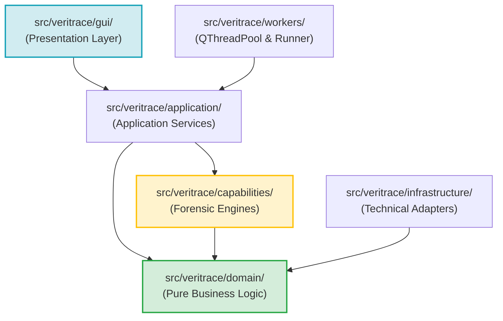
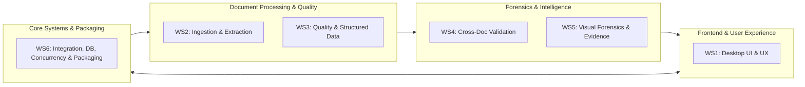
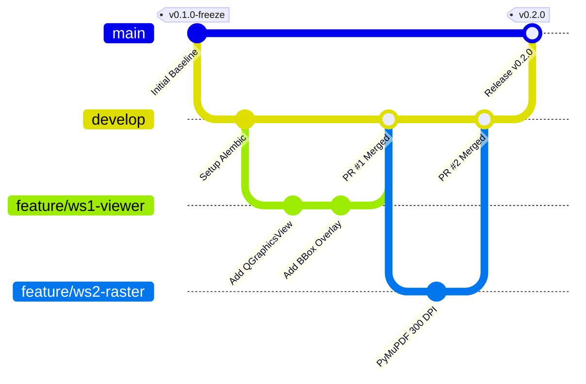
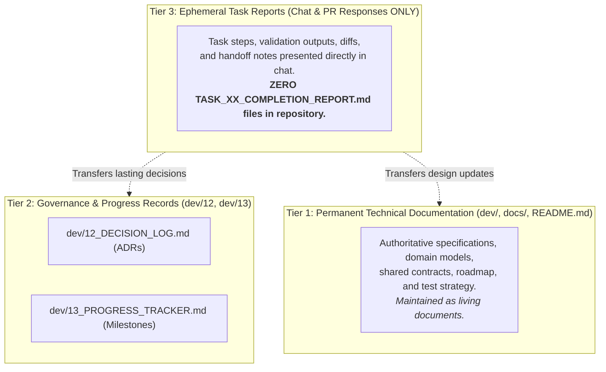

# 26_TEAM_DEVELOPMENT_AND_GITHUB_WORKFLOW.md
# VeriTrace Team Development Guide, Governance & GitHub Collaboration Baseline

**Author:** Technical Project Manager & Senior Software Architect  
**Target Audience:** All VeriTrace Engineering Team Members, Workstream Leads, and Contributors  
**Status:** AUTHORITATIVE GOVERNANCE BASELINE  
**Effective Date:** 2026-11-05  

---

## 1. Project Overview & Product Vision

**VeriTrace Desktop** is an AI-powered document forensics and contextual intelligence system designed as standalone native desktop software for Windows 10/11 x64, developed for the **DataOps Innovation Hackathon (Problem Statement 2 — PS-2)**.

### The Problem
Traditional document processing pipelines use Optical Character Recognition (OCR) merely to convert raster images into text strings. However, OCR cannot verify whether extracted information is authentic, internally consistent, or contextually valid. Digital manipulation tools allow malicious actors to splice numbers, overwrite dates, and alter names. Furthermore, discrepancies frequently span across multiple documents (e.g., salary slip earnings conflicting with bank deposit statements), remaining completely invisible when files are audited in isolation.

### The Solution
VeriTrace Desktop transforms document review from passive OCR into an active, forensic investigation workstation:
1. **Multi-Document Ingestion & Cryptographic Proof:** Ingests PDFs, PNGs, and JPEGs with SHA-256 evidence hashing.
2. **Multi-Factor Text Quality & Hybrid Extraction:** PyMuPDF direct vector extraction combined with bundled Tesseract OCR fallback for scanned pages.
3. **Deterministic Computer Vision Forensics:** Error Level Analysis (ELA) for JPEG compression anomalies, font baseline regression for spliced figures, and ORB feature matching for duplicate signatures/stamps.
4. **Contextual Cross-Document Reconciliation:** Deterministic arithmetic checksum validation and RapidFuzz entity alignment.
5. **Human-in-the-Loop Review & PS-2 Dossier:** Interactive PySide6 4-pane workstation with high-resolution bounding box inspection and one-click auditor-grade PDF dossier generation via ReportLab.

---

## 2. Approved Technology Stack

| Layer | Approved Technology | Key Constraints |
| :--- | :--- | :--- |
| **Operating System** | Windows 10 / Windows 11 (x64) | Core target platform; must run without administrative rights. |
| **Language Runtime** | **Python 3.11 (64-bit)** | Approved baseline. *Do not use Python 3.12+ (MinGW lacking pip) or Python 3.14 (missing binary wheels).* |
| **Desktop Framework** | **PySide6 (Qt 6.7+)** | Native Qt Widgets, custom QSS styling, `QGraphicsView` document canvas. No web frameworks. |
| **Application Layer** | In-Process Python Services | Direct strongly-typed method calls; FastAPI, Uvicorn, and loopback HTTP are completely eliminated. |
| **Persistence** | SQLite 3 (WAL Mode) + SQLAlchemy 2.0 | Located in `%LOCALAPPDATA%/VeriTrace/database/veritrace.sqlite`. Migrations managed via Alembic. |
| **PDF Processing** | PyMuPDF (`fitz` 1.24+) | Direct vector extraction and 300 DPI page rasterization. |
| **OCR Engine** | **Tesseract OCR 5.x** (via `pytesseract`) | Initial default baseline candidate behind `TextExtractorProtocol`. Evaluated via 30-document benchmark suite. |
| **Computer Vision** | OpenCV (`cv2`), Pillow (`PIL`), NumPy | Pure deterministic image forensics (ELA, font baseline regression, evidence crops). |
| **String Alignment** | RapidFuzz (C++ Levenshtein) | Cross-document entity reconciliation and fuzzy matching. |
| **Generative AI** | `LLMProviderProtocol` (Candidate: Groq) | Optional narrative synthesis; strictly non-decisional; 100% deterministic template fallback. |
| **Reporting** | ReportLab | Programmatic compilation of 6-section PS-2 PDF investigation dossiers. |
| **Packaging** | PyInstaller + Inno Setup | One-folder distribution compiled into `VeriTrace-Setup.exe`. |

---

## 3. Repository Structure & Layered Monolith Architecture

The repository adheres strictly to the canonical Python `src`-layout established in [ADR-030](file:///c:/Users/ghong/OneDrive/Attachments/Desktop/VeriTrace/dev/12_DECISION_LOG.md#adr-030-unified-python-src-layout-and-layered-monolith-architecture):

```text
VeriTrace/
├── pyproject.toml                     # Authoritative PEP 517/518 build & dependency manifest
├── requirements.txt                   # Mirrors pyproject.toml for standard pip workflows (-e .[all])
├── alembic.ini                        # Database schema migration configuration
├── README.md                          # Primary desktop product documentation
├── .gitignore                         # Comprehensive ignore policy (protects PII & caches)
├── .env.example                       # Local environment template (zero committed secrets)
├── .github/                           # GitHub governance, templates, CI & CODEOWNERS
│   ├── workflows/
│   │   └── ci.yml                     # Continuous integration workflow
│   ├── ISSUE_TEMPLATE/                # Bug report, feature request & task templates
│   ├── pull_request_template.md       # PR checklist & governance
│   ├── CONTRIBUTING.md                # Multi-developer branch policies
│   └── CODEOWNERS                     # Workstream ownership declarations
│
├── src/                               # Python Source Root
│   └── veritrace/                     # Core VeriTrace Package
│       ├── __init__.py                # Package version metadata
│       ├── __main__.py                # python -m veritrace execution entrypoint
│       ├── main.py                    # Root application entrypoint
│       ├── bootstrap.py               # Pre-flight environment & directory initialization
│       │
│       ├── gui/                       # Presentation Layer (PySide6 / Qt Widgets)
│       │   ├── app.py                 # QApplication lifecycle
│       │   ├── views/                 # MainWindow, InvestigationView, DocumentViewer, DossierView
│       │   ├── components/            # Reusable widgets (viewer, evidence inspector, sidebar)
│       │   ├── viewmodels/            # UI presentation state
│       │   ├── controllers/           # Mediators to Application Services
│       │   ├── styles/                # dark_theme.qss stylesheet
│       │   └── resources/             # Icons, logos, static assets
│       │
│       ├── application/               # Application Services & Coordination Layer
│       │   ├── services/              # InvestigationService, DocumentService, ForensicsService, DossierService
│       │   ├── workflows/             # Pipeline coordinator & state machines
│       │   └── dtos/                  # Strongly typed Data Transfer Objects
│       │
│       ├── domain/                    # Pure Business Logic & Entities (ZERO external deps)
│       │   ├── entities/              # Core domain entities (Investigation, Document, Finding, Evidence)
│       │   ├── value_objects/         # Bounding boxes, severity enums, confidence metrics
│       │   ├── rules/                 # Math rules, checksums, date chronology
│       │   ├── events/                # Domain event declarations
│       │   ├── exceptions/            # Domain-level exceptions hierarchy
│       │   └── interfaces/            # Protocol definitions for repositories and adapters
│       │
│       ├── capabilities/              # Algorithmic & Forensic Processing Engines (8 Canonical Capabilities)
│       │   ├── ingestion/             # File intake validation, MIME checking, SHA-256 calculation
│       │   ├── classification/        # Document type classification (ID, Salary Slip, Invoice)
│       │   ├── extraction/            # PDF vector extraction, OCR text/table extraction
│       │   ├── quality/               # Extraction Quality: OCR confidence scoring, degradation assessment
│       │   ├── forensics/             # Visual forensics (ELA, font baseline regression, clone detection)
│       │   ├── correlation/           # Cross-document entity reconciliation & contradiction matrix
│       │   ├── reasoning/             # Contextual narrative synthesis & prompt engineering
│       │   └── reporting/             # PS-2 Section 7.1–7.6 PDF & JSON dossier compilation
│       │
│       ├── infrastructure/            # Concrete Technical Adapters
│       │   ├── persistence/           # SQLite database (WAL), SQLAlchemy 2.0 ORM, Alembic migrations
│       │   ├── pdf/                   # PyMuPDF rasterizer & vector text adapter
│       │   ├── ocr/                   # Tesseract / RapidOCR engine adapter
│       │   ├── vision/                # OpenCV & Pillow image processing adapter
│       │   ├── reporting/             # ReportLab PDF generation adapter
│       │   ├── ai/                    # ChatGroq LLM adapter with deterministic template fallback
│       │   └── security/              # Windows DPAPI & local filesystem path resolution
│       │
│       └── workers/                   # Concurrency & Asynchronous Workers
│           ├── job_runner.py          # Standalone background CLI worker (atomic SQLite claim)
│           ├── tasks/                 # Discrete executable background tasks
│           └── pools/                 # QThreadPool / QRunnable worker implementations
│
├── dev/                               # 27 Technical Architecture & Planning Documents
├── packaging/                         # PyInstaller spec and Inno Setup installer scripts
├── scripts/                           # Development, packaging, and validation scripts
└── tests/                             # Comprehensive test suite (unit, integration, desktop, architecture, benchmarks, packaging)
```

### Architectural Dependency Flow Rules


* **RULE 1 (Pure Domain):** `domain/` contains zero external dependencies. It must NEVER import `PySide6`, `sqlalchemy`, `cv2`, `fitz`, `groq`, or `pytesseract`.
* **RULE 2 (GUI Isolation):** `gui/` interacts with the system exclusively through `application/services/`. It must NEVER import `infrastructure/` or execute direct SQL queries.
* **RULE 3 (Capability Independence):** `capabilities/` modules are algorithmic engines. They must NEVER import `PySide6` or manipulate UI widgets.
* **RULE 4 (Automated Validation):** These boundaries are mechanically verified by running:
  ```powershell
  python scripts/validation/check_architecture.py
  ```

---

## 4. Team Workstream Responsibilities & Ownership Matrix

Work is organized into six functional workstreams. On smaller teams (e.g. 3–4 developers), workstreams are combined according to natural dependencies:



### 4.1. Workstream 1: Desktop UI and User Experience (WS1)
* **Main Responsibility:** PySide6 desktop workstation interface, High-DPI document rendering canvas, interactive bounding box overlays, dockable evidence inspector, case management sidebar, and QSS dark styling.
* **Owned Directories:** `src/veritrace/gui/`
* **Files/Modules Modified:** `gui/views/`, `gui/components/`, `gui/viewmodels/`, `gui/controllers/`, `gui/styles/`
* **Dependencies:** Consumes Application Services (`application/services/`) and Domain DTOs (`application/dtos/`).
* **Shared Interfaces Consumed:** `InvestigationServiceProtocol`, `DocumentServiceProtocol`, `DossierServiceProtocol`, `ForensicFinding`, `EvidenceAnchor`.
* **Deliverables:** Launchable 4-pane workstation window, High-DPI `QGraphicsView` with zoom/pan, interactive evidence inspector dock, QSS forensic dark theme stylesheet.
* **Required Tests:** `tests/desktop/test_main_window.py`, `tests/desktop/test_document_viewer.py` (via `pytest-qt`).
* **Definition of Done (DoD):** UI renders at 60 FPS without freezing; displays 300 DPI pages with clickable bounding boxes; zero direct imports of database or capability engines.

### 4.2. Workstream 2: Document Ingestion and Extraction (WS2)
* **Main Responsibility:** Native OS drag-and-drop document intake, cryptographic SHA-256 evidence hashing, PyMuPDF 300 DPI page rasterization, and `TextExtractorProtocol` text/table extraction.
* **Owned Directories:** `src/veritrace/capabilities/ingestion/`, `src/veritrace/capabilities/extraction/`, `src/veritrace/infrastructure/pdf/`, `src/veritrace/infrastructure/ocr/`
* **Files/Modules Modified:** `capabilities/ingestion/`, `capabilities/extraction/`, `infrastructure/pdf/`, `infrastructure/ocr/`
* **Dependencies:** Depends on `domain/entities/document.py` and `infrastructure/security/storage.py`.
* **Shared Interfaces Consumed:** `DocumentMetadata`, `ExtractionProvenance`, `TextExtractorProtocol`.
* **Deliverables:** PDF-to-image rasterizer, MIME validator, SHA-256 calculator, Tesseract OCR adapter, and empirical OCR benchmark harness.
* **Required Tests:** `tests/unit/test_intake_validation.py`, `tests/integration/test_pdf_rasterization.py`, `tests/benchmarks/test_ocr_benchmark.py`.
* **Definition of Done (DoD):** Correctly extracts text tokens and tables from PDFs and scanned images; produces normalized coordinates $[ymin, xmin, ymax, xmax] \in [0.0, 1.0]$; passes the 30-document benchmark suite without unhandled exceptions.

### 4.3. Workstream 3: Extraction Quality and Structured Data (WS3)
* **Main Responsibility:** Extraction quality scoring, OCR confidence distribution gating, image degradation assessment (blur, skew, noise), structured key-value extraction, and table normalization.
* **Owned Directories:** `src/veritrace/capabilities/quality/`, `src/veritrace/application/dtos/`
* **Files/Modules Modified:** `capabilities/quality/`, `domain/value_objects/field.py`
* **Dependencies:** Consumes extracted token streams from WS2.
* **Shared Interfaces Consumed:** `ExtractedField`, `ConfidenceScore`, `ExtractionQualityMetrics`.
* **Deliverables:** Multi-Factor Text Quality Evaluator, confidence scoring engine, tabular data parser, and degradation detection heuristics.
* **Required Tests:** `tests/unit/test_quality_scoring.py`, `tests/unit/test_table_extraction.py`.
* **Definition of Done (DoD):** Automatically flags degraded or low-confidence scans ($\text{confidence} < 0.65$); parses structured key-value pairs from financial tables; generates standardized `ExtractedField` objects.

### 4.4. Workstream 4: Validation and Cross-Document Intelligence (WS4)
* **Main Responsibility:** Deterministic intra-document financial rules (Gross = Basic + Allowances; Net = Gross - Deductions), date chronology validation, RapidFuzz cross-document entity reconciliation, discrepancy matrix, and grounded AI narrative synthesis with offline fallback.
* **Owned Directories:** `src/veritrace/domain/rules/`, `src/veritrace/capabilities/correlation/`, `src/veritrace/capabilities/reasoning/`, `src/veritrace/infrastructure/ai/`
* **Files/Modules Modified:** `domain/rules/`, `capabilities/correlation/`, `capabilities/reasoning/`, `infrastructure/ai/`
* **Dependencies:** Consumes structured fields from WS3 and document metadata from WS2.
* **Shared Interfaces Consumed:** `ValidationResult`, `ForensicFinding`, `LLMProviderProtocol`, `TemplateNarrativeGenerator`.
* **Deliverables:** Financial checksum engine, cross-document entity reconciliation engine, discrepancy reasoning pipeline, and deterministic narrative template engine.
* **Required Tests:** `tests/unit/test_financial_rules.py`, `tests/unit/test_cross_doc_correlation.py`, `tests/unit/test_narrative_generator.py`.
* **Definition of Done (DoD):** Flags mathematical inconsistencies with exact arithmetic delta; detects cross-document contradictions (e.g. name or salary mismatch); generates 100% offline narrative explanations without hallucinating facts.

### 4.5. Workstream 5: Visual Forensics and Evidence (WS5)
* **Main Responsibility:** Pure OpenCV image forensics: Error Level Analysis (ELA) for JPEG compression anomalies, font baseline regression for spliced or floating numbers, ORB feature matching for duplicate signatures/stamps, and localized evidence crop extraction.
* **Owned Directories:** `src/veritrace/capabilities/forensics/`, `src/veritrace/infrastructure/vision/`
* **Files/Modules Modified:** `capabilities/forensics/`, `infrastructure/vision/`
* **Dependencies:** Consumes 300 DPI page images from WS2.
* **Shared Interfaces Consumed:** `EvidenceAnchor`, `ForensicFinding`, `NormalizedBoundingBox`.
* **Deliverables:** ELA differential engine, font baseline regression module ($>2.5\sigma$), stamp/signature clone detector, and evidence crop extractor with 20px padding.
* **Required Tests:** `tests/unit/test_ela_engine.py`, `tests/unit/test_font_baseline.py`, `tests/unit/test_clone_detector.py`.
* **Definition of Done (DoD):** Produces normalized coordinate bounding boxes and high-resolution PNG crops for visual anomalies; classifies findings into 3-tier ontology (`DEFINITIVE`, `CORROBORATED`, `SUSPICIOUS`); memory consumption remains below 450 MB per page.

### 4.6. Workstream 6: Integration, Database, Testing and Packaging (WS6)
* **Main Responsibility:** SQLite WAL persistence via SQLAlchemy 2.0, Alembic migrations, in-process `QThreadPool` asynchronous worker execution, stage checkpoint recovery (ADR-028), PyInstaller bundling, and Inno Setup installer compilation (`VeriTrace-Setup.exe`).
* **Owned Directories:** `src/veritrace/infrastructure/persistence/`, `src/veritrace/workers/`, `packaging/`, `scripts/`
* **Files/Modules Modified:** `infrastructure/persistence/`, `workers/`, `packaging/`, `scripts/`, `alembic.ini`, `pyproject.toml`
* **Dependencies:** Supports all workstreams; coordinates system build and release.
* **Shared Interfaces Consumed:** `JobState`, `InvestigationRepositoryProtocol`, `DocumentRepositoryProtocol`.
* **Deliverables:** SQLite schema with 12 Core Entities + 1 Assoc Table, Alembic migration scripts, `QThreadPool` job runner with 12 recovery rules, PyInstaller spec, and Inno Setup installer script.
* **Required Tests:** `tests/integration/test_database_persistence.py`, `tests/integration/test_job_checkpoints.py`, `tests/packaging/test_installer_build.py`.
* **Definition of Done (DoD):** Database schema applies cleanly with foreign key enforcement; background jobs recover smoothly after simulated crash; PyInstaller compiles a functional one-folder distribution.

---

## 5. Authoritative Shared Contracts Specification

To ensure developers work in parallel without interface breakage, the following thirteen contracts are formally codified. **All modules must adhere strictly to these schema specifications.**

### 5.1. Identifiers Contract
* **Purpose:** Standardized unique identification across all entities and files.
* **Format:** Canonical UUIDv4 strings formatted with domain prefixes:
  * Investigation: `inv_<uuid4_hex>` (e.g. `inv_a1b2c3d4e5f6...`)
  * Document: `doc_<uuid4_hex>`
  * Finding: `fnd_<uuid4_hex>`
  * Evidence Anchor: `anc_<uuid4_hex>`
  * Job: `job_<uuid4_hex>`
* **Validation:** Must be lowercase, alphanumeric plus underscore, length 36–40 characters.
* **Owning Module:** `src/veritrace/domain/value_objects/identifiers.py`
* **Consuming Modules:** All layers.

### 5.2. DocumentMetadata Contract
* **Purpose:** Immutable cryptographic and filesystem provenance for ingested files.
* **Required Fields:**
  * `document_id`: `str` (UUIDv4)
  * `investigation_id`: `str`
  * `original_filename`: `str`
  * `file_path`: `str` (absolute path in `%LOCALAPPDATA%/VeriTrace/originals/`)
  * `file_size_bytes`: `int` ($>0$)
  * `sha256_hash`: `str` (64 hex characters)
  * `mime_type`: `str` (`application/pdf`, `image/png`, `image/jpeg`)
  * `page_count`: `int` ($\ge 1$)
  * `ingested_at`: `datetime` (UTC ISO 8601)
* **Optional Fields:** `metadata_dict`: `Dict[str, Any]` (PDF author, creator, modification date).
* **Validation Rules:** SHA-256 hash calculated immediately upon intake; original file is strictly read-only.
* **Owning Module:** `src/veritrace/domain/entities/document.py`
* **Consuming Modules:** WS1, WS2, WS3, WS4, WS5, WS6.

### 5.3. ExtractedField Contract
* **Purpose:** Structured representation of a key-value pair extracted from a document.
* **Required Fields:**
  * `field_id`: `str`
  * `document_id`: `str`
  * `page_number`: `int` ($\ge 1$)
  * `field_name`: `str` (standardized: e.g. `gross_salary`, `pan_number`, `invoice_total`)
  * `raw_value`: `str` (exact textual representation extracted)
  * `normalized_value`: `Union[str, float, int, date]` (type-coerced value)
  * `field_type`: `str` (`CURRENCY`, `IDENTIFIER`, `DATE`, `NUMERIC`, `TEXT`)
  * `normalized_bbox`: `List[float]` ($[ymin, xmin, ymax, xmax] \in [0.0, 1.0]$)
  * `confidence`: `float` ($0.0 \le c \le 1.0$)
  * `source_type`: `str` (`VECTOR_TEXT`, `OCR_RASTER`, `HYBRID`)
* **Optional Fields:** `table_id`: `Optional[str]`, `row_index`: `Optional[int]`, `col_index`: `Optional[int]`.
* **Owning Module:** `src/veritrace/domain/value_objects/field.py`
* **Consuming Modules:** WS3, WS4, WS1.

### 5.4. ExtractionProvenance Contract
* **Purpose:** Audit trail of how a text or layout element was produced.
* **Required Fields:**
  * `extractor_name`: `str` (`PyMuPDF`, `Tesseract`, `RapidOCR`)
  * `extractor_version`: `str`
  * `execution_time_ms`: `float`
  * `page_dpi`: `int` (typically 300)
  * `extraction_method`: `str` (`VECTOR`, `OCR`, `HYBRID`)
* **Owning Module:** `src/veritrace/domain/value_objects/provenance.py`
* **Consuming Modules:** WS2, WS3, WS6.

### 5.5. ConfidenceScore & VerificationStatus Contract
* **Purpose:** Epistemic grounding of extraction and finding validity.
* **ConfidenceScore:** `float` $\in [0.0, 1.0]$ with `metric_breakdown: Dict[str, float]`.
* **VerificationStatus Enum:**
  * `UNVERIFIED`: Extracted without secondary cross-check.
  * `AUTO_VERIFIED`: Corroborated by deterministic rules or vector parity.
  * `HUMAN_CONFIRMED`: Explicitly verified by investigator in GUI.
  * `HUMAN_DISMISSED`: Dismissed by investigator as a false positive.
* **Owning Module:** `src/veritrace/domain/value_objects/enums.py`
* **Consuming Modules:** WS1, WS3, WS4.

### 5.6. Normalized Bounding Box Coordinate Standard
* **Purpose:** Universal coordinate format for High-DPI screen rendering, crop extraction, and IoU calculation.
* **Specification:**
  $$[y_{\min}, x_{\min}, y_{\max}, x_{\max}] \quad \text{where} \quad 0.0 \le y_{\min} < y_{\max} \le 1.0, \quad 0.0 \le x_{\min} < x_{\max} \le 1.0$$
* **Origin:** Top-left corner of the rendered page is $(0.0, 0.0)$; bottom-right is $(1.0, 1.0)$.
* **Pixel Transformation:**
  $$\text{pixel\_x} = \lfloor x \times \text{page\_width\_px} \rfloor, \quad \text{pixel\_y} = \lfloor y \times \text{page\_height\_px} \rfloor$$
* **Intersection-over-Union (IoU) Heuristic:** Used as an initial operational target ($\text{IoU} \ge 0.70$) for word overlap evaluation in benchmark suites, subject to empirical calibration against real document ground truth.
* **Owning Module:** `src/veritrace/domain/value_objects/coordinates.py`
* **Consuming Modules:** All workstreams.

### 5.7. ValidationResult Contract
* **Purpose:** Standardized output produced by deterministic rule evaluators.
* **Required Fields:**
  * `rule_id`: `str` (e.g. `RULE_FIN_001_PAYROLL_SUM`)
  * `rule_name`: `str`
  * `rule_category`: `str` (`ARITHMETIC`, `CHRONOLOGY`, `FORMAT`, `CROSS_DOC`)
  * `status`: `str` (`PASSED`, `FAILED`, `WARNING`)
  * `expected_value`: `Any`
  * `actual_value`: `Any`
  * `deviation_magnitude`: `float`
  * `message`: `str`
  * `evidence_anchors`: `List[EvidenceAnchor]`
* **Owning Module:** `src/veritrace/domain/rules/base.py`
* **Consuming Modules:** WS4, WS1, WS6.

### 5.8. ForensicFinding Contract
* **Purpose:** Core legal and forensic anomaly record satisfying PS-2 reporting requirements.
* **Three Independent Evaluative Dimensions:**
  * `severity`: `str` (`CRITICAL`, `HIGH`, `MEDIUM`, `LOW`, `INFO`) — Impact or operational importance of the finding if substantiated.
  * `confidence_score`: `float` ($0.0 \le c \le 1.0$) — Mathematical/statistical reliability of the detection and supporting evidence.
  * `epistemic_tier`: `str` (`CONFIRMED_OBSERVATION` / `DEFINITIVE`, `CORROBORATED`, `SUSPICIOUS` / `DETECTED_INCONSISTENCY`) — Strength of evidentiary grounding supporting the conclusion.
* **Forensic Neutrality Policy:** Findings record empirical discrepancies, baseline deviations, and mathematical mismatches. An anomaly does NOT prove fraud or deliberate manipulation. Monetary magnitude or an isolated vision signal must NEVER automatically promote an epistemic tier to definitive.
* **Required Fields:**
  * `finding_id`: `str` (UUIDv4)
  * `investigation_id`: `str`
  * `document_id`: `Optional[str]` (None if cross-document finding)
  * `finding_type`: `str` (`ELA_ANOMALY`, `BASELINE_OFFSET`, `CLONE_STAMP`, `ARITHMETIC_MISMATCH`, `CROSS_DOC_CONTRADICTION`)
  * `epistemic_tier`: `str`
  * `severity`: `str`
  * `confidence_score`: `float`
  * `summary`: `str` (short 1-line description)
  * `detailed_reasoning`: `str` (grounded forensic explanation)
  * `evidence_ids`: `List[str]` (foreign keys to supporting `Evidence` entities)
  * `is_dismissed`: `bool` (default: False)
  * `review_status`: `str` (`UNVERIFIED`, `AUTO_VERIFIED`, `HUMAN_CONFIRMED`, `HUMAN_DISMISSED`)
* **Owning Module:** `src/veritrace/domain/entities/finding.py`
* **Consuming Modules:** WS1, WS4, WS5, WS6.

### 5.9. Evidence, EvidenceAnchor & FindingEvidenceMap Contract
* **Purpose:** Unbroken chain-of-custody linking visual/textual observations to findings and the final audit dossier.
* **Three Architectural Concepts:**
  1. `EvidenceAnchor` (Value Object): In-memory spatial/textual coordinates (`document_id`, `page_number`, `normalized_bbox: [ymin, xmin, ymax, xmax]`, `context_snippet`).
  2. `Evidence` (Domain Entity / Table `evidence`): Persistent first-class entity storing `evidence_id`, `investigation_id`, `document_id`, `page_number`, embedded coordinates, absolute `crop_path` (300 DPI high-res crop with 20px padding), `crop_sha256` hash, and detector metadata. Independently addressable by UI and API.
  3. `FindingEvidenceMap` (Association Table `finding_evidence`): Many-to-many join relationship mapping `finding_id` to `evidence_id` with `relevance_role` (`PRIMARY_OBSERVATION`, `CORROBORATING_SIGNAL`).
* **Owning Module:** `src/veritrace/domain/entities/evidence.py`
* **Consuming Modules:** All workstreams.

### 5.10. JobState Contract
* **Purpose:** Durable state tracking for background forensic pipeline execution.
* **Required Fields:**
  * `job_id`: `str` (UUIDv4)
  * `investigation_id`: `str`
  * `status`: `str` (`QUEUED`, `RUNNING`, `COMPLETED`, `FAILED`, `CANCELLED`, `INTERRUPTED`)
  * `current_stage`: `str` (`INGESTION`, `EXTRACTION`, `QUALITY_ASSESSMENT`, `FORENSICS`, `CORRELATION`, `REASONING`, `REPORTING`)
  * `stage_progress_pct`: `float` ($0.0 \le p \le 100.0$)
  * `total_progress_pct`: `float` ($0.0 \le p \le 100.0$)
  * `last_completed_stage`: `Optional[str]`
  * `error_message`: `Optional[str]`
  * `stage_metadata`: `Dict[str, Any]` (checkpoint diagnostics)
* **Owning Module:** `src/veritrace/domain/entities/job.py`
* **Consuming Modules:** WS6, WS1, WS2.

### 5.11. Application Service Interfaces
* **Purpose:** High-level facades invoked by GUI controllers to execute business use-cases.
* **Protocols Defined:**
  * `InvestigationServiceProtocol`: `create_investigation()`, `get_investigation()`, `list_investigations()`
  * `DocumentServiceProtocol`: `ingest_documents()`, `get_document_pages()`, `get_page_image()`
  * `ForensicsServiceProtocol`: `run_investigation()`, `resume_investigation()`, `get_findings()`
  * `DossierServiceProtocol`: `compile_dossier_pdf()`, `export_dossier_json()`
* **Owning Module:** `src/veritrace/application/services/protocols.py`
* **Consuming Modules:** WS1 (GUI), WS6 (Workers).

### 5.12. Database Repository Contracts
* **Purpose:** Decoupled persistence interfaces isolating domain entities from SQLAlchemy ORM.
* **Protocols Defined:**
  * `InvestigationRepositoryProtocol`
  * `DocumentRepositoryProtocol`
  * `FindingRepositoryProtocol`
  * `JobRepositoryProtocol`
* **Owning Module:** `src/veritrace/domain/interfaces/repositories.py`
* **Consuming Modules:** WS2, WS4, WS6.

### 5.13. AI Narrative Request & Response Contracts
* **Purpose:** Strictly bounded, privacy-gated narrative synthesis over pre-calculated findings.
* **AINarrativeRequest:**
  * `investigation_id`: `str`
  * `verified_findings`: `List[Dict[str, Any]]` (JSON findings summary)
  * `redacted_pii_fields`: `List[str]` (audit list of masked identifiers)
* **AINarrativeResponse:**
  * `narrative_markdown`: `str`
  * `executive_summary`: `str`
  * `provider_used`: `str` (`groq`, `template_fallback`)
  * `model_used`: `str`
  * `is_template_fallback`: `bool`
* **AI Capabilities & Negative Guardrails:**
  * **Permitted:** Explains both verified and unverified findings; must explicitly preserve detector uncertainty and cite evidence anchors provided in the prompt.
  * **Strictly Forbidden:** AI must NEVER independently create findings, change severity, upgrade epistemic tier, confirm or dismiss findings, or modify evidence records.
* **Owning Module:** `src/veritrace/infrastructure/ai/protocols.py`
* **Consuming Modules:** WS4, WS1.

---

## 6. Git Branching Strategy & Collaboration Workflow

### 6.1. Branching Model
The team utilizes a clean, feature-branch Git workflow based on two permanent branches:



1. **`main` (Protected):**
   * Production and release-ready branch.
   * Direct pushes and force pushes are strictly disabled.
   * Releases are tagged with Semantic Versioning (`v0.1.0`, `v0.2.0`).
2. **`develop` (Integration Branch):**
   * Active integration trunk for completed, reviewed features.
   * All feature branches branch off `develop` and merge back into `develop`.
3. **`feature/<workstream>-<short-description>`:**
   * Workstream feature branches (e.g. `feature/ws1-viewer-canvas`, `feature/ws5-ela-engine`).
   * Short-lived (1–3 days); regularly rebased on `develop`.
4. **`fix/<issue-name>`:**
   * Targeted bugfix branches (e.g. `fix/ocr-bbox-offset`).

### 6.2. Commit Message Conventions
Commits must follow the **Conventional Commits** standard:
* `feat(ws1): add QGraphicsView zoom and pan controls`
* `fix(ws5): correct JPEG resave quality in ELA computation`
* `docs(adr): update ADR-023 with empirical benchmark criteria`
* `test(ws2): add PDF rasterization unit test with synthetic fixture`
* `refactor(domain): enforce frozen dataclass on EvidenceAnchor`
* `chore: update pyproject.toml optional test dependencies`

### 6.3. Pull Request (PR) Workflow
1. **Self-Review:** Before opening a PR, the author must run locally:
   ```powershell
   python scripts/validation/check_architecture.py
   pytest tests/unit/
   ```
2. **PR Description:** Fill out `.github/pull_request_template.md` detailing:
   * Objective and Workstream.
   * Architecture layers touched.
   * Verification commands run and test evidence.
3. **Review & Approval:** At least **one peer review approval** is required before merge.
4. **Merge Strategy:** **Squash and Merge** into `develop` to maintain a clean linear commit history.

---

## 7. Code Quality, Formatting & Testing Standards

### 7.1. Code Formatting & Linting
* **Linter & Formatter:** **Ruff** (configured in `pyproject.toml`).
  * Line length: **100 characters**.
  * Quote style: Double quotes (`"..."`).
  * Formatting check: `ruff format --check src/`
  * Auto-fix linting: `ruff check --fix src/`
* **Naming Conventions:**
  * Files & Modules: `snake_case.py` (e.g. `document_service.py`)
  * Classes: `PascalCase` (e.g. `DocumentService`)
  * Functions & Methods: `snake_case()` (e.g. `calculate_sha256()`)
  * Constants: `UPPER_SNAKE_CASE` (e.g. `DEFAULT_DPI = 300`)
* **Import Conventions:**
  * ALWAYS use absolute package imports: `from veritrace.application.services.document import DocumentService`
  * NEVER use relative imports across layers (e.g. `from ..infrastructure import ...` inside `domain/`).

### 7.2. Type Checking
* **Type Checker:** **mypy** (configured in `pyproject.toml`).
  * Gradual typing: Type annotations are **mandatory** on all public functions, methods, and DTOs.
  * Running check: `mypy src/veritrace/domain/ src/veritrace/application/`

### 7.3. Error Handling & Logging
* **Custom Exceptions:** Raise structured exceptions inheriting from `VeriTraceError` (defined in `domain/exceptions.py`):
  ```python
  class VeriTraceError(Exception): """Base exception for all VeriTrace domain errors."""
  class IngestionError(VeriTraceError): """Raised when document ingestion fails."""
  class ForensicRuleViolation(VeriTraceError): """Raised when an integrity check fails."""
  ```
* **No Bare Exceptions:** Never write `except: pass` or `except Exception: pass`. Always log the exception:
  ```python
  import logging
  logger = logging.getLogger(__name__)

  try:
      ...
  except IngestionError as err:
      logger.error("Failed to ingest document %s: %s", doc_id, err, exc_info=True)
      raise
  ```

### 7.4. Testing Standards
* **Frameworks:** `pytest`, `pytest-qt` (for PySide6 GUI), `pytest-mock`.
* **Test Structure:**
  * `tests/unit/`: Pure algorithmic and domain unit tests (fast, $<2\text{s}$, zero I/O).
  * `tests/integration/`: Service and database integration tests (SQLite in-memory, PDF rendering).
  * `tests/desktop/`: PySide6 widget tests using `qtbot`.
  * `tests/benchmarks/`: Multi-document OCR and capability benchmark tests.
* **Execution:**
  ```powershell
  pytest tests/unit/
  ```

---

## 8. Task Allocation & Lifecycle Management

### 8.1. Task Lifecycle States
Tasks move through six discrete states on the project kanban board:

```text
[Backlog] ──> [Ready] ──> [In Progress] ──> [Review (PR)] ──> [Integration] ──> [Done]
    │                                                                             ▲
    └────────────────────── [Blocked] ────────────────────────────────────────────┘
```

1. **Backlog:** Tasks identified in the roadmap but not yet scheduled.
2. **Ready:** Specifications, shared contracts, and mock dependencies are established; developer can pick up immediately.
3. **In Progress:** Branch created; developer actively implementing.
4. **Review (PR):** PR submitted; peer review and automated architecture checks in progress.
5. **Integration:** PR merged into `develop`; automated test suite passing.
6. **Done:** Deliverable verified against acceptance criteria and documented in progress tracker.
7. **Blocked:** Missing upstream dependency or contract ambiguity; escalated to architect.

### 8.2. Handling Blocked Tasks & Mock-First Development
To prevent developers from stalling while waiting for another workstream:
* **Contract-First Mocking:** Upstream workstreams provide typed Protocol interfaces (in `interfaces/` or `protocols.py`). Downstream developers create mock implementations (`unittest.mock.MagicMock` or in-memory stubs) to build and test their components before the real implementation is ready.
* **Escalation Protocol:** If a contract must change, create an **Architecture Task** issue and notify the workstream leads before modifying the interface.

---

## 9. Developer Setup & Windows Environment Prerequisites

### 9.1. Python 3.11 Environment Setup (Step-by-Step)
> [!IMPORTANT]
> VeriTrace requires **Python 3.11 (64-bit)**. The system MinGW Python 3.12 (lacking pip) and Python 3.14 (missing binary wheels for PySide6 and OpenCV) cannot be used.

```powershell
# Step 1: Install Python 3.11 via Windows Package Manager
winget install Python.Python.3.11 --scope user

# Step 2: Verify Python 3.11 availability
py -3.11 --version

# Step 3: Navigate to repository root and create virtual environment
cd c:\Users\ghong\OneDrive\Attachments\Desktop\VeriTrace
py -3.11 -m venv .venv

# Step 4: Activate the virtual environment
.venv\Scripts\Activate.ps1

# Step 5: Upgrade packaging tools
python -m pip install --upgrade pip setuptools wheel

# Step 6: Install VeriTrace in editable mode with development dependencies
pip install -e .[all]

# Step 7: Verify installation and architecture boundaries
python scripts/validation/check_architecture.py
python scripts/development/run_desktop.py
```

### 9.2. External Dependency Prerequisites
* **Tesseract OCR:** Download and install Tesseract 5.x from UB-Mannheim (standard path: `C:\Program Files\Tesseract-OCR\tesseract.exe`).
* **Inno Setup (For Packaging):** Download and install Inno Setup 6.x (needed only for compiling final `VeriTrace-Setup.exe`).

---

## 10. Common Mistakes & Anti-Patterns to Avoid

1. **Importing Outside Your Layer:** Never import `infrastructure/` or `sqlalchemy` from inside `gui/`. All database queries must be coordinated through `application/services/`.
2. **Hardcoding File Paths:** Never use absolute paths like `C:\Users\...`. Always resolve paths dynamically through `bootstrap.get_data_dir()` or `%LOCALAPPDATA%/VeriTrace/`.
3. **Modifying the Foundation Repository:** Never touch or modify `C:\Users\ghong\OneDrive\Attachments\Desktop\Udyog-Permit-AI`. It must remain 100% pristine.
4. **Committing Secrets:** Never commit `.env` files or API keys. Always use `.env.example`.
5. **Directly Calling Long-Running Functions in GUI:** Never run OCR, ELA, or PDF rendering on the main thread. Always dispatch tasks to `QThreadPool` via `QRunnable`.
6. **Premature Optimization of Thresholds:** Do not hardcode magic numbers for ELA quality or baseline sigma. Keep them exposed in configuration settings (`settings.py`).
7. **Creating Temporary Report Files in Repo:** Never commit separate `TASK_XX_COMPLETION_REPORT.md` files into the repository. Follow the repository reporting policy in Section 11.

---

## 11. Permanent Repository Documentation & Task Reporting Policy

To prevent documentation sprawl and maintain a clean baseline for version control, all developers and AI coding agents must follow this strict three-tier documentation structure:



### 11.1. Rules for Future Tasks
For all future tasks (unless an explicit instruction requires a permanent project deliverable like a user-facing PDF dossier):
1. **Complete the requested work.**
2. **Update `dev/13_PROGRESS_TRACKER.md`** when task or milestone status changes.
3. **Update `dev/12_DECISION_LOG.md`** when architectural decisions are introduced, validated, or superseded.
4. **Update other authoritative documents in `dev/`** only when architectural contracts or interfaces change.
5. **Present the detailed completion report directly in the conversational response**, including:
   * Task identifier and objective.
   * Summary of completed work.
   * Files created, modified, or removed.
   * Decisions made.
   * Exact validation commands and results.
   * Outstanding issues or pending prerequisites.
   * Current Git status.
   * Recommended next action.
6. **DO NOT create another Markdown file in the repository merely to duplicate the chat report.**
