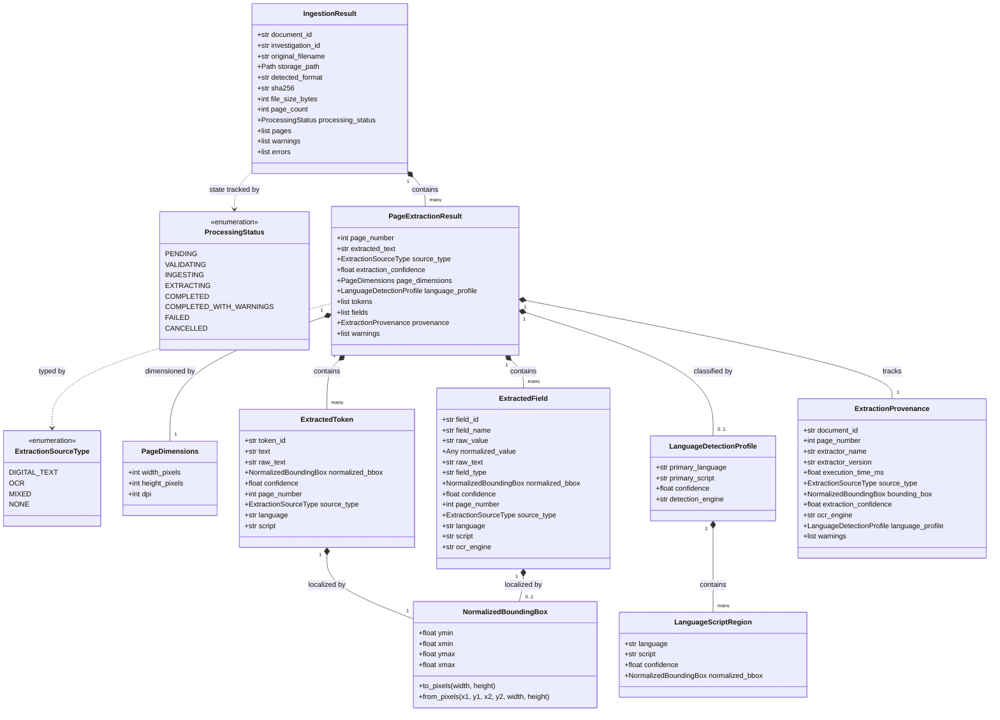
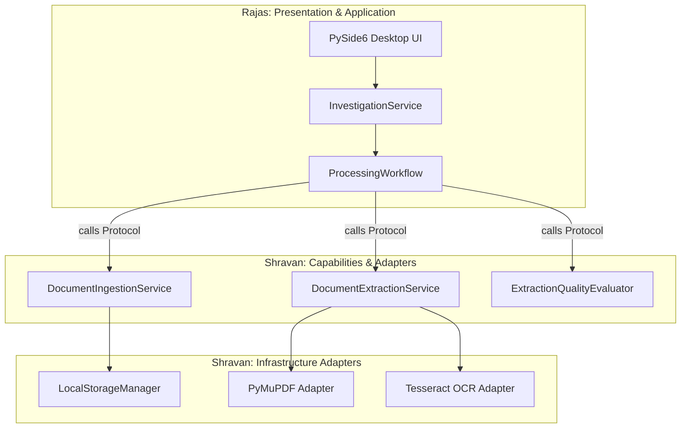
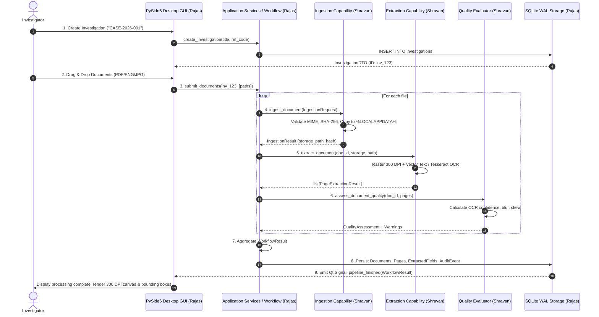
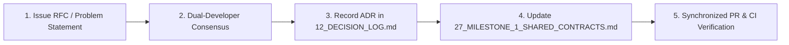

# 27_MILESTONE_1_SHARED_CONTRACTS.md
# VeriTrace Milestone 1.1: Shared Contract Freeze Specification

**Status:** APPROVED & FROZEN BASELINE  
**Effective Date:** 2026-11-05  
**Workstream Assignment:**  
* **Rajas:** Desktop Application, Investigation Management, SQLite Persistence, Application Orchestration, Background Processing, and Desktop Integration.  
* **Shravan:** Document Ingestion, PDF/Image Processing, Digital Text Extraction, OCR Engine Integration, Extraction Provenance, and Quality Evaluation.  

---

## 1. Executive Summary & Purpose

Milestone 1 establishes the native desktop foundation, document intake, and text processing engine for VeriTrace Desktop. To ensure parallel development without interface breakage, this document formally freezes all shared data contracts, Python value objects, service protocols (`typing.Protocol`), error hierarchies, and integration lifecycles between **Rajas** (Desktop & Orchestration) and **Shravan** (Ingestion & Extraction Engines).

### 1.1 Governance Invariants
1. **Zero-Drift Architecture:** Neither developer may alter frozen dataclass fields, type annotations, enum literals, or protocol signatures without following the formal Contract Change Procedure (§7).
2. **Strict Layer Boundary Isolation:**
   - Shravan's engines (`capabilities/ingestion/`, `capabilities/extraction/`, `capabilities/quality/`, `infrastructure/pdf/`, `infrastructure/ocr/`) must **never** import `PySide6`, `veritrace.gui`, or Qt modules.
   - Rajas's presentation layer (`src/veritrace/gui/`) must **never** import PDF libraries (`fitz`), OCR libraries (`pytesseract`), or computer vision (`cv2`). All processing is mediated through `application/services/` and `application/workflows/`.
   - Domain layer (`src/veritrace/domain/`) remains pure Python with **zero external dependencies**.
3. **Evidence Grounding Invariant:** OCR confidence measures character recognizer probability; it must never be treated as legal or factual correctness.
4. **No Implementation Code in Contract Freeze:** This specification defines the exact contracts. Implementation of application features begins in Milestone 1.2.

---

## 2. Frozen Shared Data Contracts

All contracts are defined as pure Python dataclasses and enums. They are located in `src/veritrace/domain/value_objects/`, `src/veritrace/domain/entities/`, and `src/veritrace/application/dto/`.



### 2.1 Normalized Coordinate Standard (`NormalizedBoundingBox`)

Universal coordinate format for High-DPI screen rendering, crop extraction, and IoU calculation.

* **Coordinate Convention:**
  $$[y_{\min}, x_{\min}, y_{\max}, x_{\max}] \quad \text{where} \quad 0.0 \le y_{\min} < y_{\max} \le 1.0, \quad 0.0 \le x_{\min} < x_{\max} \le 1.0$$
* **Origin:** Top-left corner of the page is $(0.0, 0.0)$; bottom-right is $(1.0, 1.0)$.
* **Axis Directions:**
  - $x$ increases from left ($0.0$) to right ($1.0$).
  - $y$ increases from top ($0.0$) to bottom ($1.0$).
* **Transformation Formulas:**
  $$\text{pixel\_x1} = \lfloor x_{\min} \times \text{page\_width\_px} \rfloor, \quad \text{pixel\_y1} = \lfloor y_{\min} \times \text{page\_height\_px} \rfloor$$
  $$\text{pixel\_x2} = \lceil x_{\max} \times \text{page\_width\_px} \rceil, \quad \text{pixel\_y2} = \lceil y_{\max} \times \text{page\_height\_px} \rceil$$

```python
from dataclasses import dataclass
from typing import Self


@dataclass(frozen=True, slots=True)
class NormalizedBoundingBox:
    """Normalized spatial coordinates [ymin, xmin, ymax, xmax] in range [0.0, 1.0].

    Origin (0.0, 0.0) is the top-left corner.
    """

    ymin: float
    xmin: float
    ymax: float
    xmax: float

    def __post_init__(self) -> None:
        if not (0.0 <= self.ymin <= 1.0 and 0.0 <= self.ymax <= 1.0):
            raise ValueError(f"Y coordinates must be in [0.0, 1.0]: ymin={self.ymin}, ymax={self.ymax}")
        if not (0.0 <= self.xmin <= 1.0 and 0.0 <= self.xmax <= 1.0):
            raise ValueError(f"X coordinates must be in [0.0, 1.0]: xmin={self.xmin}, xmax={self.xmax}")
        if self.ymin >= self.ymax:
            raise ValueError(f"ymin must be strictly less than ymax: {self.ymin} >= {self.ymax}")
        if self.xmin >= self.xmax:
            raise ValueError(f"xmin must be strictly less than xmax: {self.xmin} >= {self.xmax}")

    def to_pixels(self, page_width_px: int, page_height_px: int) -> tuple[int, int, int, int]:
        """Convert normalized coordinates to absolute integer pixel bounds (x1, y1, x2, y2)."""
        x1 = int(round(self.xmin * page_width_px))
        y1 = int(round(self.ymin * page_height_px))
        x2 = int(round(self.xmax * page_width_px))
        y2 = int(round(self.ymax * page_height_px))
        return (x1, y1, x2, y2)

    @classmethod
    def from_pixels(cls, x1: int, y1: int, x2: int, y2: int, page_width_px: int, page_height_px: int) -> Self:
        """Construct normalized box from pixel coordinates."""
        if page_width_px <= 0 or page_height_px <= 0:
            raise ValueError("Page pixel dimensions must be strictly positive")
        return cls(
            ymin=max(0.0, min(1.0, y1 / page_height_px)),
            xmin=max(0.0, min(1.0, x1 / page_width_px)),
            ymax=max(0.0, min(1.0, y2 / page_height_px)),
            xmax=max(0.0, min(1.0, x2 / page_width_px)),
        )

    def as_list(self) -> list[float]:
        """Return coordinate array [ymin, xmin, ymax, xmax]."""
        return [self.ymin, self.xmin, self.ymax, self.xmax]
```

---

### 2.2 Core Enums: Processing Status & Source Types

```python
from enum import Enum


class ProcessingStatus(str, Enum):
    """Uniform status lifecycle across ingestion, extraction, and background jobs."""

    PENDING = "pending"
    VALIDATING = "validating"
    INGESTING = "ingesting"
    EXTRACTING = "extracting"
    COMPLETED = "completed"
    COMPLETED_WITH_WARNINGS = "completed_with_warnings"
    FAILED = "failed"
    CANCELLED = "cancelled"


class ExtractionSourceType(str, Enum):
    """Origin mechanism of extracted text."""

    DIGITAL_TEXT = "digital_text"  # Native PDF vector font glyphs
    OCR = "ocr"  # Raster optical character recognition
    MIXED = "mixed"  # Page contains both digital vector and OCR text
    NONE = "none"  # Blank page or unextractable visual content
```

---

### 2.3 Page Dimensions & Token Contracts

```python
from dataclasses import dataclass, field
from typing import Any, Optional


@dataclass(frozen=True, slots=True)
class PageDimensions:
    """Pixel resolution and DPI metadata for a rendered page."""

    width_pixels: int
    height_pixels: int
    dpi: int = 300


@dataclass(frozen=True, slots=True)
class LanguageScriptIdentification:
    """Detected language and script pair with confidence."""

    language: str  # ISO 639-2/3 (e.g., 'eng', 'hin', 'mar')
    script: str  # ISO 15924 (e.g., 'Latn', 'Deva')
    confidence: float  # [0.0 - 1.0]


@dataclass(frozen=True, slots=True)
class LanguageScriptRegion:
    """Spatial bounding box region with detected language and script identification."""

    language: str  # ISO 639-2/3
    script: str  # ISO 15924
    confidence: float  # [0.0 - 1.0]
    normalized_bbox: NormalizedBoundingBox


@dataclass(frozen=True, slots=True)
class LanguageDetectionProfile:
    """Multi-script language detection profile across document, page, or region.

    Explicitly supports multi-region pages where distinct bounding boxes
    contain differing scripts (e.g. English header, Devanagari table).
    """

    primary_language: str
    primary_script: str
    confidence: float  # [0.0 - 1.0]
    detected_languages: tuple[LanguageScriptIdentification, ...] = ()
    regions: tuple[LanguageScriptRegion, ...] = ()
    detection_engine: str = "fasttext-lid"  # e.g., 'fasttext-lid', 'unicode-range'
    model_version: Optional[str] = None


@dataclass(frozen=True, slots=True)
class ExtractedToken:
    """Individual word or symbol token extracted from a document page."""

    token_id: str  # Format: "tok_<uuid4_hex>"
    text: str
    raw_text: str  # Verbatim glyphs preserving Indic script without alteration
    normalized_bbox: NormalizedBoundingBox
    confidence: float  # [0.0 - 1.0]
    page_number: int  # 1-based
    source_type: ExtractionSourceType
    language: Optional[str] = None
    script: Optional[str] = None


@dataclass(frozen=True, slots=True)
class ExtractedField:
    """Structured key-value field extracted from a document with provenance."""

    field_id: str  # Format: "fld_<uuid4_hex>"
    field_name: str  # e.g., "gross_salary", "invoice_total", "pan_number", "heat_number"
    raw_value: str
    normalized_value: Any  # Parsed decimal float, ISO date, or normalized string
    raw_text: str  # Verbatim source characters preserving original script
    field_type: str  # "CURRENCY", "IDENTIFIER", "DATE", "NUMERIC", "TEXT"
    confidence: float  # [0.0 - 1.0]
    page_number: int  # 1-based
    source_type: ExtractionSourceType
    language: Optional[str] = None
    script: Optional[str] = None
    lang_confidence: Optional[float] = None
    ocr_engine: Optional[str] = None
    ocr_model_version: Optional[str] = None
    normalized_bbox: Optional[NormalizedBoundingBox] = None
```

---

### 2.4 Extraction Provenance Contract

```python
@dataclass(frozen=True, slots=True)
class ExtractionProvenance:
    """Immutable audit trail recording how text or field data was extracted.

    INVARIANT: OCR confidence measures character recognizer probability;
    it must never be treated as legal or factual correctness.
    """

    document_id: str
    page_number: int
    extractor_name: str  # e.g., "PyMuPDF", "Tesseract", "PaddleOCR"
    extractor_version: str  # e.g., "1.24.1", "5.4.0", "ch_v4"
    execution_time_ms: float
    source_type: ExtractionSourceType
    bounding_box: Optional[NormalizedBoundingBox] = None
    extraction_confidence: Optional[float] = None  # [0.0 - 1.0]
    ocr_engine: Optional[str] = None
    ocr_model_version: Optional[str] = None
    language_profile: Optional[LanguageDetectionProfile] = None
    warnings: tuple["ProcessingWarning", ...] = ()
```

---

### 2.5 Structured Error & Warning Contracts

```python
@dataclass(frozen=True, slots=True)
class ProcessingWarning:
    """Recoverable or non-fatal anomaly encountered during processing."""

    warning_code: str  # Standard code: "WARN_LOW_CONFIDENCE_OCR", "WARN_IMAGE_DEGRADATION"
    message: str  # Human-readable explanation for investigator UI
    page_number: Optional[int] = None
    context: dict[str, Any] = field(default_factory=dict)


@dataclass(frozen=True, slots=True)
class ProcessingError:
    """Structured diagnostic for a document or system processing failure."""

    error_code: str  # Standard code: "ERR_UNSUPPORTED_FORMAT", "ERR_CORRUPTED_FILE"
    message: str  # Clear, user-actionable message
    is_fatal: bool = True  # Fatal to this document vs fatal to entire investigation
    recoverable: bool = False
    context: dict[str, Any] = field(default_factory=dict)


# Standard Domain Exception Hierarchy
class VeriTraceError(Exception):
    """Base exception for all VeriTrace runtime and domain errors."""


class DocumentIngestionError(VeriTraceError):
    """Raised when document ingestion fails at file intake."""


class UnsupportedFormatError(DocumentIngestionError):
    """Raised when file magic bytes or MIME type is unsupported."""


class CorruptedDocumentError(DocumentIngestionError):
    """Raised when file header or contents are corrupted/unreadable."""


class DocumentExtractionError(VeriTraceError):
    """Raised when vector rasterization or OCR engine fails."""


class ExtractionQualityError(VeriTraceError):
    """Raised when extraction quality fails strict verification gates."""
```

#### Standard Warning Codes:
* `WARN_LOW_CONFIDENCE_OCR`: Average OCR confidence is below $0.65$.
* `WARN_IMAGE_DEGRADATION`: Visual blur, excessive skew ($>3^{\circ}$), or severe noise detected.
* `WARN_EMPTY_PAGE`: Page yielded zero extractable characters.
* `WARN_PARTIAL_EXTRACTION`: One or more pages encountered non-fatal read errors.
* `WARN_DUPLICATE_DOCUMENT`: Document with identical SHA-256 already exists in investigation.

#### Standard Error Codes:
* `ERR_UNSUPPORTED_FORMAT`: File extension or magic bytes not in approved set (`PDF`, `PNG`, `JPEG`).
* `ERR_CORRUPTED_FILE`: File is zero bytes, truncated, or unparseable by rasterizer.
* `ERR_FILE_NOT_FOUND`: Specified source file path does not exist on disk.
* `ERR_STORAGE_WRITE_FAILURE`: Cannot write to `%LOCALAPPDATA%/VeriTrace/` storage.
* `ERR_OCR_PROCESS_FAILURE`: OCR sub-process failed, timed out, or crashed.
* `ERR_PROCESSING_TIMEOUT`: Execution exceeded per-page threshold (15,000 ms).
* `ERR_OPERATION_CANCELLED`: Job aborted by cooperative user cancellation token.

---

### 2.6 Page Extraction Result Contract

```python
@dataclass(frozen=True, slots=True)
class PageExtractionResult:
    """Granular extraction payload produced for a single document page."""

    page_number: int  # 1-based index
    extracted_text: str  # Full raw text string extracted from the page
    source_type: ExtractionSourceType
    page_dimensions: PageDimensions
    tokens: tuple[ExtractedToken, ...] = ()
    fields: tuple[ExtractedField, ...] = ()
    provenance: Optional[ExtractionProvenance] = None
    language_profile: Optional[LanguageDetectionProfile] = None
    extraction_confidence: Optional[float] = None  # Aggregate confidence [0.0, 1.0]
    warnings: tuple[ProcessingWarning, ...] = ()
```

---

### 2.7 Ingestion Request & Result Contracts

```python
from pathlib import Path


@dataclass(frozen=True, slots=True)
class IngestionRequest:
    """Input parameters to submit a document for intake.

    INVARIANT: The original source file at source_path must NEVER be modified.
    """

    investigation_id: str
    source_path: Path
    original_filename: str
    metadata: dict[str, Any] = field(default_factory=dict)


@dataclass(frozen=True, slots=True)
class IngestionResult:
    """Complete document intake and extraction outcome."""

    document_id: str  # Format: "doc_<uuid4_hex>"
    investigation_id: str
    original_filename: str
    storage_path: Path  # Immutable copy in %LOCALAPPDATA%/VeriTrace/investigations/{id}/originals/
    detected_format: str  # "application/pdf", "image/png", "image/jpeg"
    sha256: str  # 64-character lowercase hexadecimal hash
    file_size_bytes: int
    page_count: int
    processing_status: ProcessingStatus
    pages: tuple[PageExtractionResult, ...] = ()
    warnings: tuple[ProcessingWarning, ...] = ()
    errors: tuple[ProcessingError, ...] = ()
```

---

### 2.8 Investigation Identity & Detail Contracts

```python
from datetime import datetime


@dataclass(frozen=True, slots=True)
class InvestigationIdentity:
    """Immutable identity key for an investigation container."""

    investigation_id: str  # Format: "inv_<uuid4_hex>"
    reference_code: str  # e.g., "CASE-2026-001"
    created_at: datetime


@dataclass(frozen=True, slots=True)
class InvestigationDTO:
    """Data transfer object representing an investigation case."""

    investigation_id: str
    reference_code: str
    title: str
    description: Optional[str]
    status: ProcessingStatus
    document_ids: tuple[str, ...] = ()
    created_at: datetime
    updated_at: datetime
    risk_score: float = 0.0
    organization_id: Optional[str] = None
```

---

### 2.9 Organization Context & Forensic Contracts

```python
from enum import Enum


@dataclass(frozen=True, slots=True)
class OrganizationContext:
    """Enterprise multi-tenant workspace context."""

    organization_id: str  # Format: "org_<uuid4_hex>"
    name: str
    industry_sector: str  # MANUFACTURING, SUPPLY_CHAIN, BFSI, etc.


class SignatureAssessmentLevel(str, Enum):
    """Standardized Six-Level Epistemic Assessment Scale for Signature Forensics."""

    SIGNATURE_DETECTED = "SIGNATURE_DETECTED"
    VISUAL_ANOMALY_OBSERVED = "VISUAL_ANOMALY_OBSERVED"
    SIMILARITY_WITH_REFERENCE = "SIMILARITY_WITH_REFERENCE"
    POSSIBLE_MANIPULATION_INDICATOR = "POSSIBLE_MANIPULATION_INDICATOR"
    INSUFFICIENT_EVIDENCE = "INSUFFICIENT_EVIDENCE"
    HUMAN_EXAMINER_DECISION = "HUMAN_EXAMINER_DECISION"


@dataclass(frozen=True, slots=True)
class SignatureMeasurement:
    """Physical features directly measurable from a static 2D scanned image."""

    normalized_bbox: NormalizedBoundingBox
    apparent_stroke_width_mean_px: float
    apparent_stroke_width_variance_px: float
    stroke_pixel_coverage_pct: float
    boundary_mask_discontinuity: float  # [0.0 - 1.0]
    is_clone_suspect: bool = False
    clone_match_doc_id: Optional[str] = None


@dataclass(frozen=True, slots=True)
class SignatureEstimate:
    """Algorithmic estimates derived from 2D optical models.

    SCIENTIFIC INVARIANT: Static 2D scans cannot measure true 3D pen pressure,
    dynamic writing velocity, or chronological pen-lift sequencing.
    These fields represent visual optical approximations only.
    """

    apparent_stroke_smoothness: float  # Heuristic smoothness [0.0 - 1.0]
    metric_embedding_distance: Optional[float] = None  # Euclidean/cosine distance
    comparison_reference_id: Optional[str] = None


@dataclass(frozen=True, slots=True)
class SignatureAnalysisResult:
    """Complete forensic evaluation payload for a localized signature."""

    signature_id: str  # Format: "sig_<uuid4_hex>"
    document_id: str
    page_number: int
    measurement: SignatureMeasurement
    estimate: SignatureEstimate
    assessment: SignatureAssessmentLevel
    uncertainty_score: float  # Epistemic uncertainty [0.0 - 1.0]
    notes: str


@dataclass(frozen=True, slots=True)
class SignatureReferenceProfileDTO:
    """Reference signature enrolled under legal chain-of-custody."""

    profile_id: str  # Format: "sigref_<uuid4_hex>"
    subject_id: str
    organization_id: str
    crop_image_path: Path
    sha256_hash: str
    consent_mandate_ref: str
    enrollment_date: datetime
    retention_expiry_date: Optional[datetime] = None
    access_role_required: str = "FORENSIC_INVESTIGATOR"


@dataclass(frozen=True, slots=True)
class ForensicEvidenceProvenance:
    """Complete measurement provenance for visual forensic findings."""

    algorithm_name: str  # "ELA", "BASELINE_REGRESSION", "ORB_CLONE", "SIAMESE_ONNX"
    algorithm_version: str
    input_image_dpi: int
    quality_score: float
    parameters: dict[str, Any] = field(default_factory=dict)
    calibrated_dataset_ref: Optional[str] = None
```

---

## 3. Frozen Service Interfaces (`typing.Protocol`)

These interfaces define the exact programmatic boundaries between Rajas's application orchestration and Shravan's processing engines.



### 3.1 Supporting Telemetry Protocols

```python
from typing import Protocol, runtime_checkable


@runtime_checkable
class ProgressCallback(Protocol):
    """Protocol for reporting step-level progress updates to the UI."""

    def __call__(
        self,
        stage: str,
        progress_pct: int,
        message: str,
        current_document_index: int = 0,
        total_documents: int = 1,
    ) -> None: ...


@runtime_checkable
class CancellationToken(Protocol):
    """Protocol allowing cooperative abortion of long-running operations."""

    def is_cancelled(self) -> bool: ...
```

---

### 3.2 `DocumentIngestionServiceProtocol` (Shravan)

```python
@runtime_checkable
class DocumentIngestionServiceProtocol(Protocol):
    """Service responsible for document intake, validation, hashing, and storage copy."""

    def validate_file(self, source_path: Path) -> tuple[bool, Optional[str], Optional[ProcessingError]]:
        """Validate existence, permissions, size, and magic bytes before ingestion.

        Returns (is_valid, detected_mime_type, error_diagnostic).
        """
        ...

    def calculate_sha256(self, file_path: Path) -> str:
        """Calculate cryptographically secure SHA-256 hex digest of file contents."""
        ...

    def ingest_document(
        self,
        request: IngestionRequest,
        target_directory: Path,
    ) -> IngestionResult:
        """Perform full intake: validate, calculate SHA-256, copy to immutable storage,

        and produce initial IngestionResult metadata.
        """
        ...
```

---

### 3.3 `DocumentExtractionServiceProtocol` (Shravan)

```python
@runtime_checkable
class DocumentExtractionServiceProtocol(Protocol):
    """Service responsible for 300 DPI rasterization, digital text extraction, and OCR."""

    def extract_document(
        self,
        document_id: str,
        file_path: Path,
        mime_type: str,
        output_raster_dir: Path,
        progress_callback: Optional[ProgressCallback] = None,
        cancel_token: Optional[CancellationToken] = None,
    ) -> list[PageExtractionResult]:
        """Extract all pages from a document (PDF, PNG, or JPEG).

        Preserves extraction provenance for every token and field.
        """
        ...

    def extract_page(
        self,
        document_id: str,
        page_number: int,
        raster_path: Path,
        source_path: Path,
    ) -> PageExtractionResult:
        """Extract text and bounding boxes for a single pre-rasterized page."""
        ...
```

---

### 3.4 `ExtractionQualityEvaluatorProtocol` (Shravan)

```python
@dataclass(frozen=True, slots=True)
class QualityAssessment:
    """Overall quality evaluation metrics for an extraction result."""

    document_id: str
    overall_confidence: float  # [0.0, 1.0]
    digital_text_ratio: float  # Percentage of text from vector layer (0.0 to 1.0)
    is_degraded: bool
    blur_score: float  # Laplacian variance
    skew_angle_degrees: float
    warnings: list[ProcessingWarning] = field(default_factory=list)


@runtime_checkable
class ExtractionQualityEvaluatorProtocol(Protocol):
    """Service responsible for assessing OCR confidence, blur, skew, and completeness."""

    def evaluate_page(
        self,
        page_result: PageExtractionResult,
        raster_path: Optional[Path] = None,
    ) -> list[ProcessingWarning]:
        """Evaluate a single page extraction result and append quality warnings."""
        ...

    def assess_document_quality(
        self,
        document_id: str,
        pages: list[PageExtractionResult],
    ) -> QualityAssessment:
        """Aggregate quality score and degradation metrics across all pages."""
        ...
```

---

### 3.5 `InvestigationServiceProtocol` (Rajas)

```python
@runtime_checkable
class InvestigationServiceProtocol(Protocol):
    """Application service for managing investigation cases in SQLite WAL."""

    def create_investigation(
        self,
        reference_code: str,
        title: str,
        description: Optional[str] = None,
    ) -> InvestigationDTO:
        """Create a new investigation case container."""
        ...

    def get_investigation(self, investigation_id: str) -> Optional[InvestigationDTO]:
        """Retrieve investigation metadata and document references by ID."""
        ...

    def list_investigations(self) -> list[InvestigationDTO]:
        """Retrieve all investigations for sidebar navigation."""
        ...

    def associate_document(self, investigation_id: str, document_id: str) -> None:
        """Link an ingested document record to the investigation container."""
        ...
```

---

### 3.6 `ProcessingWorkflowProtocol` (Rajas)

```python
@dataclass(frozen=True, slots=True)
class WorkflowResult:
    """Aggregated output of end-to-end multi-document processing."""

    investigation_id: str
    status: ProcessingStatus
    total_documents: int
    successful_documents: int
    failed_documents: int
    ingestion_results: list[IngestionResult]
    total_execution_time_ms: float
    errors: list[ProcessingError] = field(default_factory=list)


@runtime_checkable
class ProcessingWorkflowProtocol(Protocol):
    """Application workflow coordinating ingestion, extraction, quality, and persistence."""

    def run_pipeline(
        self,
        investigation_id: str,
        file_paths: list[Path],
        progress_callback: Optional[ProgressCallback] = None,
        cancel_token: Optional[CancellationToken] = None,
    ) -> WorkflowResult:
        """Execute the complete end-to-end processing pipeline across multiple files."""
        ...
```

---

## 4. Granular Developer Ownership Matrix

To prevent merge conflicts and maintain strict accountability, file modifications are divided into **Rajas's Exclusive Ownership**, **Shravan's Exclusive Ownership**, and **Shared Coordination**.

### 4.1 Exclusive Ownership Breakdown

| Module / Directory Path | Owning Developer | Primary Responsibility |
| :--- | :---: | :--- |
| `src/veritrace/gui/` (all subpackages) | **Rajas** | PySide6 MainWindow, DocumentViewer, Evidence Inspector, styles, viewmodels. |
| `src/veritrace/application/services/investigation_service.py` | **Rajas** | Case creation, listing, retrieval, and status management. |
| `src/veritrace/application/services/job_service.py` | **Rajas** | SQLite `investigation_jobs` queue, atomic claiming, stage heartbeats. |
| `src/veritrace/application/workflows/` | **Rajas** | Orchestration of pipeline stages, worker coordination, resume logic. |
| `src/veritrace/infrastructure/persistence/` | **Rajas** | SQLite WAL database engine, SQLAlchemy 2.0 ORM mappings, Alembic. |
| `src/veritrace/workers/` | **Rajas** | Background worker thread runner (`job_runner.py`), `QThreadPool` tasks. |
| `tests/desktop/`, `tests/integration/` | **Rajas** | PySide6 UI tests (`pytest-qt`), SQLite integration tests, worker tests. |
| `src/veritrace/capabilities/ingestion/` | **Shravan** | File validation, MIME detection, SHA-256 calculation, original copying. |
| `src/veritrace/capabilities/extraction/` | **Shravan** | PyMuPDF text/table extraction, Tesseract OCR invocation, token parsing. |
| `src/veritrace/capabilities/quality/` | **Shravan** | OCR confidence scoring, text quality assessment, blur/skew heuristics. |
| `src/veritrace/infrastructure/pdf/` | **Shravan** | PyMuPDF adapter (`fitz`), 300 DPI page rasterization engine. |
| `src/veritrace/infrastructure/ocr/` | **Shravan** | Tesseract OCR adapter (`pytesseract`), bounding box conversion. |
| `tests/unit/` (ingestion, extraction, quality) | **Shravan** | Unit tests for intake validation, OCR parsing, coordinate math. |
| `tests/benchmarks/` | **Shravan** | OCR accuracy benchmarking harness (CER, WER, IoU). |

---

### 4.2 Shared Files (Strict Dual-Approval Coordination)

The following files require **both Rajas and Shravan** to review and sign off on any Pull Request modifying them:

```text
src/veritrace/domain/entities/
src/veritrace/domain/value_objects/
src/veritrace/domain/interfaces/
src/veritrace/domain/exceptions/
src/veritrace/application/dto/
dev/27_MILESTONE_1_SHARED_CONTRACTS.md
pyproject.toml
requirements.txt
alembic.ini
.github/workflows/ci.yml
```

### 4.3 Modification Rules
1. **Branch Isolation:** Rajas works on `feat/m1-desktop-orchestration`; Shravan works on `feat/m1-ingestion-extraction`.
2. **Shared File Prohibition:** Neither developer may directly edit files in the other's exclusive domain.
3. **Interface Stubs:** If Shravan's engines are not yet fully implemented, Rajas must code against the Protocols defined in §3 using test mocks or fixtures, not unapproved direct imports.
4. **No Re-Formatting Shared Files:** Automated formatters (`ruff format`) must only format files touched in that specific feature branch.

---

## 5. End-to-End Integration Workflow (9-Stage Lifecycle)

The complete multi-document intake and processing lifecycle proceeds through nine sequential steps:



### 5.1 Sub-Protocol: Progress Telemetry
* Background worker periodically invokes `progress_callback(stage, percent, message)`.
* Qt runner (`QRunnable`) translates this into custom Qt Signal `progress_updated.emit(stage, percent, message)`.
* The GUI status bar and progress indicator update smoothly at 60 FPS without UI freezing.
* **Stage Percent Allocations:**
  - `validating` & `ingesting`: $0\% \to 20\%$
  - `extracting` (rasterization & OCR): $20\% \to 80\%$
  - `quality_assessment`: $80\% \to 90\%$
  - `persistence_and_indexing`: $90\% \to 100\%$

### 5.2 Sub-Protocol: Error Containment & Partial Extraction
* **Per-Document Resilience:** A fatal error in Document B (e.g. `ERR_CORRUPTED_FILE`) does **not** terminate the processing of Document A or Document C.
* The workflow marks Document B as `FAILED`, records the structured `ProcessingError`, and continues processing remaining documents.
* **Partial Page Failure:** If page 3 of a 5-page PDF fails OCR due to a memory limit, pages 1, 2, 4, 5 are retained. The document status is set to `COMPLETED_WITH_WARNINGS`, and a `ProcessingWarning(code="WARN_PARTIAL_EXTRACTION")` is attached.

### 5.3 Sub-Protocol: Cancellation & Duplicate Detection
* **Cancellation Token:** Between every document and between every page rasterization, the engine checks `cancel_token.is_cancelled()`. If `True`, the worker halts immediately, marks status as `CANCELLED`, cleans up temporary raster caches, and commits completed records.
* **Duplicate Document Handling:** If `calculate_sha256(source_path)` matches an existing document within the same investigation, the ingestion service raises a `WARN_DUPLICATE_DOCUMENT` warning. The application layer flags the file and avoids duplicate OCR computation unless investigator explicitly requests overwrite.

### 5.4 Sub-Protocol: Retries
* Transient I/O locks on Windows files or OCR subprocess timeouts retry **once** after a 500 ms backoff and explicit garbage collection (`gc.collect()`).
* Format errors (`ERR_UNSUPPORTED_FORMAT`) and corrupted headers (`ERR_CORRUPTED_FILE`) are **never retried**.

---

## 6. Shared Canonical Test Fixtures

To ensure identical testing expectations across both developers, the following seven canonical test fixtures must be established under `tests/fixtures/`:

| Fixture ID | Filename | Description / Characteristics | Expected Status | Expected Source Type | Key Assertions |
| :---: | :--- | :--- | :---: | :---: | :--- |
| **FIX-01** | `fixture_01_digital_invoice.pdf` | Clean digital vector PDF with invoice table, totals, and PAN. | `COMPLETED` | `digital_text` | $100\%$ text extraction via PyMuPDF; zero OCR invoked; tokens have valid normalized bboxes. |
| **FIX-02** | `fixture_02_scanned_receipt.pdf` | Pure 300 DPI scanned grayscale PDF; zero vector text layer. | `COMPLETED` | `ocr` | Tesseract invoked; average confidence $\ge 0.70$; normalized bboxes encompass receipt lines. |
| **FIX-03** | `fixture_03_id_card.png` | Clean PNG image of Indian Aadhaar / PAN card. | `COMPLETED` | `ocr` | Single-page intake; detects name and ID number fields; normalized bboxes $\in [0.0, 1.0]$. |
| **FIX-04** | `fixture_04_salary_slip.jpg` | Low-quality JPEG salary slip with compression noise. | `COMPLETED_WITH_WARNINGS` | `ocr` | `WARN_IMAGE_DEGRADATION` emitted; extraction proceeds; tabular figures extracted. |
| **FIX-05** | `fixture_05_corrupted.pdf` | File with `.pdf` extension containing random truncated binary garbage. | `FAILED` | `none` | Raises `CorruptedDocumentError`; structured `ERR_CORRUPTED_FILE`; does not crash pipeline. |
| **FIX-06** | `fixture_06_unsupported.docx` | Microsoft Word DOCX file renamed or provided directly. | `FAILED` | `none` | Raises `UnsupportedFormatError`; structured `ERR_UNSUPPORTED_FORMAT`; intake rejected. |
| **FIX-07** | `fixture_07_multipage_statement.pdf` | 3-page bank statement containing both vector text and scanned stamp. | `COMPLETED` | `mixed` | Sequential extraction of 3 pages; page count $= 3$; pages 1–3 aggregated in order. |

---

## 7. Formal Contract Change Procedure

If either Rajas or Shravan determines that an interface, field, or protocol defined in this document must change during Milestone 1 development:



1. **RFC Submission:** The proposing developer creates a GitHub Issue or PR draft documenting the proposed contract modification, technical justification, and blast radius.
2. **Dual-Developer Consensus:** Both Rajas and Shravan must formally review and approve the RFC. Unilateral changes to shared contracts are rejected.
3. **ADR Recording:** The change is recorded as a new Architectural Decision Record in `dev/12_DECISION_LOG.md`.
4. **Specification Update:** This document (`dev/27_MILESTONE_1_SHARED_CONTRACTS.md`) is updated to reflect the new signature.
5. **Synchronized PR & CI Verification:** The branch containing the updated contract must pass the full CI suite (`ruff`, `mypy`, `check_architecture.py`, `pytest`) before merging to `main`.
