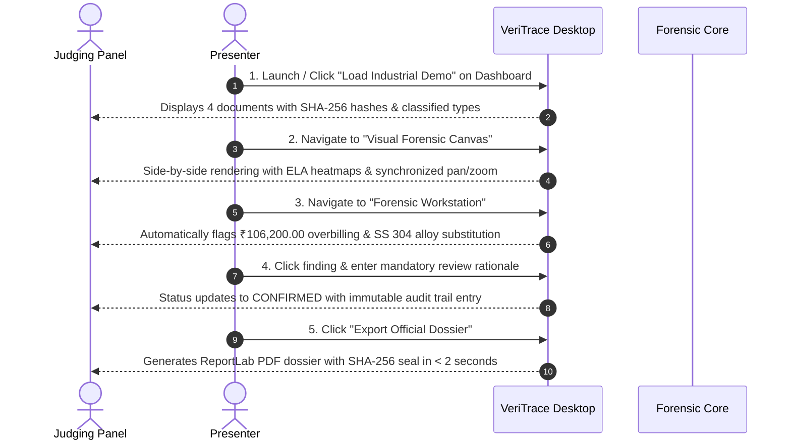

# VeriTrace — Official Hackathon Demonstration Kit & Rehearsal Guide

**Platform:** VeriTrace — Industrial Document Intelligence, Forensics & Authenticity Verification  
**Competition Target:** DataOps Innovation Hackathon – Problem Statement 2 (PS-2)  
**Form Factor:** Standalone Native Windows Desktop Application (PySide6 / C++ / Qt 6.7+)  
**Demo Duration:** 3 to 5 minutes  
**Date:** November 2026  

---

## 1. Executive Summary & Demo Objectives

During this 3–5 minute live presentation, you will demonstrate to the judging panel that VeriTrace is not merely a passive single-document OCR scanner, but an **active, multi-document forensic investigation system** designed specifically for high-stakes industrial procurement and supply chain integrity.

### Core Demonstration Proof Points
1. **Multi-Document Ingestion & Automated Classification:** Ingests 4 distinct industrial documents (PO, Challan, MTC, Invoice) in $< 1.5$ seconds with instant SHA-256 evidence hashing.
2. **Real-Time Quality Assessment:** Displays extraction quality and sharpness scoring in the status bar before running forensics.
3. **Multi-Modal Visual Forensics:** Demonstrates Error Level Analysis (ELA) thermal heatmaps and copy-move clone suppression.
4. **Cross-Document Discrepancy Detections:**
   - **Financial Shortfall Overbilling:** Exposes invoice billing for **1,000 KG** despite delivery challan recording only **800 KG** dispatched (Net Overcharge: **₹106,200.00** incl. 18% GST).
   - **Metallurgical Grade Substitution:** Exposes Mill Test Certificate disclosing Molybdenum content of **0.020%**, failing the **SS 316L** requirement ($\ge 2.0\%$) and proving substitution with cheap **SS 304**.
5. **Human Review & Sealed Dossier Export:** Enforces non-empty examiner adjudication rationale and generates a cryptographically signed, court-defensible ReportLab PDF dossier.

---

## 2. Pre-Demo Setup & Verification (T-Minus 5 Minutes)

1. **Verify Screen Resolution:** Set display scaling to 100% or 125% at 1080p or 4K.
2. **Launch Application:**
   ```powershell
   # Launch standalone executable
   dist\VeriTrace\VeriTrace.exe
   
   # Or launch via development runner
   python scripts/development/run_desktop.py
   ```
3. **Verify Demo Files Exist:**
   - Folder: `samples\industrial_procurement\`
   - Files:
     - `PO-2026-IND-001.pdf` (Purchase Order)
     - `DC-98741.pdf` (Delivery Challan)
     - `MTC-H8821.pdf` (Mill Test Certificate)
     - `INV-88992.pdf` (Commercial Tax Invoice)

---

## 3. Minute-by-Minute Demonstration Script & Click Sequence



### Minute 0:00 – 1:00: The Problem & Live Intake
- **Action:** Open VeriTrace. On the **Operational Dashboard**, point out the clean industrial interface. Click the button: **`Load Industrial Demo`** (or drag the 4 PDF files from `samples\industrial_procurement\` into the intake window).
- **Spoken Script:**
  > *"Judges, heavy manufacturing and infrastructure projects lose over $30 billion annually to counterfeit materials and procurement fraud. Existing tools like AWS Textract or Azure Document AI extract text from single pages, but they are completely blind to whether an invoice contradicts a delivery ticket.*
  > *Here, we load an authentic 4-document procurement packet for structural stainless steel bars. Notice that within 1.5 seconds, VeriTrace ingests all 4 files completely offline, calculates cryptographic SHA-256 evidence hashes, and correctly classifies each document: a Purchase Order, a Delivery Challan, a Mill Test Certificate, and a Commercial Invoice."*

### Minute 1:00 – 2:15: Cross-Document Reconciliation (The Smoking Guns)
- **Action:** Click the **`Forensic Workstation`** tab. Point to the top findings in the finding grid. Select the finding: **`RULE_QTY_CONSISTENCY: Quantity Mismatch`**.
- **Spoken Script:**
  > *"Let's examine the first critical anomaly surfaced by our deterministic cross-document engine. The Purchase Order requested 1,000 KG of Grade SS 316L. The Delivery Challan explicitly records a partial delivery of only 800 KG.*
  > *Yet look at Commercial Invoice INV-88992: the vendor billed for the entire 1,000 KG at ₹450 per KG. That represents an immediate 200 KG shortfall overcharge of ₹90,000, which with 18% GST inflates to a fraudulent ₹106,200.00 overcharge. Traditional three-way matching systems approve this because the PO number matches on paper."*
- **Action:** Click the second finding: **`RULE_MATERIAL_GRADE: Alloy Grade Substitution`**.
- **Spoken Script:**
  > *"Now for the catastrophic life-safety defect: the Purchase Order specified Grade SS 316L, an expensive molybdenum-bearing stainless steel required for acidic or marine environments. But look at Mill Test Certificate MTC-H8821: our stoichiometric parser extracted the chemical analysis table. Molybdenum content is certified at just 0.020%, failing the 2.0% ASTM requirement for 316L and proving that standard Grade SS 304 was substituted. In a nuclear plant or refinery, this would result in acid corrosion and catastrophic pipe rupture."*

### Minute 2:15 – 3:15: Visual Forensics & Signature Workbench
- **Action:** Switch to the **`Visual Forensic Canvas`** tab. Select `INV-88992.pdf` and toggle **`ELA Heatmap Overlay`**.
- **Spoken Script:**
  > *"VeriTrace does not just read text—it inspects the physical pixels. On the Visual Canvas, we run local Error Level Analysis. The compression differential heatmap immediately isolates the digital alteration around the grand total. Notice also our copy-move detector: unlike generic computer vision scripts that flood you with false positives on recurring corporate logos, VeriTrace implements spatial boilerplate suppression to keep alerts actionable."*
- **Action:** Switch to the **`Signature Workbench`** tab.
- **Spoken Script:**
  > *"In our Signature Workbench, we adhere to strict forensic neutrality. We evaluate 11-dimensional optical heuristics—Hu moment invariants, stroke coverage, and boundary clipping. In accordance with forensic science ethics, VeriTrace never emits an automated 'guilty' verdict; machine similarity does not prove legal authorship, and qualified human document examiners retain authority."*

### Minute 3:15 – 4:00: Mandatory Human Review & Sealed Dossier Export
- **Action:** In the Forensic Workstation inspector dock, click **`Confirm Finding`**. Type a brief rationale: `Verified 200 KG shortfall against DC-98741 and metallurgical non-conformance.` Click **`Save Adjudication`**.
- **Action:** Click **`Export Official PDF Dossier`**. The PDF compiles in $< 2$ seconds.
- **Spoken Script:**
  > *"Every human action is strictly governed. An examiner cannot confirm or dismiss an anomaly without providing written justification. The moment I save, an immutable, append-only SQLite trigger permanently records my examiner ID, timestamp, and rationale.*
  > *Finally, with one click, VeriTrace generates a sealed, multi-page ReportLab PDF investigation dossier. It bundles the ingestion provenance table, extraction metrics, visual evidence crops, and examiner attestations, sealed with a SHA-256 tamper-evident digital fingerprint."*

### Minute 4:00 – 4:30: Closing Pitch
- **Spoken Script:**
  > *"VeriTrace is 100% offline, air-gapped, and runs natively on Windows desktop with zero cloud exposure. With 391 automated tests passing across 7 quality gates and a standalone executable already built, VeriTrace is production-ready to protect heavy manufacturing, defense, and infrastructure supply chains. Thank you, and we welcome your questions."*

---

## 4. Expected Findings & Source Financial Calculations

### 1. Document Metrics & Baseline Contract
| Document ID | Type | Vendor / Laboratory | Key Extracted Metrics |
| :--- | :--- | :--- | :--- |
| **PO-2026-IND-001** | Purchase Order | Apex Heavy Engineering Ltd | 1,000 KG SS 316L @ ₹450.00/KG = ₹450,000.00 |
| **DC-98741** | Delivery Challan | Bharat Industrial Steel Corp | 800 KG dispatched (Shortfall: 200 KG), Grade SS 304, Heat #H-8821-A |
| **MTC-H8821** | Mill Test Cert | Apex Metallurgical Labs | Heat #H-8821-A, Mo = 0.020% (ASTM SS 304; fails SS 316L standard) |
| **INV-88992** | Commercial Invoice | Bharat Industrial Steel Corp | 1,000 KG billed @ ₹450.00 + 18% GST + Freight = ₹536,000.00 |

### 2. Exact Financial Discrepancy Breakdown (INR)
- **Contract Unit Rate:** ₹450.00 per KG
- **Ordered in PO:** 1,000 KG = **₹450,000.00**
- **Dispatched in Challan:** 800 KG
  - Legitimate goods value: $800\text{ KG} \times \text{₹}450.00 = \text{₹}360,000.00$
  - Legitimate 18% GST: $18\% \times 360,000 = \text{₹}64,800.00$
  - Legitimate Freight: **₹5,000.00**
  - **Legitimate Total Payable:** **₹429,800.00**
- **Billed in Commercial Invoice:** 1,000 KG
  - Invoiced Subtotal: ₹450,000.00
  - Invoiced 18% GST: ₹81,000.00
  - Invoiced Freight: ₹5,000.00
  - **Invoiced Grand Total:** **₹536,000.00**
- **Direct Financial Overbilling:**
  - Physical Shortfall: **200 KG** (20% delivery deficit)
  - Taxable Base Overbilling: $200\text{ KG} \times \text{₹}450.00 = \textbf{₹90,000.00}$
  - Tax Overcharged (18% GST on unreceived material): $\textbf{₹16,200.00}$
  - **Net Financial Discrepancy:** $\text{₹}536,000.00 - \text{₹}429,800.00 = \textbf{₹106,200.00}$

---

## 5. Demonstration Asset Directory & Locations

| Resource | Path | Description |
| :--- | :--- | :--- |
| **Sample Demo PDFs** | [`../samples/industrial_procurement/`](../samples/industrial_procurement/) | `PO-2026-IND-001.pdf`, `DC-98741.pdf`, `MTC-H8821.pdf`, `INV-88992.pdf` |
| **Pre-Compiled PDF Dossier** | [`../samples/industrial_procurement/VeriTrace_Sealed_Investigation_Dossier.pdf`](../samples/industrial_procurement/VeriTrace_Sealed_Investigation_Dossier.pdf) | Pre-generated 6-section auditor-grade PDF report |
| **Pre-Compiled JSON Payload** | [`../samples/industrial_procurement/VeriTrace_Investigation_Payload.json`](../samples/industrial_procurement/VeriTrace_Investigation_Payload.json) | Pre-generated structured intelligence payload |
| **PowerPoint Presentation** | [`../presentation/VeriTrace_Hackathon_Presentation.pptx`](../presentation/VeriTrace_Hackathon_Presentation.pptx) | Official 12-slide 16:9 widescreen presentation deck |
| **Presentation Markdown** | [`../presentation/VeriTrace_Hackathon_Presentation.md`](../presentation/VeriTrace_Hackathon_Presentation.md) | Markdown presentation source |
| **High-Res UI Screenshots** | [`../presentation/screenshots/`](../presentation/screenshots/) | 5 high-resolution workstation PNG captures |
| **Standalone Executable** | `dist/VeriTrace/VeriTrace.exe` (Generated via build) | Compiled standalone 64-bit Windows executable |

---

## 6. Emergency Fallback & Recovery Procedures

If during the live hackathon presentation the local GUI fails, screen sharing glitches, or an unexpected exception occurs, follow these instant recovery protocols:

### Fallback Option A: Instant Database & Cache Reset (10 Seconds)
```powershell
# Clear local transient database if locked
Remove-Item "$env:LOCALAPPDATA\VeriTrace\database\veritrace.sqlite*" -Force
# Relaunch executable
dist\VeriTrace\VeriTrace.exe
```

### Fallback Option B: Headless Execution & PDF Display (15 Seconds)
If Qt display fails entirely on the presentation projector:
```powershell
# Run headless demo runner in terminal
python -c "from veritrace.application.services.demo_data import seed_industrial_demo; from veritrace.infrastructure.persistence.database import init_db, get_session_factory; f = get_session_factory(init_db()); id_ = seed_industrial_demo(f); print('Industrial demo seeded with ID:', id_)"
```
Then immediately open the pre-compiled dossier:
- Open [`../samples/industrial_procurement/VeriTrace_Sealed_Investigation_Dossier.pdf`](../samples/industrial_procurement/VeriTrace_Sealed_Investigation_Dossier.pdf) in Acrobat or Edge browser.
- Walk the judges through the generated PDF dossier sections (Provenance, Classification, ELA crops, Contradiction matrix).

### Fallback Option C: Slide Deck UI Walkthrough (Zero Seconds)
If the host machine is completely unresponsive:
- Open [`../presentation/VeriTrace_Hackathon_Presentation.pptx`](../presentation/VeriTrace_Hackathon_Presentation.pptx) on any device or projector.
- Slide 10 features the exact pixel-perfect screenshot of the active workstation with bounding boxes, finding dock, and quality telemetry.
- Refer judges directly to Slide 5 and Slide 7 for the verified financial math and metallurgical chemical assay breakdown.
